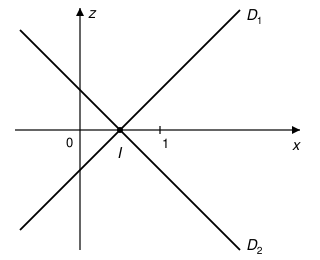

## Statement

L'espace est muni d'un repère orthonormé $(O ; \vec{i}, \vec{j}, \vec{k})$. Les coordonnées d'un
point sont notées $x$, $y$ et $z$ (abscisse, ordonnée et cote). On considère l'ensemble $\Sigma$
des points $M(x, y, z)$ tels que
$$z^2 = x(x-1) - y(y-1).$$

1. Soit $\lambda$ un réel et $P_\lambda$ le plan d'équation $x = \lambda$. Montrer que, pour
   $\lambda \neq \frac{1}{2}$, l'intersection de $\Sigma$ et de $P_\lambda$ est un cercle
   $C_\lambda$, dont on déterminera le centre et le rayon en fonction de $\lambda$. Que se
   passe-t-il pour $\lambda = \frac{1}{2}$ ?
2. Soit $I$ le point de coordonnées $\left(\frac{1}{2}, \frac{1}{2}, 0\right)$ et $(d)$ la droite
   passant par $I$ et de vecteur directeur $\vec{i}$.

   a) Montrer que la droite $(d)$ est un axe de symétrie de $\Sigma$.

   b) Déterminer et dessiner l'intersection de $\Sigma$ et du plan d'équation $y = \frac{1}{2}$.
3. Reconnaître la nature de l'ensemble $\Sigma$.
4. Pour des entiers $n \geq 2$ et $k$ tels que $1 \leq k \leq n - 1$, on pose
   $$L(n, k) = \frac{4}{2n - 1}\sqrt{n(n-1) - k(k-1)} .$$
   C'est la longueur d'une corde dans une figure formée de cercles tangents (voir l'exercice
   40081), et l'on admet que $L(n, k)$ est un nombre rationnel si et seulement s'il existe un
   entier naturel $a$ tel que $n(n-1) - k(k-1) = 4a^2$.

   Montrer que $L(n, k)$ est rationnel si et seulement si les points de $\Sigma$ d'abscisse $n$ et
   d'ordonnée $k$ ont pour cote un entier pair.

## Hints

1. **Question 1.** Remplacer $x$ par $\lambda$, puis écrire $y^2 - y$ sous forme canonique :
   $y^2 - y = \left(y - \frac{1}{2}\right)^2 - \frac{1}{4}$. Faire de même pour $\lambda^2 - \lambda$.
2. **Question 2 a).** Le symétrique $M'$ d'un point $M$ par rapport à la droite $(d)$ est le point
   tel que le milieu de $[MM']$ soit sur $(d)$ et que $\overrightarrow{MM'}$ soit orthogonal à
   $\vec{i}$. Quelles sont ses coordonnées ?
3. **Question 3.** Pour un point $M$ de l'espace, soit $H$ son projeté orthogonal sur $(d)$.
   Comparer les distances $HM$ et $IH$ quand $M$ est sur $\Sigma$.
4. **Question 4.** Que vaut $z^2$ pour un point de $\Sigma$ d'abscisse $n$ et d'ordonnée $k$ ?

## Solution

**1.** Un point $M(\lambda, y, z)$ du plan $P_\lambda$ est sur $\Sigma$ si et seulement si
$z^2 = \lambda^2 - \lambda - (y^2 - y)$. Comme
$y^2 - y = \left(y - \frac{1}{2}\right)^2 - \frac{1}{4}$ et
$\lambda^2 - \lambda = \left(\lambda - \frac{1}{2}\right)^2 - \frac{1}{4}$, cette condition s'écrit
$$\left(y - \frac{1}{2}\right)^2 + z^2 = \left(\lambda - \frac{1}{2}\right)^2.$$
Soit $\Omega_\lambda$ le point $\left(\lambda, \frac{1}{2}, 0\right)$, qui est dans $P_\lambda$. Le
membre de gauche est $\Omega_\lambda M^2$, puisque les deux points ont la même abscisse. Les points
de $\Sigma \cap P_\lambda$ sont donc les points de $P_\lambda$ situés à la distance
$\lvert \lambda - \frac{1}{2} \rvert$ de $\Omega_\lambda$.

**Conclusion :** pour $\lambda \neq \frac{1}{2}$, $C_\lambda$ est le cercle du plan $P_\lambda$
de centre $\Omega_\lambda\left(\lambda, \frac{1}{2}, 0\right)$ et de rayon
$\lvert \lambda - \frac{1}{2} \rvert$. Pour $\lambda = \frac{1}{2}$, la condition devient
$\left(y - \frac{1}{2}\right)^2 + z^2 = 0$, et l'intersection est réduite au seul point $I$
(un « cercle de rayon nul »).

**2. a)** Soit $M(x, y, z)$ et $M'(x, 1 - y, -z)$. Le milieu de $[MM']$ est
$\left(x, \frac{1}{2}, 0\right)$, qui est sur $(d)$, et
$\overrightarrow{MM'} = (0, 1 - 2y, -2z)$ est orthogonal à $\vec{i}$. Donc $M'$ est le
symétrique de $M$ par rapport à $(d)$. Or
$$(1 - y)((1 - y) - 1) = (1 - y)(-y) = y(y - 1) \qquad \text{et} \qquad (-z)^2 = z^2,$$
donc $M'$ vérifie l'équation de $\Sigma$ si et seulement si $M$ la vérifie.

**Conclusion :** la droite $(d)$ est un axe de symétrie de $\Sigma$.

**2. b)** Pour $y = \frac{1}{2}$, l'équation devient
$z^2 = x^2 - x + \frac{1}{4} = \left(x - \frac{1}{2}\right)^2$, c'est-à-dire
$z = x - \frac{1}{2}$ ou $z = \frac{1}{2} - x$.

**Conclusion :** l'intersection est la réunion de deux droites du plan $y = \frac{1}{2}$, qui se
coupent en $I$ : $D_1$ d'équation $z = x - \frac{1}{2}$ et $D_2$ d'équation $z = \frac{1}{2} - x$.
Elles ont pour vecteurs directeurs $\vec{i} + \vec{k}$ et $\vec{i} - \vec{k}$, qui sont
orthogonaux : les deux droites sont perpendiculaires et font chacune un angle de $45°$ avec
$(d)$.

**3.** L'équation de $\Sigma$ s'écrit, comme à la question 1,
$$\left(y - \frac{1}{2}\right)^2 + z^2 = \left(x - \frac{1}{2}\right)^2.$$
Pour un point $M(x, y, z)$, son projeté orthogonal sur $(d)$ est $H\left(x, \frac{1}{2}, 0\right)$.
On a $HM^2 = \left(y - \frac{1}{2}\right)^2 + z^2$ et $IH^2 = \left(x - \frac{1}{2}\right)^2$.
Ainsi $M$ est sur $\Sigma$ si et seulement si $HM = IH$ : la distance de $M$ à l'axe $(d)$ est
égale à la distance de $I$ au pied de la perpendiculaire. Pour $M \neq I$, cela veut dire que la
droite $(IM)$ fait un angle de $45°$ avec $(d)$ (le triangle $IHM$ est rectangle isocèle en $H$).

**Conclusion :** $\Sigma$ est un cône de révolution de sommet $I$, d'axe $(d)$ et de demi-angle au
sommet $45°$ (les deux nappes, de part et d'autre de $I$). On l'obtient en faisant tourner l'une des
droites $D_1$ de la question 2 b) autour de $(d)$ ; ses sections par les plans $x = \lambda$ sont
les cercles de la question 1, dont le rayon croît comme la distance au sommet.

**4.** Un point de $\Sigma$ d'abscisse $n$ et d'ordonnée $k$ a une cote $z$ telle que
$z^2 = n(n-1) - k(k-1)$. Ce nombre est strictement positif car $k < n$, donc il y a deux tels
points, de cotes $z = \sqrt{n(n-1) - k(k-1)}$ et $z = -\sqrt{n(n-1) - k(k-1)}$. L'une est un entier
pair si et seulement si l'autre l'est.

- Si $L(n, k)$ est rationnel, il existe $a$ entier naturel avec $n(n-1) - k(k-1) = 4a^2$, donc les
  cotes valent $\pm 2a$ : ce sont des entiers pairs.
- Réciproquement, si la cote positive est un entier pair $2a$, alors
  $n(n-1) - k(k-1) = 4a^2$ et $L(n, k)$ est rationnel.

**Conclusion :** $L(n, k)$ est rationnel si et seulement si les points de $\Sigma$ au-dessus et
au-dessous du point $(n, k, 0)$ ont une cote entière paire.

**Bilan.** L'ensemble $\Sigma$ est un cône de révolution d'axe parallèle à $\vec{i}$, de sommet
$I\left(\frac{1}{2}, \frac{1}{2}, 0\right)$, dont les génératrices font un angle de $45°$ avec
l'axe. La question de savoir si $L(n, k)$ est rationnel revient à chercher sur ce cône des points
dont les trois coordonnées sont des entiers, avec une cote paire.

## Going further

- Donner trois points de $\Sigma$ à coordonnées entières, avec une cote paire non nulle.
  (Indication : on peut essayer $k = n - 1$.)
- Le changement de coordonnées $X = 2x - 1$, $Y = 2y - 1$, $Z = 2z$ transforme l'équation de
  $\Sigma$ en $X^2 = Y^2 + Z^2$. Que deviennent alors les points cherchés à la question 4 ? On
  retrouve des triangles rectangles à côtés entiers, qui sont étudiés dans l'exercice 40084.
