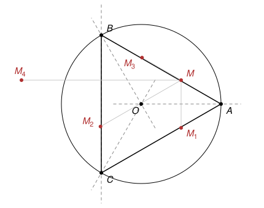

## Statement

Le plan est muni d'un repère orthonormé direct $(O; \vec{u}, \vec{v})$, et l'on confond un point
avec son affixe. On pose

$$j = e^{2i\pi/3} = -\frac{1}{2} + i\,\frac{\sqrt{3}}{2}.$$

On considère les points $O$, $A$, $B$ et $C$ d'affixes respectives $0$, $1$, $j$ et $j^2$ : le
triangle $ABC$ est équilatéral, de centre $O$. On note $s_1$, $s_2$ et $s_3$ les symétries axiales
par rapport aux droites $(OA)$, $(OB)$ et $(OC)$. Enfin, $M$ est un point quelconque du plan,
d'affixe $z = \rho e^{i\theta}$ avec $\rho \geqslant 0$ et $\theta$ réel.

1. On pose $M_1 = s_1(M)$, $M_2 = s_2(M)$ et $M_3 = s_3(M)$. Montrer que les points $M_1$, $M_2$
   et $M_3$ ont pour affixes respectives $\overline{z}$, $j^2\overline{z}$ et $j\overline{z}$.

2. Soit $M_4$ le symétrique de $M$ par rapport à la droite $(BC)$. Montrer que le point $J$
   d'affixe $-\frac{1}{2}$ est le milieu du segment $[M_1M_4]$. En déduire l'affixe de $M_4$.

3. a) À quelle condition les points $M_2$, $M_3$ et $M_4$ sont-ils alignés ? Interpréter
   géométriquement cette condition.

   *On suppose désormais que $M_2$, $M_3$ et $M_4$ ne sont pas alignés, et l'on note $\Omega$ le
   centre du cercle circonscrit au triangle $M_2M_3M_4$.*

   b) Justifier que $\Omega$ appartient à la droite $(OM_1)$. On note alors son affixe
   $\lambda e^{-i\theta}$, avec $\lambda$ réel.

   c) Montrer que
   $$\lambda = -\frac{1 + 2\rho\cos\theta}{\rho + 2\cos\theta}.$$

   d) En déduire une expression du rayon $R$ du cercle circonscrit au triangle $M_2M_3M_4$.

   e) Montrer que ce rayon est égal à $1$ si et seulement si
   $$\rho = 1 \quad \text{ou} \quad (\rho + \cos\theta)^2 = 1 - 3\cos^2\theta.$$

4. Montrer que le cercle circonscrit au triangle $M_2M_3M_4$ a le même rayon que le cercle
   circonscrit au triangle $M_1M_2M_3$ si et seulement si $M$ appartient à un ensemble $\Gamma$
   que l'on décrira géométriquement. Que peut-on dire, dans ce cas, des deux cercles circonscrits ?

## Hints

1. **Question 1.** Pour une droite passant par $O$ et dirigée par le nombre $u = e^{i\varphi}$,
   montrer que le symétrique du point $z$ est $u^2\overline{z}$ : vérifier que le milieu de $z$ et
   de $u^2\overline{z}$ est sur la droite, et que $u^2\overline{z} - z$ lui est perpendiculaire.
2. **Question 2.** La droite $(BC)$ est la droite verticale d'équation $x = -\frac{1}{2}$.
   Écrire $z = x + iy$.
3. **Question 3a.** Traiter à part le cas $z = 0$. Sinon, les points sont alignés si et seulement
   si le quotient $\frac{m_4 - m_3}{m_2 - m_3}$ des différences d'affixes est réel. Utiliser
   $1 + j + j^2 = 0$.
4. **Question 3a.** On doit trouver la condition $\rho + 2\cos\theta = 0$. Calculer $|z + 1|^2$.
5. **Question 3b.** Les points $M_2$ et $M_3$ sont à la même distance de $O$. Mieux : ils sont
   symétriques l'un de l'autre par rapport à la droite $(OM_1)$.
6. **Question 3c.** Écrire $\Omega M_2^2 = \Omega M_4^2$. On a $|e^{-i\theta}| = 1$, ce qui permet
   de mettre $e^{-i\theta}$ en facteur.
7. **Question 3d.** En posant $N = 1 + 2\rho\cos\theta$ et $D = \rho + 2\cos\theta$, simplifier
   $N^2 - \rho N D$.
8. **Question 4.** Le cercle circonscrit à $M_1M_2M_3$ a pour centre $O$. Calculer $R^2 - \rho^2$.

## Solution

On note $m_1, m_2, m_3, m_4$ les affixes de $M_1, M_2, M_3, M_4$, et l'on abrège $\cos\theta$
en $c$ dans les calculs.

**1.** *Symétrie par rapport à une droite passant par $O$.* Soit $\Delta$ la droite passant par
$O$ et dirigée par le nombre $u = e^{i\varphi}$, et $z' = u^2\overline{z}$. Comme
$\frac{1}{u} = \overline{u}$, on a
$$\frac{z + z'}{2} = u \cdot \frac{z\overline{u} + \overline{z\overline{u}}}{2} = u \cdot \mathrm{Re}(z\overline{u}), \qquad z' - z = -u\,(z\overline{u} - \overline{z\overline{u}}) = -2i\,\mathrm{Im}(z\overline{u})\, u.$$
Le milieu de $[zz']$ est donc un multiple réel de $u$ : il est sur $\Delta$. Le vecteur $z' - z$
est un multiple réel de $iu$ : il est perpendiculaire à $\Delta$. Donc $\Delta$ est la médiatrice
de $[zz']$ (ou $z' = z$ si $z$ est sur $\Delta$) : le symétrique de $z$ par rapport à $\Delta$
est $u^2\overline{z}$.

*Application.* La droite $(OA)$ est dirigée par $1$, donc $m_1 = \overline{z}$. La droite
$(OB)$ est dirigée par $j$, donc $m_2 = j^2\overline{z}$. La droite $(OC)$ est dirigée par $j^2$,
donc $m_3 = j^4\overline{z} = j\overline{z}$, puisque $j^3 = 1$.

**2.** Les points $B$ et $C$ ont tous deux pour partie réelle $-\frac{1}{2}$ : la droite $(BC)$ est
la droite verticale d'équation $x = -\frac{1}{2}$. Écrivons $z = x + iy$. Le symétrique de $M$ par
rapport à cette droite verticale a la même ordonnée $y$, et une abscisse $x'$ telle que
$\frac{x + x'}{2} = -\frac{1}{2}$, soit $x' = -1 - x$. Donc
$$m_4 = (-1 - x) + iy = -1 - \overline{z}.$$
Le milieu de $[M_1M_4]$ a pour affixe $\frac{\overline{z} + (-1 - \overline{z})}{2} = -\frac{1}{2}$ :
c'est le point $J$.

**Conclusion :** $J$ est le milieu de $[M_1M_4]$, et $M_4$ a pour affixe $-1 - \overline{z}$.

On peut aussi le voir sans calcul : les droites $(OA)$ et $(BC)$ sont perpendiculaires en $J$,
donc la composée des deux symétries est la rotation de centre $J$ et d'angle $2 \times \frac{\pi}{2} = \pi$,
c'est-à-dire la symétrie de centre $J$. Elle envoie $M_1$ sur $M_4$.

**3a.** Si $z = 0$, alors $M_2 = M_3 = O$ : les trois points sont alignés (deux d'entre eux sont
confondus).

Supposons $z \neq 0$. Alors $m_2 - m_3 = (j^2 - j)\overline{z} = -i\sqrt{3}\,\overline{z} \neq 0$.
Comme $1 + j + j^2 = 0$,
$$m_4 - m_3 = -1 - \overline{z} - j\overline{z} = -1 - (1 + j)\overline{z} = -1 + j^2\overline{z}.$$
Les trois points sont alignés si et seulement si le quotient suivant est réel :
$$\frac{m_4 - m_3}{m_2 - m_3} = \frac{-1 + j^2\overline{z}}{-i\sqrt{3}\,\overline{z}} = \frac{i}{\sqrt{3}}\left(j^2 - \frac{1}{\overline{z}}\right).$$
Ce nombre est réel si et seulement si $j^2 - \frac{1}{\overline{z}}$ est imaginaire pur, c'est-à-dire
si $\mathrm{Re}\left(\frac{1}{\overline{z}}\right) = \mathrm{Re}(j^2) = -\frac{1}{2}$. Or
$\frac{1}{\overline{z}} = \frac{z}{|z|^2} = \frac{e^{i\theta}}{\rho}$, de partie réelle
$\frac{c}{\rho}$. La condition est donc $\frac{c}{\rho} = -\frac{1}{2}$, soit
$$\rho + 2\cos\theta = 0.$$

*Interprétation.* On a $|z + 1|^2 = (z + 1)(\overline{z} + 1) = \rho^2 + 2\rho c + 1$. Donc
$|z + 1| = 1$ si et seulement si $\rho(\rho + 2c) = 0$, c'est-à-dire $z = 0$ ou $\rho + 2c = 0$.

**Conclusion :** $M_2$, $M_3$, $M_4$ sont alignés si et seulement si $M$ est sur le cercle
$\mathcal{C}_0$ de centre le point d'affixe $-1$ et de rayon $1$. Ce cercle passe par $O$, $B$ et
$C$ (car $|j + 1| = |-j^2| = 1$) : c'est le cercle circonscrit au triangle $OBC$.

**3b.** Comme $M$ n'est pas sur $\mathcal{C}_0$, on a $z \neq 0$, donc $M_1 \neq O$ et
$M_2 \neq M_3$. La droite $(OM_1)$ passe par $O$ et est dirigée par $e^{-i\theta}$ (car
$m_1 = \rho e^{-i\theta}$). D'après la question 1, la symétrie par rapport à cette droite envoie
le point $w$ sur $e^{-2i\theta}\,\overline{w}$. Elle envoie donc $M_3$ sur
$$e^{-2i\theta} \cdot \overline{j}\,\rho e^{i\theta} = j^2 \rho e^{-i\theta} = j^2 \overline{z} = m_2 .$$
Ainsi $M_2$ et $M_3$ sont symétriques par rapport à $(OM_1)$, et $(OM_1)$ est la médiatrice de
$[M_2M_3]$. Le centre $\Omega$ du cercle circonscrit est sur cette médiatrice, donc sur $(OM_1)$,
et son affixe s'écrit $\lambda e^{-i\theta}$ avec $\lambda$ réel.

**3c.** Comme $\Omega$ est sur la médiatrice de $[M_2M_3]$, on a déjà $\Omega M_2 = \Omega M_3$ ; il
reste à écrire $\Omega M_2 = \Omega M_4$. En mettant $e^{-i\theta}$ en facteur (il est de module
$1$) :
$$\Omega M_2^2 = |\lambda e^{-i\theta} - j^2\rho e^{-i\theta}|^2 = |\lambda - j^2\rho|^2 = \lambda^2 - 2\lambda\rho\,\mathrm{Re}(j^2) + \rho^2 = \lambda^2 + \lambda\rho + \rho^2,$$
$$\Omega M_4^2 = |\lambda e^{-i\theta} + 1 + \rho e^{-i\theta}|^2 = |(\lambda + \rho) + e^{i\theta}|^2 = (\lambda + \rho)^2 + 2(\lambda + \rho)c + 1.$$
L'égalité $\Omega M_2^2 = \Omega M_4^2$ s'écrit
$\lambda^2 + \lambda\rho + \rho^2 = \lambda^2 + 2\lambda\rho + \rho^2 + 2\lambda c + 2\rho c + 1$, soit
$0 = \lambda\rho + 2\lambda c + 2\rho c + 1$, c'est-à-dire
$$\lambda(\rho + 2c) = -(1 + 2\rho c).$$
Comme $\rho + 2c \neq 0$ (les points ne sont pas alignés), on obtient
$$\lambda = -\frac{1 + 2\rho\cos\theta}{\rho + 2\cos\theta}.$$

**3d.** Posons $N = 1 + 2\rho c$ et $D = \rho + 2c$, de sorte que $\lambda = -\frac{N}{D}$. D'après
le calcul précédent,
$$R^2 = \Omega M_2^2 = \lambda^2 + \lambda\rho + \rho^2 = \frac{N^2 - \rho N D + \rho^2 D^2}{D^2}.$$
Or $N - \rho D = 1 + 2\rho c - \rho^2 - 2\rho c = 1 - \rho^2$, donc $N^2 - \rho N D = N(N - \rho D) = (1 - \rho^2) N$.
Ainsi
$$R^2 = \rho^2 + \frac{(1 - \rho^2)(1 + 2\rho\cos\theta)}{(\rho + 2\cos\theta)^2}, \qquad R = \sqrt{\rho^2 + \frac{(1 - \rho^2)(1 + 2\rho\cos\theta)}{(\rho + 2\cos\theta)^2}}.$$

**3e.** D'après la question 3d,
$$R^2 - 1 = (\rho^2 - 1) - \frac{(\rho^2 - 1)N}{D^2} = \frac{(\rho^2 - 1)(D^2 - N)}{D^2}.$$
Et $D^2 - N = \rho^2 + 4\rho c + 4c^2 - 1 - 2\rho c = \rho^2 + 2\rho c + 4c^2 - 1 = (\rho + c)^2 - (1 - 3c^2)$.

Donc $R = 1$ si et seulement si $\rho^2 = 1$ ou $(\rho + c)^2 = 1 - 3c^2$. Comme $\rho \geqslant 0$,
$\rho^2 = 1$ équivaut à $\rho = 1$.

**Conclusion :** $R = 1$ si et seulement si $\rho = 1$ ou $(\rho + \cos\theta)^2 = 1 - 3\cos^2\theta$.

**4.** Comme $OM_1 = OM_2 = OM_3 = \rho$ (ce sont des symétriques de $M$ par rapport à des droites
passant par $O$), le cercle circonscrit au triangle $M_1M_2M_3$ est le cercle de centre $O$ et de
rayon $\rho$. D'après la question 3d,
$$R^2 - \rho^2 = \frac{(1 - \rho^2)(1 + 2\rho\cos\theta)}{(\rho + 2\cos\theta)^2}.$$
Donc $R = \rho$ si et seulement si $\rho = 1$ ou $1 + 2\rho\cos\theta = 0$.

- $\rho = 1$ signifie que $M$ est sur le cercle de centre $O$ et de rayon $1$, c'est-à-dire le
  cercle circonscrit au triangle $ABC$.
- $1 + 2\rho\cos\theta = 0$ signifie $\mathrm{Re}(z) = -\frac{1}{2}$, c'est-à-dire que $M$ est sur
  la droite $(BC)$.

Il faut encore retirer les points du cercle $\mathcal{C}_0$ de la question 3a, pour lesquels le
triangle $M_2M_3M_4$ est aplati. Le cercle $\mathcal{C}_0$ coupe le cercle circonscrit à $ABC$ en
$B$ et $C$ seulement (deux cercles distincts ont au plus deux points communs), et il coupe la
droite $(BC)$ en $B$ et $C$ seulement.

**Conclusion :** $\Gamma$ est la réunion du cercle circonscrit au triangle $ABC$ et de la droite
$(BC)$, privée des deux points $B$ et $C$.

*Les deux cercles dans chaque cas.*

- Si $M$ est sur $(BC)$, alors $\lambda = 0$, donc $\Omega = O$ : les deux cercles ont même centre
  et même rayon, ils sont confondus. On pouvait le prévoir : dans ce cas $M_4 = M$, et les quatre
  points $M_1, M_2, M_3, M_4$ sont à la distance $\rho$ de $O$.
- Si $M$ est sur le cercle circonscrit à $ABC$, alors $\rho = 1$ et $\lambda = -\frac{1 + 2c}{1 + 2c} = -1$,
  donc $\Omega$ a pour affixe $-e^{-i\theta} = -m_1$ : le centre $\Omega$ est le point du cercle
  $ABC$ diamétralement opposé à $M_1$. Les deux cercles ont le rayon $1$, chacun passe par le
  centre de l'autre ($O\Omega = 1$), et ils se coupent en $M_2$ et $M_3$. Ils sont symétriques
  l'un de l'autre par rapport à la droite $(M_2M_3)$.

**Bilan.** Les symétriques $M_2$, $M_3$, $M_4$ d'un point $M$ par rapport aux trois côtés du
triangle $OBC$ sont alignés exactement quand $M$ est sur le cercle circonscrit à $OBC$. Sinon, le
centre du cercle qui passe par eux est sur $(OM_1)$, et son rayon a une formule explicite. Ce rayon
vaut $\rho = OM$ exactement quand $M$ est sur la droite $(BC)$ ou sur le cercle circonscrit à $ABC$
(sauf en $B$ et $C$).

## Going further

- Le résultat de la question 3a est un cas particulier d'un théorème classique : les symétriques
  d'un point $M$ par rapport aux trois côtés d'un triangle sont alignés si et seulement si $M$ est
  sur le cercle circonscrit à ce triangle. La droite obtenue s'appelle la droite de Steiner.
- Dans la suite du sujet, on dessinait l'ensemble des points $M$ pour lesquels $R = 1$, en étudiant
  la courbe d'équation $(\rho + \cos\theta)^2 = 1 - 3\cos^2\theta$ : voir l'exercice 40123.
