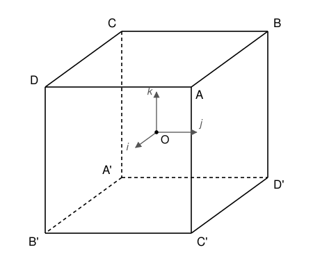

## Statement

L'espace est rapporté à un repère orthonormé $(O\,;\vec{\imath}, \vec{\jmath}, \vec{k})$. On
considère le cube $\mathcal{K}$ de centre $O$ dont les sommets sont

| $A$ | $B$ | $C$ | $D$ | $A'$ | $B'$ | $C'$ | $D'$ |
|---|---|---|---|---|---|---|---|
| $(1, 1, 1)$ | $(-1, 1, 1)$ | $(-1, -1, 1)$ | $(1, -1, 1)$ | $(-1, -1, -1)$ | $(1, -1, -1)$ | $(1, 1, -1)$ | $(-1, 1, -1)$ |

Ses arêtes ont pour longueur $2$. Remarquer que $A'$, $B'$, $C'$, $D'$ sont les symétriques de
$A$, $B$, $C$, $D$ par rapport à $O$.

On considère un plan $\mathcal{P}$ passant par $O$, et on note $\mathcal{A}$ l'intersection de
$\mathcal{P}$ et du cube (le cube plein). On admet que, lorsque $\mathcal{P}$ ne contient aucune
arête du cube, $\mathcal{A}$ est un polygone convexe dont les sommets sont les points où
$\mathcal{P}$ rencontre les arêtes du cube.

1. Montrer que $\mathcal{P}$ contient $0$, $2$ ou $4$ sommets de $\mathcal{K}$.
2. Combien y a-t-il de plans $\mathcal{P}$ contenant $4$ sommets de $\mathcal{K}$ ? Déterminer dans
   ce cas la nature de $\mathcal{A}$ et son aire.
3. On suppose que $\mathcal{P}$ contient exactement deux sommets de $\mathcal{K}$, à savoir $A$
   et $A'$.
   a) Montrer que $\mathcal{P}$ rencontre l'une des trois arêtes $[BC]$, $[CD]$ ou $[BD']$.
   b) On suppose que $\mathcal{P}$ rencontre l'arête $[BC]$ en un point $N$ de coordonnées
   $(-1, y, 1)$. Déterminer, selon la valeur de $y$, la nature exacte de $\mathcal{A}$, et calculer
   son aire.
   c) Donner, dans ce cas de figure, le meilleur encadrement possible de l'aire de $\mathcal{A}$
   lorsque $y$ varie.
4. On suppose que $\mathcal{P}$ ne contient aucun sommet de $\mathcal{K}$.
   a) Montrer que chacun des deux demi-espaces limités par $\mathcal{P}$ contient exactement $4$
   sommets de $\mathcal{K}$.
   b) Prouver que $\mathcal{P}$ rencontre $4$ ou $6$ arêtes de $\mathcal{K}$.

## Hints

1. **Question 1.** Si $\mathcal{P}$ contient un sommet, contient-il aussi son symétrique par rapport
   à $O$ ? Les huit sommets forment quatre paires.
2. **Question 1.** Un plan passant par $O$ qui contient deux paires, par exemple $A, A'$ et
   $B, B'$, est le plan $(OAB)$ : chercher son équation, et regarder s'il contient d'autres sommets.
3. **Question 3.** Pour a), $D$ et $D'$ sont de part et d'autre de $\mathcal{P}$. Suivre le chemin
   $D' \to B \to C \to D$ le long des arêtes.
4. **Question 3.** Pour b), le plan contient aussi le symétrique $N'$ de $N$. Montrer que
   $\mathcal{A}$ est le quadrilatère $ANA'N'$, en étudiant le signe de
   $(1 - y)X - 2Y + (1 + y)Z$ aux sommets du cube.
5. **Question 3.** L'aire d'un parallélogramme construit sur $\vec{u}$ et $\vec{v}$ vérifie
   $\text{aire}^2 = \lVert\vec{u}\rVert^2 \lVert\vec{v}\rVert^2 - (\vec{u} \cdot \vec{v})^2$
   (c'est $\lVert\vec{u}\rVert^2\lVert\vec{v}\rVert^2 \sin^2\theta$).
6. **Question 4.** Pour b), un plan qui ne contient aucun sommet coupe une face soit pas du tout,
   soit selon un segment qui joint deux arêtes de cette face. Compter de deux façons les couples
   (arête rencontrée, face qui contient cette arête).

## Solution

Un plan passant par $O$ a une équation de la forme $aX + bY + cZ = 0$. Posons
$\varphi(M) = aX + bY + cZ$ pour un point $M(X, Y, Z)$. Si $M'$ est le symétrique de $M$ par rapport
à $O$, alors $\varphi(M') = -\varphi(M)$. Donc $\mathcal{P}$ contient $M'$ dès qu'il contient $M$,
et si $M \notin \mathcal{P}$, les points $M$ et $M'$ sont strictement de part et d'autre de
$\mathcal{P}$.

**1.** Les sommets forment quatre paires de points symétriques : $\{A, A'\}$, $\{B, B'\}$,
$\{C, C'\}$, $\{D, D'\}$. D'après la remarque, $\mathcal{P}$ contient un nombre pair de sommets.

Supposons que $\mathcal{P}$ contienne deux paires. C'est alors le plan passant par $O$ et par deux
des points $A$, $B$, $C$, $D$ ; il y a six possibilités :

| Plan | $(OAB)$ | $(OAC)$ | $(OAD)$ | $(OBC)$ | $(OBD)$ | $(OCD)$ |
|---|---|---|---|---|---|---|
| Équation | $Y = Z$ | $X = Y$ | $X = Z$ | $X = -Z$ | $X = -Y$ | $Y = -Z$ |

(On vérifie chaque fois que l'équation est satisfaite par $O$ et par les deux sommets.) Aucun de
ces plans ne contient un troisième des points $A$, $B$, $C$, $D$ : par exemple, pour $Y = Z$, les
points $C(-1, -1, 1)$ et $D(1, -1, 1)$ ne vérifient pas l'équation ; on vérifie de même les cinq
autres. Donc $\mathcal{P}$ ne peut pas contenir trois paires, et il contient $0$, $2$ ou $4$
sommets.

**2.** D'après la question 1, il y a exactement **six** plans contenant $4$ sommets.

Prenons le plan $Y = Z$, qui contient $A$, $B$, $A'$, $B'$. Ses points dans le cube sont les points
$(X, Y, Y)$ avec $-1 \leq X \leq 1$ et $-1 \leq Y \leq 1$ : c'est le quadrilatère $ABA'B'$. On a
$\overrightarrow{AB} = (-2, 0, 0)$ et $\overrightarrow{BA'} = (0, -2, -2)$, de produit scalaire nul,
et $\overrightarrow{B'A'} = (-2, 0, 0) = \overrightarrow{AB}$. C'est donc un **rectangle** de côtés
$AB = 2$ et $BA' = 2\sqrt{2}$, qui n'est pas un carré. Son aire est $4\sqrt{2}$.

Les six plans se ramènent à celui-là par une symétrie du cube (chacun contient deux arêtes opposées
du cube, comme $[AB]$ et $[A'B']$) ; dans tous les cas, $\mathcal{A}$ est un rectangle de côtés $2$
et $2\sqrt{2}$, d'aire $4\sqrt{2}$.

**3. a)** Le plan $\mathcal{P}$ ne contient pas $D$, donc $D$ et son symétrique $D'$ sont
strictement de part et d'autre de $\mathcal{P}$. Le chemin formé par les arêtes $[D'B]$, $[BC]$,
$[CD]$ va de $D'$ à $D$ ; la fonction $\varphi$ change de signe entre $D'$ et $D$, donc elle change
de signe sur l'une de ces trois arêtes, c'est-à-dire entre ses deux extrémités. Cette arête coupe
alors $\mathcal{P}$, en un point qui n'est pas un sommet puisque $B$ et $C$ ne sont pas dans
$\mathcal{P}$.

**b)** Comme $B, C \notin \mathcal{P}$, on a $-1 < y < 1$. Le vecteur $\vec{n}(1 - y, -2, 1 + y)$
vérifie $\vec{n} \cdot \overrightarrow{OA} = 1 - y - 2 + 1 + y = 0$ et
$\vec{n} \cdot \overrightarrow{ON} = -1 + y - 2y + 1 + y = 0$. C'est donc un vecteur normal à
$\mathcal{P}$, d'équation
$$\varphi(M) = (1 - y)X - 2Y + (1 + y)Z = 0 .$$
Aux sommets autres que $A$ et $A'$ :
$$\varphi(B) = 2y - 2 < 0, \quad \varphi(C) = 2 + 2y > 0, \quad \varphi(D) = 4 > 0,$$
et $\varphi(B') = -\varphi(B) > 0$, $\varphi(C') = -\varphi(C) < 0$, $\varphi(D') = -\varphi(D) < 0$.
Les sommets du côté positif sont $C$, $D$, $B'$ ; ceux du côté négatif sont $B$, $C'$, $D'$. Parmi
les arêtes qui ne passent ni par $A$ ni par $A'$, seules $[BC]$ et $[B'C']$ joignent deux sommets de
signes opposés (les autres sont $[CD]$, $[DB']$, $[BD']$, $[C'D']$). Le plan rencontre donc les
arêtes en $A$, $A'$, $N$ et en $N' = (1, -y, -1)$, symétrique de $N$, situé sur $[B'C']$.

Le plan ne contient aucune arête, car ses seuls sommets $A$ et $A'$ ne sont pas les deux
extrémités d'une même arête. D'après le résultat admis, $\mathcal{A}$ est donc le quadrilatère
$ANA'N'$. Ses diagonales $[AA']$ et $[NN']$ ont le même
milieu $O$ : c'est un **parallélogramme**. Avec
$$\vec{u} = \overrightarrow{AN} = (-2,\ y - 1,\ 0), \qquad \vec{v} = \overrightarrow{AN'} = (0,\ -1 - y,\ -2),$$
on a $\lVert\vec{u}\rVert^2 = 4 + (1 - y)^2$, $\lVert\vec{v}\rVert^2 = 4 + (1 + y)^2$ et
$\vec{u} \cdot \vec{v} = -(y - 1)(y + 1) = 1 - y^2 > 0$.

- Ce n'est jamais un rectangle, car $\vec{u} \cdot \vec{v} \neq 0$.
- C'est un losange si et seulement si $\lVert\vec{u}\rVert = \lVert\vec{v}\rVert$, soit
  $(1 - y)^2 = (1 + y)^2$, soit $y = 0$.

**Nature :** si $y = 0$, $\mathcal{A}$ est un losange (qui n'est pas un carré) ; si $y \neq 0$,
c'est un parallélogramme qui n'est ni un losange ni un rectangle.

*Aire.* L'aire d'un parallélogramme vaut $\lVert\vec{u}\rVert\,\lVert\vec{v}\rVert \sin\theta$, où
$\theta$ est l'angle entre $\vec{u}$ et $\vec{v}$, donc son carré vaut
$\lVert\vec{u}\rVert^2\lVert\vec{v}\rVert^2(1 - \cos^2\theta) = \lVert\vec{u}\rVert^2\lVert\vec{v}\rVert^2 - (\vec{u} \cdot \vec{v})^2$.
Ici, en développant,
$$\left(4 + (1 - y)^2\right)\left(4 + (1 + y)^2\right) - (1 - y^2)^2 = 16 + 4\left[(1 - y)^2 + (1 + y)^2\right] = 24 + 8y^2,$$
car $(1 - y)^2(1 + y)^2 = (1 - y^2)^2$. L'aire de $\mathcal{A}$ est donc
$$S = \sqrt{24 + 8y^2} = 2\sqrt{6 + 2y^2} .$$

**c)** Quand $y$ décrit $]-1, 1[$, $y^2$ décrit $[0, 1[$, donc $S$ décrit $[2\sqrt{6}, 4\sqrt{2}[$.
Le meilleur encadrement est
$$2\sqrt{6} \leq S < 4\sqrt{2} ,$$
la valeur $2\sqrt{6}$ étant atteinte pour $y = 0$, et $4\sqrt{2}$ approchée autant qu'on veut
quand $N$ s'approche de $B$ ou de $C$, sans être atteinte (ce serait alors un plan à $4$ sommets).

Remarque : les trois arêtes $[BC]$, $[CD]$, $[BD']$ jouent le même rôle. La transformation
$\rho$ qui envoie $(X, Y, Z)$ sur $(Z, X, Y)$ est une rotation d'axe $(AA')$ ; elle conserve le
cube, fixe $A$ et $A'$, envoie $[BD']$ sur $[DC]$ et $[CD]$ sur $[B'C']$. Or un plan passant par $O$
qui rencontre $[B'C']$ rencontre aussi son symétrique $[BC]$. Ainsi, si $\mathcal{P}$ rencontre
$[CD]$, le plan $\rho(\mathcal{P})$ rencontre $[BC]$ ; s'il rencontre $[BD']$, le plan
$\rho(\rho(\mathcal{P}))$ rencontre $[BC]$. Comme $\rho$ conserve les formes et les aires, les
résultats de b) et c) valent dans les trois cas.

**4. a)** Aucun sommet n'est dans $\mathcal{P}$. Dans chaque paire $\{M, M'\}$ de sommets
symétriques, $\varphi(M)$ et $\varphi(M')$ sont non nuls et de signes opposés : un sommet est de
chaque côté. Les quatre paires donnent exactement $4$ sommets de chaque côté.

**b)** *Une arête rencontrée l'est en un point intérieur*, puisque $\mathcal{P}$ ne contient aucun
sommet ; et $\mathcal{P}$ ne contient aucune arête.

*Faces.* Le plan $\mathcal{P}$ n'est le plan d'aucune face (il contiendrait $4$ sommets). Son
intersection avec le plan d'une face est donc une droite, qui ne passe par aucun sommet. Si cette
droite rencontre le carré, elle y entre et en sort en traversant deux côtés différents : la face
contient alors exactement deux arêtes rencontrées par $\mathcal{P}$. Sinon, elle n'en contient
aucune.

*Double comptage.* Notons $a$ le nombre d'arêtes rencontrées et $f$ le nombre de faces rencontrées.
Comptons les couples (arête rencontrée, face contenant cette arête). Chaque arête est dans $2$
faces, d'où $2a$ couples ; chaque face rencontrée contient $2$ arêtes rencontrées, d'où $2f$ couples.
Donc $a = f$.

*Parité.* Si $\mathcal{P}$ rencontre une face, il rencontre aussi la face opposée, qui est sa
symétrique par rapport à $O$. Les faces vont par paires opposées, donc $f$ est pair, et $f \leq 6$.

*Au moins trois.* Le point $O$ est à l'intérieur du cube, donc $\mathcal{A}$ contient un petit
disque de centre $O$ du plan $\mathcal{P}$ : c'est un vrai polygone, qui a au moins $3$ sommets,
tous sur des arêtes différentes. Donc $a \geq 3$.

Finalement $a = f$ est un nombre pair compris entre $3$ et $6$ : $\mathcal{P}$ rencontre $4$ ou $6$
arêtes, et $\mathcal{A}$ est un quadrilatère ou un hexagone.

**Bilan.** Grâce à la symétrie par rapport à $O$, un plan passant par le centre du cube contient
$0$, $2$ ou $4$ sommets. Avec $4$ sommets, la section est un rectangle d'aire $4\sqrt{2}$ ; avec deux
sommets $A$ et $A'$, c'est un parallélogramme d'aire $2\sqrt{6 + 2y^2}$, comprise entre $2\sqrt{6}$
et $4\sqrt{2}$ ; sans sommet, c'est un quadrilatère ou un hexagone.

## Going further

- Les cas « quatre arêtes » et « six arêtes » sont étudiés dans les exercices 40170 et 40171 :
  l'aire d'une section par un plan passant par le centre est toujours comprise entre $4$ et
  $4\sqrt{2}$.
- Montrer, sans le résultat admis sur les sommets de $\mathcal{A}$, que la section est un polygone
  convexe.
