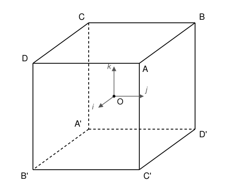

## Statement

L'espace est rapporté à un repère orthonormé $(O\,;\vec{\imath}, \vec{\jmath}, \vec{k})$. On
considère le cube $\mathcal{K}$ de centre $O$ dont les sommets sont

| $A$ | $B$ | $C$ | $D$ | $A'$ | $B'$ | $C'$ | $D'$ |
|---|---|---|---|---|---|---|---|
| $(1, 1, 1)$ | $(-1, 1, 1)$ | $(-1, -1, 1)$ | $(1, -1, 1)$ | $(-1, -1, -1)$ | $(1, -1, -1)$ | $(1, 1, -1)$ | $(-1, 1, -1)$ |

On considère un plan $\mathcal{P}$ passant par $O$ et ne contenant aucun sommet du cube, et on note
$\mathcal{A}$ l'intersection de $\mathcal{P}$ et du cube (le cube plein). On admet que
$\mathcal{A}$ est un polygone convexe dont les sommets sont les points où $\mathcal{P}$ rencontre
les arêtes du cube.

On suppose que $\mathcal{P}$ rencontre l'arête $[AB]$ en un point $M$ de coordonnées $(u, 1, 1)$ et
l'arête $[CD]$ en un point $N$ de coordonnées $(v, -1, 1)$.

1. Déterminer, selon les valeurs de $u$ et de $v$, la nature exacte de $\mathcal{A}$, et calculer
   son aire.
2. Donner, dans ce cas de figure, le meilleur encadrement possible de l'aire de $\mathcal{A}$
   lorsque $u$ et $v$ varient.

## Hints

1. **Question 1.** Le plan contient aussi les symétriques de $M$ et $N$ par rapport à $O$. Sur
   quelles arêtes sont-ils ?
2. **Question 1.** Trouver une équation de $\mathcal{P}$, de la forme $2X + bY + cZ = 0$, puis
   regarder son signe aux huit sommets : quelles arêtes $\mathcal{P}$ rencontre-t-il ?
3. **Question 1.** Pour la nature, calculer les longueurs de deux côtés consécutifs et leur produit
   scalaire. Pour l'aire d'un parallélogramme construit sur $\vec{a}$ et $\vec{b}$ :
   $\text{aire}^2 = \lVert\vec{a}\rVert^2 \lVert\vec{b}\rVert^2 - (\vec{a} \cdot \vec{b})^2$.

## Solution

Comme $\mathcal{P}$ ne contient aucun sommet, $M \neq A, B$ et $N \neq C, D$ : on a
$-1 < u < 1$ et $-1 < v < 1$.

**1.** *Une équation de $\mathcal{P}$.* Le vecteur $\vec{n}(2,\ v - u,\ -(u + v))$ vérifie
$\vec{n} \cdot \overrightarrow{OM} = 2u + (v - u) - (u + v) = 0$ et
$\vec{n} \cdot \overrightarrow{ON} = 2v - (v - u) - (u + v) = 0$ ; il est non nul, et $\overrightarrow{OM}$,
$\overrightarrow{ON}$ ne sont pas colinéaires. C'est donc un vecteur normal à $\mathcal{P}$, qui a
pour équation
$$\varphi(X, Y, Z) = 2X + (v - u)Y - (u + v)Z = 0 .$$

*Les arêtes rencontrées.* En un sommet, $X$, $Y$, $Z$ valent $\pm 1$, et
$$\lvert (v - u)Y - (u + v)Z \rvert \leq \lvert v - u \rvert + \lvert u + v \rvert = 2\max(\lvert u\rvert, \lvert v\rvert) < 2 .$$
(Pour l'égalité du milieu, distinguer selon que $u$ et $v$ ont le même signe ou non.) Donc
$\varphi$ a le signe de $X$ en chaque sommet : positif en $A$, $D$, $B'$, $C'$ (où $X = 1$), négatif
en $B$, $C$, $A'$, $D'$. Les arêtes qui joignent deux sommets de signes opposés sont les quatre
arêtes parallèles à $(O\,;\vec{\imath})$ : $[AB]$, $[DC]$, $[B'A']$, $[C'D']$. Le plan les coupe en
$M$, $N$, et en leurs symétriques $M' = (-u, -1, -1) \in [A'B']$ et $N' = (-v, 1, -1) \in [C'D']$.

*Nature.* $\mathcal{A}$ est le quadrilatère $MNM'N'$. Ses diagonales $[MM']$ et $[NN']$ ont le même
milieu $O$ : c'est un **parallélogramme**. Ses côtés issus de $M$ sont dirigés par
$$\vec{a} = \overrightarrow{MN} = (v - u,\ -2,\ 0), \qquad \vec{b} = \overrightarrow{MN'} = (-u - v,\ 0,\ -2),$$
avec
$$\lVert\vec{a}\rVert^2 = 4 + (v - u)^2, \qquad \lVert\vec{b}\rVert^2 = 4 + (u + v)^2, \qquad \vec{a} \cdot \vec{b} = -(v - u)(v + u) = u^2 - v^2 .$$

- C'est un rectangle si et seulement si $\vec{a} \cdot \vec{b} = 0$, c'est-à-dire $v = u$ ou $v = -u$.
- C'est un losange si et seulement si $(v - u)^2 = (u + v)^2$, c'est-à-dire $uv = 0$.
- C'est un carré si et seulement si les deux conditions ont lieu, c'est-à-dire $u = v = 0$ : le
  plan est alors le plan $X = 0$, et $\mathcal{A}$ est le carré de côté $2$ qui coupe le cube en son
  milieu.

**Conclusion sur la nature :** si $u = v = 0$, un carré ; si $\lvert u \rvert = \lvert v \rvert \neq 0$,
un rectangle qui n'est pas un carré ; si un seul des deux nombres $u$, $v$ est nul, un losange qui
n'est pas un carré ; dans tous les autres cas, un parallélogramme quelconque.

*Aire.* L'aire $S$ d'un parallélogramme vaut $\lVert\vec{a}\rVert\,\lVert\vec{b}\rVert\sin\theta$, où
$\theta$ est l'angle de $\vec{a}$ et $\vec{b}$, donc
$S^2 = \lVert\vec{a}\rVert^2\lVert\vec{b}\rVert^2 - (\vec{a} \cdot \vec{b})^2$. Ici, comme
$(v - u)^2(u + v)^2 = (u^2 - v^2)^2$,
$$S^2 = \left(4 + (v - u)^2\right)\left(4 + (u + v)^2\right) - (u^2 - v^2)^2 = 16 + 4\left[(v - u)^2 + (u + v)^2\right] = 16 + 8u^2 + 8v^2 .$$
Donc
$$S = \sqrt{16 + 8u^2 + 8v^2} = 2\sqrt{4 + 2u^2 + 2v^2} .$$

**2.** Quand $u$ et $v$ décrivent $]-1, 1[$, la somme $u^2 + v^2$ décrit $[0, 2[$, donc $S^2$ décrit
$[16, 32[$. Le meilleur encadrement est
$$4 \leq S < 4\sqrt{2} .$$
La valeur $4$ est atteinte pour $u = v = 0$ (le carré médian) ; la valeur $4\sqrt{2}$ n'est pas
atteinte, mais $S$ s'en approche autant qu'on veut quand $M$ et $N$ s'approchent de sommets du cube.

**Bilan.** Un plan passant par $O$ qui coupe les arêtes $[AB]$ et $[CD]$ coupe exactement les quatre
arêtes parallèles à l'axe des abscisses ; la section est un parallélogramme d'aire
$2\sqrt{4 + 2u^2 + 2v^2}$, au moins égale à $4$ (le carré médian) et toujours inférieure à
$4\sqrt{2}$.

## Going further

- Retrouver l'aire avec la formule $S^2 = S'^2 + S''^2 + S'''^2$, où $S'$, $S''$, $S'''$ sont les
  aires des projetés orthogonaux de $\mathcal{A}$ sur les trois plans de coordonnées (exercice
  40168). Les trois projetés sont faciles à dessiner.
- Les autres cas de figure (plans passant par deux sommets, plans coupant six arêtes) sont traités
  dans les exercices 40169, 40171 et 40172.
