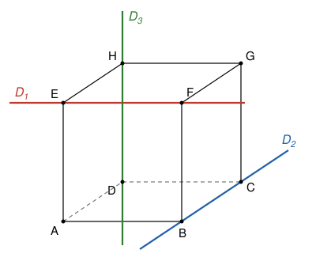

## Statement

On dit qu'une droite $\Delta$ *coupe* une droite $D$ si elles ont un point commun.

1. Dans l'espace, soit $D_1$ et $D_2$ deux droites non coplanaires, et soit $M$ un point qui
   n'appartient ni à $D_1$ ni à $D_2$. Montrer qu'il existe au plus une droite passant par $M$ et
   coupant à la fois $D_1$ et $D_2$. Dans quel cas n'en existe-t-il aucune ?

Désormais, l'espace est muni d'un repère orthonormé, et $ABCDEFGH$ est le cube dont les sommets
ont pour coordonnées
$A(0, 0, 0)$, $B(1, 0, 0)$, $C(1, 1, 0)$, $D(0, 1, 0)$, $E(0, 0, 1)$, $F(1, 0, 1)$,
$G(1, 1, 1)$, $H(0, 1, 1)$. On note $D_1$, $D_2$ et $D_3$ les droites $(EF)$, $(BC)$ et $(DH)$.

Enfin, on note $\mathcal{S}$ l'ensemble des points $M(x, y, z)$ tels que
$$xy + yz + zx - (x + y + z) + 1 = 0.$$

2. Donner une représentation paramétrique de chacune des droites $D_1$, $D_2$ et $D_3$.
3. Montrer que les droites $D_1$, $D_2$ et $D_3$ sont incluses dans $\mathcal{S}$.
4. Montrer que toute droite de l'espace qui n'est pas incluse dans $\mathcal{S}$ rencontre
   $\mathcal{S}$ en $0$, $1$ ou $2$ points.
5. En déduire que toute droite qui coupe les trois droites $D_1$, $D_2$ et $D_3$ est incluse dans
   $\mathcal{S}$.
6. Soit $D_4$ une droite qui ne coupe aucune des droites $D_1$, $D_2$, $D_3$, et qui n'est pas
   incluse dans $\mathcal{S}$. Montrer qu'il existe au plus deux droites de l'espace qui coupent
   les quatre droites $D_1$, $D_2$, $D_3$ et $D_4$.

## Hints

1. **Question 1.** Une droite qui passe par $M$ et coupe $D_1$ est contenue dans le plan $P$ qui
   contient $M$ et $D_1$.
2. **Question 1.** Combien de points communs la droite $D_2$ peut-elle avoir avec ce plan $P$ ?
   Elle n'est pas contenue dans $P$, sinon $D_1$ et $D_2$ seraient coplanaires.
3. **Question 1.** Il y a deux façons d'échouer : $D_2$ peut être parallèle au plan $P$, ou bien
   la droite obtenue peut être parallèle à $D_1$. Introduire le plan qui contient $D_1$ et qui est
   parallèle à $D_2$, et le plan qui contient $D_2$ et qui est parallèle à $D_1$.
4. **Question 4.** Prendre une droite passant par $(x_0, y_0, z_0)$, de vecteur directeur
   $(u, v, w)$, et remplacer $x$, $y$, $z$ par $x_0 + ut$, $y_0 + vt$, $z_0 + wt$ dans l'équation
   de $\mathcal{S}$. Quel est le degré de l'équation obtenue en $t$ ?
5. **Question 4.** Une expression $\alpha t^2 + \beta t + \gamma$ dont les coefficients ne sont
   pas tous nuls s'annule pour au plus deux valeurs de $t$.
6. **Question 5.** Les droites $D_1$, $D_2$ et $D_3$ ont-elles des points communs deux à deux ?
7. **Question 6.** Une droite qui coupe les quatre droites est incluse dans $\mathcal{S}$, donc
   elle coupe $D_4$ en un point de $\mathcal{S}$. Combien y a-t-il de tels points sur $D_4$, et
   combien de droites convenables peuvent passer par chacun d'eux ?

## Solution

**1.** *Au plus une droite.* Comme $M \notin D_1$, il existe un unique plan $P$ contenant $M$ et
$D_1$.

Soit $\Delta$ une droite passant par $M$ qui coupe $D_1$ en $A$ et $D_2$ en $B$. Comme
$M \notin D_1$, on a $A \neq M$, donc $\Delta = (MA)$. Les points $M$ et $A$ sont dans $P$, donc
$\Delta$ est contenue dans $P$, et en particulier $B \in P$.

La droite $D_2$ n'est pas contenue dans $P$, sinon $D_1$ et $D_2$ seraient coplanaires. Elle a
donc au plus un point commun avec $P$. Ainsi $B$ est forcément l'unique point commun de $D_2$ et
de $P$, s'il existe, et $\Delta$ est forcément la droite $(MB)$ (on a $B \neq M$ car
$M \notin D_2$). Il existe donc au plus une droite convenable.

*Quand il n'y en a aucune.* Notons $\vec{u}_1$ et $\vec{u}_2$ des vecteurs directeurs de $D_1$ et
$D_2$. Ils ne sont pas colinéaires, sinon $D_1$ et $D_2$ seraient parallèles, donc coplanaires.
On peut donc définir deux plans :

- $Q_1$, le plan qui contient $D_1$ et qui est dirigé par $\vec{u}_1$ et $\vec{u}_2$ : c'est le
  plan contenant $D_1$ et parallèle à $D_2$ ;
- $Q_2$, le plan qui contient $D_2$ et qui est dirigé par $\vec{u}_1$ et $\vec{u}_2$ : c'est le
  plan contenant $D_2$ et parallèle à $D_1$.

Ces deux plans sont parallèles, et distincts (sinon $D_1$ et $D_2$ seraient dans un même plan).

- *Si $M \in Q_1$.* Le plan $P$ contenant $M$ et $D_1$ est alors $Q_1$. Ce plan est parallèle à
  $D_2$ et ne la contient pas, donc il ne la rencontre pas. D'après ce qui précède, aucune droite
  ne convient.
- *Si $M \in Q_2$.* On échange les rôles de $D_1$ et $D_2$ : le plan contenant $M$ et $D_2$ est
  $Q_2$, qui ne rencontre pas $D_1$. Aucune droite passant par $M$ et coupant $D_2$ ne peut couper
  $D_1$.
- *Si $M$ n'est ni dans $Q_1$ ni dans $Q_2$.* Le plan $P$ contient $D_1$. Si $D_2$ était
  parallèle à $P$, le vecteur $\vec{u}_2$ serait un vecteur de $P$, et $P$ serait le plan
  contenant $D_1$ dirigé par $\vec{u}_1$ et $\vec{u}_2$, c'est-à-dire $Q_1$ : exclu. Donc $D_2$
  coupe $P$ en un point $B$, et $B \neq M$. Les droites $(MB)$ et $D_1$ sont toutes deux dans le
  plan $P$, donc elles sont sécantes ou parallèles. Si elles étaient parallèles, $M$ serait sur la
  droite passant par $B$ et dirigée par $\vec{u}_1$, qui est contenue dans $Q_2$ : exclu. Donc
  $(MB)$ coupe $D_1$, et c'est l'unique droite convenable.

**Conclusion :** il existe une seule droite passant par $M$ et coupant $D_1$ et $D_2$, sauf
quand $M$ appartient au plan contenant $D_1$ parallèle à $D_2$, ou au plan contenant $D_2$
parallèle à $D_1$ ; dans ces deux cas, il n'en existe aucune.

**2.** On a $\overrightarrow{EF} = (1, 0, 0)$, $\overrightarrow{BC} = (0, 1, 0)$ et
$\overrightarrow{DH} = (0, 0, 1)$. Une représentation paramétrique de chaque droite est donc,
pour $t$ réel :

- $D_1$ : $x = t$, $y = 0$, $z = 1$ ;
- $D_2$ : $x = 1$, $y = t$, $z = 0$ ;
- $D_3$ : $x = 0$, $y = 1$, $z = t$.

**3.** Notons $f(x, y, z) = xy + yz + zx - (x + y + z) + 1$. Pour tout réel $t$ :

- $f(t, 0, 1) = 0 + 0 + t - (t + 1) + 1 = 0$ ;
- $f(1, t, 0) = t + 0 + 0 - (1 + t) + 1 = 0$ ;
- $f(0, 1, t) = 0 + t + 0 - (1 + t) + 1 = 0$.

Tous les points de $D_1$, $D_2$ et $D_3$ sont donc dans $\mathcal{S}$.

**4.** Soit $\Delta$ la droite passant par $M_0(x_0, y_0, z_0)$, de vecteur directeur non nul
$(u, v, w)$. Ses points sont les points $M_t(x_0 + ut,\ y_0 + vt,\ z_0 + wt)$, et des valeurs
différentes de $t$ donnent des points différents.

En développant, par exemple $(x_0 + ut)(y_0 + vt) = x_0 y_0 + (x_0 v + y_0 u)\,t + uv\,t^2$, on
trouve
$$f(x_0 + ut,\ y_0 + vt,\ z_0 + wt) = \alpha t^2 + \beta t + \gamma,$$
avec
$$\alpha = uv + vw + wu, \qquad \gamma = f(x_0, y_0, z_0),$$
$$\beta = u\,(y_0 + z_0) + v\,(x_0 + z_0) + w\,(x_0 + y_0) - (u + v + w).$$

Les points de $\Delta$ qui sont dans $\mathcal{S}$ correspondent aux valeurs de $t$ qui annulent
$g(t) = \alpha t^2 + \beta t + \gamma$. Si $\Delta$ n'est pas incluse dans $\mathcal{S}$, alors
$g$ ne s'annule pas pour tous les $t$, donc $\alpha$, $\beta$, $\gamma$ ne sont pas tous nuls.

- Si $\alpha \neq 0$, c'est une équation du second degré : elle a $0$, $1$ ou $2$ solutions.
- Si $\alpha = 0$ et $\beta \neq 0$, l'équation $\beta t + \gamma = 0$ a une seule solution.
- Si $\alpha = \beta = 0$, alors $\gamma \neq 0$ et il n'y a aucune solution.

**Conclusion :** une droite non incluse dans $\mathcal{S}$ rencontre $\mathcal{S}$ en $0$, $1$
ou $2$ points.

**5.** Les droites $D_1$, $D_2$, $D_3$ n'ont deux à deux aucun point commun : les points de $D_1$
ont $z = 1$ et ceux de $D_2$ ont $z = 0$ ; ceux de $D_1$ ont $y = 0$ et ceux de $D_3$ ont
$y = 1$ ; ceux de $D_2$ ont $x = 1$ et ceux de $D_3$ ont $x = 0$.

Soit $\Delta$ une droite qui coupe $D_1$, $D_2$, $D_3$ en des points $A_1$, $A_2$, $A_3$. Ces
trois points sont différents, puisque les droites $D_i$ sont disjointes deux à deux, et ils sont
dans $\mathcal{S}$ d'après la question 3. La droite $\Delta$ rencontre donc $\mathcal{S}$ en au
moins trois points. D'après la question 4, elle est incluse dans $\mathcal{S}$.

**6.** *Les droites $D_1$ et $D_2$ ne sont pas coplanaires.* Elles n'ont aucun point commun
(question 5), et elles ne sont pas parallèles, car leurs vecteurs directeurs $(1, 0, 0)$ et
$(0, 1, 0)$ ne sont pas colinéaires. Or deux droites d'un même plan sont parallèles ou sécantes.

*Les droites qui coupent les quatre.* Soit $\Delta$ une droite qui coupe $D_1$, $D_2$, $D_3$ et
$D_4$, et soit $N$ son point commun avec $D_4$. D'après la question 5, $\Delta$ est incluse dans
$\mathcal{S}$, donc $N$ est un point de $\mathcal{S} \cap D_4$. Comme $D_4$ n'est pas incluse
dans $\mathcal{S}$, la question 4 dit que $\mathcal{S} \cap D_4$ compte au plus deux points.

Par ailleurs, $N$ n'est ni sur $D_1$ ni sur $D_2$, puisque $D_4$ ne les coupe pas. D'après la
question 1, il passe par $N$ au plus une droite qui coupe à la fois $D_1$ et $D_2$.

Chaque droite convenable est donc la seule possible passant par l'un des points de
$\mathcal{S} \cap D_4$, et ces points sont au plus deux.

**Conclusion :** il existe au plus deux droites qui coupent $D_1$, $D_2$, $D_3$ et $D_4$.

**Bilan.** L'ensemble $\mathcal{S}$, défini par une équation du second degré, contient les trois
droites $D_1$, $D_2$, $D_3$ et toutes les droites qui s'appuient sur elles trois. Une quatrième
droite qui n'est pas dans $\mathcal{S}$ le traverse en au plus deux points, et par chacun d'eux
passe au plus une droite s'appuyant sur les trois premières : il y a donc au plus deux droites
qui s'appuient sur les quatre droites $D_1$, $D_2$, $D_3$, $D_4$.

## Going further

- Pour un réel $a$ différent de $0$ et de $1$, montrer que la droite qui passe par le point
  $A(a, 0, 1)$ de $D_1$ et qui coupe $D_2$ et $D_3$ passe par les points
  $B(1,\ 1 - \frac{1}{a},\ 0)$ et $C(0,\ 1,\ \frac{1}{1 - a})$. Vérifier sur un exemple que tous
  ses points sont dans $\mathcal{S}$. On obtient ainsi une infinité de droites contenues dans
  $\mathcal{S}$.
- En posant $X = x - \frac{1}{2}$, $Y = y - \frac{1}{2}$, $Z = z - \frac{1}{2}$, montrer que
  l'équation de $\mathcal{S}$ devient $XY + YZ + ZX = -\frac{1}{4}$. La surface $\mathcal{S}$ est
  symétrique par rapport au centre du cube : c'est un *hyperboloïde à une nappe*, la surface en
  forme de tour de refroidissement de centrale, qui est entièrement faite de droites.
- Le titre du sujet, « Tiré à quatre épingles », fait allusion à ce résultat classique : quatre
  droites « en position générale » ont soit aucune, soit exactement deux droites qui s'appuient
  sur toutes les quatre.
