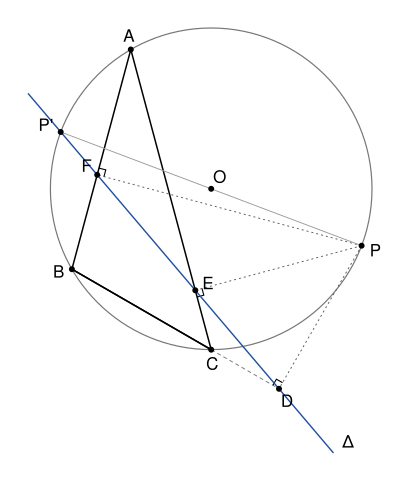

## Statement

Soit $ABC$ un triangle et $\Gamma$ son cercle circonscrit. Soit $P$ un point de $\Gamma$, et $D$, $E$, $F$ ses projetés orthogonaux sur les droites $(BC)$, $(CA)$ et $(AB)$. On admet que ces trois points sont alignés, sur une droite $\Delta$ appelée la droite de Simson du point $P$.

On note $P'$ le point de $\Gamma$ diamétralement opposé à $P$, et on suppose que la droite $\Delta$ passe par $P'$.

Montrer que la droite $\Delta$ passe aussi par le centre de gravité $G$ du triangle $ABC$.

## Hints

1. Prends le centre $O$ du cercle $\Gamma$ comme origine et son rayon comme unité. Les affixes $a$, $b$, $c$, $p$ sont de module 1, donc $\bar a = \frac{1}{a}$, et de même pour les autres.
2. Montre que l'orthocentre $H$ du triangle a pour affixe $a + b + c$.
3. Vérifie que le projeté $D$ de $P$ sur $(BC)$ a pour affixe $d = \frac{1}{2}\left(p + b + c - \frac{bc}{p}\right)$.
4. Montre que le milieu $N$ du segment $[PH]$ est toujours sur la droite $\Delta$. Compare ensuite les points $P'$, $N$ et $G$.

## Solution

On se place dans le plan complexe, avec l'origine au centre $O$ de $\Gamma$, et le rayon de $\Gamma$ comme unité de longueur. Les affixes de $A$, $B$, $C$, $P$ sont notées $a$, $b$, $c$, $p$. Elles sont de module 1.

**Rappel.**

- Si $|z| = 1$, alors $z\bar z = |z|^2 = 1$, donc $\bar z = \frac{1}{z}$.
- Un nombre complexe $w$ est réel si et seulement si $\bar w = w$, et imaginaire pur si et seulement si $\bar w = -w$.
- Si $U \neq V$, le point $W$ est sur la droite $(UV)$ si et seulement si $\frac{w - u}{v - u}$ est réel. Si de plus $W \neq X$, les droites $(WX)$ et $(UV)$ sont perpendiculaires si et seulement si $\frac{x - w}{v - u}$ est imaginaire pur.

### Étape 1 : une équation de la droite $(BC)$

Soit $Z$ un point d'affixe $z$. On calcule le conjugué de $\frac{z - b}{c - b}$ avec $\bar b = \frac{1}{b}$ et $\bar c = \frac{1}{c}$ :
$$\overline{\left(\frac{z - b}{c - b}\right)} = \frac{\bar z - \frac{1}{b}}{\frac{1}{c} - \frac{1}{b}} = \frac{\frac{b\bar z - 1}{b}}{\frac{b - c}{bc}} = \frac{c\,(b\bar z - 1)}{b - c} .$$
Le point $Z$ est sur $(BC)$ si et seulement si ce conjugué est égal à $\frac{z - b}{c - b}$, c'est-à-dire si et seulement si $z - b = -c\,(b\bar z - 1)$. Finalement,
$$Z \in (BC) \iff z + bc\,\bar z = b + c . \qquad (1)$$

### Étape 2 : l'orthocentre

Soit $H$ le point d'affixe $h = a + b + c$. Alors $h - a = b + c$, et le nombre $w = \frac{b + c}{b - c}$ vérifie
$$\bar w = \frac{\frac{1}{b} + \frac{1}{c}}{\frac{1}{b} - \frac{1}{c}} = \frac{c + b}{c - b} = -w .$$
Il est imaginaire pur, donc $H = A$ ou $(AH) \perp (BC)$ : dans les deux cas, $H$ est sur la hauteur issue de $A$. De la même façon, $H$ est sur la hauteur issue de $B$. **Le point $H$ est donc l'orthocentre du triangle $ABC$.**

### Étape 3 : les projetés de $P$

Soit $d = \frac{1}{2}\left(p + b + c - \frac{bc}{p}\right)$. On a $\bar d = \frac{1}{2}\left(\frac{1}{p} + \frac{1}{b} + \frac{1}{c} - \frac{p}{bc}\right)$, donc
$$d + bc\,\bar d = \frac{1}{2}\left(p + b + c - \frac{bc}{p} + \frac{bc}{p} + c + b - p\right) = b + c .$$
D'après (1), le point d'affixe $d$ est sur $(BC)$. Ensuite,
$$d - p = \frac{-p^2 + (b + c)\,p - bc}{2p} = \frac{(b - p)(p - c)}{2p} .$$
Posons
$$w = \frac{d - p}{c - b} = \frac{(b - p)(p - c)}{2p\,(c - b)} .$$
On calcule son conjugué :
$$\bar w = \frac{\left(\frac{1}{b} - \frac{1}{p}\right)\left(\frac{1}{p} - \frac{1}{c}\right)}{\frac{2}{p}\left(\frac{1}{c} - \frac{1}{b}\right)} = \frac{\frac{(p - b)(c - p)}{bcp^2}}{\frac{2\,(b - c)}{bcp}} = \frac{(p - b)(c - p)}{2p\,(b - c)} = -w ,$$
car $(p - b)(c - p) = (b - p)(p - c)$. Le nombre $w$ est imaginaire pur, donc ce point est $P$ lui-même ou bien la droite qui le joint à $P$ est perpendiculaire à $(BC)$. C'est donc le projeté $D$ :
$$d = \frac{1}{2}\left(p + b + c - \frac{bc}{p}\right), \qquad e = \frac{1}{2}\left(p + c + a - \frac{ca}{p}\right), \qquad f = \frac{1}{2}\left(p + a + b - \frac{ab}{p}\right),$$
les formules pour $E$ et $F$ s'obtenant en échangeant les lettres.

### Étape 4 : le milieu de $[PH]$ est sur $\Delta$

Soit $N$ le milieu de $[PH]$, d'affixe $n = \frac{1}{2}(p + a + b + c)$. Alors
$$d - n = -\frac{ap + bc}{2p}, \qquad e - n = -\frac{bp + ca}{2p}, \qquad f - n = -\frac{cp + ab}{2p} .$$
Si $e \neq n$, on pose
$$q = \frac{d - n}{e - n} = \frac{ap + bc}{bp + ca} .$$
En multipliant en haut et en bas par $abcp$, on trouve
$$\bar q = \frac{\frac{1}{ap} + \frac{1}{bc}}{\frac{1}{bp} + \frac{1}{ca}} = \frac{bc + ap}{ca + bp} = q .$$
Il est réel. Le même calcul, en échangeant les lettres, vaut pour les deux autres paires.

Les trois points $D$, $E$, $F$ ne sont pas tous égaux, car aucun point n'est à la fois sur les trois droites $(BC)$, $(CA)$ et $(AB)$. Soient $U$ et $V$ deux points distincts parmi eux, de sorte que $\Delta = (UV)$. Si $N = U$ ou $N = V$, alors $N$ est sur $\Delta$. Sinon, $\frac{u - n}{v - n}$ est réel, donc $N$, $U$, $V$ sont alignés. Dans tous les cas, **le point $N$ est sur la droite $\Delta$.**

### Étape 5 : conclusion

Le point $P'$ a pour affixe $-p$, et $G$ a pour affixe $g = \frac{a + b + c}{3}$. Donc
$$n - (-p) = \frac{a + b + c + 3p}{2}, \qquad g - (-p) = \frac{a + b + c + 3p}{3} = \frac{2}{3}\,(n - (-p)) .$$
Autrement dit, $\overrightarrow{P'G} = \frac{2}{3}\,\overrightarrow{P'N}$.

- Si $N = P'$, cette égalité donne $G = P'$, et $G$ est sur $\Delta$.
- Sinon, la droite $\Delta$ passe par les deux points distincts $P'$ (par hypothèse) et $N$ (étape 4), donc $\Delta = (P'N)$. L'égalité $\overrightarrow{P'G} = \frac{2}{3}\,\overrightarrow{P'N}$ montre que $G$ est sur cette droite.

**La droite de Simson $\Delta$ passe par le centre de gravité $G$ du triangle.**

## Going further

- L'étape 4 démontre en fait le théorème de Simson lui-même : les points $D$, $E$, $F$ et $N$ sont toujours alignés. Vérifie-le en relisant le calcul.
- L'égalité $\overrightarrow{P'G} = \frac{2}{3}\,\overrightarrow{P'N}$ ne dépend pas de l'hypothèse : $G$ est toujours sur la droite $(P'N)$. On a donc mieux que l'énoncé : si $G \neq N$, la droite de Simson de $P$ passe par $P'$ si et seulement si elle passe par $G$.
- Le corrigé raisonne sans calcul. L'homothétie de centre $P$ et de rapport 2 envoie $\Delta$ sur une droite qui passe par $H$ (la droite de Steiner), donc $\Delta$ passe par le milieu de $[PH]$. Dans le triangle $PP'H$, la droite $\Delta$ est alors la médiane issue de $P'$, et $G$ est le centre de gravité de ce triangle.
