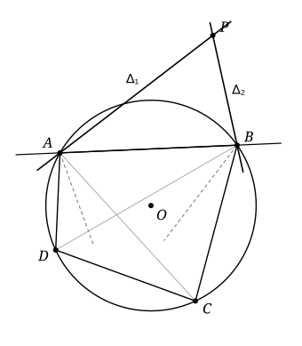

## Statement

Soit $ABCD$ un quadrilatère inscrit dans un cercle $\Gamma$ de centre $O$.

On note $\Delta_1$ la droite symétrique de la droite $(AB)$ par rapport à la bissectrice intérieure de l'angle $\widehat{CAD}$, et $\Delta_2$ la droite symétrique de la droite $(AB)$ par rapport à la bissectrice intérieure de l'angle $\widehat{CBD}$. On suppose que $\Delta_1$ et $\Delta_2$ se coupent en un point $P$, distinct de $O$.

Démontrer que les droites $(OP)$ et $(CD)$ sont perpendiculaires.

## Hints

1. La bissectrice de l'angle $\widehat{CAD}$ recoupe le cercle en un point $S$. Comparez les longueurs $SC$ et $SD$. Où se trouve $S$ par rapport à la médiatrice de $[CD]$ ?
2. Notez $m$ la médiatrice de $[CD]$. Elle passe par $O$ et elle est perpendiculaire à $(CD)$. Il suffit donc de montrer que $P$ est sur $m$. Notez $\sigma$ la symétrie d'axe $m$.
3. Soit $B'$ le symétrique de $B$ par $\sigma$. Il est sur le cercle, et $S$ est le milieu d'un des deux arcs $BB'$. Montrez que $\Delta_1$ est la droite $(AB')$.
4. De même, $\Delta_2$ est la droite $(BA')$, où $A'$ est le symétrique de $A$. Que devient la droite $\Delta_1$ par la symétrie $\sigma$ ? Qu'en déduire pour le point $P$ ?

## Solution

**Rappel : l'angle inscrit et le milieu d'un arc.** Un angle inscrit dans un cercle vaut la moitié de l'arc qu'il intercepte. On en déduit le fait suivant, qui sert deux fois.

> Soient $X$, $Y$ et $A$ trois points distincts d'un cercle. La bissectrice intérieure de l'angle $\widehat{XAY}$ recoupe le cercle au milieu de l'arc $XY$ qui ne contient pas $A$. La bissectrice extérieure recoupe le cercle au milieu de l'autre arc $XY$.

En effet, si la bissectrice intérieure recoupe le cercle en $M_1$, les angles inscrits $\widehat{XAM_1}$ et $\widehat{M_1AY}$ sont égaux, donc ils interceptent deux arcs égaux : $M_1$ est le milieu de l'arc $XY$ qui ne contient pas $A$. La bissectrice extérieure est perpendiculaire à la bissectrice intérieure en $A$. Elle recoupe donc le cercle en un point $M_2$ tel que l'angle $\widehat{M_1AM_2}$ est droit, c'est-à-dire que $[M_1M_2]$ est un diamètre. Le point diamétralement opposé au milieu d'un arc $XY$ est le milieu de l'autre arc $XY$.

Remarquons que les deux milieux d'arcs $XY$ sont les deux points où la médiatrice de $[XY]$ coupe le cercle, puisqu'ils sont à égale distance de $X$ et de $Y$.

**Mise en place.** Notons $m$ la médiatrice de $[CD]$. Elle passe par $O$, puisque $OC = OD$, et elle est perpendiculaire à $(CD)$. Il suffit donc de montrer que **$P$ est sur $m$** : alors $(OP) = m$, qui est perpendiculaire à $(CD)$.

Notons $\sigma$ la symétrie d'axe $m$. Comme $O$ est sur $m$, la symétrie $\sigma$ envoie le cercle $\Gamma$ sur lui-même. Elle échange $C$ et $D$.

**Étape 1 : la bissectrice en $A$ passe par un point $S$ de $m$.** D'après le rappel (avec $X = C$, $Y = D$), la bissectrice intérieure de $\widehat{CAD}$ recoupe $\Gamma$ en un point $S$, milieu d'un arc $CD$. Donc $SC = SD$ et $S$ est sur $m$.

**Étape 2 : $\Delta_1$ est la droite $(AB')$, où $B' = \sigma(B)$.**

Le point $B'$ est sur $\Gamma$. Supposons d'abord $B' \ne B$ et $B' \ne A$. L'axe $m$ est alors la médiatrice de $[BB']$, et $S$ est l'un des deux points où $m$ coupe $\Gamma$ : c'est donc le milieu de l'un des deux arcs $BB'$. D'après le rappel (avec $X = B$, $Y = B'$), la droite $(AS)$ est la bissectrice intérieure ou la bissectrice extérieure de l'angle $\widehat{BAB'}$.

Dans les deux cas, la symétrie par rapport à $(AS)$ échange les droites $(AB)$ et $(AB')$ : c'est vrai pour les deux bissectrices d'un angle. Par définition de $\Delta_1$, on obtient $\Delta_1 = (AB')$.

**Étape 3 : $\Delta_2$ est la droite $(BA')$, où $A' = \sigma(A)$.** C'est le même raisonnement en échangeant les rôles de $A$ et $B$. La bissectrice intérieure de $\widehat{CBD}$ recoupe $\Gamma$ au milieu d'un arc $CD$, donc en un point de $m$, et l'étape 2 s'applique telle quelle.

**Étape 4 : conclusion.** La symétrie $\sigma$ envoie $A$ sur $A'$ et $B'$ sur $B$. Elle envoie donc la droite $\Delta_1 = (AB')$ sur la droite $(A'B) = \Delta_2$, et de même $\Delta_2$ sur $\Delta_1$.

Le point $P$ est sur $\Delta_1$ et sur $\Delta_2$. Son symétrique $\sigma(P)$ est donc sur $\sigma(\Delta_1) = \Delta_2$ et sur $\sigma(\Delta_2) = \Delta_1$. Or ces deux droites se coupent en un seul point, $P$. Donc $\sigma(P) = P$ : le point $P$ est sur l'axe $m$.

Les points $O$ et $P$ sont tous les deux sur $m$, et $m$ est perpendiculaire à $(CD)$. Donc **les droites $(OP)$ et $(CD)$ sont perpendiculaires.**

**Les cas particuliers.**

- Si $B$ est sur $m$, alors $B' = B$. Le point $B$ est l'un des deux points de $m$ sur le cercle, et ce n'est pas $S$ (qui est sur l'arc $CD$ opposé à $A$ et $B$). Donc $[SB]$ est un diamètre et l'angle $\widehat{SAB}$ est droit. La symétrie par rapport à $(AS)$ laisse alors la droite $(AB)$ en place : $\Delta_1 = (AB) = (AB')$, et la suite ne change pas. De même si $A$ est sur $m$.
- Si $B' = A$, c'est-à-dire si $(AB)$ est parallèle à $(CD)$, la droite $(AB')$ n'a plus de sens. Le même raisonnement, en remplaçant la corde $[AB']$ par la tangente en $A$, montre que $\Delta_1$ et $\Delta_2$ sont les tangentes à $\Gamma$ en $A$ et en $B$. Ces deux tangentes sont symétriques par rapport à $m$, et elles se coupent donc sur $m$.

## Going further

Le corrigé officiel procède par chasse aux angles : il montre d'abord que $A$, $P$, $B$ et $O$ sont sur un même cercle, puis que $P$, $O$ et $S$ sont alignés. Ce calcul dépend de la position des points sur la figure, et il ne traite que le cas où $O$ est à l'intérieur de $ABCD$. La symétrie $\sigma$ évite ces discussions.
