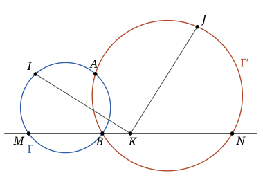

## Statement

Deux cercles $\Gamma$ et $\Gamma'$ se coupent en deux points $A$ et $B$. Une droite $\Delta$ passant par $B$ recoupe $\Gamma$ en $M$ et $\Gamma'$ en $N$, de sorte que $B$ soit entre $M$ et $N$.

On note $I$ le milieu de l'arc $AM$ de $\Gamma$ qui ne contient pas $B$, $J$ le milieu de l'arc $AN$ de $\Gamma'$ qui ne contient pas $B$, et $K$ le milieu de $[MN]$.

Démontrer que le triangle $IKJ$ est rectangle en $K$.

## Hints

1. Notez $P$ et $Q$ les milieux de $[AM]$ et $[AN]$. Quelle est la nature du quadrilatère $APKQ$ ?
2. Les points $I$ et $J$ sont sur les médiatrices de $[AM]$ et $[AN]$, donc les triangles $API$ et $AQJ$ sont rectangles. Exprimez les angles $\widehat{IAM}$ et $\widehat{JAN}$ à l'aide de $\widehat{ABM}$ et $\widehat{ABN}$.
3. Vous devez trouver $\widehat{IAM} + \widehat{JAN} = 90^\circ$. Déduisez-en que $\dfrac{PI}{AP} \times \dfrac{QJ}{AQ} = 1$.
4. Calculez le produit scalaire $\overrightarrow{KI} \cdot \overrightarrow{KJ}$ en écrivant $\overrightarrow{KI} = \overrightarrow{KP} + \overrightarrow{PI}$ et $\overrightarrow{KJ} = \overrightarrow{KQ} + \overrightarrow{QJ}$. Attention au sens des vecteurs $\overrightarrow{PI}$ et $\overrightarrow{QJ}$ : de quel côté de $(AM)$ se trouve $I$ ?

## Solution

Le point $A$ n'est pas sur $\Delta$ : sinon $\Delta$ serait la droite $(AB)$, et l'on aurait $M = N = A$. Les points $A$, $M$, $N$ forment donc un vrai triangle. Notons $P$ et $Q$ les milieux de $[AM]$ et $[AN]$, et posons

$$\vec{p} = \overrightarrow{AP} = \frac{1}{2}\overrightarrow{AM}, \qquad \vec{q} = \overrightarrow{AQ} = \frac{1}{2}\overrightarrow{AN} .$$

**Étape 1 : les vecteurs $\overrightarrow{KP}$ et $\overrightarrow{KQ}$.** Comme $K$ est le milieu de $[MN]$,

$$\overrightarrow{AK} = \frac{1}{2}\left(\overrightarrow{AM} + \overrightarrow{AN}\right) = \vec{p} + \vec{q} ,$$

donc $\overrightarrow{KP} = \overrightarrow{AP} - \overrightarrow{AK} = -\vec{q}$ et de même $\overrightarrow{KQ} = -\vec{p}$. (Autrement dit, $APKQ$ est un parallélogramme.)

**Étape 2 : $\widehat{IAM} + \widehat{JAN} = 90^\circ$.** Sur le cercle $\Gamma$, le point $I$ est sur l'arc $AM$ qui ne contient pas $B$ : les points se suivent dans l'ordre $A$, $I$, $M$, $B$, et le quadrilatère $AIMB$ est inscrit dans $\Gamma$. D'après une propriété classique des quadrilatères inscrits (conséquence du théorème de l'angle inscrit), ses angles opposés sont supplémentaires :

$$\widehat{AIM} = 180^\circ - \widehat{ABM} .$$

Comme $I$ est le milieu de l'arc, $IA = IM$ : le triangle $AIM$ est isocèle en $I$, et

$$\widehat{IAM} = \frac{180^\circ - \widehat{AIM}}{2} = \frac{\widehat{ABM}}{2} .$$

De même, sur $\Gamma'$, on obtient $\widehat{JAN} = \dfrac{\widehat{ABN}}{2}$. Enfin, $M$, $B$, $N$ sont alignés avec $B$ entre $M$ et $N$, donc $\widehat{ABM} + \widehat{ABN} = 180^\circ$. En ajoutant :

$$\widehat{IAM} + \widehat{JAN} = 90^\circ .$$

**Étape 3 : les longueurs $PI$ et $QJ$.** Comme $IA = IM$, le point $I$ est sur la médiatrice de $[AM]$, qui passe par $P$ et est perpendiculaire à $(AM)$. Le triangle $API$ est donc rectangle en $P$, et

$$PI = AP \times \tan \widehat{IAM} .$$

De même $QJ = AQ \times \tan \widehat{JAN}$. Or, dans un triangle rectangle, les tangentes des deux angles aigus sont inverses l'une de l'autre (côté opposé sur côté adjacent, puis l'inverse). Comme $\widehat{IAM}$ et $\widehat{JAN}$ ont pour somme $90^\circ$, on a $\tan \widehat{JAN} = \dfrac{1}{\tan \widehat{IAM}}$, donc

$$\frac{PI}{AP} \times \frac{QJ}{AQ} = 1 .$$

**Étape 4 : le produit scalaire.** Plaçons-nous dans un repère orthonormé. Pour un vecteur $\vec{u}$ de coordonnées $(x, y)$, notons $\vec{u}^{\perp}$ le vecteur de coordonnées $(-y, x)$. Un calcul direct en coordonnées montre que, pour tous vecteurs $\vec{u}$ et $\vec{v}$ :

$$\vec{u}^{\perp} \cdot \vec{u} = 0, \qquad \vec{u}^{\perp} \cdot \vec{v}^{\perp} = \vec{u} \cdot \vec{v}, \qquad \vec{u} \cdot \vec{v}^{\perp} = -\,\vec{u}^{\perp} \cdot \vec{v} ,$$

et que $\vec{u}^{\perp}$ a la même longueur que $\vec{u}$.

Le vecteur $\overrightarrow{PI}$ est orthogonal à $\vec{p}$, donc colinéaire à $\vec{p}^{\perp}$ : il existe un réel $\lambda$ tel que $\overrightarrow{PI} = \lambda\, \vec{p}^{\perp}$. De même $\overrightarrow{QJ} = \mu\, \vec{q}^{\perp}$ pour un réel $\mu$. Alors $PI = |\lambda|\,AP$ et $QJ = |\mu|\,AQ$, et l'étape 3 donne

$$|\lambda| \times |\mu| = 1 .$$

D'après l'étape 1,

$$\overrightarrow{KI} = \overrightarrow{KP} + \overrightarrow{PI} = -\vec{q} + \lambda\,\vec{p}^{\perp}, \qquad \overrightarrow{KJ} = \overrightarrow{KQ} + \overrightarrow{QJ} = -\vec{p} + \mu\,\vec{q}^{\perp} .$$

En développant, avec les règles ci-dessus :

$$\overrightarrow{KI} \cdot \overrightarrow{KJ} = \vec{q} \cdot \vec{p} - \mu\, \vec{q} \cdot \vec{q}^{\perp} - \lambda\, \vec{p}^{\perp} \cdot \vec{p} + \lambda\mu\, \vec{p}^{\perp} \cdot \vec{q}^{\perp} = (1 + \lambda\mu)\, \vec{p} \cdot \vec{q} .$$

Il suffit donc de montrer que $\lambda\mu = -1$. Comme $|\lambda\mu| = 1$, il reste à voir que **$\lambda$ et $\mu$ sont de signes contraires**. C'est là qu'intervient la position des points.

**Étape 5 : les signes de $\lambda$ et $\mu$.** Le vecteur $\vec{p}^{\perp}$ est un vecteur normal à la droite $(AM)$, qui est donc l'ensemble des points $X$ tels que $\overrightarrow{AX} \cdot \vec{p}^{\perp} = 0$. Deux points $X$ et $Y$ sont de part et d'autre de $(AM)$ si et seulement si les nombres $\overrightarrow{AX} \cdot \vec{p}^{\perp}$ et $\overrightarrow{AY} \cdot \vec{p}^{\perp}$ sont de signes contraires. En effet, quand un point $Z$ parcourt le segment $[XY]$, le nombre $\overrightarrow{AZ} \cdot \vec{p}^{\perp}$ varie comme une fonction affine du paramètre, et il s'annule sur le segment exactement quand ses valeurs aux deux bouts sont de signes contraires (ou que l'une est nulle).

Posons $s = \vec{q} \cdot \vec{p}^{\perp}$. Ce nombre n'est pas nul, car $\vec{q}$ n'est pas colinéaire à $\vec{p}$.

- *Le signe de $\lambda$.* On a $\overrightarrow{AI} \cdot \vec{p}^{\perp} = \left(\vec{p} + \lambda\,\vec{p}^{\perp}\right) \cdot \vec{p}^{\perp} = \lambda\, AP^2$ et $\overrightarrow{AN} \cdot \vec{p}^{\perp} = 2s$. Or $I$ et $B$ sont sur les deux arcs différents de $\Gamma$ délimités par la corde $[AM]$, donc de part et d'autre de $(AM)$. Et $B$ et $N$ sont du même côté de $(AM)$, car le segment $[BN]$ ne contient pas $M$, le seul point commun de $\Delta$ et de $(AM)$. Donc $I$ et $N$ sont de part et d'autre de $(AM)$ : **$\lambda$ et $s$ sont de signes contraires.**
- *Le signe de $\mu$.* De même, $\overrightarrow{AJ} \cdot \vec{q}^{\perp} = \mu\, AQ^2$ et $\overrightarrow{AM} \cdot \vec{q}^{\perp} = 2\,\vec{p} \cdot \vec{q}^{\perp} = -2s$. Les points $J$ et $M$ sont de part et d'autre de $(AN)$, pour la même raison. Donc $\mu$ et $-s$ sont de signes contraires : **$\mu$ et $s$ sont de même signe.**

Ainsi $\lambda$ et $\mu$ sont de signes contraires, et $\lambda\mu = -1$. D'après l'étape 4, $\overrightarrow{KI} \cdot \overrightarrow{KJ} = 0$.

**Conclusion.** Les points $I$ et $J$ sont distincts de $K$, car ils ne sont pas sur $\Delta$ (la droite $\Delta$ ne coupe $\Gamma$ qu'en $B$ et $M$, et $\Gamma'$ qu'en $B$ et $N$). Comme $\overrightarrow{KI} \cdot \overrightarrow{KJ} = 0$, les droites $(KI)$ et $(KJ)$ sont perpendiculaires : le triangle $IKJ$ est rectangle en $K$.

## Going further

On peut aussi conclure sans coordonnées, en lisant la figure. Les droites $(PI)$ et $(KQ)$ sont perpendiculaires, ainsi que $(KP)$ et $(QJ)$, et l'étape 3 donne $\dfrac{PI}{KQ} = \dfrac{KP}{QJ}$ puisque $KQ = AP$ et $KP = AQ$. Les triangles $IPK$ et $KQJ$ sont alors semblables, et la similitude qui envoie l'un sur l'autre fait tourner chaque droite d'un angle droit, donc envoie $(IK)$ sur une droite perpendiculaire, qui est $(KJ)$. Cette méthode est plus courte, mais elle demande de vérifier sur la figure que les angles $\widehat{IPK}$ et $\widehat{KQJ}$ sont égaux et non supplémentaires : c'est exactement le rôle de l'étape 5 dans la solution ci-dessus.
