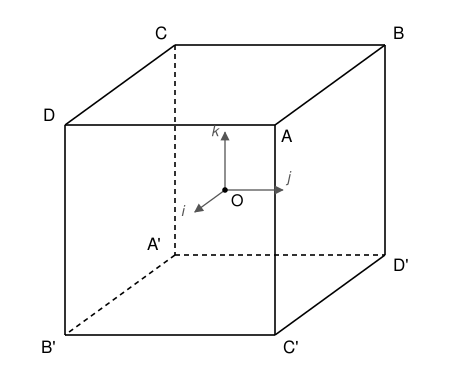

## Statement

L'espace est rapporté à un repère orthonormé $(O\,;\vec{\imath}, \vec{\jmath}, \vec{k})$. On
considère le cube $\mathcal{K}$ de centre $O$ dont les sommets sont

| $A$ | $B$ | $C$ | $D$ | $A'$ | $B'$ | $C'$ | $D'$ |
|---|---|---|---|---|---|---|---|
| $(1, 1, 1)$ | $(-1, 1, 1)$ | $(-1, -1, 1)$ | $(1, -1, 1)$ | $(-1, -1, -1)$ | $(1, -1, -1)$ | $(1, 1, -1)$ | $(-1, 1, -1)$ |

On considère un plan $\mathcal{P}$ passant par $O$ et ne contenant aucun sommet du cube, et on note
$\mathcal{A}$ l'intersection de $\mathcal{P}$ et du cube (le cube plein), et $S$ son aire. On
admet que $\mathcal{A}$ est un polygone convexe dont les sommets sont les points où $\mathcal{P}$
rencontre les arêtes du cube. On admet aussi le résultat suivant : si $S'$, $S''$, $S'''$ sont les
aires des projetés orthogonaux d'un polygone plan d'aire $S$ sur les plans
$(O\,;\vec{\imath}, \vec{\jmath})$, $(O\,;\vec{\jmath}, \vec{k})$ et $(O\,;\vec{k}, \vec{\imath})$,
alors
$$S^2 = S'^2 + S''^2 + S'''^2 .$$

On suppose que $\mathcal{P}$ rencontre l'arête $[AB]$ en un point $M$ de coordonnées $(x, 1, 1)$ et
l'arête $[BC]$ en un point $N$ de coordonnées $(-1, y, 1)$.

1. Montrer que $\mathcal{P}$ rencontre l'arête $[CA']$ en un point $R$ de coordonnées
   $(-1, -1, z)$. Expliquer comment construire le point $R$ sur une figure en perspective, les
   points $M$ et $N$ étant donnés.
2. Établir que les trois réels $x$, $y$ et $z$ sont liés par la relation
$$x + y + z + xyz = 0 . \qquad (1)$$
3. Dessiner le polygone $\mathcal{A}$ pour $x = y = z = 0$ et calculer son aire.
4. Montrer que l'aire $S$ de $\mathcal{A}$ vérifie
$$S^2 = (3 - x + y + xy)^2 + (3 + x - z + xz)^2 + (3 - y + z + yz)^2 .$$
5. Déterminer l'ensemble des valeurs de $S$ lorsque les points $M$ et $N$ varient de manière que
   $x + y = 0$.

## Hints

1. **Question 1.** Chercher un vecteur normal à $\mathcal{P}$ orthogonal à $\overrightarrow{OM}$ et à
   $\overrightarrow{ON}$ ; on peut prendre $(1 - y,\ -(1 + x),\ 1 + xy)$. Quel est le signe de
   l'équation en $C$ et en $A'$ ?
2. **Question 1.** Pour la construction, la droite $(MN)$ est dans le plan de la face du haut :
   prolongée, elle coupe la droite $(CD)$ en un point $K$. Le plan $\mathcal{P}$ contient aussi le
   symétrique $M'$ de $M$ par rapport à $O$. Que dire de la droite $(KM')$ ?
3. **Question 3.** Les six sommets de $\mathcal{A}$ sont des milieux d'arêtes. Quelle est leur
   distance à $O$ ?
4. **Question 4.** Commencer par trouver les six arêtes rencontrées et les six sommets de
   $\mathcal{A}$. Puis dessiner le projeté de $\mathcal{A}$ sur le plan $(O\,;\vec{\imath}, \vec{\jmath})$ :
   c'est un carré auquel on a enlevé deux coins triangulaires.
5. **Question 5.** Montrer que $z = 0$, puis étudier les variations de
   $x \mapsto (3 + x)^2\left((1 - x)^2 + 2\right)$ sur $]-1, 1[$.

## Solution

Comme $\mathcal{P}$ ne contient aucun sommet, $-1 < x < 1$ et $-1 < y < 1$ ; en particulier
$1 + x > 0$, $1 - x > 0$, $1 \pm y > 0$ et $1 + xy > 0$.

**1.** *Une équation de $\mathcal{P}$.* Le vecteur $\vec{n}(1 - y,\ -(1 + x),\ 1 + xy)$ est non nul
et vérifie
$$\vec{n} \cdot \overrightarrow{OM} = x - xy - 1 - x + 1 + xy = 0, \qquad \vec{n} \cdot \overrightarrow{ON} = -1 + y - y - xy + 1 + xy = 0 .$$
Comme $\overrightarrow{OM}$ et $\overrightarrow{ON}$ ne sont pas colinéaires, $\vec{n}$ est normal à
$\mathcal{P}$, d'équation
$$\varphi(X, Y, Z) = (1 - y)X - (1 + x)Y + (1 + xy)Z = 0 .$$

*Le point $R$.* On a
$$\varphi(C) = -(1 - y) + (1 + x) + (1 + xy) = (1 + x)(1 + y) > 0,$$
$$\varphi(A') = -(1 - y) + (1 + x) - (1 + xy) = -(1 - x)(1 - y) < 0 .$$
La fonction $t \mapsto \varphi(-1, -1, t)$ est affine, positive en $t = 1$ et négative en $t = -1$ :
elle s'annule en un unique $z \in\ ]-1, 1[$. Le plan $\mathcal{P}$ coupe donc l'arête $[CA']$ en
$R(-1, -1, z)$.

*Construction.* Les points $M$ et $N$ sont dans le plan $Z = 1$ de la face $ABCD$. La droite $(MN)$
n'est pas parallèle à $(CD)$ (elle le serait seulement si $y = 1$) ; elle la coupe en un point $K$,
qui est dans $\mathcal{P}$ et dans le plan $Y = -1$ de la face $CDB'A'$. Le symétrique
$M' = (-x, -1, -1)$ de $M$ par rapport à $O$ est dans $\mathcal{P}$ et sur l'arête $[A'B']$, donc
aussi dans le plan $Y = -1$. La trace de $\mathcal{P}$ sur ce plan est donc la droite $(KM')$, et
$R$ est le point d'intersection de $(KM')$ et de $(CA')$.

Sur la figure : on prolonge $(MN)$ jusqu'à $(CD)$, ce qui donne $K$ ; on place $M'$ sur $[A'B']$ (le
symétrique de $M$, c'est-à-dire le point de $[A'B']$ tel que $A'M' = AM$) ; la droite $(KM')$ coupe $[CA']$ en $R$.

**2.** Le point $R$ est dans $\mathcal{P}$ :
$$\varphi(-1, -1, z) = -(1 - y) + (1 + x) + (1 + xy)z = x + y + z + xyz = 0 .$$

**3.** Pour $x = y = z = 0$, le plan a pour équation $X - Y + Z = 0$. Il coupe les arêtes en leurs
milieux :
$$M(0, 1, 1),\quad N(-1, 0, 1),\quad R(-1, -1, 0),\quad M'(0, -1, -1),\quad N'(1, 0, -1),\quad R'(1, 1, 0),$$
milieux de $[AB]$, $[BC]$, $[CA']$, $[A'B']$, $[B'C']$, $[C'A]$. (Les points $M'$, $N'$, $R'$ sont
les symétriques de $M$, $N$, $R$.) Le polygone $\mathcal{A}$ est l'hexagone $MNRM'N'R'$. Ses six
sommets sont à la distance $\sqrt{2}$ de $O$, et ses six côtés ont pour longueur $\sqrt{2}$ (par
exemple $\overrightarrow{MN} = (-1, -1, 0)$, $\overrightarrow{NR} = (0, -1, -1)$). Les six triangles
$OMN$, $ONR$, … sont équilatéraux de côté $\sqrt{2}$ : $\mathcal{A}$ est un **hexagone régulier**
de côté $\sqrt{2}$, et
$$S = 6 \times \frac{\sqrt{3}}{4} \times (\sqrt{2})^2 = 3\sqrt{3} .$$

**4.** *Les arêtes rencontrées.* On a déjà $\varphi(A) = (1 - x)(1 - y) > 0$, et
$$\varphi(B) = -(1 - y) - (1 + x) + 1 + xy = -(1 + x)(1 - y) < 0,$$
$$\varphi(D) = 3 + x - y + xy = (1 + x)(1 - y) + 2 + 2xy > 0 .$$
Avec $\varphi(C) > 0$, $\varphi(A') < 0$ et $\varphi$ changée de signe aux symétriques
($B' = -B$, $C' = -C$, $D' = -D$), les sommets « positifs » sont $A$, $C$, $D$, $B'$ et les
« négatifs » $B$, $A'$, $C'$, $D'$. Les arêtes qui joignent un positif à un négatif sont
$$[AB],\ [BC],\ [CA'],\ [A'B'],\ [B'C'],\ [C'A] .$$
$\mathcal{A}$ est donc l'hexagone $MNRM'N'R'$, avec $M' = (-x, -1, -1)$, $N' = (1, -y, -1)$ et
$R' = (1, 1, -z)$.

*Les trois projections.* Aucune coordonnée de $\vec{n}$ n'est nulle, donc aucune projection n'aplatit
$\mathcal{A}$ sur un segment.

- Sur $(O\,;\vec{\imath}, \vec{\jmath})$ (on oublie $Z$) : les sommets deviennent $(x, 1)$,
  $(-1, y)$, $(-1, -1)$, $(-x, -1)$, $(1, -y)$, $(1, 1)$. C'est le carré $[-1, 1] \times [-1, 1]$,
  d'aire $4$, privé de deux triangles rectangles : celui de sommets $(-1, 1)$, $(x, 1)$, $(-1, y)$,
  de côtés de l'angle droit $1 + x$ et $1 - y$, et son symétrique. Donc
$$S' = 4 - (1 + x)(1 - y) = 3 - x + y + xy .$$
- Sur $(O\,;\vec{k}, \vec{\imath})$ (on oublie $Y$ ; on note les points $(X, Z)$) : $(x, 1)$,
  $(-1, 1)$, $(-1, z)$, $(-x, -1)$, $(1, -1)$, $(1, -z)$. Le carré est privé du coin $(1, 1)$
  (triangle de côtés $1 - x$ et $1 + z$) et de son symétrique. Donc
$$S''' = 4 - (1 - x)(1 + z) = 3 + x - z + xz .$$
- Sur $(O\,;\vec{\jmath}, \vec{k})$ (on oublie $X$ ; on note les points $(Y, Z)$) : $(1, 1)$,
  $(y, 1)$, $(-1, z)$, $(-1, -1)$, $(-y, -1)$, $(1, -z)$. Le carré est privé du coin $(-1, 1)$
  (triangle de côtés $1 + y$ et $1 - z$) et de son symétrique. Donc
$$S'' = 4 - (1 + y)(1 - z) = 3 - y + z + yz .$$

D'après le résultat admis,
$$S^2 = (3 - x + y + xy)^2 + (3 + x - z + xz)^2 + (3 - y + z + yz)^2 .$$
(Pour $x = y = z = 0$, on retrouve $S^2 = 27$, soit $S = 3\sqrt{3}$.)

**5.** Si $x + y = 0$, la relation (1) donne $z(1 + xy) = 0$, et $1 + xy = 1 - x^2 > 0$, donc
$z = 0$. Avec $y = -x$ et $z = 0$ :
$$S^2 = (3 - 2x - x^2)^2 + (3 + x)^2 + (3 + x)^2 = (3 + x)^2(1 - x)^2 + 2(3 + x)^2 = (3 + x)^2\left(x^2 - 2x + 3\right),$$
car $3 - 2x - x^2 = (3 + x)(1 - x)$. Posons $g(x) = (3 + x)^2(x^2 - 2x + 3)$ pour $x \in\ ]-1, 1[$.
Alors
$$g'(x) = 2(3 + x)(x^2 - 2x + 3) + (3 + x)^2(2x - 2) = 2(3 + x)\left[x^2 - 2x + 3 + (3 + x)(x - 1)\right],$$
et comme $x^2 - 2x + 3 + (3 + x)(x - 1) = x^2 - 2x + 3 + x^2 + 2x - 3 = 2x^2$,
$$g'(x) = 4x^2(3 + x) .$$
Donc $g' \geq 0$, et $g'$ ne s'annule qu'en $0$ : $g$ est strictement croissante sur $]-1, 1[$. Comme
$g(-1) = 4 \times 6 = 24$ et $g(1) = 16 \times 2 = 32$, et que $g$ est continue, $S^2 = g(x)$
décrit l'intervalle $]24, 32[$ quand $x$ décrit $]-1, 1[$. (Tout $x \in\ ]-1, 1[$ convient : le
plan passant par $O$, $M(x, 1, 1)$ et $N(-1, -x, 1)$ ne contient aucun sommet, d'après les signes
trouvés à la question 4.)

**Conclusion :** quand $x + y = 0$, l'aire $S$ décrit l'intervalle $]2\sqrt{6},\ 4\sqrt{2}[$
(bornes non atteintes).

**Bilan.** Un plan passant par le centre du cube et coupant $[AB]$ et $[BC]$ coupe six arêtes, et
les trois paramètres $x$, $y$, $z$ des points de coupe sont liés par $x + y + z + xyz = 0$. Les
projections sur les trois plans de coordonnées sont des carrés écornés, ce qui donne $S^2$ comme une
somme de trois carrés. Pour l'hexagone régulier, $S = 3\sqrt{3}$ ; le long de la famille
$x + y = 0$, l'aire varie entre $2\sqrt{6}$ et $4\sqrt{2}$, sans les atteindre.

## Going further

- Dans la suite du sujet, on montrait que cet encadrement $2\sqrt{6} < S < 4\sqrt{2}$ vaut pour
  tous les plans qui coupent six arêtes : voir l'exercice 40172.
- En réunissant tous les cas (exercices 40169, 40170 et celui-ci), quelle est la plus petite et la
  plus grande aire d'une section du cube par un plan passant par son centre ?
