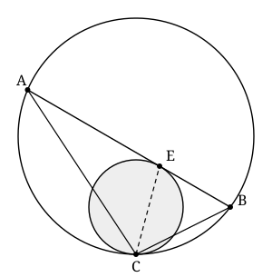

## Statement

Deux cercles sont tangents **intérieurement** en un point $C$ : le petit est à l'intérieur du
grand, et les deux se touchent en $C$.

Une corde $[AB]$ du grand cercle est tangente au petit cercle en un point $E$.

Montrer que la droite $(CE)$ est la bissectrice de l'angle $\widehat{ACB}$.

## Hints

1. Deux cercles tangents en $C$ ont **la même tangente** en $C$. Appelle $t$ cette droite : c'est
   le seul lien entre les deux cercles, donc c'est par elle qu'il faut passer.
2. Rappel utile (angle tangentiel, ou « angle entre une tangente et une corde ») : si une droite
   est tangente en $M$ à un cercle et si $[MN]$ est une corde de ce cercle, alors l'angle entre la
   tangente et la corde est égal à l'angle inscrit qui intercepte $[MN]$ de l'autre côté.
3. Prolonge $[CA]$ et $[CB]$ jusqu'à recouper le petit cercle, en $H$ et $G$. Applique l'angle
   tangentiel deux fois, une fois dans chaque cercle, du côté de $t$ et de la droite $(CA)$. Que
   peux-tu en déduire sur les droites $(GH)$ et $(AB)$ ?
4. Le petit cercle est tangent à $(AB)$ en $E$ : que dire de la droite qui joint son centre à $E$ ?
   Et puisque $(GH)$ est parallèle à $(AB)$ ?
5. Une fois que tu sais que $EG = EH$, reviens aux angles inscrits vus depuis $C$.

## Solution

Notons $\gamma$ le petit cercle, de centre $O$, et $\Gamma$ le grand.

### L'outil : l'angle tangentiel

On utilisera plusieurs fois le résultat suivant, classique.

> Soit un cercle, $M$ un point de ce cercle et $t$ la tangente en $M$. Soit $[MN]$ une corde. Alors
> l'angle entre $t$ et $[MN]$ est égal à l'angle inscrit interceptant $[MN]$ depuis l'autre arc.

C'est le cas limite du théorème de l'angle inscrit, quand le point de vue vient se confondre avec
l'extrémité de la corde.

### La construction

Les deux cercles sont tangents en $C$ : ils ont donc la même tangente en ce point. Notons-la $t$.

La droite $(CA)$ recoupe le petit cercle en un point que nous appelons $H$, et la droite $(CB)$
le recoupe en un point que nous appelons $G$. Comme le petit cercle est à l'intérieur du grand,
les points $H$ et $G$ sont situés entre $C$ et $A$, et entre $C$ et $B$ respectivement.

### Première étape : les droites $(GH)$ et $(AB)$ sont parallèles

Appliquons l'angle tangentiel deux fois, avec la même tangente $t$ et la même droite issue de $C$.

**Dans le grand cercle $\Gamma$**, la tangente en $C$ est $t$ et $[CA]$ est une corde. Donc
l'angle entre $t$ et $(CA)$ est égal à l'angle inscrit $\widehat{ABC}$ :
$$\big(t, (CA)\big) = \widehat{ABC}.$$

**Dans le petit cercle $\gamma$**, la tangente en $C$ est la même droite $t$, et $[CH]$ est une
corde. Donc l'angle entre $t$ et $(CH)$ est égal à l'angle inscrit $\widehat{HGC}$ :
$$\big(t, (CH)\big) = \widehat{HGC}.$$

Mais $(CH)$ et $(CA)$ sont **la même droite**, et les deux angles sont pris du même côté. Donc
$$\widehat{ABC} = \widehat{HGC}.$$

Regardons maintenant la droite $(CB)$ comme une sécante. Elle coupe $(AB)$ en $B$ et $(GH)$ en
$G$, et elle forme avec ces deux droites deux angles correspondants égaux, $\widehat{ABC}$ et
$\widehat{HGC}$. Par conséquent
$$(GH) \parallel (AB).$$

### Deuxième étape : $E$ est le milieu de l'arc $GH$

La droite $(AB)$ est tangente au petit cercle en $E$. Le rayon aboutissant au point de contact est
perpendiculaire à la tangente :
$$(OE) \perp (AB).$$

Comme $(GH)$ est parallèle à $(AB)$, on en déduit
$$(OE) \perp (GH).$$

Or $[GH]$ est une corde de $\gamma$, et $(OE)$ est une droite qui passe par le centre $O$ et qui
est perpendiculaire à cette corde : c'est donc la **médiatrice** de $[GH]$.

Le point $E$ est sur cette médiatrice et sur le cercle $\gamma$, donc
$$EG = EH.$$

Plus précisément, $E$ est le milieu de l'arc $GH$ qui ne contient pas $C$ (les points $G$ et $H$
sont du côté de $C$, le point $E$ du côté de la corde $[AB]$).

### Troisième étape : conclusion

Dans le petit cercle $\gamma$, les quatre points $C$, $G$, $E$, $H$ sont sur le cercle. Les angles
inscrits $\widehat{GCE}$ et $\widehat{ECH}$ interceptent respectivement les arcs $GE$ et $EH$ qui
ne contiennent pas $C$. Ces deux arcs sont égaux, puisque $E$ en est le point milieu. Donc
$$\widehat{GCE} = \widehat{ECH}.$$

Il ne reste qu'à traduire. Le point $G$ est sur la demi-droite $[CB)$ et le point $H$ sur la
demi-droite $[CA)$, donc
$$\widehat{GCE} = \widehat{BCE} \qquad \text{et} \qquad \widehat{ECH} = \widehat{ECA}.$$

Finalement
$$\widehat{BCE} = \widehat{ECA},$$

**la droite $(CE)$ est bien la bissectrice de l'angle $\widehat{ACB}$.**

## Going further

Il existe une seconde démonstration, plus courte mais qui demande un autre outil. Notons $F$ le
point où la droite $(AB)$ coupe la tangente commune $t$. Montrer que $FC = FE$ (puissance d'un
point), puis que les triangles $FAC$ et $FCB$ sont semblables, et en déduire
$$\frac{CA}{CB} = \frac{AE}{EB},$$
ce qui est exactement la caractérisation de la bissectrice intérieure issue de $C$.
