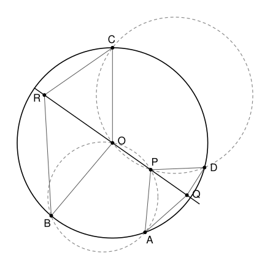

## Statement

On considère un cercle de centre $O$ et quatre points $A$, $B$, $C$, $D$ de ce cercle. Les cercles circonscrits aux triangles $ABO$ et $CDO$ se recoupent en un point $P$ autre que $O$, et on suppose que $P$ est à l'intérieur du triangle $OAD$.

On choisit un point $Q$ sur la demi-droite $[OP)$, en dehors du segment $[OP]$, et un point $R$ sur la demi-droite $[PO)$, en dehors du segment $[OP]$.

Montrer que les angles $\widehat{QAP}$ et $\widehat{OBR}$ sont égaux si et seulement si les angles $\widehat{PDQ}$ et $\widehat{RCO}$ sont égaux.

## Hints

1. Prolonge les droites $(AB)$ et $(CD)$ sur la figure. Que remarques-tu ?
2. Si une droite passant par un point $M$ coupe un cercle de centre $\omega$ et de rayon $\rho$ en $X$ et $Y$, alors $\overrightarrow{MX} \cdot \overrightarrow{MY} = M\omega^2 - \rho^2$ (passe par le milieu de $[XY]$). Utilise ce résultat pour montrer que $(AB)$, $(CD)$ et $(OP)$ se coupent en un point $M$, avec $MA \times MB = MC \times MD = MO \times MP$.
3. L'égalité $MA \times MB = MO \times MP$ donne deux triangles semblables, $MAP$ et $MOB$. Lesquels de leurs angles sont égaux ?
4. Associe à $Q$ le point $R_0$ de la droite $(OP)$, du côté de $O$, tel que $MQ \times MR_0 = MO \times MP$. Montre que $\widehat{QAP} = \widehat{OBR_0}$ et $\widehat{PDQ} = \widehat{R_0CO}$, puis que $R_0$ est le seul point qui convient dans chacune des deux égalités. N'oublie pas le cas où $Q$ est au-delà de $M$.

## Solution

On note $r$ le rayon du cercle $\Omega$ de centre $O$, $\Gamma_1$ le cercle circonscrit à $ABO$ (centre $\omega_1$) et $\Gamma_2$ le cercle circonscrit à $CDO$ (centre $\omega_2$).

### Deux outils

**Outil 1 (puissance d'un point).** Soit un cercle de centre $\omega$ et de rayon $\rho$. Pour un point $M$, on pose $p(M) = M\omega^2 - \rho^2$. Si une droite passant par $M$ coupe le cercle en $X$ et $Y$, alors
$$\overrightarrow{MX} \cdot \overrightarrow{MY} = p(M) .$$

*Preuve.* Soit $H$ le milieu de $[XY]$. La droite $(\omega H)$ est perpendiculaire à $(XY)$, et $M$ est sur $(XY)$. On a $\overrightarrow{MX} = \overrightarrow{MH} + \overrightarrow{HX}$ et $\overrightarrow{MY} = \overrightarrow{MH} - \overrightarrow{HX}$, donc
$$\overrightarrow{MX} \cdot \overrightarrow{MY} = MH^2 - HX^2 = \left(M\omega^2 - \omega H^2\right) - \left(\rho^2 - \omega H^2\right) = M\omega^2 - \rho^2 ,$$
avec le théorème de Pythagore dans les triangles $MH\omega$ et $XH\omega$, rectangles en $H$.

Les vecteurs $\overrightarrow{MX}$ et $\overrightarrow{MY}$ sont colinéaires. Si $p(M) > 0$, ils sont donc de même sens : $X$ et $Y$ sont du même côté de $M$, et $MX \times MY = p(M)$.

**Outil 2.** Prenons deux cercles de centres distincts $\omega_1$, $\omega_2$, de rayons $\rho_1$, $\rho_2$, et posons $d(M) = p_1(M) - p_2(M)$. Si $K$ est le milieu de $[\omega_1\omega_2]$,
$$M\omega_1^2 - M\omega_2^2 = \left(\overrightarrow{M\omega_1} - \overrightarrow{M\omega_2}\right) \cdot \left(\overrightarrow{M\omega_1} + \overrightarrow{M\omega_2}\right) = \overrightarrow{\omega_2\omega_1} \cdot 2\,\overrightarrow{MK} = 2\,\overrightarrow{KM} \cdot \overrightarrow{\omega_1\omega_2} ,$$
donc $d(M) = 2\,\overrightarrow{KM} \cdot \overrightarrow{\omega_1\omega_2} - \left(\rho_1^2 - \rho_2^2\right)$. Ce nombre ne dépend que de la projection de $M$ sur la droite $(\omega_1\omega_2)$, et il augmente quand cette projection avance dans le sens de $\overrightarrow{\omega_1\omega_2}$. Donc :

- les points où $d$ s'annule forment une droite perpendiculaire à $(\omega_1\omega_2)$ ;
- $d$ est strictement positif d'un côté de cette droite et strictement négatif de l'autre.

Si les deux cercles se coupent en $X$ et $Y$, alors $d(X) = 0 - 0 = 0$ et de même $d(Y) = 0$ : cette droite est la droite $(XY)$.

### Étape 1 : les droites $(AB)$, $(CD)$ et $(OP)$ passent par un même point $M$

Les cercles $\Gamma_1$ et $\Gamma_2$ passent par $O$, donc leurs centres ne sont pas $O$. Ils ont aussi des centres distincts : sinon, passant tous les deux par $O$, ils auraient le même rayon et seraient le même cercle, qui couperait $\Omega$ en quatre points $A$, $B$, $C$, $D$, ce qui est impossible pour deux cercles distincts.

On applique l'outil 2 trois fois :

- $d_1 = p_\Omega - p_{\Gamma_1}$ s'annule exactement sur la droite $(AB)$ ;
- $d_2 = p_{\Gamma_1} - p_{\Gamma_2}$ s'annule exactement sur la droite $(OP)$ ;
- $d_3 = p_\Omega - p_{\Gamma_2}$ s'annule exactement sur la droite $(CD)$, et $d_3 = d_1 + d_2$.

Les droites $(AB)$ et $(OP)$ ne sont pas parallèles. En effet, le centre $\omega_1$ est sur la médiatrice de $[AB]$, qui passe par $O$ puisque $OA = OB$, et sur la médiatrice de $[OP]$, puisque $\Gamma_1$ passe par $O$ et $P$. Si $(AB)$ et $(OP)$ étaient parallèles, ces deux médiatrices seraient toutes les deux perpendiculaires à $(OP)$, donc parallèles, et distinctes (l'une passe par $O$, l'autre par le milieu de $[OP]$). Elles ne pourraient pas contenir toutes les deux le point $\omega_1$.

Soit donc $M$ le point d'intersection de $(AB)$ et $(OP)$. On a $d_1(M) = 0$ et $d_2(M) = 0$, donc $d_3(M) = 0$ : **$M$ est aussi sur $(CD)$**.

### Étape 2 : où se trouve $M$

D'abord, $O$ et $P$ sont du même côté de $(AB)$. En effet $d_1(O) = p_\Omega(O) - p_{\Gamma_1}(O) = -r^2 - 0 < 0$, car $O$ est sur $\Gamma_1$. Et $d_1(P) = \left(OP^2 - r^2\right) - 0 < 0$, car $P$ est sur $\Gamma_1$ et à l'intérieur du triangle $OAD$, donc à l'intérieur du disque. D'après l'outil 2, $O$ et $P$ sont du même côté de la droite $(AB)$. Le point $M$, qui est sur $(AB)$, n'est donc pas entre $O$ et $P$, et $\overrightarrow{MO} \cdot \overrightarrow{MP} > 0$.

L'outil 1, appliqué à $\Gamma_1$ avec les droites $(OP)$ et $(AB)$, puis à $\Omega$ avec les droites $(AB)$ et $(CD)$, donne
$$k = \overrightarrow{MO} \cdot \overrightarrow{MP} = \overrightarrow{MA} \cdot \overrightarrow{MB} = \overrightarrow{MC} \cdot \overrightarrow{MD} = MO^2 - r^2 .$$

Comme $k > 0$, le point $M$ est à l'extérieur du cercle $\Omega$, les points $A$ et $B$ sont du même côté de $M$, de même que $C$ et $D$, et
$$MA \times MB = MC \times MD = MO \times MP = k .$$

Enfin, $P$ est entre $O$ et $M$. Sinon, $O$ serait entre $M$ et $P$, on aurait $MP > MO$, puis $k = MO \times MP > MO^2 > MO^2 - r^2 = k$, ce qui est absurde. Les points se suivent donc dans l'ordre $O$, $P$, $M$ sur la droite.

### Étape 3 : deux paires de triangles semblables

Comme $MA \times MB = MO \times MP$, on a $\dfrac{MA}{MO} = \dfrac{MP}{MB}$. Les triangles $MAP$ et $MOB$ ont le même angle en $M$ (les points $A$ et $B$ sont sur une même demi-droite d'origine $M$, les points $O$ et $P$ sur une autre), compris entre des côtés proportionnels. Ils sont semblables, avec $A \to O$ et $P \to B$, donc
$$\widehat{MPA} = \widehat{MBO} \qquad \text{et} \qquad \widehat{MAP} = \widehat{MOB} . \qquad (1)$$

De même, $MC \times MD = MO \times MP$ rend semblables les triangles $MDP$ et $MOC$, avec $D \to O$ et $P \to C$ :
$$\widehat{MPD} = \widehat{MCO} \qquad \text{et} \qquad \widehat{MDP} = \widehat{MOC} . \qquad (2)$$

### Étape 4 : le cas où $Q$ est entre $P$ et $M$

On place sur la demi-droite $[MO)$ le point $R_0$ tel que $MR_0 = \dfrac{k}{MQ}$. Comme $MQ < MP$, on a $MR_0 > \dfrac{k}{MP} = MO$ : le point $R_0$ est au-delà de $O$, c'est un point de la demi-droite $[PO)$ en dehors de $[OP]$, donc un choix permis pour $R$.

Comme $MA \times MB = MQ \times MR_0$, le même raisonnement qu'à l'étape 3 rend semblables les triangles $MAQ$ et $MR_0B$, avec $A \to R_0$ et $Q \to B$. Donc $\widehat{MQA} = \widehat{MBR_0}$. De même, avec $C$ et $D$, $\widehat{MQD} = \widehat{MCR_0}$.

Le point $Q$ est entre $M$ et $P$, donc dans le triangle $APQ$, l'angle $\widehat{MQA}$ est l'angle extérieur en $Q$ :
$$\widehat{MQA} = \widehat{QAP} + \widehat{APQ}, \qquad \text{avec} \qquad \widehat{APQ} = \widehat{MPA} .$$
Avec (1), on obtient $\widehat{QAP} = \widehat{MQA} - \widehat{MPA} = \widehat{MBR_0} - \widehat{MBO}$.

Le point $O$ est entre $M$ et $R_0$, donc la demi-droite $[BO)$ est à l'intérieur de l'angle $\widehat{MBR_0}$, et $\widehat{MBR_0} - \widehat{MBO} = \widehat{OBR_0}$. Finalement
$$\widehat{QAP} = \widehat{OBR_0} .$$
Exactement de la même façon, avec (2) et le triangle $DPQ$ :
$$\widehat{PDQ} = \widehat{MQD} - \widehat{MPD} = \widehat{MCR_0} - \widehat{MCO} = \widehat{R_0CO} .$$

Il reste à voir que $R_0$ est le seul point qui convient. Quand $R$ s'éloigne de $O$ sur la demi-droite, l'angle $\widehat{OBR}$ augmente strictement : si $R$ est entre $O$ et $R'$, la demi-droite $[BR)$ est à l'intérieur de l'angle $\widehat{OBR'}$, donc $\widehat{OBR} < \widehat{OBR'}$. Ainsi $\widehat{OBR} = \widehat{QAP}$ seulement pour $R = R_0$. Pour la même raison, $\widehat{RCO} = \widehat{PDQ}$ seulement pour $R = R_0$.

Les deux égalités sont donc vraies exactement au même moment, quand $R = R_0$.

### Étape 5 : le cas où $Q$ est en $M$ ou au-delà de $M$

Soit $R$ un point permis, donc au-delà de $O$. Dans le triangle $OBR$,
$$\widehat{OBR} = 180° - \widehat{BOR} - \widehat{ORB} < 180° - \widehat{BOR} = \widehat{BOM},$$
car $M$ et $R$ sont de part et d'autre de $O$ sur une même droite, si bien que $\widehat{BOR} + \widehat{BOM} = 180°$.

De l'autre côté, $M$ est sur le segment $[PQ]$, donc la demi-droite $[AM)$ est dans l'angle $\widehat{PAQ}$ (ou confondue avec $[AQ)$ si $Q = M$), et avec (1) :
$$\widehat{QAP} \geqslant \widehat{MAP} = \widehat{MOB} > \widehat{OBR} .$$
L'égalité $\widehat{QAP} = \widehat{OBR}$ n'est jamais vraie. De même, avec (2), $\widehat{PDQ} \geqslant \widehat{MDP} = \widehat{MOC} > \widehat{RCO}$ : l'égalité $\widehat{PDQ} = \widehat{RCO}$ n'est jamais vraie non plus. Deux affirmations toujours fausses sont équivalentes.

**Conclusion.** Dans tous les cas, $\widehat{QAP} = \widehat{OBR}$ si et seulement si $\widehat{PDQ} = \widehat{RCO}$. Plus précisément, cela se produit exactement quand $Q$ est entre $P$ et $M$ et que $MQ \times MR = MO \times MP$.

## Going further

Montre que $OP \times OM = r^2$. Le point $M$ ne dépend donc que de $P$, et pas du choix de $A$, $B$, $C$, $D$.
