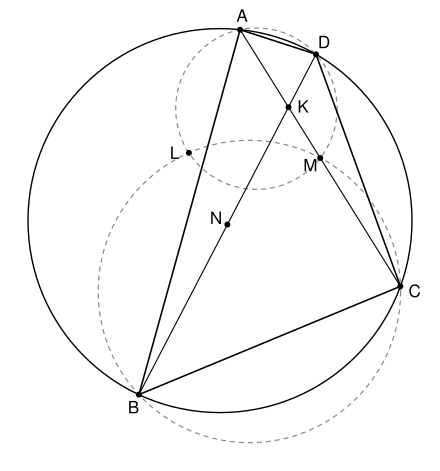

## Statement

Soit $ABCD$ un quadrilatère convexe inscrit dans un cercle. On note $K$ le point d'intersection de ses diagonales, et $M$ et $N$ les milieux de $[AC]$ et de $[BD]$. Le cercle circonscrit au triangle $ADM$ et le cercle circonscrit au triangle $BCM$ se coupent en $M$ et en un deuxième point $L$.

Montrer que les points $K$, $L$, $M$, $N$ sont sur un même cercle.

## Hints

1. Note $O$ le centre du cercle circonscrit à $ABCD$. Que vaut l'angle $\widehat{OMK}$ ? Sur quel cercle se trouvent $M$ et $N$ ?
2. Soit $E$ le point d'intersection des droites $(AD)$ et $(BC)$. Avec la puissance d'un point, montre que $E$, $M$, $L$ sont alignés et que $\overrightarrow{EM} \cdot \overrightarrow{EL} = \overrightarrow{EA} \cdot \overrightarrow{ED}$.
3. Il reste à montrer que la puissance de $E$ par rapport au cercle de diamètre $[OK]$, c'est-à-dire $\overrightarrow{EO} \cdot \overrightarrow{EK}$, est aussi égale à $\overrightarrow{EA} \cdot \overrightarrow{ED}$.
4. Pour ce calcul, écris $\overrightarrow{EA} = a\,\vec{u}$, $\overrightarrow{ED} = d\,\vec{u}$, $\overrightarrow{EB} = b\,\vec{v}$, $\overrightarrow{EC} = c\,\vec{v}$, puis exprime $\overrightarrow{EK}$ à l'aide de $\overrightarrow{EA}$ et $\overrightarrow{EC}$.

## Solution

On note $\Gamma$ le cercle circonscrit à $ABCD$, $O$ son centre et $R$ son rayon.

**Rappel : la puissance d'un point.** Soit $\mathcal{C}$ un cercle de centre $J$ et de rayon $\rho$, et $Z$ un point. On pose $p(Z) = ZJ^2 - \rho^2$.

- *(a)* Si une droite passant par $Z$ coupe $\mathcal{C}$ en $X$ et $X'$ (avec $X = X'$ si elle est tangente), alors $\overrightarrow{ZX} \cdot \overrightarrow{ZX'} = p(Z)$.
  En effet, soit $H$ le milieu de $[XX']$, qui est le pied de la perpendiculaire à la droite issue de $J$. Alors $\overrightarrow{ZX} = \overrightarrow{ZH} + \overrightarrow{HX}$ et $\overrightarrow{ZX'} = \overrightarrow{ZH} - \overrightarrow{HX}$, donc $\overrightarrow{ZX} \cdot \overrightarrow{ZX'} = ZH^2 - HX^2$. Par le théorème de Pythagore, $ZH^2 = ZJ^2 - JH^2$ et $HX^2 = \rho^2 - JH^2$, d'où le résultat.
- *(b)* Si $[UV]$ est un diamètre de $\mathcal{C}$, alors $\overrightarrow{ZU} \cdot \overrightarrow{ZV} = p(Z)$. En effet $\overrightarrow{ZU} = \overrightarrow{ZJ} + \overrightarrow{JU}$ et $\overrightarrow{ZV} = \overrightarrow{ZJ} - \overrightarrow{JU}$.
- *(c)* Dans la situation *(a)*, si $X \neq Z$, le point $X'$ est sur la droite $(ZX)$ et vérifie $\overrightarrow{ZX} \cdot \overrightarrow{ZX'} = p(Z)$, donc $\overrightarrow{ZX'} = \dfrac{p(Z)}{ZX^2}\,\overrightarrow{ZX}$. Le second point d'intersection est entièrement déterminé par $X$ et par le nombre $p(Z)$.

Dans toute la suite, on suppose que les droites $(AD)$ et $(BC)$ se coupent. Le cas où elles sont parallèles est traité à la fin. Alors $ABCD$ n'est pas un rectangle, donc ses diagonales ne sont pas toutes les deux des diamètres, et $O \neq K$.

### Étape 1 : $K$, $M$, $N$ sont sur le cercle de diamètre $[OK]$

Le point $M$ est le milieu de la corde $[AC]$ de $\Gamma$, donc $(OM)$ est perpendiculaire à $(AC)$, c'est-à-dire à $(MK)$. Ainsi $\widehat{OMK} = 90°$, et $M$ est sur le cercle $\Omega$ de diamètre $[OK]$ (si $M = K$, c'est évident). De même, $N$ est sur $\Omega$, et $K$ aussi bien sûr.

Il reste donc à montrer que **$L$ est sur $\Omega$**.

### Étape 2 : $E$, $M$, $L$ sont alignés et $\overrightarrow{EM} \cdot \overrightarrow{EL} = p$

Soit $E$ le point d'intersection de $(AD)$ et de $(BC)$, et $p = \overrightarrow{EA} \cdot \overrightarrow{ED}$. D'après *(a)* appliqué à $\Gamma$, on a aussi $p = \overrightarrow{EB} \cdot \overrightarrow{EC}$, puisque ces deux produits valent la puissance de $E$ par rapport à $\Gamma$.

Le point $M$ n'est pas sur la droite $(AD)$, car sinon $C$ y serait aussi. Donc $E \neq M$. La droite $(EM)$ recoupe le cercle circonscrit à $ADM$ en un point $L_1$, et le cercle circonscrit à $BCM$ en un point $L_2$. D'après *(a)*, appliqué à chacun de ces deux cercles,
$$\overrightarrow{EM} \cdot \overrightarrow{EL_1} = \overrightarrow{EA} \cdot \overrightarrow{ED} = p \qquad \text{et} \qquad \overrightarrow{EM} \cdot \overrightarrow{EL_2} = \overrightarrow{EB} \cdot \overrightarrow{EC} = p .$$
D'après *(c)*, $\overrightarrow{EL_1} = \overrightarrow{EL_2}$, donc $L_1 = L_2$. Ce point est sur les deux cercles, c'est donc $M$ ou $L$. Ce n'est pas $M$ : sinon la droite $(EM)$ serait tangente en $M$ aux deux cercles, qui seraient alors tangents en $M$ et ne pourraient pas se recouper en $L$. Donc $L_1 = L_2 = L$ :
$$E,\ M,\ L \text{ sont alignés et } \overrightarrow{EM} \cdot \overrightarrow{EL} = p .$$

### Étape 3 : on se ramène à un calcul

La droite $(EM)$ recoupe $\Omega$ en un point $L'$. D'après *(a)* et *(b)* appliqués à $\Omega$, dont $[OK]$ est un diamètre,
$$\overrightarrow{EM} \cdot \overrightarrow{EL'} = \overrightarrow{EO} \cdot \overrightarrow{EK} .$$
Si l'on prouve que $\overrightarrow{EO} \cdot \overrightarrow{EK} = p$, alors $\overrightarrow{EM} \cdot \overrightarrow{EL'} = p = \overrightarrow{EM} \cdot \overrightarrow{EL}$, et d'après *(c)* $L' = L$ : le point $L$ est sur $\Omega$. Il reste donc à démontrer que
$$\overrightarrow{EO} \cdot \overrightarrow{EK} = p .$$

### Étape 4 : le calcul de $\overrightarrow{EO} \cdot \overrightarrow{EK}$

Soit $\vec{u}$ un vecteur unitaire de la droite $(AD)$ et $\vec{v}$ un vecteur unitaire de la droite $(BC)$. Il existe des nombres réels $a$, $d$, $b$, $c$, tous non nuls, tels que
$$\overrightarrow{EA} = a\,\vec{u}, \qquad \overrightarrow{ED} = d\,\vec{u}, \qquad \overrightarrow{EB} = b\,\vec{v}, \qquad \overrightarrow{EC} = c\,\vec{v} .$$
Alors $p = \overrightarrow{EA} \cdot \overrightarrow{ED} = ad$ et $p = \overrightarrow{EB} \cdot \overrightarrow{EC} = bc$.

**Deux produits scalaires.** Le projeté orthogonal de $O$ sur $(AD)$ est le milieu $H$ de $[AD]$, car $O$ est sur la médiatrice de cette corde. Donc $\overrightarrow{EH} = \dfrac{a + d}{2}\,\vec{u}$ et, comme $\overrightarrow{HO}$ est orthogonal à $\vec{u}$,
$$\overrightarrow{EO} \cdot \overrightarrow{EA} = \overrightarrow{EH} \cdot \overrightarrow{EA} = \frac{a(a + d)}{2} .$$
De même, avec le milieu de $[BC]$, $\overrightarrow{EO} \cdot \overrightarrow{EC} = \dfrac{c(b + c)}{2}$.

**Le point $K$.** Comme $K$ est sur $(AC)$, il existe un réel $t$ tel que $\overrightarrow{EK} = (1 - t)\,\overrightarrow{EA} + t\,\overrightarrow{EC}$. Comme $K$ est sur $(BD)$, il existe un réel $s$ tel que $\overrightarrow{EK} = s\,\overrightarrow{ED} + (1 - s)\,\overrightarrow{EB}$. Les vecteurs $\vec{u}$ et $\vec{v}$ ne sont pas colinéaires, donc on peut identifier les coordonnées :
$$(1 - t)\,a = s\,d \qquad \text{et} \qquad t\,c = (1 - s)\,b .$$
La première donne $s = \dfrac{(1 - t)\,a}{d}$. En reportant dans la seconde et en multipliant par $d$, on obtient $tcd = bd - ab + abt$, soit
$$t\,(cd - ab) = b\,(d - a) .$$
Le nombre $cd - ab$ n'est pas nul : sinon on aurait $b(d - a) = 0$, donc $d = a$ et $A = D$. Ainsi
$$t = \frac{b(d - a)}{cd - ab} \qquad \text{et} \qquad 1 - t = \frac{cd - ab - bd + ab}{cd - ab} = \frac{d(c - b)}{cd - ab} .$$

**Le calcul.** Par linéarité du produit scalaire,
$$\overrightarrow{EO} \cdot \overrightarrow{EK} = (1 - t)\,\frac{a(a + d)}{2} + t\,\frac{c(b + c)}{2} = \frac{ad\,(c - b)(a + d) + bc\,(d - a)(b + c)}{2\,(cd - ab)} .$$
On remplace $ad$ et $bc$ par $p$ :
$$\overrightarrow{EO} \cdot \overrightarrow{EK} = p \times \frac{(c - b)(a + d) + (d - a)(b + c)}{2\,(cd - ab)} .$$
En développant, $(c - b)(a + d) + (d - a)(b + c) = ac + cd - ab - bd + bd + cd - ab - ac = 2cd - 2ab$. Donc
$$\overrightarrow{EO} \cdot \overrightarrow{EK} = p \times \frac{2(cd - ab)}{2(cd - ab)} = p .$$

D'après l'étape 3, $L$ est sur $\Omega$.

### Le cas particulier où $(AD)$ et $(BC)$ sont parallèles

Les deux cordes parallèles $[AD]$ et $[BC]$ ont alors la même médiatrice $\Delta$, et la symétrie d'axe $\Delta$ échange $A$ et $D$, et $B$ et $C$. Elle échange donc les diagonales $[AC]$ et $[DB]$, et leurs milieux $M$ et $N$.

- Si $M = N$, les diagonales ont le même milieu : $ABCD$ est un parallélogramme inscrit, donc un rectangle, et $K = M = N$. Il reste au plus deux points distincts, $K$ et $L$, et il n'y a rien à démontrer.
- Sinon, le centre du cercle circonscrit à $ADM$ est sur la médiatrice de $[AD]$, c'est-à-dire sur $\Delta$. Ce cercle est donc symétrique par rapport à $\Delta$, et il contient le symétrique $N$ de $M$. De même, le cercle circonscrit à $BCM$ passe par $N$. Les deux cercles passent par $M$ et $N$, donc $L = N$. Or $K$, $M$, $N$ sont sur $\Omega$ d'après l'étape 1, qui reste valable ici. Donc $K$, $L$, $M$, $N$ sont sur $\Omega$.

**Conclusion.** Les quatre points $K$, $L$, $M$, $N$ sont sur le cercle de diamètre $[OK]$.

## Going further

Le calcul de l'étape 4 dit que $\overrightarrow{EO} \cdot \overrightarrow{EK} = \overrightarrow{EO}^2 - R^2$, c'est-à-dire $\overrightarrow{EO} \cdot \overrightarrow{OK} = -R^2$, ou encore $\overrightarrow{OE} \cdot \overrightarrow{OK} = R^2$.

Le même calcul fonctionne avec le point $G$ d'intersection de $(AB)$ et de $(CD)$, quand il existe, à la place de $E$ : on obtient $\overrightarrow{OG} \cdot \overrightarrow{OK} = R^2$. En soustrayant, $\overrightarrow{OK} \cdot \overrightarrow{GE} = 0$ : **la droite $(OK)$ est perpendiculaire à $(EG)$**. C'est une partie du théorème de Brocard.
