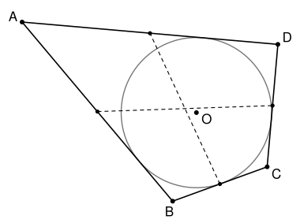

## Statement

Un cercle de centre $O$ est inscrit dans un quadrilatère $ABCD$ : il est tangent aux quatre côtés. On suppose que le quadrilatère n'a pas deux côtés parallèles.

On appelle *ligne médiane* du quadrilatère une droite qui joint les milieux de deux côtés opposés. Le quadrilatère a donc deux lignes médianes.

Montrer que le point $O$ est le point d'intersection des deux lignes médianes si et seulement si
$$OA \times OC = OB \times OD .$$

## Hints

1. Note $2\alpha$, $2\beta$, $2\gamma$, $2\delta$ les angles du quadrilatère en $A$, $B$, $C$, $D$. Les droites $(OA)$, $(OB)$, $(OC)$, $(OD)$ sont des bissectrices. Montre que $\widehat{AOB} + \widehat{COD} = 180°$.
2. Les milieux des quatre côtés forment un parallélogramme. Où se coupent ses diagonales ?
3. Sens « si » : soit $I$ le milieu de $[AB]$ et $K$ le symétrique de $O$ par rapport à $I$. Compare le triangle $BOK$ et le triangle $OCD$.
4. Sens « seulement si » : soit $P$ le point où se coupent les droites $(AB)$ et $(CD)$, et $J$ le milieu de $[CD]$. Si $O$ est le milieu de $[IJ]$, que dire du triangle $IPJ$ ? Cherche ensuite deux paires de triangles semblables.

## Solution

**Rappel : triangles semblables.** Deux triangles $XYZ$ et $X'Y'Z'$ sont semblables (dans cet ordre) quand $\widehat{X} = \widehat{X'}$, $\widehat{Y} = \widehat{Y'}$ et $\widehat{Z} = \widehat{Z'}$. Leurs côtés sont alors proportionnels :
$$\frac{X'Y'}{XY} = \frac{Y'Z'}{YZ} = \frac{Z'X'}{ZX} .$$
On utilisera deux façons de le reconnaître.

- **Deux angles égaux.** Si $\widehat{X} = \widehat{X'}$ et $\widehat{Y} = \widehat{Y'}$, le troisième angle est égal lui aussi, car la somme vaut $180°$.
- **Un angle égal entre deux côtés proportionnels.** Si $\widehat{X} = \widehat{X'}$ et $\dfrac{X'Y'}{XY} = \dfrac{X'Z'}{XZ}$, les triangles sont semblables.

Pour le voir, on pose une copie $X''Y''Z''$ du triangle $X'Y'Z'$ avec $X''$ en $X$, $Y''$ sur la demi-droite $[XY)$ et $Z''$ sur la demi-droite $[XZ)$. Dans le premier cas, les droites $(Y''Z'')$ et $(YZ)$ font le même angle avec $(XY)$, donc elles sont parallèles, et le théorème de Thalès donne les rapports. Dans le second cas, $\dfrac{XY''}{XY} = \dfrac{XZ''}{XZ}$, la réciproque du théorème de Thalès donne $(Y''Z'') \parallel (YZ)$, donc les angles sont égaux.

**Les notations.** On note $I$, $M$, $J$, $N$ les milieux de $[AB]$, $[BC]$, $[CD]$, $[DA]$. Les deux lignes médianes sont $(IJ)$ et $(MN)$. On note $2\alpha$, $2\beta$, $2\gamma$, $2\delta$ les angles du quadrilatère en $A$, $B$, $C$, $D$. Le quadrilatère est convexe, donc
$$2\alpha + 2\beta + 2\gamma + 2\delta = 360° , \qquad \text{c'est-à-dire} \qquad \alpha + \beta + \gamma + \delta = 180° .$$

### Étape 1 : deux faits sur la figure

**Les bissectrices.** Le cercle est tangent aux côtés $[AB]$ et $[AD]$, donc son centre $O$ est à la même distance des droites $(AB)$ et $(AD)$, à l'intérieur de l'angle $\widehat{DAB}$. Comme pour le cercle inscrit dans un triangle, $O$ est sur la bissectrice de cet angle : $\widehat{OAB} = \widehat{OAD} = \alpha$. De même, $\widehat{OBA} = \widehat{OBC} = \beta$, $\widehat{OCB} = \widehat{OCD} = \gamma$ et $\widehat{ODC} = \widehat{ODA} = \delta$.

Dans le triangle $AOB$, on a donc $\widehat{AOB} = 180° - \alpha - \beta$, et dans le triangle $COD$, $\widehat{COD} = 180° - \gamma - \delta$. En additionnant :
$$\widehat{AOB} + \widehat{COD} = 360° - (\alpha + \beta + \gamma + \delta) = 180° . \qquad (1)$$

**Les milieux.** D'après le théorème des milieux, $\overrightarrow{IM} = \dfrac{1}{2}\overrightarrow{AC}$ et $\overrightarrow{NJ} = \dfrac{1}{2}\overrightarrow{AC}$. Donc $\overrightarrow{IM} = \overrightarrow{NJ}$ et $IMJN$ est un parallélogramme. Il n'est pas aplati, car ses côtés sont parallèles aux diagonales $(AC)$ et $(BD)$ du quadrilatère, qui se coupent. Ses diagonales $[IJ]$ et $[MN]$ se coupent en leur milieu commun. Ainsi :

> les deux lignes médianes se coupent en un seul point, qui est à la fois le milieu de $[IJ]$ et le milieu de $[MN]$.

### Étape 2 : si $OA \times OC = OB \times OD$, alors $O$ est sur les deux lignes médianes

On suppose $OA \times OC = OB \times OD$, c'est-à-dire
$$\frac{OB}{OC} = \frac{OA}{OD} . \qquad (2)$$

Soit $K$ le symétrique de $O$ par rapport à $I$. Les segments $[AB]$ et $[OK]$ ont le même milieu $I$, donc $OAKB$ est un parallélogramme : $\overrightarrow{BK} = \overrightarrow{OA}$. En particulier $BK = OA$, et les angles consécutifs $\widehat{OBK}$ et $\widehat{AOB}$ du parallélogramme ont pour somme $180°$. Avec (1), on obtient $\widehat{OBK} = \widehat{COD}$.

**Les triangles $BOK$ et $OCD$ sont semblables**, avec $B$ en face de $O$, $O$ en face de $C$ et $K$ en face de $D$. En effet, l'angle en $B$ du premier est égal à l'angle en $O$ du second, et d'après (2) :
$$\frac{BO}{OC} = \frac{OA}{OD} = \frac{BK}{OD} .$$
On note $k = \dfrac{BO}{OC}$ ce rapport. On en tire $\widehat{BOK} = \widehat{OCD}$ et $\dfrac{OK}{CD} = k$.

**Les triangles $BOI$ et $OCJ$ sont semblables**, dans cet ordre. Le point $I$ est sur le segment $[OK]$ et $J$ sur le segment $[CD]$, donc $\widehat{BOI} = \widehat{BOK} = \widehat{OCD} = \widehat{OCJ}$. De plus,
$$\frac{BO}{OC} = k \qquad \text{et} \qquad \frac{OI}{CJ} = \frac{OK/2}{CD/2} = k .$$
On a donc un angle égal entre deux côtés proportionnels. On en déduit l'égalité des autres angles, $\widehat{OBI} = \widehat{COJ}$.

**$O$ est sur la droite $(IJ)$.** Le point $I$ est sur $[BA]$ et $J$ sur $[CD]$. Avec les bissectrices de l'étape 1, on obtient
$$\widehat{IOB} = \widehat{OCJ} = \widehat{OCD} = \gamma \qquad \text{et} \qquad \widehat{COJ} = \widehat{OBI} = \widehat{OBA} = \beta .$$
Or, dans le triangle $OBC$, $\widehat{BOC} = 180° - \beta - \gamma$. Donc
$$\widehat{IOB} + \widehat{BOC} + \widehat{COJ} = \gamma + (180° - \beta - \gamma) + \beta = 180° .$$
Le point $O$ est à l'intérieur du quadrilatère. En tournant autour de $O$, on rencontre dans l'ordre les demi-droites $[OI)$, $[OB)$, $[OC)$, $[OJ)$, et les trois angles ci-dessus sont côte à côte. Leur somme vaut $180°$, donc $[OI)$ et $[OJ)$ sont deux demi-droites opposées : $O$ est sur le segment $[IJ]$.

**$O$ est aussi sur $(MN)$.** On refait le même raisonnement en nommant le quadrilatère $BCDA$ au lieu de $ABCD$. L'hypothèse devient $OB \times OD = OC \times OA$, qui est la même. La ligne médiane obtenue joint les milieux de $[BC]$ et de $[DA]$ : c'est $(MN)$.

Le point $O$ est sur les deux lignes médianes. D'après l'étape 1, elles n'ont qu'un point commun, donc $O$ est leur point d'intersection.

### Étape 3 : si $O$ est le point d'intersection des lignes médianes, alors $OA \times OC = OB \times OD$

On suppose maintenant que $O$ est le point d'intersection des lignes médianes. D'après l'étape 1, **$O$ est le milieu de $[IJ]$**.

Les droites $(AB)$ et $(CD)$ ne sont pas parallèles. Elles se coupent en un point $P$, situé soit au-delà de $B$ et de $C$, soit au-delà de $A$ et de $D$. On peut échanger les noms $A \leftrightarrow B$ et $C \leftrightarrow D$ : le quadrilatère, ses lignes médianes et l'égalité à démontrer ne changent pas. On peut donc supposer que les points sont dans l'ordre $A, I, B, P$ sur la droite $(AB)$, et $D, J, C, P$ sur la droite $(CD)$.

**Le triangle $IPJ$ est isocèle en $P$.** Le cercle est tangent aux droites $(PA)$ et $(PD)$, et $O$ est à l'intérieur de l'angle $\widehat{IPJ}$. Donc $(PO)$ est la bissectrice de cet angle. Elle passe aussi par le milieu $O$ de $[IJ]$. Soit $Q$ le symétrique de $P$ par rapport à $O$. Les segments $[IJ]$ et $[PQ]$ ont le même milieu, donc $IPJQ$ est un parallélogramme. Les droites $(IQ)$ et $(PJ)$ sont parallèles, et la droite $(PQ)$ les coupe, avec $I$ et $J$ de part et d'autre. Les angles alternes-internes sont égaux : $\widehat{IQP} = \widehat{QPJ}$. Comme $(PQ)$ est la bissectrice, $\widehat{QPJ} = \widehat{IPQ}$. Le triangle $IPQ$ a donc deux angles égaux, en $P$ et en $Q$, et il est isocèle en $I$ : $IP = IQ$. Comme $IQ = PJ$ dans le parallélogramme, on obtient $IP = JP$.

**Calcul d'angles.** Dans le triangle $PBC$, $\widehat{PBC} = 180° - 2\beta$ et $\widehat{PCB} = 180° - 2\gamma$, donc
$$\widehat{BPC} = 2\beta + 2\gamma - 180° .$$
Le triangle $IPJ$ est isocèle en $P$, et $\widehat{IPJ} = \widehat{BPC}$, donc
$$\widehat{PIJ} = \widehat{PJI} = \frac{180° - \widehat{BPC}}{2} = 180° - \beta - \gamma .$$
Le point $O$ est sur $[IJ]$, $B$ est sur $[IP]$ et $C$ est sur $[JP]$. Donc $\widehat{BIO} = \widehat{PIJ}$ et $\widehat{CJO} = \widehat{PJI}$, et ces deux angles valent $180° - \beta - \gamma$.

**Les triangles $IOB$ et $JCO$ sont semblables**, dans cet ordre. On vient de voir que $\widehat{BIO} = \widehat{CJO}$. Dans le triangle $IOB$, $\widehat{IBO} = \widehat{ABO} = \beta$, donc
$$\widehat{IOB} = 180° - (180° - \beta - \gamma) - \beta = \gamma = \widehat{DCO} = \widehat{JCO} .$$
Les deux triangles ont deux angles égaux. On en tire
$$\frac{OB}{CO} = \frac{IB}{JO} .$$

**Les triangles $IOA$ et $JDO$ sont semblables**, dans cet ordre. Les angles $\widehat{AIO}$ et $\widehat{DJO}$ valent tous les deux $180° - (180° - \beta - \gamma) = \beta + \gamma$. Dans le triangle $IOA$, $\widehat{IAO} = \widehat{BAO} = \alpha$, donc
$$\widehat{IOA} = 180° - (\beta + \gamma) - \alpha = \delta = \widehat{CDO} = \widehat{JDO} .$$
Les deux triangles ont deux angles égaux. On en tire
$$\frac{OA}{DO} = \frac{IA}{JO} .$$

Comme $I$ est le milieu de $[AB]$, $IA = IB$. Les deux rapports sont donc égaux :
$$\frac{OA}{OD} = \frac{OB}{OC} , \qquad \text{donc} \qquad OA \times OC = OB \times OD .$$

**Conclusion.** Le centre $O$ du cercle inscrit est le point d'intersection des deux lignes médianes si et seulement si $OA \times OC = OB \times OD$.

## Going further

- L'hypothèse « pas de côtés parallèles » sert seulement à l'étape 3, pour avoir le point $P$. Elle est nécessaire. Dans un losange qui n'est pas un carré, le cercle inscrit a pour centre le centre du losange, qui est aussi le point d'intersection des lignes médianes, et pourtant $OA \times OC = OA^2$ n'est pas égal à $OB \times OD = OB^2$.
- D'après l'étape 1, le point d'intersection des lignes médianes est l'isobarycentre $G$ des quatre sommets : $\overrightarrow{OG} = \frac{1}{4}\left(\overrightarrow{OA} + \overrightarrow{OB} + \overrightarrow{OC} + \overrightarrow{OD}\right)$. L'exercice dit donc que $\overrightarrow{OA} + \overrightarrow{OB} + \overrightarrow{OC} + \overrightarrow{OD} = \vec{0}$ exactement quand $OA \times OC = OB \times OD$.
- Le corrigé donne aussi une solution par les nombres complexes. On prend le cercle de centre $0$ et de rayon $1$, et on note $u$, $v$, $w$, $x$ les affixes des points de contact avec $(AB)$, $(BC)$, $(CD)$, $(DA)$. La droite $(AB)$ a pour équation $z + u^2\,\overline{z} = 2u$, et on en tire $a = \dfrac{2ux}{u + x}$, $b = \dfrac{2uv}{u + v}$, et ainsi de suite. Les deux conditions de l'énoncé se traduisent alors par des égalités entre ces quatre nombres. Les calculs sont longs mais n'ont rien de difficile.
