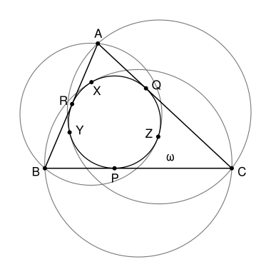

## Statement

Soit $ABC$ un triangle et $\omega$ son cercle inscrit. On note $P$, $Q$, $R$ les points de contact de $\omega$ avec les droites $(BC)$, $(CA)$ et $(AB)$. Un cercle passant par $B$ et $C$ est tangent à $\omega$ en $X$, un cercle passant par $C$ et $A$ est tangent à $\omega$ en $Y$, et un cercle passant par $A$ et $B$ est tangent à $\omega$ en $Z$.

Montrer que les droites $(PX)$, $(QY)$ et $(RZ)$ sont concourantes.

## Hints

1. On note $\Gamma_A$ le cercle qui passe par $B$ et $C$ et touche $\omega$ en $X$. Supposons que la tangente commune à $\omega$ et $\Gamma_A$ en $X$ coupe la droite $(BC)$ en un point $A_0$. Compare les longueurs $A_0X$ et $A_0P$, puis le produit $A_0B \times A_0C$.
2. La puissance d'un point $M$ par rapport à un cercle de centre $K$ et de rayon $\rho$ est le nombre $MK^2 - \rho^2$. Montre que $A_0$ a la même puissance par rapport à $\omega$ et par rapport au cercle circonscrit au triangle.
3. Note $I$ le centre et $r$ le rayon de $\omega$. Montre que la droite $(PX)$ est l'ensemble des points $N$ tels que $\overrightarrow{IA_0} \cdot \overrightarrow{IN} = r^2$.
4. Les points qui ont la même puissance par rapport aux deux cercles forment une droite perpendiculaire à $(OI)$, où $O$ est le centre du cercle circonscrit. Cherche un point $W$ de $(OI)$ tel que $\overrightarrow{IM} \cdot \overrightarrow{IW} = r^2$ pour tous les points $M$ de cette droite.

## Solution

**Rappel : la puissance d'un point par rapport à un cercle.** Soit $\Gamma$ un cercle de centre $K$ et de rayon $\rho$, et $M$ un point. Le nombre $p_\Gamma(M) = MK^2 - \rho^2$ s'appelle la puissance de $M$ par rapport à $\Gamma$. Si une droite passant par $M$ coupe $\Gamma$ en $U$ et $V$, alors
$$\overrightarrow{MU} \cdot \overrightarrow{MV} = p_\Gamma(M) .$$
En effet, soit $H$ le milieu de $[UV]$, de sorte que $(KH)$ est perpendiculaire à $(UV)$. Alors $\overrightarrow{HV} = -\overrightarrow{HU}$ et
$$\overrightarrow{MU} \cdot \overrightarrow{MV} = \left(\overrightarrow{MH} + \overrightarrow{HU}\right) \cdot \left(\overrightarrow{MH} - \overrightarrow{HU}\right) = MH^2 - HU^2 = (MK^2 - KH^2) - (\rho^2 - KH^2) ,$$
d'après le théorème de Pythagore dans les triangles $MHK$ et $UHK$. Si la droite $(MT)$ est tangente à $\Gamma$ en $T$, le triangle $MTK$ est rectangle en $T$ et $MT^2 = MK^2 - \rho^2 = p_\Gamma(M)$.

**Notations.** On note $\Omega$ le cercle circonscrit, $O$ son centre et $R$ son rayon, $I$ le centre et $r$ le rayon de $\omega$. On note $\Gamma_A$ le cercle qui passe par $B$ et $C$ et touche $\omega$ en $X$, et $K_A$ son centre. Le point $X$ est différent de $P$ : en effet, la droite $(BC)$ coupe $\Gamma_A$ seulement en $B$ et $C$, et $P$ est strictement entre $B$ et $C$.

Les deux cercles $\omega$ et $\Gamma_A$ ont en $X$ une tangente commune $t$. Deux cas sont possibles.

### Étape 1 : la tangente $t$ coupe $(BC)$ en un point $A_0$

La droite $t$ est tangente à $\omega$ en $X$, et la droite $(BC)$ est tangente à $\omega$ en $P$. D'après le rappel,
$$p_\omega(A_0) = A_0X^2 = A_0P^2 .$$
La droite $t$ est aussi tangente à $\Gamma_A$ en $X$, et la droite $(BC)$ coupe $\Gamma_A$ en $B$ et $C$, donc
$$A_0X^2 = p_{\Gamma_A}(A_0) = \overrightarrow{A_0B} \cdot \overrightarrow{A_0C} .$$
Enfin, $(BC)$ coupe aussi $\Omega$ en $B$ et $C$, donc $p_\Omega(A_0) = \overrightarrow{A_0B} \cdot \overrightarrow{A_0C}$. En réunissant ces égalités,
$$p_\Omega(A_0) = p_\omega(A_0) . \qquad (1)$$

Montrons maintenant que la droite $(PX)$ est l'ensemble $D$ des points $N$ tels que $\overrightarrow{IA_0} \cdot \overrightarrow{IN} = r^2$. Le point $A_0$ est sur $(BC)$, donc il est différent de $I$. Dans un repère orthonormé d'origine $I$, si $A_0$ a pour coordonnées $(u\,;\,v)$, l'ensemble $D$ a pour équation $ux + vy = r^2$ avec $(u\,;\,v) \neq (0\,;\,0)$ : c'est une droite. Le point $P$ est dans $D$, car la tangente $(A_0P)$ est perpendiculaire au rayon $[IP]$ :
$$\overrightarrow{IA_0} \cdot \overrightarrow{IP} = \left(\overrightarrow{IP} + \overrightarrow{PA_0}\right) \cdot \overrightarrow{IP} = IP^2 + 0 = r^2 .$$
Le même calcul montre que $X$ est dans $D$. Comme $X \neq P$, on a $D = (PX)$ :
$$(PX) = \left\{ N : \overrightarrow{IA_0} \cdot \overrightarrow{IN} = r^2 \right\} . \qquad (2)$$

### Étape 2 : la tangente $t$ est parallèle à $(BC)$

Les tangentes à $\omega$ en $X$ et en $P$ sont parallèles. Les rayons $[IX]$ et $[IP]$ leur sont perpendiculaires, donc $X$ est sur la perpendiculaire à $(BC)$ passant par $I$. Comme $X \neq P$, le point $X$ est diamétralement opposé à $P$ sur $\omega$. Ainsi $(PX)$ est perpendiculaire à $(BC)$ et passe par $I$, le milieu de $[PX]$.

D'autre part, le rayon $[K_AX]$ de $\Gamma_A$ est perpendiculaire à $t$, donc à $(BC)$. Le centre $K_A$ est sur la médiatrice $m$ de $[BC]$, qui est aussi perpendiculaire à $(BC)$. Donc la droite $(K_AX)$ est la droite $m$, et $X$ est sur $m$. La droite $(PX)$, perpendiculaire à $(BC)$ et passant par $X$, est donc la médiatrice $m$. En résumé :
$$(PX) \text{ est la médiatrice de } [BC], \text{ et elle passe par } O \text{ et par } I . \qquad (3)$$

Les mêmes conclusions valent pour $(QY)$ avec un point $B_0$ sur $(CA)$, et pour $(RZ)$ avec un point $C_0$ sur $(AB)$.

### Étape 3 : le cas où $O = I$

On a alors, pour tout point $M$, $p_\Omega(M) - p_\omega(M) = MO^2 - R^2 - MI^2 + r^2 = r^2 - R^2$, qui n'est pas nul car $r < R$. L'égalité (1) est donc impossible, et seul le cas de l'étape 2 peut se produire. D'après (3), les trois droites $(PX)$, $(QY)$, $(RZ)$ passent par $O$ : elles sont concourantes.

### Étape 4 : le cas où $O \neq I$, la droite $\ell$

On prend un repère orthonormé d'origine $I$ dont l'axe des abscisses est la droite $(IO)$, et on note $O(d\,;\,0)$ avec $d = OI > 0$. Pour un point $M(x\,;\,y)$,
$$p_\Omega(M) - p_\omega(M) = (x - d)^2 + y^2 - R^2 - x^2 - y^2 + r^2 = -2dx + d^2 - R^2 + r^2 .$$
Les points qui ont la même puissance par rapport aux deux cercles forment donc la droite $\ell$ d'équation $x = x_0$, avec
$$x_0 = \frac{d^2 - R^2 + r^2}{2d} .$$

**Le nombre $x_0$ n'est pas nul.** Le cercle $\omega$ est à l'intérieur du triangle, et le triangle est à l'intérieur du disque limité par $\Omega$. Le cercle $\omega$ ne touche pas $\Omega$, car il ne passe par aucun sommet. Le point de $\omega$ le plus éloigné de $O$ est à la distance $d + r$ de $O$, donc $d + r < R$. On en déduit $R^2 > (d + r)^2 > d^2 + r^2$, et donc $x_0 < 0$.

**Le point $W$.** Soit $W$ le point de coordonnées $\left(\dfrac{r^2}{x_0}\,;\,0\right)$, sur la droite $(OI)$. Pour tout point $M(x_0\,;\,y)$ de $\ell$,
$$\overrightarrow{IM} \cdot \overrightarrow{IW} = x_0 \times \frac{r^2}{x_0} + y \times 0 = r^2 . \qquad (4)$$
Sur la figure, $F(x_0\,;\,0)$ est le pied de la perpendiculaire menée de $I$ à $\ell$. Le point $W$ est sur la demi-droite $[IF)$, et $IF \times IW = r^2$.

### Étape 5 : conclusion quand $O \neq I$

Considérons la droite $(PX)$.

- Si on est dans le cas de l'étape 1, l'égalité (1) dit que $A_0$ est sur $\ell$. D'après (4), $\overrightarrow{IA_0} \cdot \overrightarrow{IW} = r^2$, et d'après (2), le point $W$ est sur $(PX)$.
- Si on est dans le cas de l'étape 2, d'après (3), la droite $(PX)$ passe par $O$ et $I$, qui sont distincts : c'est la droite $(OI)$, qui contient $W$.

Dans les deux cas, $W$ est sur $(PX)$. Le même raisonnement montre que $W$ est sur $(QY)$ et sur $(RZ)$.

**Conclusion.** Les droites $(PX)$, $(QY)$ et $(RZ)$ sont concourantes. Leur point commun est sur la droite $(OI)$ qui joint les centres des cercles inscrit et circonscrit (ou c'est le centre lui-même si le triangle est équilatéral).

## Going further

- Les mots du corrigé : la droite $\ell$ s'appelle l'**axe radical** des cercles $\Omega$ et $\omega$, la droite (2) est la **polaire** de $A_0$ par rapport à $\omega$, et $W$ est le **pôle** de $\ell$. L'étape 5 est un cas du théorème de La Hire : quand un point décrit une droite, sa polaire passe par un point fixe, le pôle de cette droite.
- On a aussi montré que les points $A_0$, $B_0$, $C_0$, quand ils existent, sont alignés sur $\ell$.
- Le cas de l'étape 2 se produit exactement quand $AB = AC$. Le corrigé ne le traite pas.
