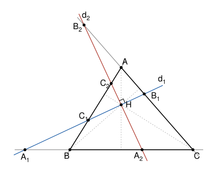

## Statement

Soit $ABC$ un triangle sans angle droit, et $H$ son orthocentre. Soient $d_1$ et $d_2$ deux droites perpendiculaires qui se coupent en $H$, et dont aucune n'est parallèle à un côté du triangle.

On note $A_1$, $B_1$ et $C_1$ les points d'intersection de $d_1$ avec les droites $(BC)$, $(CA)$ et $(AB)$, et $A_2$, $B_2$ et $C_2$ les points d'intersection de $d_2$ avec ces mêmes droites.

On se place dans le plan complexe, et on note $z_X$ l'affixe d'un point $X$. On se donne un nombre complexe $\zeta$, et on place les points $A_3$, $B_3$ et $C_3$ tels que
$$z_{A_3} - z_{A_1} = \zeta\,(z_{A_2} - z_{A_1}), \qquad z_{B_3} - z_{B_1} = \zeta\,(z_{B_2} - z_{B_1}), \qquad z_{C_3} - z_{C_1} = \zeta\,(z_{C_2} - z_{C_1}) .$$
Si $\zeta = r\,e^{i\theta}$ avec $r > 0$, on obtient le vecteur $\overrightarrow{A_1A_3}$ en tournant le vecteur $\overrightarrow{A_1A_2}$ d'un angle $\theta$, puis en multipliant sa longueur par $r$, et de même pour les deux autres. Les triangles $A_1A_2A_3$, $B_1B_2B_3$ et $C_1C_2C_3$ ont donc la même forme et le même sens : on dit qu'ils sont **directement semblables**.

Montrer que les points $A_3$, $B_3$ et $C_3$ sont alignés.

## Hints

1. Prends un repère orthonormé d'origine $H$ dont les axes sont $d_1$ et $d_2$. Note $A_1(p_A\,;\,0)$ et $A_2(0\,;\,q_A)$, puis de même $B_1(p_B\,;\,0)$, $B_2(0\,;\,q_B)$, $C_1(p_C\,;\,0)$ et $C_2(0\,;\,q_C)$. Vérifie que la droite $(BC)$ a pour équation
$$\frac{x}{p_A} + \frac{y}{q_A} = 1 .$$
2. Le vecteur $\vec n_A$ de coordonnées $(1/p_A\,;\,1/q_A)$ est normal à $(BC)$, et la hauteur issue de $A$ passe par $H$. Écris $\overrightarrow{HA} = t_A\,\vec n_A$, puis utilise que $A$ est sur $(CA)$ et sur $(AB)$. Tu dois trouver $\vec n_A \cdot \vec n_B = \vec n_A \cdot \vec n_C$.
3. Montre que les trois points $W_A(p_A\,;\,q_A)$, $W_B(p_B\,;\,q_B)$ et $W_C(p_C\,;\,q_C)$ sont alignés, en calculant un déterminant.
4. Calcule l'affixe de $A_3$ à l'aide de $p_A$, $q_A$ et $\zeta$. Le reste suit de l'indication 3.

## Solution

**Rappels.**

- Dans un repère orthonormé, si $(u\,;\,v) \neq (0\,;\,0)$, l'ensemble des points $M(x\,;\,y)$ tels que $ux + vy = 1$ est une droite, et le vecteur $\vec n(u\,;\,v)$ lui est perpendiculaire.
- Pour deux vecteurs $\vec a(x\,;\,y)$ et $\vec b(x'\,;\,y')$, on pose $\det(\vec a, \vec b) = xy' - x'y$. Les deux vecteurs sont colinéaires si et seulement si ce déterminant est nul.

### Étape 1 : où sont les points

**Le point $H$ n'est pas un sommet.** Si $H = A$, la hauteur issue de $B$ passe par $A$ : c'est la droite $(BA)$, et elle est perpendiculaire à $(AC)$. Le triangle serait rectangle en $A$, ce qui est exclu. De même pour $B$ et $C$.

**Le point $H$ n'est sur aucun des côtés.** Si $H$ est sur la droite $(BC)$, la hauteur issue de $B$ est la droite $(BH)$, c'est-à-dire $(BC)$ puisque $H \neq B$. Elle est perpendiculaire à $(CA)$, et le triangle serait rectangle en $C$. C'est exclu. De même pour les deux autres côtés.

Les six points $A_1, \ldots, C_2$ existent, car $d_1$ et $d_2$ ne sont parallèles à aucun côté, et ils sont tous différents de $H$, car $H$ n'est sur aucun côté.

### Étape 2 : un repère et les équations des côtés

Soit $h$ l'affixe de $H$ et $\omega$ un nombre complexe de module $1$ qui dirige la droite $d_1$. Le nombre $i\omega$ dirige alors la droite $d_2$, qui est perpendiculaire à $d_1$. On utilise le repère orthonormé d'origine $H$, dont le premier vecteur a pour affixe $\omega$ et le second pour affixe $i\omega$. Le point de coordonnées $(x\,;\,y)$ dans ce repère a pour affixe
$$h + x\,\omega + y\,i\omega = h + (x + iy)\,\omega .$$
L'axe des abscisses est $d_1$, et l'axe des ordonnées est $d_2$. On peut donc écrire
$$A_1(p_A\,;\,0), \quad A_2(0\,;\,q_A), \quad B_1(p_B\,;\,0), \quad B_2(0\,;\,q_B), \quad C_1(p_C\,;\,0), \quad C_2(0\,;\,q_C),$$
et les six nombres $p_A, q_A, \ldots, q_C$ sont différents de $0$ d'après l'étape 1. On pose
$$u_A = \frac{1}{p_A}, \qquad v_A = \frac{1}{q_A},$$
et de même $u_B$, $v_B$, $u_C$, $v_C$. Ces six nombres ne sont pas nuls.

Les points $A_1$ et $A_2$ vérifient l'équation $u_A x + v_A y = 1$, et ils sont distincts. Cette équation est donc celle de la droite $(BC)$. De la même façon :
$$(BC) : u_A x + v_A y = 1, \qquad (CA) : u_B x + v_B y = 1, \qquad (AB) : u_C x + v_C y = 1 .$$
On note $\vec n_A(u_A\,;\,v_A)$, $\vec n_B(u_B\,;\,v_B)$ et $\vec n_C(u_C\,;\,v_C)$. D'après le rappel, $\vec n_A$ est perpendiculaire à $(BC)$, $\vec n_B$ à $(CA)$ et $\vec n_C$ à $(AB)$.

### Étape 3 : ce que dit l'orthocentre

La hauteur issue de $A$ passe par $H$ et elle est perpendiculaire à $(BC)$, donc elle est dirigée par $\vec n_A$. Il existe un réel $t_A$ tel que $\overrightarrow{HA} = t_A\,\vec n_A$, c'est-à-dire $A(t_A u_A\,;\,t_A v_A)$. Comme $A \neq H$, on a $t_A \neq 0$.

Le point $A$ est sur la droite $(CA)$ et sur la droite $(AB)$. Leurs équations donnent
$$t_A\,(u_B u_A + v_B v_A) = 1 \qquad \text{et} \qquad t_A\,(u_C u_A + v_C v_A) = 1,$$
c'est-à-dire $t_A\,(\vec n_A \cdot \vec n_B) = 1 = t_A\,(\vec n_A \cdot \vec n_C)$. On divise par $t_A$ : $\vec n_A \cdot \vec n_B = \vec n_A \cdot \vec n_C$.

Le même raisonnement avec la hauteur issue de $B$ donne $\vec n_B \cdot \vec n_A = \vec n_B \cdot \vec n_C$. Les trois produits scalaires sont donc égaux :
$$\vec n_A \cdot \vec n_B = \vec n_B \cdot \vec n_C = \vec n_C \cdot \vec n_A .$$
On en garde deux conséquences. De $\vec n_C \cdot \vec n_A = \vec n_C \cdot \vec n_B$ et de $\vec n_B \cdot \vec n_A = \vec n_B \cdot \vec n_C$, on tire
$$(1) \qquad u_C\,(u_A - u_B) = -v_C\,(v_A - v_B),$$
$$(2) \qquad u_B\,(u_A - u_C) = -v_B\,(v_A - v_C).$$

### Étape 4 : trois points alignés

On considère les points $W_A(p_A\,;\,q_A)$, $W_B(p_B\,;\,q_B)$ et $W_C(p_C\,;\,q_C)$. Le point $W_A$ est le quatrième sommet du rectangle $HA_1W_AA_2$. On a
$$p_B - p_A = \frac{1}{u_B} - \frac{1}{u_A} = \frac{u_A - u_B}{u_A u_B},$$
et de même pour les autres coordonnées. Ainsi
$$\overrightarrow{W_AW_B}\left(\frac{u_A - u_B}{u_A u_B}\,;\,\frac{v_A - v_B}{v_A v_B}\right), \qquad \overrightarrow{W_AW_C}\left(\frac{u_A - u_C}{u_A u_C}\,;\,\frac{v_A - v_C}{v_A v_C}\right).$$
Soit $D = \det(\overrightarrow{W_AW_B}, \overrightarrow{W_AW_C})$. Alors
$$D = \frac{(u_A - u_B)(v_A - v_C)}{u_A u_B v_A v_C} - \frac{(u_A - u_C)(v_A - v_B)}{u_A u_C v_A v_B} .$$
On multiplie par le nombre non nul $K = u_A u_B u_C v_A v_B v_C$, et on regroupe les facteurs :
$$K D = u_C(u_A - u_B) \times v_B(v_A - v_C) - u_B(u_A - u_C) \times v_C(v_A - v_B) .$$
D'après (1) et (2), on remplace $u_C(u_A - u_B)$ par $-v_C(v_A - v_B)$, et $u_B(u_A - u_C)$ par $-v_B(v_A - v_C)$ :
$$K D = -v_C(v_A - v_B) \times v_B(v_A - v_C) + v_B(v_A - v_C) \times v_C(v_A - v_B) = 0 .$$
Donc $D = 0$ : les vecteurs $\overrightarrow{W_AW_B}$ et $\overrightarrow{W_AW_C}$ sont colinéaires.

De plus $W_A \neq W_B$. Sinon $p_A = p_B$ et $q_A = q_B$, et les droites $(BC)$ et $(CA)$ auraient la même équation, ce qui est impossible. Il existe donc un **réel** $s$ tel que $\overrightarrow{W_AW_C} = s\,\overrightarrow{W_AW_B}$, c'est-à-dire
$$p_C - p_A = s\,(p_B - p_A) \qquad \text{et} \qquad q_C - q_A = s\,(q_B - q_A) .$$

### Étape 5 : les points $A_3$, $B_3$ et $C_3$

D'après l'étape 2, $z_{A_1} = h + p_A\,\omega$ et $z_{A_2} = h + i\,q_A\,\omega$. Donc
$$z_{A_3} = z_{A_1} + \zeta\,(z_{A_2} - z_{A_1}) = h + p_A\,\omega + \zeta\,(i\,q_A - p_A)\,\omega = h + \left((1 - \zeta)\,p_A + i\zeta\,q_A\right)\omega .$$
De même
$$z_{B_3} = h + \left((1 - \zeta)\,p_B + i\zeta\,q_B\right)\omega, \qquad z_{C_3} = h + \left((1 - \zeta)\,p_C + i\zeta\,q_C\right)\omega .$$
On fait la différence et on utilise l'étape 4 :
$$z_{C_3} - z_{A_3} = \left((1 - \zeta)(p_C - p_A) + i\zeta\,(q_C - q_A)\right)\omega = s\left((1 - \zeta)(p_B - p_A) + i\zeta\,(q_B - q_A)\right)\omega = s\,(z_{B_3} - z_{A_3}) .$$
Comme $s$ est un nombre réel, cela veut dire que $\overrightarrow{A_3C_3} = s\,\overrightarrow{A_3B_3}$ : les deux vecteurs sont colinéaires. **Les points $A_3$, $B_3$ et $C_3$ sont alignés.**

C'est encore vrai si deux de ces points sont confondus. Par exemple, si $A_3 = B_3$, l'égalité donne aussi $C_3 = A_3$.

## Going further

- Pour $\zeta = 1/2$, le point $A_3$ est le milieu de $[A_1A_2]$. On obtient le théorème de Droz-Farny : les milieux de $[A_1A_2]$, $[B_1B_2]$ et $[C_1C_2]$ sont alignés.
- Pourquoi est-il important que $s$ soit réel à l'étape 5 ? Que se passerait-il si l'on avait seulement $z_{C_3} - z_{A_3} = \lambda\,(z_{B_3} - z_{A_3})$ avec un nombre complexe $\lambda$ quelconque ?
- Si le triangle est rectangle en $A$, alors $H = A$. Que deviennent les points $B_1$, $B_2$, $C_1$, $C_2$, puis $B_3$ et $C_3$ ? Vérifie que la conclusion reste vraie.
- Le corrigé officiel raisonne avec des angles. Il montre que les cercles de diamètres $[A_1A_2]$, $[B_1B_2]$ et $[C_1C_2]$, qui passent tous par $H$, ont un deuxième point commun $M$, situé sur le cercle circonscrit à $ABC$. Les triangles $MA_1A_2$, $MB_1B_2$ et $MC_1C_2$ sont alors directement semblables, et une même similitude de centre $M$ envoie $A_1$ sur $A_3$, $B_1$ sur $B_3$ et $C_1$ sur $C_3$. Comme $A_1$, $B_1$ et $C_1$ sont sur la droite $d_1$, leurs images sont alignées.
