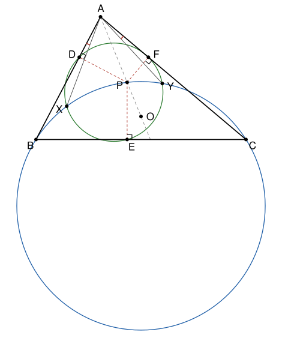

## Statement

Soit $ABC$ un triangle et $O$ le centre de son cercle circonscrit $\Gamma$. Soit $P$ un point de la droite $(AO)$, et $D$, $E$, $F$ les projetés orthogonaux de $P$ sur les droites $(AB)$, $(BC)$ et $(CA)$. On suppose que les triangles $DEF$ et $BCP$ ne sont pas aplatis, et que leurs cercles circonscrits se coupent en deux points $X$ et $Y$.

1. Montrer que les droites $(AX)$ et $(AY)$ sont symétriques par rapport à la bissectrice de l'angle $\widehat{BAC}$.
2. En déduire que, si $P$ est sur la demi-droite $[AO)$ comme sur la figure, alors $\widehat{BAX} = \widehat{YAC}$.

## Hints

1. Soit $A'$ le point diamétralement opposé à $A$ sur $\Gamma$, et $t$ le réel tel que $\overrightarrow{AP} = t\,\overrightarrow{AA'}$. Montre que $\overrightarrow{AD} = t\,\overrightarrow{AB}$ et $\overrightarrow{AF} = t\,\overrightarrow{AC}$.
2. Montre que le pied $H$ de la hauteur issue de $A$ est sur le cercle $(DEF)$. Le cercle de diamètre $[AP]$ passe par $D$ et par $F$ : regarde la médiatrice de $[DF]$.
3. Place $A$ à l'origine et la bissectrice de $\widehat{BAC}$ sur l'axe des réels. Le produit $bc$ est alors un réel positif. Que fait l'application $z \mapsto k/z$, avec $k = t\,bc$, aux points $B$, $C$ et $P$ ?
4. Montre que cette application envoie le cercle $(BCP)$ sur le cercle $(DEF)$, puis qu'elle échange $X$ et $Y$.

## Solution

**Rappel.** On confond un point et son affixe.

- Pour $u \neq 0$, le quotient $v / u = v\,\overline{u} / |u|^2$ est réel exactement quand $v\,\overline{u}$ est réel, et imaginaire pur exactement quand $v\,\overline{u}$ est imaginaire pur. Ainsi, pour deux vecteurs non nuls d'affixes $u$ et $v$, ils sont colinéaires quand $v\,\overline{u}$ est réel, et orthogonaux quand $v\,\overline{u}$ est imaginaire pur.
- Un nombre $w$ est réel quand $\overline{w} = w$, et imaginaire pur quand $\overline{w} = -w$.
- Le cercle de centre $\omega$ et de rayon $r$ est l'ensemble des $z$ tels que $|z - \omega|^2 = r^2$, c'est-à-dire
$$z\,\overline{z} - \overline{\omega}\,z - \omega\,\overline{z} + g = 0, \qquad \text{avec } g = |\omega|^2 - r^2 \text{ réel.}$$
- Par trois points distincts, il passe au plus un cercle.

On note $\Gamma_1$ le cercle $(BCP)$ et $\Gamma_2$ le cercle $(DEF)$. Ils sont différents, puisqu'ils n'ont que deux points communs.

### Étape 1 : le point $A'$ et les cas à écarter

Soit $A'$ le point diamétralement opposé à $A$ sur $\Gamma$. Le point $P$ est sur $(AO) = (AA')$, donc $\overrightarrow{AP} = t\,\overrightarrow{AA'}$ pour un réel $t$.

- $t \neq 0$ : sinon $P = A$, et $D = F = A$, donc le triangle $DEF$ serait aplati.
- $t \neq 1$ : sinon $P = A'$. Or le projeté orthogonal de $A'$ sur $(AB)$ est $B$ : si $B \neq A'$, l'angle $\widehat{ABA'}$ est droit, car $B$ est sur le cercle de diamètre $[AA']$, et si $B = A'$ c'est évident. On aurait donc $D = B$ et, de même, $F = C$, et les trois points $D$, $E$, $F$ seraient sur $(BC)$.
- $A$ n'est pas sur $\Gamma_1$ : sinon $\Gamma_1$ passerait par $A$, $B$ et $C$, donc $\Gamma_1 = \Gamma$, et $P$ serait sur $\Gamma$ et sur $(AA')$, donc $P = A$ ou $P = A'$, ce que l'on vient d'exclure.

### Étape 2 : la droite $(DF)$ est parallèle à $(BC)$

Le projeté orthogonal $D$ de $P$ sur $(AB)$ vérifie
$$\overrightarrow{AD} = \frac{\overrightarrow{AP} \cdot \overrightarrow{AB}}{AB^2}\;\overrightarrow{AB} = t \times \frac{\overrightarrow{AA'} \cdot \overrightarrow{AB}}{AB^2}\;\overrightarrow{AB} = t\,\overrightarrow{AB} ,$$
car la même formule appliquée à $A'$ donne son projeté sur $(AB)$, qui est $B$. De même, $\overrightarrow{AF} = t\,\overrightarrow{AC}$. Ainsi $\overrightarrow{DF} = t\,\overrightarrow{BC}$ : comme $t \neq 0$, on a $D \neq F$ et **$(DF)$ est parallèle à $(BC)$**.

### Étape 3 : le pied $H$ de la hauteur issue de $A$ est sur $\Gamma_2$

Soit $H$ le pied de la hauteur issue de $A$, et $M$ le milieu de $[AP]$. Les angles $\widehat{ADP}$ et $\widehat{AFP}$ sont droits (ou bien $D = P$, ou $F = P$), donc $D$ et $F$ sont sur le cercle de diamètre $[AP]$, de centre $M$. Ainsi $MD = MF$, et $M$ est sur la médiatrice $m$ de $[DF]$. Comme $(DF)$ est parallèle à $(BC)$, la droite $m$ est perpendiculaire à $(BC)$.

Soit $N$ le point où $m$ coupe $(BC)$. Les droites $(AH)$, $(MN)$ et $(PE)$ sont toutes perpendiculaires à $(BC)$, donc parallèles, et $M$ est le milieu de $[AP]$. D'après le théorème de Thalès, $N$ est le milieu de $[HE]$. Si $H \neq E$, la droite $m$ est donc la médiatrice de $[HE]$.

Le centre $\Omega_2$ de $\Gamma_2$ est à égale distance de $D$ et de $F$, donc il est sur $m$. Alors $\Omega_2 H = \Omega_2 E$, qui est le rayon de $\Gamma_2$ : **$H$ est sur $\Gamma_2$** (c'est évident si $H = E$).

Enfin, $D$, $F$ et $H$ sont trois points distincts. On sait que $D \neq F$. Le point $H$ est sur $(BC)$ et $D$ sur $(AB)$ : s'ils étaient égaux, ce serait le point $B$, et $D = B$ donnerait $t = 1$. De même, $H \neq F$.

### Étape 4 : le repère complexe

On place $A$ à l'origine, et l'axe des réels sur la bissectrice de l'angle $\widehat{BAC}$. Les demi-droites $[AB)$ et $[AC)$ sont alors symétriques par rapport à l'axe des réels : si $\alpha$ est la moitié de l'angle $\widehat{BAC}$,
$$b = AB\,e^{i\alpha}, \qquad c = AC\,e^{-i\alpha}, \qquad \text{donc} \qquad bc = AB \times AC \quad \text{est un réel positif.}$$
La symétrie d'axe la bissectrice est l'application $s : z \mapsto \overline{z}$. On note $a'$, $p$, $h$ les affixes de $A'$, $P$, $H$. L'étape 1 donne $p = t\,a'$, et l'étape 2 donne $d = t\,b$ et $f = t\,c$.

**Calcul de $h$.** Le centre $O$ vérifie $|o|^2 = |o - b|^2$, c'est-à-dire $o\,\overline{b} + \overline{o}\,b = b\,\overline{b}$, et de même $o\,\overline{c} + \overline{o}\,c = c\,\overline{c}$. On multiplie la première égalité par $c$, la seconde par $b$, et on soustrait :
$$o\,(\overline{b}\,c - b\,\overline{c}) = bc\,(\overline{b} - \overline{c}) .$$
Le nombre $\overline{b}\,c - b\,\overline{c}$ n'est pas nul : il vaut $2i$ fois la partie imaginaire de $\overline{b}\,c = AB \times AC \times e^{-2i\alpha}$, et $0 < 2\alpha < \pi$. Comme $a' = 2o$, on obtient
$$q = \frac{bc}{a'} = \frac{\overline{b}\,c - b\,\overline{c}}{2\,(\overline{b} - \overline{c})} .$$
On vérifie que $q$ est le point $H$.

- $(q - b)(\overline{b} - \overline{c}) = \tfrac{1}{2}(\overline{b}\,c - b\,\overline{c}) - b\,\overline{b} + b\,\overline{c} = \tfrac{1}{2}(\overline{b}\,c + b\,\overline{c}) - |b|^2$. C'est un réel, car $\overline{b}\,c + b\,\overline{c}$ est égal à son conjugué. D'après le rappel, $(q - b)/(b - c)$ est réel, donc le vecteur qui va de $B$ au point $q$ est colinéaire à $\overrightarrow{CB}$ : **$q$ est sur $(BC)$**.
- $q\,(\overline{b} - \overline{c}) = \tfrac{1}{2}(\overline{b}\,c - b\,\overline{c})$ est imaginaire pur, car son conjugué est son opposé. Comme $q \neq 0$, **$(Aq)$ est perpendiculaire à $(BC)$**.

Le point $q$ est donc le pied de la hauteur issue de $A$ : $h = bc / a'$.

### Étape 5 : l'application $\varphi : z \mapsto k/z$

On pose $k = t\,bc$. C'est un réel non nul, d'après l'étape 1 et l'étape 4. Soit $\varphi(z) = k / z$ pour $z \neq 0$. On a $\varphi(\varphi(z)) = z$, et
$$\varphi(b) = \frac{t\,bc}{b} = tc = f, \qquad \varphi(c) = tb = d, \qquad \varphi(p) = \frac{t\,bc}{t\,a'} = \frac{bc}{a'} = h .$$
**L'application $\varphi$ envoie $B$, $C$, $P$ sur $F$, $D$, $H$.**

Écrivons l'équation de $\Gamma_1$ sous la forme $z\,\overline{z} - \overline{\omega}\,z - \omega\,\overline{z} + g = 0$. En $z = 0$ elle donne $g$, et $A$ n'est pas sur $\Gamma_1$, donc $g \neq 0$.

Soit $z \neq 0$ et $w = \varphi(z)$. Alors $z = k / w$ et $\overline{z} = k / \overline{w}$, puisque $k$ est réel. Le point $z$ est sur $\Gamma_1$ exactement quand
$$\frac{k^2}{w\,\overline{w}} - \frac{\overline{\omega}\,k}{w} - \frac{\omega\,k}{\overline{w}} + g = 0 .$$
On multiplie par $w\,\overline{w} / g$, qui n'est pas nul. Avec $\omega_2 = \overline{\omega}\,k / g$, dont le conjugué est $\omega\,k / g$, et $g_2 = k^2 / g$, cela s'écrit
$$(5) \qquad w\,\overline{w} - \overline{\omega_2}\,w - \omega_2\,\overline{w} + g_2 = 0 .$$
Cette équation s'écrit aussi $|w - \omega_2|^2 = |\omega_2|^2 - g_2$, et
$$|\omega_2|^2 - g_2 = \frac{k^2\,|\omega|^2}{g^2} - \frac{k^2}{g} = \frac{k^2\,(|\omega|^2 - g)}{g^2} = \frac{k^2\,r_1^2}{g^2} > 0 ,$$
où $r_1$ est le rayon de $\Gamma_1$. L'équation $(5)$ est donc celle d'un cercle $\mathcal{C}$, et pour tout $z \neq 0$ :
$$z \in \Gamma_1 \iff \varphi(z) \in \mathcal{C} .$$
Les points $B$, $C$, $P$ sont sur $\Gamma_1$, donc $F$, $D$, $H$ sont sur $\mathcal{C}$. Ces trois points distincts sont aussi sur $\Gamma_2$ d'après l'étape 3. Donc **$\mathcal{C} = \Gamma_2$**, et pour tout $z \neq 0$ :
$$z \in \Gamma_1 \iff \varphi(z) \in \Gamma_2 .$$
En appliquant cela à $\varphi(z)$, et comme $\varphi(\varphi(z)) = z$, on a aussi : $z \in \Gamma_2 \iff \varphi(z) \in \Gamma_1$.

### Étape 6 : l'application $\varphi$ échange $X$ et $Y$

Le point $X$ n'est pas $A$, car $A$ n'est pas sur $\Gamma_1$. Comme $X$ est sur $\Gamma_1$, $\varphi(X)$ est sur $\Gamma_2$, et comme $X$ est sur $\Gamma_2$, $\varphi(X)$ est sur $\Gamma_1$. Donc $\varphi(X)$ est $X$ ou $Y$.

Supposons $\varphi(X) = X$, c'est-à-dire $x^2 = k$, où $x$ est l'affixe de $X$. Alors $\varphi(Y)$ n'est pas $X$, sinon $Y = \varphi(\varphi(Y)) = \varphi(X) = X$. Donc $\varphi(Y) = Y$, l'affixe $y$ vérifie $y^2 = k = x^2$, et $y = -x$. Le cercle $\Gamma_1$ passe par $x$ et par $-x$ :
$$x\,\overline{x} - \overline{\omega}\,x - \omega\,\overline{x} + g = 0 \qquad \text{et} \qquad x\,\overline{x} + \overline{\omega}\,x + \omega\,\overline{x} + g = 0 .$$
En ajoutant, $g = -|x|^2$. En soustrayant, $\overline{\omega}\,x = -\omega\,\overline{x}$. Comme $k = x^2$ est réel, $k^2 = |x|^4$, et
$$g_2 = \frac{k^2}{g} = \frac{|x|^4}{-|x|^2} = -|x|^2 = g, \qquad \omega_2 = \frac{\overline{\omega}\,k}{g} = \frac{\overline{\omega}\,x^2}{-x\,\overline{x}} = -\frac{\overline{\omega}\,x}{\overline{x}} = \frac{\omega\,\overline{x}}{\overline{x}} = \omega .$$
Les cercles $\Gamma_1$ et $\Gamma_2$ auraient la même équation, donc seraient égaux, ce qui est faux. Ainsi **$\varphi(X) = Y$**, c'est-à-dire
$$x\,y = k .$$

### Étape 7 : conclusion

**Question 1.** On a
$$y = \frac{k}{x} = \frac{k}{|x|^2}\;\overline{x} ,$$
et $\tfrac{k}{|x|^2}$ est un réel non nul. Le point $s(X)$, d'affixe $\overline{x}$, est donc sur la droite $(AY)$. La symétrie $s$ envoie la droite $(AX)$, qui passe par $A$ et $X$, sur la droite qui passe par $A$ et $s(X)$, c'est-à-dire sur $(AY)$. **Les droites $(AX)$ et $(AY)$ sont symétriques par rapport à la bissectrice de l'angle $\widehat{BAC}$.**

**Question 2.** Si $P$ est sur la demi-droite $[AO)$, alors $t > 0$, donc $k = t \times AB \times AC > 0$, et le réel $\tfrac{k}{|x|^2}$ est positif : $s(X)$ est sur la demi-droite $[AY)$. La symétrie $s$ envoie la demi-droite $[AB)$ sur $[AC)$ et la demi-droite $[AX)$ sur $[AY)$. Une symétrie conserve les angles, donc **$\widehat{BAX} = \widehat{CAY}$**.

## Going further

- Montre que $AX \times AY = |t| \times AB \times AC$.
- Si $P$ est sur la demi-droite opposée à $[AO)$, montre que $\widehat{BAX} + \widehat{YAC} = 180°$. C'est pourquoi l'énoncé original, qui dit seulement « $P$ sur $(AO)$ », doit être précisé.
- Pour $k > 0$, l'application $z \mapsto k / z$ est la composée de l'inversion de centre $A$ et de rapport $k$, qui envoie $z$ sur $k / \overline{z}$, et de la symétrie d'axe la bissectrice. Le corrigé officiel l'appelle une « involution de centre $A$ », et utilise sans preuve le fait qu'elle envoie un cercle qui ne passe pas par $A$ sur un cercle. L'étape 5 démontre ce fait.
