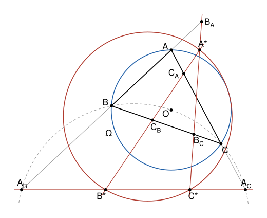

## Statement

Soit $ABC$ un triangle qui n'a pas d'angle droit et qui n'est pas équilatéral. On note $\Omega$ son cercle circonscrit et $O$ le centre de $\Omega$.

Le cercle qui passe par $B$, $O$ et $C$ recoupe la droite $(AB)$ en un point $A_B$ et la droite $(AC)$ en un point $A_C$. On note $\ell_1$ la droite $(A_BA_C)$.

De la même façon, le cercle qui passe par $C$, $O$ et $A$ recoupe $(BC)$ en $B_C$ et $(BA)$ en $B_A$, et l'on note $\ell_2$ la droite $(B_CB_A)$. Le cercle qui passe par $A$, $O$ et $B$ recoupe $(CA)$ en $C_A$ et $(CB)$ en $C_B$, et l'on note $\ell_3$ la droite $(C_AC_B)$.

(Si l'une de ces six droites est tangente au cercle correspondant, on prend pour second point le point de contact.)

Les trois droites $\ell_1$, $\ell_2$, $\ell_3$ forment un triangle $A^*B^*C^*$ : le point $A^*$ est commun à $\ell_2$ et $\ell_3$, le point $B^*$ à $\ell_3$ et $\ell_1$, le point $C^*$ à $\ell_1$ et $\ell_2$.

Montrer que le cercle circonscrit au triangle $A^*B^*C^*$ est tangent au cercle $\Omega$.

## Hints

1. Prends $O$ comme origine et $\Omega$ comme cercle unité. On note $a$, $b$, $c$ les affixes de $A$, $B$, $C$. Comme $|a| = 1$, on a $\overline{a} = 1/a$. Montre qu'un point d'affixe $z$ est sur la droite $(AB)$ exactement quand $z + ab\,\overline{z} = a + b$.
2. Vérifie que le point d'affixe $bc/(b + c)$ est à la même distance de $O$, de $B$ et de $C$. Écris l'équation du cercle $BOC$, puis cherche ses points sur $(AB)$. Tu dois trouver que $A_B$ a pour affixe $c(a + b)/(b + c)$.
3. Montre que $\ell_1$ est perpendiculaire à $(OA)$, et que son équation est $z + a^2\,\overline{z} = (a + b)(a + c)/(b + c)$. Écris de même celles de $\ell_2$ et $\ell_3$, puis calcule l'affixe de $A^*$.
4. On pose $s = ab + bc + ca$ et $P = (a + b)(b + c)(c + a)$. Montre que $A^*$ a pour affixe $(s^2 - b^2c^2)/P$. Quel point est à la même distance de $A^*$, de $B^*$ et de $C^*$ ?
5. Pour comparer la distance des deux centres aux deux rayons, pose $h = a + b + c$. Montre que $s = abc\,\overline{h}$ et que $P = abc\,(|h|^2 - 1)$.

## Solution

**Rappel.**

- *Conjugué.* Pour tout nombre complexe $z$, on a $z\,\overline{z} = |z|^2$. Donc si $|z| = 1$, alors $\overline{z} = 1/z$. Le conjugué d'une somme, d'un produit ou d'un quotient est la somme, le produit ou le quotient des conjugués.
- *Réel, imaginaire pur.* Un nombre complexe $u$ est réel exactement quand $\overline{u} = u$, et imaginaire pur exactement quand $\overline{u} = -u$.
- *Alignement, orthogonalité.* Soit $M$ et $M'$ deux points distincts d'affixes $m$ et $m'$. Un point d'affixe $z$ est sur la droite $(MM')$ exactement quand $(z - m)/(m' - m)$ est réel. Deux vecteurs non nuls d'affixes $u$ et $v$ sont orthogonaux exactement quand $u/v$ est imaginaire pur.
- *Polynôme de degré 2.* Si $z_1$ est une racine de $\alpha z^2 + \beta z + \gamma$, avec $\alpha \neq 0$, ce polynôme s'écrit $\alpha(z - z_1)(z - z_2)$ pour un certain nombre $z_2$, et il n'a pas d'autres racines que $z_1$ et $z_2$. En comparant les termes constants, $\alpha z_1 z_2 = \gamma$.
- *Cercles tangents.* Deux cercles de centres distincts $O$ et $N$, de rayons $r$ et $r'$, sont tangents exactement quand $ON = r + r'$ (ils se touchent de l'extérieur) ou quand $ON = |r - r'|$ (l'un est à l'intérieur de l'autre et le touche).

On prend un repère orthonormé d'origine $O$, avec pour unité le rayon de $\Omega$ : le cercle $\Omega$ est alors le cercle unité. On note $a$, $b$, $c$ les affixes de $A$, $B$, $C$. Ainsi $|a| = |b| = |c| = 1$, et d'après le rappel
$$\overline{a} = \frac{1}{a}, \qquad \overline{b} = \frac{1}{b}, \qquad \overline{c} = \frac{1}{c} .$$
Pour conjuguer une fraction écrite avec $a$, $b$, $c$, il suffit donc de remplacer chaque lettre par son inverse.

Deux remarques avant de commencer.

- $b + c \neq 0$. Sinon $c = -b$, le segment $[BC]$ serait un diamètre de $\Omega$, et l'angle $\widehat{BAC}$ serait droit. De même, $a + b \neq 0$ et $a + c \neq 0$.
- $b^2 \neq c^2$. En effet $b^2 - c^2 = (b - c)(b + c)$, et $b \neq c$. De même, $a^2 \neq b^2$ et $a^2 \neq c^2$.

### Étape 1 : l'équation de la droite $(AB)$

Soit $z$ l'affixe d'un point $Z$, et $u = (z - a)/(b - a)$. D'après le rappel, $Z$ est sur $(AB)$ exactement quand $u$ est réel. En multipliant le numérateur et le dénominateur par $ab$,
$$\overline{u} = \frac{\overline{z} - 1/a}{1/b - 1/a} = \frac{ab\,\overline{z} - b}{a - b} = \frac{b - ab\,\overline{z}}{b - a} .$$
Donc $\overline{u} = u$ exactement quand $z - a = b - ab\,\overline{z}$. Ainsi, un point d'affixe $z$ est sur $(AB)$ exactement quand
$$(1) \qquad z + ab\,\overline{z} = a + b .$$

### Étape 2 : le cercle $BOC$ et le point $A_B$

Soit $W$ le point d'affixe $w = bc/(b + c)$. On a
$$w - b = \frac{bc - b^2 - bc}{b + c} = \frac{-b^2}{b + c}, \qquad w - c = \frac{-c^2}{b + c} .$$
Donc $|w| = |w - b| = |w - c| = 1/|b + c|$ : le point $W$ est à la même distance de $O$, de $B$ et de $C$. Les points $B$, $O$, $C$ ne sont pas alignés, puisque $c \neq b$ et $c \neq -b$. Donc $W$ est le centre du cercle qui passe par $B$, $O$ et $C$, et ce cercle a pour rayon $|w|$.

Un point d'affixe $z$ est sur ce cercle exactement quand $|z - w|^2 = |w|^2$, c'est-à-dire $(z - w)(\overline{z} - \overline{w}) = w\,\overline{w}$, ou encore
$$z\,\overline{z} - \overline{w}\,z - w\,\overline{z} = 0 .$$
En remplaçant chaque lettre par son inverse, $\overline{w} = 1/(b + c)$. En multipliant par $b + c$, l'équation du cercle $BOC$ devient
$$(2) \qquad (b + c)\,z\,\overline{z} - z - bc\,\overline{z} = 0 .$$

Soit maintenant $z$ l'affixe d'un point de $(AB)$. D'après $(1)$, $ab\,\overline{z} = a + b - z$. On multiplie $(2)$ par $ab$ et l'on remplace $ab\,\overline{z}$ :
$$(b + c)\,z\,(a + b - z) - ab\,z - bc\,(a + b - z) = 0 .$$
Le coefficient de $z$ vaut $(b + c)(a + b) - ab + bc = b^2 + ac + 2bc$. En développant, puis en changeant tous les signes,
$$(b + c)\,z^2 - \left(b^2 + 2bc + ac\right) z + bc\,(a + b) = 0 .$$
Un point de $(AB)$ est donc sur le cercle $BOC$ exactement quand son affixe est une racine de ce polynôme. Le point $B$ est sur les deux, donc $b$ est une racine. D'après le rappel, l'autre racine $z_2$ vérifie $(b + c)\,b\,z_2 = bc\,(a + b)$, d'où
$$z_2 = \frac{c\,(a + b)}{b + c} .$$
Vérifions que le point d'affixe $z_2$ est sur $(AB)$. En remplaçant chaque lettre par son inverse, puis en multipliant le numérateur et le dénominateur par $abc$,
$$\overline{z_2} = \frac{(1/c)(1/a + 1/b)}{1/b + 1/c} = \frac{a + b}{a\,(b + c)}, \qquad \text{donc} \qquad z_2 + ab\,\overline{z_2} = \frac{c\,(a + b) + b\,(a + b)}{b + c} = a + b .$$
D'après $(1)$, ce point est sur $(AB)$. Comme $z_2$ est une racine du polynôme, il est aussi sur le cercle $BOC$.

- Si $z_2 \neq b$, ce point est le second point commun à $(AB)$ et au cercle : c'est $A_B$.
- Si $z_2 = b$, le polynôme n'a pas d'autre racine que $b$, donc $(AB)$ ne rencontre le cercle qu'en $B$. Elle lui est tangente, et $A_B = B$ d'après l'énoncé.

Dans les deux cas, $A_B$ a pour affixe $z_2$. Le cercle $BOC$ ne change pas quand on échange $b$ et $c$, et la droite $(AB)$ devient alors $(AC)$. On a donc :
$$A_B : \ \frac{c\,(a + b)}{b + c}, \qquad A_C : \ \frac{b\,(a + c)}{b + c} .$$

### Étape 3 : la droite $\ell_1$

On note $p$ et $q$ les affixes de $A_B$ et de $A_C$. Alors
$$p - q = \frac{ac + bc - ab - bc}{b + c} = a \times \frac{c - b}{b + c} = a\,v, \qquad \text{avec} \quad v = \frac{c - b}{b + c} .$$
En remplaçant chaque lettre par son inverse, puis en multipliant le numérateur et le dénominateur par $bc$, on trouve $\overline{v} = (b - c)/(c + b) = -v$. Le nombre $v$ est donc imaginaire pur, et il n'est pas nul puisque $b \neq c$. En particulier $p \neq q$, donc la droite $\ell_1$ est bien définie. Et $(p - q)/a = v$ est imaginaire pur : d'après le rappel, **la droite $\ell_1$ est perpendiculaire à $(OA)$**.

Cherchons son équation. Un point d'affixe $z$ est sur $\ell_1$ exactement quand $(z - p)/(a\,v)$ est réel. Comme $v$ est imaginaire pur et non nul, c'est le cas exactement quand $(z - p)/a$ est imaginaire pur, c'est-à-dire quand
$$\frac{z - p}{a} + a\left(\overline{z} - \overline{p}\right) = 0, \qquad \text{ou encore} \qquad z + a^2\,\overline{z} = p + a^2\,\overline{p} .$$
À l'étape 2, on a trouvé $\overline{p} = (a + b)/\left(a\,(b + c)\right)$. Donc
$$p + a^2\,\overline{p} = \frac{c\,(a + b) + a\,(a + b)}{b + c} = \frac{(a + b)(a + c)}{b + c} .$$
L'équation de $\ell_1$ est donc
$$(3) \qquad z + a^2\,\overline{z} = \frac{(a + b)(a + c)}{b + c} .$$

Les droites $\ell_2$ et $\ell_3$ se construisent comme $\ell_1$, en partant de $B$ et de $C$ au lieu de $A$. Pour obtenir leurs équations, on remplace dans $(3)$ la lettre $a$ par $b$, $b$ par $c$ et $c$ par $a$, une fois puis deux fois :
$$\ell_2 : \ z + b^2\,\overline{z} = \frac{(b + c)(b + a)}{c + a}, \qquad \ell_3 : \ z + c^2\,\overline{z} = \frac{(c + a)(c + b)}{a + b} .$$

### Étape 4 : le point $A^*$

Si $z$ est l'affixe d'un point commun à $\ell_2$ et $\ell_3$, on soustrait les deux équations :
$$\left(b^2 - c^2\right)\overline{z} = (b + c)\left(\frac{a + b}{a + c} - \frac{a + c}{a + b}\right) = (b + c) \times \frac{(a + b)^2 - (a + c)^2}{(a + b)(a + c)} .$$
Or $(a + b)^2 - (a + c)^2 = (b - c)(2a + b + c)$ et $b^2 - c^2 = (b - c)(b + c)$, qui n'est pas nul. En divisant,
$$\overline{z} = \frac{2a + b + c}{(a + b)(a + c)} .$$
Les droites $\ell_2$ et $\ell_3$ ont donc un seul point commun. On obtient $z$ avec l'équation de $\ell_3$ :
$$z = \frac{(c + a)(c + b)}{a + b} - c^2\,\overline{z} = \frac{(c + a)^2(c + b) - c^2(2a + b + c)}{(a + b)(a + c)} .$$
En développant, $(c + a)^2(c + b) = c^3 + bc^2 + 2ac^2 + 2abc + a^2c + a^2b$. On retire $c^2(2a + b + c) = 2ac^2 + bc^2 + c^3$, et il reste $2abc + a^2c + a^2b$. Donc $A^*$ a pour affixe
$$\frac{a\,(ab + ac + 2bc)}{(a + b)(a + c)} .$$

### Étape 5 : le cercle circonscrit au triangle $A^*B^*C^*$

On pose
$$s = ab + bc + ca, \qquad P = (a + b)(b + c)(c + a) .$$
D'après les remarques du début, $P \neq 0$. On multiplie le numérateur et le dénominateur de l'affixe de $A^*$ par $b + c$. Comme $a\,(b + c) = s - bc$ et $ab + ac + 2bc = s + bc$, l'affixe de $A^*$ devient
$$\frac{(s - bc)(s + bc)}{P} = \frac{s^2 - b^2c^2}{P} .$$
Les nombres $s$ et $P$ ne changent pas quand on permute les lettres $a$, $b$, $c$. Le même calcul donne donc les affixes de $B^*$ et de $C^*$ :
$$A^* : \ \frac{s^2 - b^2c^2}{P}, \qquad B^* : \ \frac{s^2 - c^2a^2}{P}, \qquad C^* : \ \frac{s^2 - a^2b^2}{P} .$$

Soit $N$ le point d'affixe $n = s^2/P$. L'affixe du vecteur $\overrightarrow{NA^*}$ est $-b^2c^2/P$, donc
$$NA^* = \frac{|b|^2\,|c|^2}{|P|} = \frac{1}{|P|} ,$$
et de même $NB^* = NC^* = 1/|P|$. Les points $A^*$, $B^*$, $C^*$ sont distincts : par exemple, l'affixe de $\overrightarrow{B^*A^*}$ est $c^2\left(a^2 - b^2\right)/P$, qui n'est pas nul. Trois points distincts d'un même cercle ne sont pas alignés. Donc $A^*B^*C^*$ est bien un triangle, et **son cercle circonscrit a pour centre $N$ et pour rayon $\rho = 1/|P|$**.

### Étape 6 : les deux cercles sont tangents

On pose $h = a + b + c$ et $t = |h|^2$.

- En remplaçant les inverses par les conjugués, $s = abc\,(1/a + 1/b + 1/c) = abc\left(\overline{a} + \overline{b} + \overline{c}\right) = abc\,\overline{h}$. Donc $|s| = |h|$, et $|s|^2 = t$.
- En développant les deux membres, on vérifie que $(a + b)(b + c)(c + a) = (a + b + c)(ab + bc + ca) - abc$. Donc $P = h\,s - abc = abc\,h\,\overline{h} - abc = abc\,(t - 1)$, et $|P| = |t - 1|$. En particulier $t \neq 1$, puisque $P \neq 0$.

On en déduit
$$ON = |n| = \frac{|s|^2}{|P|} = \frac{t}{|t - 1|}, \qquad \rho = \frac{1}{|t - 1|} .$$
Le rayon de $\Omega$ vaut $1$. Deux cas se présentent.

- **Si $t > 1$.** Alors $ON = t/(t - 1) = 1 + 1/(t - 1) = 1 + \rho$. La distance des centres est la somme des rayons : les deux cercles se touchent de l'extérieur.
- **Si $t < 1$.** Alors $\rho = 1/(1 - t) > 1$ et $ON = t/(1 - t) = 1/(1 - t) - 1 = \rho - 1$. La distance des centres est la différence des rayons : le cercle $\Omega$ est à l'intérieur de l'autre et le touche, pourvu que $O \neq N$, c'est-à-dire $t \neq 0$.

Il reste à voir que $t \neq 0$. Si $t = 0$, alors $a + b + c = 0$, donc $a + b = -c$ et $|a + b| = 1$. Or
$$|a + b|^2 = (a + b)\left(\frac{1}{a} + \frac{1}{b}\right) = 2 + \frac{a}{b} + \frac{b}{a}, \qquad |a - b|^2 = (a - b)\left(\frac{1}{a} - \frac{1}{b}\right) = 2 - \frac{a}{b} - \frac{b}{a} .$$
La première égalité donne $a/b + b/a = -1$, puis la seconde $|a - b|^2 = 3$, donc $AB = \sqrt{3}$. De même $BC = CA = \sqrt{3}$, et le triangle serait équilatéral, ce que l'énoncé exclut.

**Dans tous les cas, le cercle circonscrit au triangle $A^*B^*C^*$ est tangent au cercle $\Omega$.**

## Going further

- Montre que le point $H$ d'affixe $h = a + b + c$ est l'orthocentre de $ABC$. Le nombre $t$ de l'étape 6 vaut donc $OH^2$. On peut démontrer que $OH < 1$ exactement quand les trois angles de $ABC$ sont aigus : les deux cercles se touchent de l'intérieur quand le triangle a trois angles aigus, et de l'extérieur quand il a un angle obtus.
- La droite $\ell_1$ est parallèle à la tangente à $\Omega$ en $A$, dont l'équation est $z + a^2\,\overline{z} = 2a$. Les tangentes à $\Omega$ en $A$, $B$, $C$ forment un triangle $T_AT_BT_C$, où $T_A$ est le point commun des tangentes en $B$ et en $C$. Montre que $T_A$ a pour affixe $2bc/(b + c)$, puis que $A^*$ est le milieu de $[T_BT_C]$.
- Le cercle circonscrit à $A^*B^*C^*$ passe donc par les milieux des trois côtés du triangle $T_AT_BT_C$ : c'est son cercle d'Euler. Le cercle $\Omega$ est tangent aux trois côtés de ce triangle : c'est son cercle inscrit, ou l'un de ses cercles exinscrits. L'exercice est un cas particulier du théorème de Feuerbach : dans tout triangle, le cercle d'Euler est tangent au cercle inscrit et aux trois cercles exinscrits.
