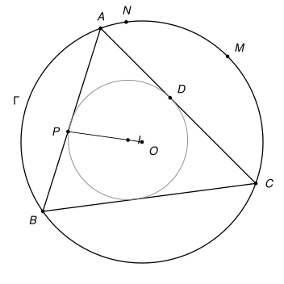

## Statement

Soit $ABC$ un triangle non équilatéral, $\Gamma$ son cercle circonscrit et $O$ le centre de $\Gamma$. Soit $I$ le centre du cercle inscrit, et $D$ le point où le cercle inscrit touche le côté $[AC]$.

Les droites $(OI)$ et $(AB)$ se coupent en un point $P$. Soit $M$ le milieu de l'arc $AC$ de $\Gamma$ qui ne contient pas $B$, et $N$ le milieu de l'arc $BC$ qui contient $A$.

Montrer que les droites $(MD)$ et $(NP)$ se coupent en un point du cercle $\Gamma$.

## Hints

1. Soit $X$ le second point d'intersection de la droite $(MD)$ avec $\Gamma$. Il s'agit de montrer que $X$, $N$ et $P$ sont alignés. Pourquoi la droite $(XM)$ est-elle la bissectrice de l'angle $\widehat{AXC}$ ?
2. Soient $E$ et $F$ les points de contact du cercle inscrit avec $[AB]$ et $[BC]$. Le théorème de la bissectrice donne $\frac{XA}{XC} = \frac{DA}{DC}$. Comparez avec $\frac{AE}{CF}$ et trouvez deux triangles semblables.
3. Montrez que $X$ est sur le cercle de diamètre $[BI]$. Si $Y$ est le point de $\Gamma$ diamétralement opposé à $B$, que peut-on dire des points $X$, $I$, $Y$ ?
4. Appliquez le théorème de Pascal à l'hexagone $SABYXN$, où $S$ est le second point d'intersection de la bissectrice $(AI)$ avec $\Gamma$.

## Solution

**Rappel.** *Le théorème de Pascal* est un résultat de géométrie projective, hors du programme du lycée. Il dit ceci : si six points $U_1, U_2, U_3, U_4, U_5, U_6$ sont sur un même cercle, alors les trois points

$$(U_1U_2) \cap (U_4U_5), \qquad (U_2U_3) \cap (U_5U_6), \qquad (U_3U_4) \cap (U_6U_1)$$

sont alignés. Autrement dit, si l'on parcourt l'« hexagone » $U_1U_2U_3U_4U_5U_6$ (qui peut se croiser lui-même, l'ordre des points sur le cercle est quelconque), les trois paires de côtés opposés se coupent en trois points alignés. On l'utilise ici sans le démontrer.

On utilise aussi, plus classique, le *théorème de la bissectrice* : si la bissectrice de l'angle en $X$ d'un triangle $XUV$ coupe $[UV]$ en $D$, alors $\frac{DU}{DV} = \frac{XU}{XV}$.

On note $E$ et $F$ les points de contact du cercle inscrit avec $[AB]$ et $[BC]$. Les tangentes issues d'un même point ont la même longueur, donc $AE = AD$ et $CF = CD$.

Si $BA = BC$, les points $O$ et $I$ sont tous deux sur la bissectrice issue de $B$, donc $P = B$. De plus $D$ est le milieu de $[AC]$, et $(MD)$ est la médiatrice de $[AC]$, qui passe par $B$. Les deux droites se coupent alors en $B$, qui est sur $\Gamma$. On suppose désormais $BA \neq BC$.

![La figure complète : le point X, le cercle de diamètre [BI] qui passe par E, F et X, le point Y diamétralement opposé à B, le point S, et les deux droites (MX) et (NX)](10213-figure-2.svg)

**Étape 1 : le point $X$ et une bissectrice.** Soit $X$ le second point d'intersection de la droite $(MD)$ avec $\Gamma$. Le point $D$ est strictement entre $A$ et $C$, et $M$ est de l'autre côté de $(AC)$ que $B$ : la droite $(MD)$ traverse la corde $[AC]$ en $D$, donc $X$ est sur l'arc $AC$ qui contient $B$.

Les arcs $AM$ et $MC$ sont égaux, donc les angles inscrits $\widehat{AXM}$ et $\widehat{MXC}$ sont égaux : $(XD)$ est la bissectrice de l'angle $\widehat{AXC}$. Par le théorème de la bissectrice dans le triangle $AXC$,

$$\frac{XA}{XC} = \frac{DA}{DC} = \frac{AE}{CF}.$$

Si $X = B$, alors $\frac{BA}{BC} = \frac{AE}{CF}$, d'où $\frac{AE + EB}{CF + FB} = \frac{AE}{CF}$ avec $EB = FB$, ce qui force $AE = CF$ et donc $BA = BC$. Comme on a supposé $BA \neq BC$, on a $X \neq B$.

**Étape 2 : deux triangles semblables.** Les points $B$ et $X$ sont tous deux sur l'arc $AC$ qui contient $B$. La corde $[BX]$ découpe un petit arc qui ne contient ni $A$ ni $C$, donc $A$ et $C$ sont du même côté de la droite $(BX)$, et les angles inscrits qui interceptent la corde $[BX]$ sont égaux :

$$\widehat{XAE} = \widehat{XAB} = \widehat{XCB} = \widehat{XCF}.$$

Les triangles $XAE$ et $XCF$ ont donc un angle égal, en $A$ et en $C$, compris entre des côtés proportionnels, puisque $\frac{XA}{XC} = \frac{AE}{CF}$. Ils sont semblables, et en particulier $\widehat{AEX} = \widehat{CFX}$.

**Étape 3 : $X$ est sur le cercle de diamètre $[BI]$.** Comme $E$ est entre $A$ et $B$, et $F$ entre $C$ et $B$,

$$\widehat{BEX} = 180° - \widehat{AEX} = 180° - \widehat{CFX} = \widehat{BFX}.$$

Les points $E$ et $F$ sont du même côté de $(BX)$, puisque $A$ et $C$ le sont. Ils voient donc le segment $[BX]$ sous le même angle et du même côté : les quatre points $B$, $X$, $E$, $F$ sont sur un même cercle. Or les angles $\widehat{BEI}$ et $\widehat{BFI}$ sont droits, donc ce cercle est le cercle de diamètre $[BI]$. Ainsi $X$ est sur le cercle de diamètre $[BI]$, et

$$\widehat{BXI} = 90°.$$

**Étape 4 : $X$, $I$, $Y$ sont alignés.** Soit $Y$ le point de $\Gamma$ diamétralement opposé à $B$. Si $X \neq Y$, l'angle $\widehat{BXY}$ est droit, car il intercepte le diamètre $[BY]$. Les droites $(XI)$ et $(XY)$ sont toutes les deux perpendiculaires à $(XB)$ au point $X$ : elles sont égales. Dans tous les cas, $X$, $I$ et $Y$ sont alignés.

**Étape 5 : Pascal.** Soit $S$ le second point d'intersection de la bissectrice $(AI)$ avec $\Gamma$. C'est le milieu de l'arc $BC$ qui ne contient pas $A$. Les points $S$ et $N$, milieux des deux arcs $BC$, sont les deux extrémités du diamètre perpendiculaire à $(BC)$ : la droite $(SN)$ passe par $O$. La droite $(BY)$ passe aussi par $O$.

Soit $P'$ le point d'intersection des droites $(AB)$ et $(XN)$. Appliquons le théorème de Pascal aux six points $S, A, B, Y, X, N$ de $\Gamma$, pris dans cet ordre :

- $(SA) \cap (YX) = I$, car $I$ est sur la bissectrice $(AS)$ et, d'après l'étape 4, sur $(YX)$ ;
- $(AB) \cap (XN) = P'$ ;
- $(BY) \cap (NS) = O$.

Ces trois points sont alignés : $P'$ est sur la droite $(OI)$. Comme $P'$ est aussi sur $(AB)$, c'est le point d'intersection de $(OI)$ et $(AB)$, c'est-à-dire $P' = P$.

**Conclusion.** La droite $(NP)$ passe par $X$, et la droite $(MD)$ aussi. Les deux droites se coupent donc en $X$, qui est sur le cercle $\Gamma$.

## Going further

1. Montrer que $MA = MI = MC$ : le cercle de centre $M$ qui passe par $A$ passe aussi par $I$ et par $C$. (Comparer les angles $\widehat{MAI}$ et $\widehat{MIA}$.) Les correcteurs signalent une autre solution, par une inversion de centre $M$ qui laisse fixes $A$, $I$ et $C$.
