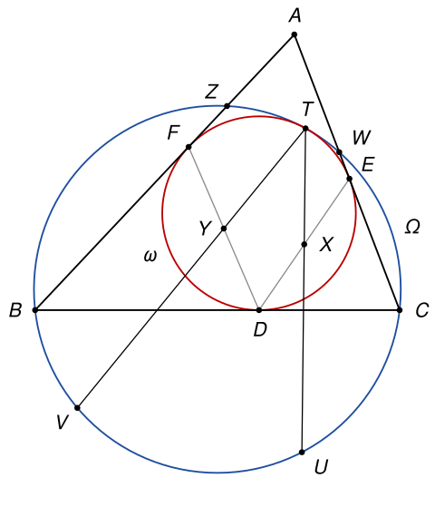
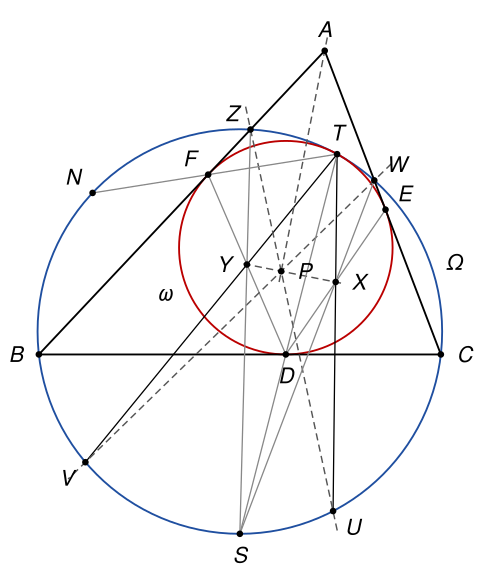

## Statement

Soit $ABC$ un triangle et $\omega$ son cercle inscrit, qui touche les côtés $[BC]$, $[CA]$ et $[AB]$ en $D$, $E$ et $F$. On note $\Omega$ le cercle qui passe par $B$ et $C$ et qui est tangent à $\omega$, et $T$ le point de contact de ces deux cercles.

On note $X$ et $Y$ les milieux des segments $[DE]$ et $[DF]$. Les droites $(TX)$ et $(TY)$ recoupent le cercle $\Omega$ en $U$ et $V$. Les droites $(AB)$ et $(AC)$ recoupent le cercle $\Omega$ en $Z$ et $W$.

Montrer que les droites $(ZU)$, $(WV)$, $(XY)$ et la bissectrice de l'angle $\widehat{BAC}$ sont concourantes.

## Hints

1. Oubliez $A$ un moment et regardez le triangle $ZBC$, inscrit dans $\Omega$. Le cercle $\omega$ est tangent à deux de ses côtés et à son cercle circonscrit. Sur la figure, que semble être le point $Y$ pour ce triangle ?
2. Montrez que la droite $(TF)$ recoupe $\Omega$ au milieu de l'arc $BZ$ qui ne contient pas $C$, et que $(TD)$ recoupe $\Omega$ au milieu $S$ de l'arc $BC$ qui ne contient pas $A$. Le théorème de Pascal montre alors que $Y$ est le centre du cercle inscrit du triangle $ZBC$.
3. Montrez que $Z$, $F$, $Y$, $T$ sont cocycliques, ainsi que $D$, $Y$, $T$, $C$. Vous en déduirez que $(TY)$ est la bissectrice de l'angle $\widehat{ZTC}$, puis que $(WV)$ et $(ZU)$ sont deux bissectrices extérieures du triangle $AZW$.
4. Pour finir, appliquez le théorème de Pascal à l'hexagone $TUZSWV$.

## Solution

**Rappel.** Le théorème de Pascal n'est pas au programme du lycée. Il dit ceci : si six points distincts $P_1$, $P_2$, $P_3$, $P_4$, $P_5$, $P_6$ sont sur un même cercle, placés dans n'importe quel ordre, alors les trois points

$$(P_1P_2) \cap (P_4P_5), \qquad (P_2P_3) \cap (P_5P_6), \qquad (P_3P_4) \cap (P_6P_1)$$

sont alignés (quand ils existent). On dit qu'on applique le théorème à « l'hexagone » $P_1P_2P_3P_4P_5P_6$ : on coupe les côtés opposés deux par deux. On l'admet ici.

*Autres rappels*, plus classiques.

- *Pôle sud.* Soit $Q$ un point d'un cercle et $[KL]$ une corde. Si $M$ est le milieu de l'arc $KL$ qui ne contient pas $Q$, alors $\widehat{KQM} = \widehat{MQL}$, car ces deux angles inscrits interceptent deux arcs égaux. Autrement dit $(QM)$ est la bissectrice de l'angle $\widehat{KQL}$, et inversement la bissectrice de $\widehat{KQL}$ recoupe le cercle au milieu de l'arc $KL$ qui ne contient pas $Q$.
- *Angle au centre du cercle inscrit.* Si $J$ est le centre du cercle inscrit d'un triangle $KLM$, alors $\widehat{LJM} = 90° + \frac{1}{2}\widehat{LKM}$. En effet, dans le triangle $JLM$, les angles en $L$ et en $M$ valent la moitié des angles du triangle $KLM$ en $L$ et en $M$, dont la somme est $180° - \widehat{LKM}$.
- *Tangentes aux deux bouts d'une corde.* Les tangentes à un cercle aux deux extrémités d'une corde sont symétriques par rapport à la médiatrice de cette corde.
- *Cercle exinscrit.* Dans un triangle, les bissectrices extérieures en deux sommets et la bissectrice intérieure au troisième sommet sont concourantes : leur point commun est à égale distance des trois côtés.
- *Points cocycliques.* Si $K$ et $L$ sont du même côté de la droite $(MN)$ et si $\widehat{MKN} = \widehat{MLN}$, alors $M$, $N$, $K$, $L$ sont sur un même cercle. Dans un quadrilatère inscrit non croisé, deux angles opposés ont pour somme $180°$.

**Étape 0 : la disposition des points.**

- Le point $D$ est sur la corde $[BC]$ de $\Omega$, donc à l'intérieur de $\Omega$. Un cercle tangent à $\Omega$ qui a un point à l'intérieur de $\Omega$ est tangent intérieurement, et $\omega$ ne peut pas contenir $\Omega$ puisque $B$ est hors de $\omega$. Donc $\omega$ est à l'intérieur de $\Omega$ et ne la touche qu'en $T$.
- Le point $T$ n'est pas sur la droite $(AB)$. Sinon $T = F$, seul point de $\omega$ sur $(AB)$, et $(AB)$ serait la tangente commune aux deux cercles en $T$ ; elle ne toucherait $\Omega$ qu'en $T$, alors qu'elle passe par $B$, qui est sur $\Omega$ mais pas sur $\omega$. De même, $T$ n'est ni sur $(BC)$ ni sur $(CA)$. En particulier $D$, $E$, $F$ sont strictement à l'intérieur de $\Omega$.
- Le point $A$ est à l'extérieur de $\Omega$. Sinon tout le triangle $ABC$ serait dans le disque de $\Omega$, et les seuls points du triangle situés sur le cercle $\Omega$ seraient des sommets. Or $T$ est dans le triangle, comme tout le cercle $\omega$, il est sur $\Omega$, et ce n'est pas un sommet.
- Sur la droite $(AB)$, le disque de $\Omega$ découpe le segment $[BZ]$. Il contient $F$ mais pas $A$, donc les points sont dans l'ordre $B$, $F$, $Z$, $A$. De même, $C$, $E$, $W$, $A$ sont dans cet ordre sur $(AC)$.
- Le quadrilatère $BCWZ$ est donc non croisé, et on rencontre $B$, $C$, $W$, $Z$ dans cet ordre sur $\Omega$. L'arc $ZB$ qui ne contient pas $C$ est de l'autre côté de $(AB)$ que $C$. De même l'arc $BC$ qui ne contient pas $W$ est de l'autre côté de $(BC)$ que $A$, et l'arc $CW$ qui ne contient pas $Z$ est de l'autre côté de $(CA)$ que $B$. Le point $T$ est dans le triangle et sur aucun de ses côtés, donc il est sur le quatrième arc, l'arc $WZ$ qui ne contient pas $B$. Sur $\Omega$, l'ordre est donc $B$, $C$, $W$, $T$, $Z$.

**Étape 1 : deux droites qui passent par des milieux d'arcs.** On note $N$ et $S$ les seconds points d'intersection des droites $(TF)$ et $(TD)$ avec $\Omega$, et $O$ le centre de $\Omega$.

Soit $\tau$ la tangente commune aux deux cercles en $T$. Pour le cercle $\omega$ et sa corde $[TF]$, les tangentes $\tau$ et $(AB)$ sont symétriques par rapport à la médiatrice de $[TF]$. Pour le cercle $\Omega$ et sa corde $[TN]$, la tangente $\tau$ et la tangente $t$ en $N$ sont symétriques par rapport à la médiatrice de $[TN]$. Ces deux médiatrices sont perpendiculaires à la même droite $(TN)$, donc parallèles. Or deux symétries d'axes parallèles envoient une même droite sur deux droites parallèles. Donc $t$ est parallèle à $(AB)$.

La tangente $t$ est perpendiculaire au rayon $[ON]$. Donc $(ON)$ est perpendiculaire à la corde $[BZ]$ : c'est sa médiatrice, et $NB = NZ$. Ainsi $N$ est le milieu d'un des deux arcs $BZ$. Comme $F$ est à l'intérieur de $\Omega$, il est entre $T$ et $N$, donc $T$ et $N$ sont de part et d'autre de $(AB)$. Or $T$ est du côté de $C$. **Donc $N$ est le milieu de l'arc $BZ$ qui ne contient pas $C$.**

Le même raisonnement, avec $D$ et la droite $(BC)$, montre que **$S$ est le milieu de l'arc $BC$ situé de l'autre côté de $(BC)$ que $A$**, c'est-à-dire de l'arc $BC$ qui ne contient ni $Z$, ni $W$, ni $T$. Sur $\Omega$, l'ordre est maintenant $B$, $S$, $C$, $W$, $T$, $Z$, $N$.

**Étape 2 : $Y$ est le centre du cercle inscrit du triangle $ZBC$.** Notons $J$ ce centre. D'après le rappel du pôle sud, la bissectrice $(CJ)$ de l'angle $\widehat{BCZ}$ passe par $N$, et la bissectrice $(ZJ)$ de l'angle $\widehat{BZC}$ passe par $S$.

Appliquons le théorème de Pascal à l'hexagone $CNTSZB$ :

- $(CN) \cap (SZ) = J$ ;
- $(NT) \cap (ZB) = F$, car $(NT)$ est la droite $(TF)$ et $(ZB)$ est la droite $(AB)$ ;
- $(TS) \cap (BC) = D$, car $(TS)$ est la droite $(TD)$.

Donc $J$, $F$ et $D$ sont alignés.

D'autre part, $J$ est sur la bissectrice de l'angle $\widehat{ZBC}$, qui est l'angle $\widehat{ABC}$ puisque $Z$ est sur $[BA]$. Comme $BF = BD$ (deux tangentes menées de $B$ au cercle $\omega$), le triangle $BFD$ est isocèle en $B$, et cette bissectrice est la médiatrice de $[FD]$. Elle coupe la droite $(FD)$ en un seul point, le milieu $Y$ de $[FD]$. **Donc $J = Y$.** Au passage, $(FD)$ est perpendiculaire à $(BY)$.

De la même façon, en échangeant les rôles de $B$ et de $C$, **$X$ est le centre du cercle inscrit du triangle $WBC$.**

**Étape 3 : $V$ est le milieu de l'arc $ZC$ qui contient $B$.** On note $\beta = \widehat{ZBC}$, $\gamma = \widehat{BCZ}$ et $\zeta = \widehat{BZC}$ les angles du triangle $ZBC$.

*Les points $Z$, $F$, $Y$, $T$ sont cocycliques.* Les points $T$ et $C$ sont sur le même arc $NZ$, celui qui contient $B$. Les angles inscrits $\widehat{NTZ}$ et $\widehat{NCZ}$ sont donc égaux. Comme $F$ est sur $[TN]$ et que $(CN)$ est la bissectrice de $\widehat{BCZ}$,

$$\widehat{FTZ} = \widehat{NTZ} = \widehat{NCZ} = \frac{\gamma}{2}.$$

D'autre part, $F$ est sur le segment $[BZ]$, donc la demi-droite $[YF)$ est entre $[YB)$ et $[YZ)$, et $\widehat{BYF} = 90°$ d'après l'étape 2. Avec le rappel sur le centre du cercle inscrit,

$$\widehat{FYZ} = \widehat{BYZ} - \widehat{BYF} = \left(90° + \frac{\gamma}{2}\right) - 90° = \frac{\gamma}{2}.$$

Les points $T$ et $Y$ sont du même côté de la droite $(ZF)$, qui est $(AB)$. Comme $\widehat{FTZ} = \widehat{FYZ}$, les points $Z$, $F$, $Y$, $T$ sont sur un même cercle.

*Un premier angle en $T$.* La droite $(ZY)$ passe par $S$. Dans l'ordre $B$, $S$, $C$, $W$, $T$, $Z$, $N$, la corde $[ZS]$ sépare $B$ de $T$, et $F$, qui est sur $]BZ[$, est du côté de $B$. Donc $F$ et $T$ sont de part et d'autre de $(ZY)$, et $ZFYT$ est un quadrilatère inscrit non croisé. Ses angles opposés en $T$ et en $F$ ont pour somme $180°$, et comme $B$, $F$, $Z$ sont alignés dans cet ordre,

$$\widehat{ZTY} = 180° - \widehat{ZFY} = \widehat{BFY} = \widehat{BFD}.$$

*Le même calcul de l'autre côté.* Les points $T$ et $Z$ sont sur le même arc $SC$, celui qui contient $B$, et $(ZS)$ est la bissectrice de $\widehat{BZC}$. Comme $D$ est sur $[TS]$,

$$\widehat{DTC} = \widehat{STC} = \widehat{SZC} = \frac{\zeta}{2}.$$

Le point $D$ est sur le segment $[BC]$ et $\widehat{BYD} = 90°$, donc

$$\widehat{DYC} = \widehat{BYC} - \widehat{BYD} = \left(90° + \frac{\zeta}{2}\right) - 90° = \frac{\zeta}{2}.$$

Les points $T$ et $Y$ sont du même côté de $(DC)$, donc $D$, $Y$, $T$, $C$ sont sur un même cercle. La droite $(CY)$ passe par $N$, et la corde $[CN]$ sépare $B$ de $T$, avec $D$ du côté de $B$. Donc $CDYT$ est un quadrilatère inscrit non croisé, et

$$\widehat{CTY} = 180° - \widehat{CDY} = \widehat{BDY} = \widehat{BDF}.$$

*Conclusion de l'étape.* Le triangle $BFD$ est isocèle en $B$, donc $\widehat{BFD} = \widehat{BDF}$ et

$$\widehat{ZTY} = \widehat{CTY}.$$

Le point $Y$ est à l'intérieur du triangle $ZBC$, et ce triangle est dans l'angle $\widehat{ZTC}$, car $B$ est sur l'arc $ZC$ qui ne contient pas $T$. Donc $(TY)$ est la bissectrice de l'angle $\widehat{ZTC}$. D'après le rappel du pôle sud, **$V$ est le milieu de l'arc $ZC$ qui ne contient pas $T$**, c'est-à-dire de l'arc $ZC$ qui contient $B$.

De la même façon, dans le triangle $WBC$, **$U$ est le milieu de l'arc $WB$ qui contient $C$.**

**Étape 4 : les droites $(ZU)$, $(WV)$ et la bissectrice de $\widehat{BAC}$ sont concourantes.** Le point $W$ est sur l'arc $ZC$ qui contient $T$, donc qui ne contient pas $V$. D'après le rappel du pôle sud, $(WV)$ est la bissectrice de l'angle $\widehat{ZWC}$. Comme $W$ est entre $A$ et $C$, les angles $\widehat{ZWC}$ et $\widehat{ZWA}$ sont supplémentaires : $(WV)$ est la bissectrice extérieure en $W$ du triangle $AZW$.

De même, $Z$ est sur l'arc $WB$ qui contient $T$, donc $(ZU)$ est la bissectrice de l'angle $\widehat{WZB}$. Comme $Z$ est entre $A$ et $B$, c'est la bissectrice extérieure en $Z$ du triangle $AZW$.

D'après le rappel sur le cercle exinscrit, $(WV)$, $(ZU)$ et la bissectrice intérieure en $A$ du triangle $AZW$ se coupent en un même point $P$, le centre du cercle exinscrit du triangle $AZW$ dans l'angle $A$. Comme $Z$ est sur $[AB]$ et $W$ sur $[AC]$, cette bissectrice est celle de l'angle $\widehat{BAC}$.

**Étape 5 : le point $P$ est sur la droite $(XY)$.** La bissectrice $(ZY)$ de l'angle $\widehat{BZC}$ passe par $S$, milieu de l'arc $BC$ qui ne contient pas $Z$. De même, la bissectrice $(WX)$ de l'angle $\widehat{BWC}$ passe par $S$, qui est aussi le milieu de l'arc $BC$ qui ne contient pas $W$.

Appliquons le théorème de Pascal à l'hexagone $TUZSWV$ :

- $(TU) \cap (SW) = X$, car $X$ est sur $(TU)$ par définition de $U$, et sur $(SW)$ ;
- $(UZ) \cap (WV) = P$, d'après l'étape 4 ;
- $(ZS) \cap (VT) = Y$, car $Y$ est sur $(ZS)$, et sur $(VT)$ par définition de $V$.

Les deux droites de chaque paire sont bien distinctes, sinon trois points distincts du cercle $\Omega$ seraient alignés. Donc $X$, $P$ et $Y$ sont alignés.

**Conclusion.** Le point $P$ est sur $(ZU)$, sur $(WV)$ et sur la bissectrice de $\widehat{BAC}$ (étape 4), et sur $(XY)$ (étape 5). **Les quatre droites sont concourantes en $P$, le centre du cercle exinscrit du triangle $AZW$ dans l'angle $A$.**

*Remarques.*

- Un cercle tangent à deux côtés d'un triangle et tangent intérieurement à son cercle circonscrit s'appelle un cercle mixtilinéaire. Ici $\omega$ est le cercle mixtilinéaire du triangle $ZBC$ issu de $B$, et celui du triangle $WBC$ issu de $C$. Les étapes 2 et 3 démontrent ses deux propriétés classiques : le centre du cercle inscrit est le milieu du segment qui joint les deux points de contact avec les côtés, et la droite qui joint le point de contact $T$ à ce centre passe par le milieu de l'arc qui contient le sommet.
- L'étape 1 s'appelle souvent le « lemme du bocal » dans les stages olympiques.
- Le corrigé officiel démontre l'étape 3 avec une propriété des symédianes. La preuve ci-dessus n'utilise que des angles inscrits.
