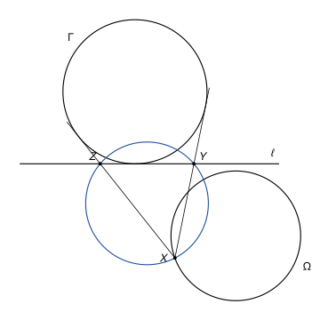
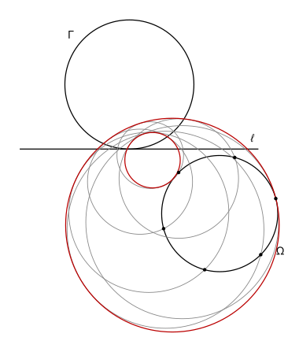

## Statement

Soit $\Gamma$ un cercle et $\ell$ une droite tangente à $\Gamma$. Soit $\Omega$ un cercle qui ne coupe pas $\ell$, situé de l'autre côté de $\ell$ que $\Gamma$.

Pour un point $X$ de $\Omega$, on note $Y$ et $Z$ les deux points de $\ell$ tels que les droites $(XY)$ et $(XZ)$ soient tangentes à $\Gamma$.

Montrer que, lorsque $X$ parcourt $\Omega$, le cercle circonscrit au triangle $XYZ$ reste tangent à deux cercles fixes. (Dans un cas particulier, l'un des deux se réduit à un point, par lequel passent alors tous ces cercles.)

## Hints

1. Utilisez l'inversion de cercle $\Gamma$. Notez $A$ et $B$ les points de contact des tangentes $(XY)$ et $(XZ)$ avec $\Gamma$, et $C$ celui de $\ell$. Que deviennent les points $X$, $Y$ et $Z$ ?
2. Le cercle $XYZ$ devient le cercle qui passe par les milieux des côtés du triangle $ABC$. Montrez que son rayon est la moitié de celui de $\Gamma$, et exprimez son centre $E$ à l'aide du milieu de $[AB]$ et du point $C$.
3. Quand $X$ parcourt $\Omega$, que parcourt le point $E$ ? Des cercles qui ont tous le même rayon et dont les centres sont sur un même cercle sont tous tangents à deux cercles fixes.

## Solution

**Rappel.** L'inversion n'est pas au programme du lycée. Soit $\Gamma$ un cercle de centre $O$ et de rayon $r$. L'*inversion de cercle* $\Gamma$ est la transformation $\varphi$ qui associe à chaque point $M \neq O$ le point $M'$ de la demi-droite $[OM)$ tel que

$$OM \times OM' = r^2.$$

Elle n'est pas définie en $O$. Nous utilisons les propriétés suivantes, que nous admettons.

- Les points de $\Gamma$ sont fixes, et $\varphi(\varphi(M)) = M$. Ainsi $\varphi$ est une bijection du plan privé de $O$ sur lui-même : chaque point $N \neq O$ est l'image d'un seul point, à savoir $\varphi(N)$.
- L'image d'un cercle qui ne passe pas par $O$ est un cercle qui ne passe pas par $O$.
- L'image d'une droite qui ne passe pas par $O$ est un cercle qui passe par $O$, privé du point $O$, et inversement.

*Autres rappels.*

- *Tangentes issues d'un point.* Si les deux tangentes à un cercle de centre $O$ issues d'un point $Y$ le touchent en $A$ et $C$, alors $YA = YC$. Comme aussi $OA = OC$, la droite $(OY)$ est la médiatrice de $[AC]$.
- *Cercles tangents.* Deux cercles distincts sont tangents quand ils ont exactement un point commun. Si leurs centres sont distincts et à la distance $d$, et si leurs rayons sont $R_1$ et $R_2$, ils sont tangents si et seulement si $d = R_1 + R_2$ ou $d = |R_1 - R_2|$.
- *Centre de gravité.* Le centre de gravité $G$ d'un triangle $ABC$ vérifie $\overrightarrow{OG} = \frac{1}{3}\left(\overrightarrow{OA} + \overrightarrow{OB} + \overrightarrow{OC}\right)$ pour tout point $O$. L'homothétie de centre $G$ et de rapport $-\frac{1}{2}$ envoie chaque sommet sur le milieu du côté opposé.

On note $O$ et $r$ le centre et le rayon de $\Gamma$, $C$ le point de contact de $\ell$ avec $\Gamma$, et $\varphi$ l'inversion de cercle $\Gamma$. Pour un point $X$ de $\Omega$, on note $A$ et $B$ les points de contact des tangentes $(XY)$ et $(XZ)$ avec $\Gamma$.

**Étape 0 : la figure existe.** Le cercle $\Omega$ est de l'autre côté de $\ell$ que $\Gamma$, et il ne touche pas $\ell$. Ses points sont donc à l'extérieur de $\Gamma$ et hors de $\ell$, et le point $O$, qui est du côté de $\Gamma$, n'est pas sur $\Omega$. D'un point $X$ de $\Omega$ partent deux tangentes à $\Gamma$. Les seules tangentes à $\Gamma$ parallèles à $\ell$ sont $\ell$ elle-même et la tangente au point diamétralement opposé à $C$. Aucune ne passe par $X$ : la première parce que $X$ n'est pas sur $\ell$, la seconde parce qu'elle est tout entière du côté de $\Gamma$. Les deux tangentes coupent donc $\ell$, en deux points $Y$ et $Z$ distincts, et $X$, $Y$, $Z$ ne sont pas alignés. Enfin $A$, $B$, $C$ sont trois points distincts de $\Gamma$ : par exemple $A \neq C$, sinon la tangente en $A$ serait $\ell$, qui ne passe pas par $X$.

**Étape 1 : les images de $X$, $Y$ et $Z$.** Le point $Y$ est sur $\ell$, tangente en $C$, et sur $(XY)$, tangente en $A$ : les deux tangentes issues de $Y$ touchent $\Gamma$ en $A$ et en $C$. La droite $(OY)$ est donc la médiatrice de $[AC]$ et coupe $[AC]$ en son milieu $Y'$. Dans le triangle $OAY$, rectangle en $A$, le point $Y'$ est le pied de la hauteur issue de $A$. Les triangles $OY'A$ et $OAY$ ont l'angle en $O$ en commun et un angle droit, en $Y'$ et en $A$. Ils sont semblables, donc

$$\frac{OY'}{OA} = \frac{OA}{OY}, \qquad \text{soit} \qquad OY' \times OY = r^2.$$

Comme $Y'$ est sur la demi-droite $[OY)$, on a $\varphi(Y) = Y'$, **le milieu de $[AC]$**. De même, $\varphi(Z) = Z'$ est le milieu de $[BC]$, et $\varphi(X) = X'$ est le milieu de $[AB]$.

**Étape 2 : l'image du cercle $XYZ$.** Notons $c_X$ le cercle circonscrit au triangle $XYZ$. S'il passait par $O$, son image serait une droite, qui contiendrait $X'$, $Y'$ et $Z'$. Or les milieux des trois côtés d'un triangle ne sont pas alignés. Donc $c_X$ ne passe pas par $O$, et son image est un cercle $\varepsilon_X$ qui ne passe pas par $O$ : c'est le cercle qui passe par $X'$, $Y'$ et $Z'$.

Soit $G$ le centre de gravité du triangle $ABC$ et $h$ l'homothétie de centre $G$ et de rapport $-\frac{1}{2}$. Elle envoie $A$, $B$, $C$ sur $Z'$, $Y'$, $X'$, donc elle envoie le cercle $\Gamma$, qui passe par $A$, $B$, $C$, sur le cercle $\varepsilon_X$. Par conséquent :

- le rayon de $\varepsilon_X$ est $\frac{r}{2}$ ;
- son centre est $E = h(O)$, c'est-à-dire $\overrightarrow{GE} = -\frac{1}{2}\overrightarrow{GO}$. Donc $\overrightarrow{OE} = \overrightarrow{OG} + \frac{1}{2}\overrightarrow{OG} = \frac{3}{2}\overrightarrow{OG} = \frac{1}{2}\left(\overrightarrow{OA} + \overrightarrow{OB} + \overrightarrow{OC}\right)$.

Comme $\overrightarrow{OX'} = \frac{1}{2}\left(\overrightarrow{OA} + \overrightarrow{OB}\right)$, on obtient

$$\overrightarrow{OE} = \overrightarrow{OX'} + \frac{1}{2}\overrightarrow{OC}.$$

Le point $E$ est donc l'image de $X'$ par la translation de vecteur $\vec{u} = \frac{1}{2}\overrightarrow{OC}$, qui ne dépend pas de $X$.

**Étape 3 : le point $X$ bouge.** Le cercle $\Omega$ ne passe pas par $O$, donc son image $\Omega' = \varphi(\Omega)$ est un cercle. Notons $\rho$ son rayon. Quand $X$ parcourt tout $\Omega$, son image $X'$ parcourt tout $\Omega'$, car $\varphi$ est une bijection. D'après l'étape 2, $E$ parcourt alors tout le cercle $\Omega''$, image de $\Omega'$ par la translation de vecteur $\vec{u}$. Notons $K$ son centre ; son rayon est $\rho$.

En résumé, après inversion, **les cercles $\varepsilon_X$ ont tous le rayon $\frac{r}{2}$, et leurs centres parcourent le cercle fixe de centre $K$ et de rayon $\rho$**.

**Étape 4 : deux cercles fixes après inversion.** Soit $\Sigma_1$ le cercle de centre $K$ et de rayon $\rho + \frac{r}{2}$. Pour tout $X$, on a $KE = \rho = \left(\rho + \frac{r}{2}\right) - \frac{r}{2}$ : le cercle $\varepsilon_X$ est tangent intérieurement à $\Sigma_1$.

Supposons $\rho \neq \frac{r}{2}$, et soit $\Sigma_2$ le cercle de centre $K$ et de rayon $\left|\rho - \frac{r}{2}\right|$. Si $\rho > \frac{r}{2}$, on a $KE = \rho = \left(\rho - \frac{r}{2}\right) + \frac{r}{2}$, et si $\rho < \frac{r}{2}$, on a $KE = \rho = \frac{r}{2} - \left(\frac{r}{2} - \rho\right)$. Dans les deux cas, $\varepsilon_X$ est tangent à $\Sigma_2$.

Les points de contact sont sur la droite $(KE)$ :

$$\overrightarrow{KT_1} = \frac{\rho + \frac{r}{2}}{\rho}\,\overrightarrow{KE}, \qquad \overrightarrow{KT_2} = \frac{\rho - \frac{r}{2}}{\rho}\,\overrightarrow{KE}.$$

On vérifie que $T_1$ est à la distance $\rho + \frac{r}{2}$ de $K$ et à la distance $\frac{r}{2}$ de $E$, et de même pour $T_2$. Quand $E$ fait le tour du cercle de centre $K$ et de rayon $\rho$, le point $T_1$ fait le tour de $\Sigma_1$ et le point $T_2$ fait le tour de $\Sigma_2$.

**Étape 5 : le point $O$ n'est ni sur $\Sigma_1$ ni sur $\Sigma_2$.** Si $O$ était sur $\Sigma_1$, ce serait le point de contact $T_1$ pour une certaine position de $X$, et $O$ serait sur le cercle $\varepsilon_X$. C'est impossible d'après l'étape 2. De même pour $\Sigma_2$.

**Étape 6 : retour à la figure de départ.** D'après l'étape 5 et le rappel, $\Sigma'_1 = \varphi(\Sigma_1)$ et $\Sigma'_2 = \varphi(\Sigma_2)$ sont des cercles. Ils ne dépendent pas de $X$. Les cercles $\varepsilon_X$ et $\Sigma_1$ ont exactement un point commun, $T_1$, qui n'est pas $O$. Comme $\varphi$ est une bijection du plan privé de $O$, leurs images $c_X = \varphi(\varepsilon_X)$ et $\Sigma'_1$ ont exactement un point commun, $\varphi(T_1)$ : elles sont tangentes. De même, $c_X$ est tangent à $\Sigma'_2$.

**Conclusion.** Lorsque $X$ parcourt $\Omega$, **le cercle circonscrit au triangle $XYZ$ reste tangent aux deux cercles fixes $\Sigma'_1$ et $\Sigma'_2$**.

Dans le cas particulier $\rho = \frac{r}{2}$, le cercle $\Sigma_2$ se réduit au point $K$, et tous les cercles $\varepsilon_X$ passent par $K$, puisque $KE = \frac{r}{2}$. Ce point $K$ n'est pas $O$, toujours d'après l'étape 2. Les cercles $XYZ$ restent tangents à $\Sigma'_1$, et ils passent tous par le point fixe $\varphi(K)$.

*Remarques.*

- Le cercle $\varepsilon_X$ qui passe par les milieux des côtés de $ABC$ est le *cercle d'Euler* du triangle $ABC$. Il passe aussi par les pieds des hauteurs, et c'est le nom qu'utilise le corrigé officiel, qui suit la même démarche.
- Le cercle $\Gamma$ est tangent aux trois droites $(XY)$, $(XZ)$ et $(YZ)$, et il est de l'autre côté de $(YZ)$ que $X$ : c'est le cercle exinscrit du triangle $XYZ$ dans l'angle en $X$.

## Going further

1. On remplace le cercle $\Omega$ par une droite $m$ parallèle à $\ell$, de l'autre côté de $\ell$ que $\Gamma$. Montrer qu'alors l'image de $m$ passe par $O$, que l'un des deux cercles de l'étape 4 passe par $O$, et en déduire que les cercles $XYZ$ sont tangents à une droite fixe et à un cercle fixe.
2. Avec $\Gamma$ de rayon $1$ et $m$ à la distance $2$ du centre de $\Gamma$, montrer que cette droite fixe est parallèle à $\ell$, à la distance $\frac{2}{3}$ du centre de $\Gamma$.
