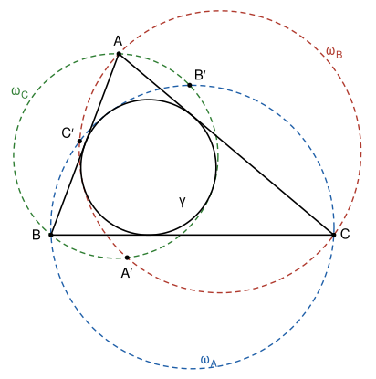

## Statement

$ABC$ est un triangle. On note $\gamma$ son cercle inscrit, $I$ le centre de $\gamma$, et $O$ le centre du cercle circonscrit à $ABC$.

Soit $\omega_A$ le cercle qui passe par $B$ et $C$ et qui est tangent à $\gamma$. On définit de la même façon $\omega_B$, qui passe par $C$ et $A$, et $\omega_C$, qui passe par $A$ et $B$, tous deux tangents à $\gamma$.

Les cercles $\omega_B$ et $\omega_C$ passent tous les deux par $A$. On note $A'$ leur autre point commun. On définit de même $B'$, l'autre point commun de $\omega_C$ et $\omega_A$, et $C'$, l'autre point commun de $\omega_A$ et $\omega_B$.

Montrer que les droites $(AA')$, $(BB')$ et $(CC')$ passent par un même point $K$, et que $K$, $O$ et $I$ sont alignés.

## Hints

1. La droite $(CC')$ est formée des points qui ont la même puissance par rapport à $\omega_A$ et à $\omega_B$. Il suffit donc de trouver un point $K$ dont les puissances par rapport à $\omega_A$, $\omega_B$ et $\omega_C$ sont égales.
2. Note $A_1$ le point de contact de $\gamma$ avec $[BC]$, et $X_A$ le point de contact de $\gamma$ et $\omega_A$. L'homothétie de centre $X_A$ qui envoie $\gamma$ sur $\omega_A$ envoie $A_1$ sur un point $M_A$ de $\omega_A$. Où est ce point ? Montre que $M_A B^2$ est égal à la puissance de $M_A$ par rapport à $\gamma$.
3. L'ensemble des points $P$ tels que $PB^2$ soit égal à la puissance de $P$ par rapport à $\gamma$ est une droite $\Delta_B$. Avec le produit scalaire, montre qu'elle est parallèle à $(A_1 C_1)$, où $C_1$ est le point de contact de $\gamma$ avec $[AB]$.
4. On obtient un triangle $M_A M_B M_C$ dont les côtés sont parallèles à ceux de $A_1 B_1 C_1$. Une homothétie de centre $K$ et de rapport $r$ envoie l'un sur l'autre. Compare la puissance de $K$ par rapport à $\omega_A$ à sa puissance par rapport à $\gamma$. Pour l'alignement, cherche l'image de $I$ par cette homothétie.

## Solution

**Rappel.** Cet exercice utilise trois outils qui ne sont pas au programme du lycée.

- *Puissance d'un point.* La puissance d'un point $P$ par rapport à un cercle de centre $\Omega$ et de rayon $R$ est le nombre $p(P) = P\Omega^2 - R^2$. Elle est positive quand $P$ est à l'extérieur du cercle. Si une droite passant par $P$ coupe le cercle en $U$ et $V$, alors $p(P) = \overline{PU} \cdot \overline{PV}$ (produit de mesures algébriques sur la droite : il est positif si $U$ et $V$ sont du même côté de $P$). Si la droite est tangente au cercle en $U$, alors $p(P) = PU^2$.
- *Axe radical.* Pour deux cercles de centres distincts, l'ensemble des points qui ont la même puissance par rapport aux deux cercles est une droite perpendiculaire à la droite des centres, appelée **axe radical**. Quand les deux cercles se coupent en deux points, ces deux points ont une puissance nulle par rapport aux deux cercles, donc l'axe radical est la droite qui les relie.
- *Homothétie.* L'homothétie de centre $K$ et de rapport $r \neq 0$ envoie chaque point $P$ sur le point $P'$ tel que $\overrightarrow{KP'} = r\,\overrightarrow{KP}$. Elle envoie une droite sur une droite parallèle, un cercle sur un cercle, et une tangente sur une tangente. Deux cercles tangents sont images l'un de l'autre par une homothétie dont le centre est leur point de contact, et dont le rapport est positif quand l'un est à l'intérieur de l'autre. Enfin, quand deux triangles ont leurs côtés deux à deux parallèles, on passe de l'un à l'autre par une homothétie ou par une translation.

**Notations.** On note $\rho$ le rayon de $\gamma$, et $A_1$, $B_1$, $C_1$ les points de contact de $\gamma$ avec $[BC]$, $[CA]$, $[AB]$. On note $X_A$ le point de contact de $\gamma$ et de $\omega_A$, et de même $X_B$ et $X_C$. On note $p_\gamma$, $p_A$, $p_B$, $p_C$ les puissances par rapport à $\gamma$, $\omega_A$, $\omega_B$, $\omega_C$.

**Étape 1 : trois droites $\Delta_A$, $\Delta_B$, $\Delta_C$.** Appelons $\Delta_A$ l'ensemble des points $P$ tels que $PA^2 = p_\gamma(P)$, et définissons de même $\Delta_B$ et $\Delta_C$.

En écrivant $\overrightarrow{PA} = \overrightarrow{PI} + \overrightarrow{IA}$, on trouve $PA^2 = PI^2 - 2\,\overrightarrow{IA} \cdot \overrightarrow{IP} + IA^2$. Comme $p_\gamma(P) = PI^2 - \rho^2$, la condition $PA^2 = p_\gamma(P)$ devient

$$\overrightarrow{IA} \cdot \overrightarrow{IP} = \frac{IA^2 + \rho^2}{2}.$$

C'est une droite perpendiculaire à $(IA)$.

D'autre part, la droite $(AB_1)$ est tangente à $\gamma$ en $B_1$, donc $(IB_1) \perp (AB_1)$, et

$$\overrightarrow{IA} \cdot \overrightarrow{IB_1} = \left(\overrightarrow{IB_1} + \overrightarrow{B_1 A}\right) \cdot \overrightarrow{IB_1} = IB_1^2 = \rho^2.$$

De même $\overrightarrow{IA} \cdot \overrightarrow{IC_1} = \rho^2$. La droite $(B_1 C_1)$ est donc la droite d'équation $\overrightarrow{IA} \cdot \overrightarrow{IP} = \rho^2$, elle aussi perpendiculaire à $(IA)$. Ainsi

$$\Delta_A \parallel (B_1 C_1), \qquad \Delta_B \parallel (C_1 A_1), \qquad \Delta_C \parallel (A_1 B_1).$$

**Étape 2 : le point $M_A$.** Le point $A_1$ est strictement entre $B$ et $C$, donc à l'intérieur du disque limité par $\omega_A$. Le cercle $\gamma$, tangent à $\omega_A$, est donc à l'intérieur de $\omega_A$. Soit $h$ l'homothétie de centre $X_A$, de rapport positif $k$, qui envoie $\gamma$ sur $\omega_A$. Le rayon de $\omega_A$ est plus grand que $\rho$, donc $k > 1$.

Notons $M_A = h(A_1)$. La tangente à $\gamma$ en $A_1$ est $(BC)$, donc la tangente à $\omega_A$ en $M_A$ est parallèle à $(BC)$. Le rayon de $\omega_A$ qui aboutit en $M_A$ est perpendiculaire à cette tangente, donc à $(BC)$ : $M_A$ est une extrémité du diamètre de $\omega_A$ perpendiculaire à $(BC)$. Ce diamètre est porté par la médiatrice de $[BC]$, puisque le centre de $\omega_A$ est à égale distance de $B$ et de $C$. Notons $M'$ l'autre extrémité de ce diamètre, et $H$ le milieu de $[BC]$, qui est sur $[M_A M']$.

Comme $\overrightarrow{X_A M_A} = k\,\overrightarrow{X_A A_1}$ avec $k > 1$, le point $A_1$ est sur le segment $[X_A M_A]$. Or $X_A$ est un point de $\gamma$ autre que $A_1$ (un cercle qui passe par $B$ et $C$ ne peut pas être tangent à $(BC)$), donc $X_A$ est du côté de $A$ par rapport à $(BC)$. Par conséquent $M_A$ est de l'autre côté de $(BC)$, à l'extérieur de $\gamma$.

**Étape 3 : $M_A$ est sur $\Delta_B$ et sur $\Delta_C$.** Le triangle $M_A B M'$ est inscrit dans un demi-cercle, donc rectangle en $B$, et $H$ est le pied de sa hauteur issue de $B$. Les triangles rectangles $M_A H B$ et $M_A B M'$ ont le même angle en $M_A$, donc ils sont semblables, et $M_A B^2 = M_A H \cdot M_A M'$.

De même, le triangle $M_A X_A M'$ est rectangle en $X_A$. Les triangles rectangles $M_A H A_1$ (rectangle en $H$) et $M_A X_A M'$ ont le même angle en $M_A$, donc ils sont semblables, et $M_A A_1 \cdot M_A X_A = M_A H \cdot M_A M'$. (Si $A_1 = H$, ce qui arrive quand $AB = AC$, la droite $(X_A M_A)$ est le diamètre lui-même, $X_A = M'$, et l'égalité est immédiate.)

On en déduit $M_A B^2 = M_A A_1 \cdot M_A X_A$. Or la droite $(M_A X_A)$ coupe $\gamma$ en $A_1$ et en $X_A$, qui sont du même côté de $M_A$, donc $M_A A_1 \cdot M_A X_A = p_\gamma(M_A)$. Ainsi $M_A B^2 = p_\gamma(M_A)$ : le point $M_A$ est sur $\Delta_B$. Comme $M_A$ est sur la médiatrice de $[BC]$, on a aussi $M_A C = M_A B$, donc $M_A$ est sur $\Delta_C$.

En faisant le même travail pour $\omega_B$ et $\omega_C$, on obtient des points $M_B$ et $M_C$, avec $M_B$ sur $\Delta_C$ et $\Delta_A$, et $M_C$ sur $\Delta_A$ et $\Delta_B$.

**Étape 4 : une homothétie $\Phi$.** Les droites $\Delta_A$, $\Delta_B$, $\Delta_C$ sont parallèles aux côtés du triangle $A_1 B_1 C_1$, donc deux d'entre elles ne sont jamais parallèles. D'après l'étape 3, ce sont les côtés du triangle $M_A M_B M_C$ : le côté $[M_B M_C]$ est sur $\Delta_A$, parallèle à $(B_1 C_1)$, et ainsi de suite. Les triangles $A_1 B_1 C_1$ et $M_A M_B M_C$ ont donc leurs côtés deux à deux parallèles, et une homothétie ou une translation $\Phi$ envoie $A_1$ sur $M_A$, $B_1$ sur $M_B$, $C_1$ sur $M_C$.

Montrons que $\Phi$ n'est pas une translation. Si c'était la translation de vecteur $\vec v$, elle enverrait la droite $(B_1 C_1)$, d'équation $\overrightarrow{IA} \cdot \overrightarrow{IP} = \rho^2$, sur la droite $\Delta_A$, d'équation $\overrightarrow{IA} \cdot \overrightarrow{IP} = \frac{IA^2 + \rho^2}{2}$. En prenant $P = B_1$, on aurait $\overrightarrow{IA} \cdot \left(\overrightarrow{IB_1} + \vec v\right) = \frac{IA^2 + \rho^2}{2}$, donc

$$\overrightarrow{IA} \cdot \vec v = \frac{IA^2 - \rho^2}{2} > 0,$$

puisque $A$ est à l'extérieur de $\gamma$. De même $\overrightarrow{IB} \cdot \vec v > 0$ et $\overrightarrow{IC} \cdot \vec v > 0$. Les trois sommets $A$, $B$, $C$ seraient alors strictement du même côté de la droite passant par $I$ et perpendiculaire à $\vec v$, et le triangle $ABC$ tout entier aussi. C'est impossible, puisque $I$ est à l'intérieur du triangle.

Donc $\Phi$ est une homothétie. Notons $K$ son centre et $r$ son rapport : $\overrightarrow{KM_A} = r\,\overrightarrow{KA_1}$, et de même pour $B$ et $C$.

**Étape 5 : les trois droites passent par $K$.** Les points $K$, $A_1$, $M_A$ sont alignés, et $X_A$ est sur la droite $(A_1 M_A)$ d'après l'étape 2. Cette droite coupe $\gamma$ en $A_1$ et $X_A$, et $\omega_A$ en $M_A$ et $X_A$. Donc

$$p_A(K) = \overline{KM_A} \cdot \overline{KX_A} = r\,\overline{KA_1} \cdot \overline{KX_A} = r\,p_\gamma(K).$$

Le même calcul avec la droite $(B_1 M_B)$, qui passe par $K$ et par $X_B$, donne $p_B(K) = r\,p_\gamma(K)$, et de même $p_C(K) = r\,p_\gamma(K)$.

Ainsi $K$ a la même puissance par rapport à $\omega_A$ et à $\omega_B$. Ces deux cercles se coupent en $C$ et en $C'$, donc leur axe radical est la droite $(CC')$, et $K$ est sur $(CC')$. De même, $p_B(K) = p_C(K)$ met $K$ sur $(AA')$, et $p_C(K) = p_A(K)$ le met sur $(BB')$.

**Étape 6 : $K$, $I$, $O$ sont alignés.** L'homothétie $\Phi$ envoie la droite $(A_1 I)$ sur la droite parallèle qui passe par $M_A$. Or $(A_1 I)$ est perpendiculaire à $(BC)$, et la perpendiculaire à $(BC)$ passant par $M_A$ est la médiatrice de $[BC]$ (étape 2). Donc $\Phi(I)$ est sur la médiatrice de $[BC]$. De même, $\Phi(I)$ est sur la médiatrice de $[CA]$. Ces deux médiatrices se coupent en $O$, donc $\Phi(I) = O$.

Comme $\Phi$ est une homothétie de centre $K$, le centre $K$, le point $I$ et son image $O$ sont alignés.

**Conclusion : les droites $(AA')$, $(BB')$ et $(CC')$ passent toutes par le centre $K$ de l'homothétie qui envoie $A_1 B_1 C_1$ sur $M_A M_B M_C$, et ce point $K$ est sur la droite $(OI)$.**

## Going further

L'étape 4 montre un peu plus : on peut vérifier que le rapport $r$ est plus grand que $1$, car chaque côté du triangle $M_A M_B M_C$ est plus loin de $I$ que le côté parallèle du triangle $A_1 B_1 C_1$. Une vérification numérique sur des centaines de triangles tirés au hasard confirme la concourance et l'alignement.
