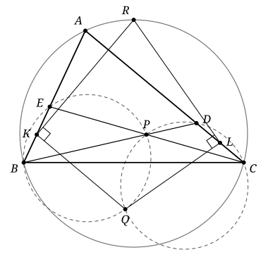

## Statement

Soit $ABC$ un triangle. Soient $D$ un point du segment $[AC]$ et $E$ un point du segment $[AB]$, distincts des sommets, tels que $BE = CD$. Soit $P$ le point d'intersection des droites $(BD)$ et $(CE)$. Les cercles circonscrits aux triangles $BEP$ et $CDP$ se recoupent en un point $Q$. Soient $K$ et $L$ les milieux respectifs de $[BE]$ et de $[CD]$. Soit $R$ le point d'intersection de la perpendiculaire à $(QK)$ passant par $K$ et de la perpendiculaire à $(QL)$ passant par $L$.

Montrer que :

1. le point $R$ est sur le cercle circonscrit au triangle $ABC$ ;
2. le point $Q$ est sur la bissectrice de l'angle $\widehat{BAC}$.

## Hints

1. Commencez par la question 2. Un point de la bissectrice se projette sur $(AB)$ et sur $(AC)$ à la même distance de $A$. Cherchez sur la bissectrice un point $Q_0$ tel que $Q_0B = Q_0D$ et $Q_0E = Q_0C$.
2. Montrez qu'une rotation de centre $Q_0$ envoie $B$ sur $D$ et $E$ sur $C$. Pour la construire, faites suivre la symétrie d'axe la bissectrice d'une symétrie d'axe perpendiculaire à $(AC)$.
3. Pour une rotation $\rho$ de centre $O$, l'angle orienté des droites $(XO)$ et $(X\rho(X))$ ne dépend pas du point $X$. Déduisez-en que $Q_0$ est sur les cercles $BEP$ et $CDP$, puis que $Q_0 = Q$.
4. Pour la question 1, prenez un repère orthonormé d'origine $A$ dont l'axe des abscisses est la bissectrice. Calculez les coordonnées de $R$, puis écrivez l'équation du cercle $ABC$.

## Solution

**Rappel.** Cette solution utilise deux outils qui ne sont pas au programme du lycée.

- *Angles orientés de droites.* Pour deux droites $d_1$ et $d_2$, on note $(d_1, d_2)$ l'angle dont il faut tourner $d_1$, dans le sens direct, pour la rendre parallèle à $d_2$. Il est défini à un multiple de $180^\circ$ près, et il vérifie la relation de Chasles $(d_1, d_2) + (d_2, d_3) = (d_1, d_3)$. On écrit $(MX, MY)$ pour l'angle des droites $(MX)$ et $(MY)$. Le théorème de l'angle inscrit devient alors, sans aucune discussion de figure : *si $M$, $N$, $X$, $Y$ sont quatre points distincts et si $M$, $X$, $Y$ ne sont pas alignés, alors ces quatre points sont sur un même cercle si et seulement si $(MX, MY) = (NX, NY)$.*
- *Rotations.* Une rotation $\rho$ de centre $O$ et d'angle $\theta$ conserve les distances et envoie le milieu d'un segment sur le milieu du segment image. Pour tout point $X \neq O$, l'angle orienté de vecteurs de $\overrightarrow{OX}$ vers $\overrightarrow{O\rho(X)}$ vaut $\theta$. Un demi-tour, c'est-à-dire une rotation d'angle $180^\circ$, envoie toute droite sur une droite parallèle. Enfin, si deux droites $\Delta$ et $\Delta'$ se coupent en $O$, la symétrie d'axe $\Delta$ suivie de la symétrie d'axe $\Delta'$ est une rotation de centre $O$.

**Notations.** On note $\alpha$ la moitié de l'angle $\widehat{BAC}$, de sorte que $0^\circ < \alpha < 90^\circ$, et $\Delta$ la droite qui porte la bissectrice de $\widehat{BAC}$. On pose $t = BE = CD > 0$. Comme $D$ et $E$ sont strictement à l'intérieur des côtés, les segments $[BD]$ et $[CE]$ se coupent en $P$ à l'intérieur du triangle : $P$ est strictement entre $B$ et $D$, strictement entre $C$ et $E$, et il n'est ni sur $(AB)$ ni sur $(AC)$.

On démontre d'abord la question 2, qui sert ensuite pour la question 1.

**Étape 1 : un point $Q_0$ de la bissectrice et une rotation.** On a $AE = AB - t$ et $AD = AC - t$, donc $AB + AD = AE + AC$. Notons $m$ la moitié de ce nombre :

$$m = \frac{AB + AD}{2} = \frac{AE + AC}{2} > 0 .$$

On gradue la droite $(AC)$ avec l'origine en $A$, dans le sens de $A$ vers $C$ : le point d'abscisse $x \geqslant 0$ est le point de $[AC)$ situé à la distance $x$ de $A$.

- La symétrie $s_1$ d'axe $\Delta$ échange les demi-droites $[AB)$ et $[AC)$ et conserve les distances à $A$. Elle envoie donc $B$ sur le point $B_1$ d'abscisse $AB$, et $E$ sur le point $E_1$ d'abscisse $AE$.
- Soit $H$ le point d'abscisse $m$, et $\Delta'$ la perpendiculaire à $(AC)$ en $H$. La symétrie $s_2$ d'axe $\Delta'$ laisse la droite $(AC)$ en place, et elle envoie le point d'abscisse $x$ sur le point d'abscisse $2m - x$, car $H$ est le milieu des deux. Elle envoie donc $B_1$ sur le point d'abscisse $2m - AB = AD$, c'est-à-dire $D$, et $E_1$ sur le point d'abscisse $2m - AE = AC$, c'est-à-dire $C$.

La droite $\Delta'$ est perpendiculaire à $(AC)$, alors que $\Delta$ fait avec $(AC)$ un angle $\alpha < 90^\circ$. Ces deux droites se coupent donc en un point $Q_0$. D'après le rappel, $\rho = s_2 \circ s_1$ est une rotation de centre $Q_0$, et

$$\rho(B) = D , \qquad \rho(E) = C .$$

Le point $Q_0$ de $\Delta$ se projette orthogonalement sur $(AC)$ en $H$, qui est sur $[AC)$ et distinct de $A$. Les points de $\Delta$ situés hors de l'angle se projettent sur la demi-droite opposée à $[AC)$, car ils font avec elle un angle de $180^\circ - \alpha > 90^\circ$. Donc $Q_0$ est sur la bissectrice de $\widehat{BAC}$, distinct de $A$, et le triangle $AHQ_0$ rectangle en $H$ donne

$$AQ_0 \cos\alpha = AH = m . \qquad (1)$$

Le seul point de $\Delta$ situé sur $(AB)$ ou sur $(AC)$ est $A$. Donc $Q_0$ n'est ni sur $(AB)$ ni sur $(AC)$, et il est distinct de $B$, $C$, $D$, $E$. Comme $\rho$ conserve les distances, $Q_0B = Q_0D$ et $Q_0E = Q_0C$.

Notons $\theta$ l'angle de $\rho$. Il n'est pas nul, car $\rho(B) = D \neq B$. Il ne vaut pas $180^\circ$ non plus : $\rho$ envoie la droite $(BE) = (AB)$ sur la droite $(DC) = (AC)$, qui ne lui est pas parallèle.

**Étape 2 : un angle qui ne dépend pas du point.** On choisit pour $\theta$ une mesure comprise entre $-180^\circ$ et $180^\circ$. Soit $X \neq Q_0$ et $X' = \rho(X)$. Montrons que, à $180^\circ$ près,

$$(XQ_0, XX') = \frac{\theta}{2} + 90^\circ ,$$

une valeur qui ne dépend pas de $X$. Comme $Q_0X = Q_0X'$, le triangle $Q_0XX'$ est isocèle en $Q_0$. Soit $M$ le milieu de $[XX']$. Il est distinct de $Q_0$, car $\theta \neq 180^\circ$. La droite $(Q_0M)$ est la bissectrice de l'angle en $Q_0$, donc $(Q_0X, Q_0M) = \theta/2$, et elle est perpendiculaire à $(XX')$. Par la relation de Chasles,

$$(XQ_0, XX') = (Q_0X, Q_0M) + (Q_0M, XX') = \frac{\theta}{2} + 90^\circ .$$

**Étape 3 : $Q_0 = Q$.**

*(a) $Q_0 \neq P$.* Sinon $P$ serait un point du segment $[BD]$ tel que $PB = PD$, donc le milieu de $[BD]$, et de même le milieu de $[CE]$. Le quadrilatère $BCDE$ aurait des diagonales $[BD]$ et $[CE]$ de même milieu : ce serait un parallélogramme, et $(BE)$ serait parallèle à $(CD)$, c'est-à-dire $(AB)$ parallèle à $(AC)$. C'est absurde.

*(b) $Q_0$ est sur le cercle $BEP$.* L'étape 2, appliquée à $X = B$ puis à $X = E$, donne $(BQ_0, BD) = (EQ_0, EC)$. Comme $(BD) = (BP)$ et $(EC) = (EP)$, cela s'écrit

$$(BQ_0, BP) = (EQ_0, EP) .$$

Les points $B$, $Q_0$, $P$ ne sont pas alignés. Sinon $(BQ_0, BP) = 0$, donc $(EQ_0, EP) = 0$, et $Q_0$ serait à la fois sur $(BP) = (BD)$ et sur $(EP) = (CE)$. Ces deux droites sont distinctes et se coupent seulement en $P$, donc $Q_0 = P$, ce que (a) interdit. Les points $B$, $E$, $Q_0$, $P$ sont distincts : $P$ et $Q_0$ ne sont pas sur $(AB)$, et $Q_0 \neq P$. Le critère du rappel, avec $M = B$, $N = E$, $X = Q_0$, $Y = P$, montre que $B$, $E$, $Q_0$, $P$ sont sur un même cercle.

*(c) $Q_0$ est sur le cercle $CDP$.* La rotation réciproque $\rho^{-1}$, de centre $Q_0$, envoie $D$ sur $B$ et $C$ sur $E$. Elle n'est ni l'identité ni un demi-tour, et l'étape 2 s'applique de la même façon à elle : $(DQ_0, DB) = (CQ_0, CE)$, c'est-à-dire $(DQ_0, DP) = (CQ_0, CP)$. Exactement comme en (b), on obtient que $D$, $C$, $Q_0$, $P$ sont sur un même cercle.

*(d) Conclusion.* Les cercles $BEP$ et $CDP$ sont distincts : un même cercle contenant $B$, $P$ et $D$ contiendrait trois points distincts alignés. Deux cercles distincts ont au plus deux points communs, ici $P$ et $Q$. Le point $Q_0$ leur est commun et différent de $P$, donc $Q_0 = Q$.

**Réponse à la question 2.** Le point $Q = Q_0$ est sur la bissectrice de l'angle $\widehat{BAC}$.

**Étape 4 : les coordonnées de $R$.** On prend le repère orthonormé d'origine $A$ dont l'axe des abscisses est $\Delta$, orienté vers l'intérieur de l'angle, et l'axe des ordonnées orienté pour que $B$ ait une ordonnée positive. Notons $k = AK$ et $l = AL$. Comme $K$ est le milieu de $[EB]$ sur la demi-droite $[AB)$, et $L$ le milieu de $[DC]$ sur $[AC)$,

$$k = \frac{AE + AB}{2} , \qquad l = \frac{AD + AC}{2} .$$

Les points ont pour coordonnées

$$K = (k\cos\alpha,\ k\sin\alpha) , \qquad L = (l\cos\alpha,\ -l\sin\alpha) , \qquad Q = (q,\ 0) ,$$

où $q = AQ$ vérifie $q\cos\alpha = m$ d'après $(1)$.

Un point $M = (x, y)$ est sur la perpendiculaire à $(QK)$ en $K$ si et seulement si $\overrightarrow{KM} \cdot \overrightarrow{KQ} = 0$, c'est-à-dire

$$(x - k\cos\alpha)(q - k\cos\alpha) - k\sin\alpha\,(y - k\sin\alpha) = 0 .$$

En développant, avec $q\cos\alpha = m$ et $\cos^2\alpha + \sin^2\alpha = 1$, cela devient

$$x\,(q - k\cos\alpha) - k\sin\alpha \cdot y = k\,(m - k) .$$

De même, $M$ est sur la perpendiculaire à $(QL)$ en $L$ si et seulement si

$$x\,(q - l\cos\alpha) + l\sin\alpha \cdot y = l\,(m - l) .$$

Or $m - k = (AD - AE)/2$ et $m - l = (AE - AD)/2$. Posons $w = (AE - AD)/2$, de sorte que $m - k = -w$ et $m - l = w$. Le point $x = 0$, $y = w/\sin\alpha$ vérifie les deux équations : la première devient $-k\,w = -k\,w$, la seconde $l\,w = l\,w$. Les deux perpendiculaires se coupent en un seul point, qui est $R$ par définition. Donc $R = (0, h)$ avec

$$h = \frac{w}{\sin\alpha} = \frac{AE - AD}{2\sin\alpha} = \frac{AB - AC}{2\sin\alpha} ,$$

car $AE - AD = (AB - t) - (AC - t) = AB - AC$.

**Étape 5 : $R$ est sur le cercle $ABC$.** Soit $(x_0, y_0)$ le centre du cercle circonscrit à $ABC$ et $r$ son rayon. Comme $A$ est sur le cercle, $x_0^2 + y_0^2 = r^2$. L'équation $(x - x_0)^2 + (y - y_0)^2 = r^2$ du cercle s'écrit donc

$$x^2 + y^2 - 2x_0\,x - 2y_0\,y = 0 .$$

Le point $B = (AB\cos\alpha,\ AB\sin\alpha)$ est sur le cercle. En divisant par $AB$, on obtient $AB = 2x_0\cos\alpha + 2y_0\sin\alpha$. De même, avec $C = (AC\cos\alpha,\ -AC\sin\alpha)$, on obtient $AC = 2x_0\cos\alpha - 2y_0\sin\alpha$. En soustrayant,

$$AB - AC = 4\,y_0\sin\alpha , \qquad \text{donc} \qquad h = 2y_0 .$$

Pour le point $R = (0, h)$, le membre de gauche de l'équation vaut $h^2 - 2y_0\,h = h\,(h - 2y_0) = 0$. Donc $R$ est sur le cercle circonscrit à $ABC$.

**Conclusion.** Le point $R$ est sur le cercle circonscrit au triangle $ABC$ (question 1), et le point $Q$ est sur la bissectrice de l'angle $\widehat{BAC}$ (question 2).

## Going further

1. D'après l'étape 4, le point $R$ ne dépend pas du choix de $D$ et $E$. Montrer que $RB = RC$. Le point $R$ est donc le milieu de l'arc $BC$ du cercle $ABC$ qui contient $A$.
2. Que devient $R$ quand le triangle est isocèle en $A$ ? Le vérifier directement sur la figure, en montrant que $(QK)$ est alors perpendiculaire à $(AB)$.
