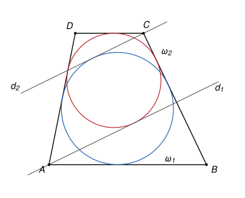

## Statement

Soit $ABCD$ un trapèze avec $(AB) \parallel (CD)$. Deux cercles $\omega_1$ et $\omega_2$ sont situés à l'intérieur du trapèze, de sorte que :

- $\omega_1$ est tangent aux droites $(DA)$, $(AB)$ et $(BC)$ ;
- $\omega_2$ est tangent aux droites $(BC)$, $(CD)$ et $(DA)$.

Soit $d_1$ la tangente à $\omega_2$ passant par $A$, autre que $(AD)$, et soit $d_2$ la tangente à $\omega_1$ passant par $C$, autre que $(CB)$.

Montrer que les droites $d_1$ et $d_2$ sont parallèles.

## Hints

1. Commence par le cas où $AB = CD$ : le trapèze est alors un parallélogramme, et une transformation simple échange tout.
2. Si $AB > CD$, prolonge les côtés $[AD]$ et $[BC]$ jusqu'à leur point de rencontre $E$. Que sont $\omega_1$ et $\omega_2$ pour les triangles $EAB$ et $EDC$ ? Où sont leurs centres $I_1$ et $I_2$ ?
3. Les deux tangentes menées d'un point à un cercle sont symétriques par rapport à la droite qui joint ce point au centre. Exprime l'angle entre $d_1$ et $(AB)$ à l'aide de l'angle $\widehat{EAI_2}$, et l'angle entre $d_2$ et $(CD)$ à l'aide de l'angle $\widehat{ECI_1}$.
4. Montre que $EA \times EC = EI_1 \times EI_2$, puis que les triangles $EAI_2$ et $EI_1C$ sont semblables. Pour l'égalité des produits, compare d'abord $EA \times EB$ avec le produit des distances de $E$ aux centres du cercle inscrit et du cercle exinscrit du triangle $EAB$.

## Solution

Le trapèze $ABCD$ est convexe, de bases $[AB]$ et $[CD]$. On note $\widehat{XYZ}$ l'angle géométrique (entre $0°$ et $180°$) formé par les demi-droites $[YX)$ et $[YZ)$.

**Étape 0. Le cas $AB = CD$, et une réduction.**

Si $AB = CD$, le quadrilatère $ABCD$ est un parallélogramme. Soit $s$ la symétrie centrale par rapport à son centre. Elle échange $A$ et $C$, ainsi que $B$ et $D$, donc elle échange les droites $(DA)$ et $(BC)$, ainsi que $(AB)$ et $(CD)$, et elle envoie le parallélogramme sur lui-même. Le cercle $s(\omega_1)$ est donc à l'intérieur du parallélogramme et tangent à $(BC)$, $(CD)$ et $(DA)$. Or il n'existe qu'un tel cercle : comme $(DA) \parallel (BC)$, son centre est sur la droite parallèle à mi-distance de ces deux côtés et son rayon vaut la moitié de leur distance, puis la tangence à $(CD)$ fixe le centre. Donc $s(\omega_1) = \omega_2$, et de même $s(\omega_2) = \omega_1$. La droite $s(d_1)$ passe par $s(A) = C$, est tangente à $s(\omega_2) = \omega_1$ et est différente de $s((AD)) = (CB)$ : c'est $d_2$. Une symétrie centrale envoie toute droite sur une droite parallèle, donc $d_1 \parallel d_2$.

Si $AB < CD$, on renomme les points : $A, B, C, D$ deviennent $C, D, A, B$. Les hypothèses sont les mêmes, avec $\omega_1$ et $\omega_2$ échangés, ainsi que $d_1$ et $d_2$. On peut donc supposer désormais que $AB > CD$.

**Étape 1. Le point $E$ et les deux cercles.**

Comme $AB > CD$, les droites $(AD)$ et $(BC)$ se coupent en un point $E$ situé du côté de $(CD)$. D'après le théorème de Thalès, $\dfrac{ED}{EA} = \dfrac{EC}{EB} = \dfrac{DC}{AB} = k$, avec $k < 1$. Le point $D$ est donc entre $E$ et $A$, et $C$ entre $E$ et $B$. Le triangle $EDC$ est une réduction du triangle $EAB$ : c'est l'image de $EAB$ par l'homothétie $h$ de centre $E$ et de rapport $k$.

On note $2\theta$ l'angle $\widehat{AEB}$, et $a = \widehat{EAB}$, $b = \widehat{EBA}$ les deux autres angles du triangle $EAB$, de sorte que $a + b + 2\theta = 180°$.

- Le trapèze est contenu dans le triangle $EAB$. Le cercle $\omega_1$ est donc à l'intérieur du triangle $EAB$ et tangent à ses trois côtés : c'est son **cercle inscrit**. On note $I_1$ son centre.
- Le cercle $\omega_2$ est tangent aux trois droites $(ED)$, $(EC)$, $(DC)$, à l'intérieur de l'angle $\widehat{DEC}$ mais de l'autre côté de $(DC)$ par rapport à $E$. On l'appelle le **cercle exinscrit** au triangle $EDC$ dans l'angle $E$. On note $I_2$ son centre.

Chacun des deux centres est à égale distance des droites $(EA)$ et $(EB)$, à l'intérieur de l'angle $\widehat{AEB}$ : $I_1$ et $I_2$ sont sur la bissectrice de cet angle. Ainsi $\widehat{AEI_2} = \widehat{I_1EC} = \theta$.

**Étape 2. Un lemme : $EA \times EC = EI_1 \times EI_2$.**

Soit $\Omega$ le cercle exinscrit au triangle $EAB$ dans l'angle $E$ (tangent à $(EA)$, $(EB)$ et $(AB)$, de l'autre côté de $(AB)$ par rapport à $E$), et $J$ son centre. Comme $I_1$, le point $J$ est sur la bissectrice de l'angle $\widehat{AEB}$.

*Calcul de $\widehat{EJA}$.* Le point $J$ est à égale distance des droites $(AE)$ et $(AB)$, donc la droite $(AJ)$ est une bissectrice d'un des angles formés par ces deux droites. Le point $J$ est de l'autre côté de $(AB)$ par rapport à $E$, et du même côté de $(AE)$ que $B$ : il est dans l'angle formé par $[AB)$ et par le prolongement de $[EA]$ au-delà de $A$. Cet angle mesure $180° - a$, et $(AJ)$ le coupe en deux, donc

$$\widehat{EAJ} = a + \frac{180° - a}{2} = 90° + \frac{a}{2}.$$

Dans le triangle $EAJ$, on obtient $\widehat{EJA} = 180° - \theta - 90° - \dfrac{a}{2} = \dfrac{180° - 2\theta - a}{2} = \dfrac{b}{2}$.

*Deux triangles semblables.* Comme $(BI_1)$ est la bissectrice de l'angle en $B$ du triangle $EAB$, on a aussi $\widehat{EBI_1} = \dfrac{b}{2}$. Les triangles $EAJ$ et $EI_1B$ ont donc deux angles égaux ($\theta$ en $E$, et $\dfrac{b}{2}$ en $J$ et en $B$) : ils sont semblables, avec la correspondance $E \leftrightarrow E$, $A \leftrightarrow I_1$, $J \leftrightarrow B$. Donc

$$\frac{EA}{EI_1} = \frac{EJ}{EB}, \qquad \text{c'est-à-dire} \qquad EA \times EB = EI_1 \times EJ.$$

*Retour au triangle $EDC$.* L'homothétie $h$ fixe les droites $(EA)$ et $(EB)$ et envoie $(AB)$ sur la parallèle $(DC)$. Elle envoie donc $\Omega$ sur un cercle tangent à $(EA)$, $(EB)$ et $(DC)$, situé dans l'angle $\widehat{DEC}$ de l'autre côté de $(DC)$ : c'est $\omega_2$. Ainsi $I_2 = h(J)$ et $EI_2 = k \times EJ$. Comme aussi $EC = k \times EB$ :

$$EA \times EC = k \times EA \times EB = k \times EI_1 \times EJ = EI_1 \times EI_2.$$

**Étape 3. Les triangles $EAI_2$ et $EI_1C$ sont semblables.**

L'égalité de l'étape 2 s'écrit $\dfrac{EA}{EI_1} = \dfrac{EI_2}{EC}$. Les triangles $EAI_2$ et $EI_1C$ ont donc un angle égal en $E$ (il vaut $\theta$ dans les deux) compris entre des côtés proportionnels. Ils sont semblables, avec $E \leftrightarrow E$, $A \leftrightarrow I_1$, $I_2 \leftrightarrow C$. En particulier, en posant $\alpha = \widehat{EAI_2}$ et $\gamma = \widehat{ECI_1}$ :

$$\widehat{EI_1C} = \alpha, \qquad \text{et donc, dans le triangle } EI_1C : \qquad \theta + \alpha + \gamma = 180°.$$

**Étape 4. L'angle entre $d_1$ et $(AB)$.**

La symétrie par rapport à la droite $(AI_2)$ laisse $A$ fixe et envoie $\omega_2$ sur lui-même. Elle échange donc les deux tangentes à $\omega_2$ issues de $A$ : $d_1$ est la symétrique de $(AD)$ par rapport à $(AI_2)$.

Soit $S$ le point de contact de $\omega_2$ avec $(AD)$, et $T$ son point de contact avec $d_1$. Ils sont dans le trapèze, donc $[AS) = [AD) = [AE)$, et la demi-droite $[AT)$, symétrique de $[AS)$, fait avec elle l'angle $2\widehat{SAI_2} = 2\alpha$. Comme $\omega_2$ est dans le trapèze, la demi-droite $[AT)$ est à l'intérieur de l'angle $\widehat{DAB}$, qui vaut $a$. Donc

$$\varphi_1 = \widehat{TAB} = a - 2\alpha.$$

**Étape 5. L'angle entre $d_2$ et $(CD)$.**

De même, $d_2$ est la symétrique de $(CB)$ par rapport à $(CI_1)$. Soit $V$ le point de contact de $\omega_1$ avec $(CB)$ et $U$ son point de contact avec $d_2$. On a $[CV) = [CB)$. Comme $C$ est entre $E$ et $B$, les demi-droites $[CB)$ et $[CE)$ sont opposées, donc $\widehat{BCI_1} = 180° - \gamma$, et $\widehat{BCU} = 2(180° - \gamma)$. La demi-droite $[CU)$ est à l'intérieur de l'angle $\widehat{BCD}$, et comme $(AB) \parallel (CD)$, les angles $\widehat{ABC}$ et $\widehat{BCD}$ sont supplémentaires : $\widehat{BCD} = 180° - b$. Donc

$$\varphi_2 = \widehat{UCD} = (180° - b) - 2(180° - \gamma) = 2\gamma - b - 180°.$$

**Étape 6. Conclusion.**

D'après l'étape 3, $\gamma = 180° - \theta - \alpha$, donc

$$\varphi_2 = 360° - 2\theta - 2\alpha - b - 180° = (180° - 2\theta - b) - 2\alpha = a - 2\alpha = \varphi_1.$$

Plaçons-nous dans un repère orthonormé d'origine $A$, dont l'axe des abscisses est $(AB)$ orienté de $A$ vers $B$, et où le trapèze est du côté des ordonnées positives. La demi-droite $[AT)$ part vers le haut en faisant l'angle $\varphi_1$ avec $[AB)$ : elle est dirigée par le vecteur $(\cos\varphi_1, \sin\varphi_1)$. La demi-droite $[CD)$ est dirigée par $(-1, 0)$, et $[CU)$ part vers le bas en faisant l'angle $\varphi_2$ avec elle : elle est dirigée par $(-\cos\varphi_2, -\sin\varphi_2)$.

Comme $\varphi_1 = \varphi_2$, ces deux vecteurs sont opposés, donc colinéaires. **Les droites $d_1$ et $d_2$ sont parallèles.**

## Going further

L'égalité $EA \times EB = EI_1 \times EJ$ de l'étape 2 est vraie dans tout triangle : le produit des deux côtés issus d'un sommet est égal au produit des distances de ce sommet au centre du cercle inscrit et au centre du cercle exinscrit correspondant.

Le corrigé officiel suit une autre voie. Il trace la parallèle à $d_1$ passant par $C$, qui coupe $(AB)$ en un point $Y$. En comptant des longueurs de tangentes, il montre que le quadrilatère $EAYC$ a des sommes de côtés opposés égales : $EA + YC = AY + CE$. Un quadrilatère convexe qui a cette propriété possède un cercle tangent à ses quatre côtés (c'est la réciproque du théorème de Pitot). Ce cercle est tangent à $(EA)$, $(AB)$ et $(EC)$, donc c'est $\omega_1$, et la parallèle à $d_1$ est bien tangente à $\omega_1$.
