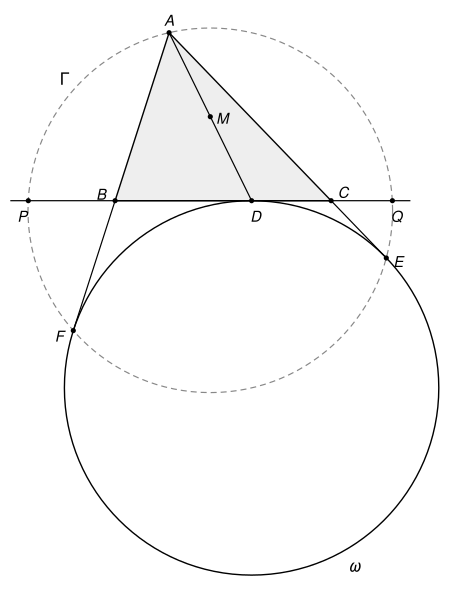

## Statement

Soit $ABC$ un triangle avec $AB \neq AC$. On note $\omega$ son cercle exinscrit dans l'angle
$\widehat{A}$ : c'est le cercle tangent au segment $[BC]$, à la demi-droite $[AB)$ au-delà de $B$
et à la demi-droite $[AC)$ au-delà de $C$. Ses points de contact avec $[BC]$, $[AC)$ et $[AB)$
sont notés $D$, $E$ et $F$.

Le cercle $\Gamma$ circonscrit au triangle $AEF$ recoupe la droite $(BC)$ en $P$ et $Q$. On note
$M$ le milieu de $[AD]$.

Montrer que le cercle circonscrit au triangle $MPQ$ est tangent à $\omega$.

## Hints

1. Note $J$ le centre de $\omega$. Que valent les angles $\widehat{AEJ}$ et $\widehat{AFJ}$ ? Qu'est-ce
   que le cercle $\Gamma$ ?
2. Soit $T$ le second point où la droite $(AD)$ coupe $\omega$, et $N$ le milieu de $[DT]$.
   Montre que $N$ est sur $\Gamma$, puis compare $DP \cdot DQ$ et $DM \cdot DT$. Tu dois obtenir que
   $M$, $P$, $Q$, $T$ sont sur un même cercle.
3. Pour la tangence en $T$, trace la tangente à $\omega$ en $T$. Elle coupe $(BC)$ en un point $X$.
   Compare $XT$ et $XD$.
4. Montre que $XD^2 = XN \cdot XJ$, puis que $XN \cdot XJ = XP \cdot XQ$.

## Solution

On commence par quatre outils, que l'on démontre.

### Quatre outils

**Outil 1 (deux cordes qui se coupent).** Si deux cordes $[UV]$ et $[U'V']$ d'un même cercle se
coupent en un point $Z$, alors $ZU \cdot ZV = ZU' \cdot ZV'$. En effet, les triangles $ZUU'$ et
$ZV'V$ ont des angles égaux en $Z$ (opposés par le sommet), et $\widehat{ZUU'} = \widehat{VUU'}$
et $\widehat{ZV'V} = \widehat{U'V'V}$ sont deux angles inscrits qui interceptent le même arc
$U'V$. Ces deux triangles sont donc semblables, d'où $\dfrac{ZU}{ZV'} = \dfrac{ZU'}{ZV}$.

**Outil 2 (deux sécantes issues d'un point extérieur).** Soit $X$ un point extérieur à un cercle.
Si une droite passant par $X$ coupe le cercle en $U$ et $V$, et une autre en $U'$ et $V'$ (avec
$U$ entre $X$ et $V$, et $U'$ entre $X$ et $V'$), alors $XU \cdot XV = XU' \cdot XV'$. En effet,
les triangles $XUV'$ et $XU'V$ ont le même angle en $X$. De plus,
$\widehat{XV'U} = \widehat{U'V'U}$ et $\widehat{XVU'} = \widehat{UVU'}$ sont deux angles inscrits
qui interceptent le même arc $UU'$, avec $V$ et $V'$ du même côté de $(UU')$. Les deux triangles
sont donc semblables, d'où $\dfrac{XU}{XU'} = \dfrac{XV'}{XV}$.

**Outil 3 (critère de tangence).** Soit $X$ un point extérieur à un cercle $\mathcal{C}$, et $U$,
$V$ deux points de $\mathcal{C}$ alignés avec $X$. Si un point $T$ de $\mathcal{C}$ vérifie
$XT^2 = XU \cdot XV$, alors la droite $(XT)$ est tangente à $\mathcal{C}$ en $T$. En effet, sinon
elle recouperait $\mathcal{C}$ en un point $T' \neq T$. Comme $X$ est extérieur au cercle, $T$ et
$T'$ sont du même côté de $X$, et l'outil 2 donne $XT \cdot XT' = XU \cdot XV = XT^2$, donc
$XT' = XT$, puis $T' = T$, ce qui est absurde.

**Outil 4 (cercle de diamètre).** Soient $A$ et $J$ deux points distincts et $I$ le milieu de
$[AJ]$. Pour tout point $Z$, en écrivant $\overrightarrow{ZA} = \overrightarrow{ZI} + \overrightarrow{IA}$
et $\overrightarrow{ZJ} = \overrightarrow{ZI} - \overrightarrow{IA}$,
$$\overrightarrow{ZA} \cdot \overrightarrow{ZJ} = ZI^2 - IA^2.$$
Donc $Z$ est sur le cercle de diamètre $[AJ]$ exactement quand ce produit scalaire est nul (par
exemple quand l'angle $\widehat{AZJ}$ est droit), et $Z$ est à l'intérieur de ce cercle exactement
quand ce produit scalaire est strictement négatif.

### Étape 1 : $\Gamma$ est le cercle de diamètre $[AJ]$

Soit $J$ le centre de $\omega$ et $r$ son rayon. Un rayon est perpendiculaire à la tangente en son
extrémité, donc $(JE) \perp (AC)$ et $(JF) \perp (AB)$ : les angles $\widehat{AEJ}$ et
$\widehat{AFJ}$ sont droits. D'après l'outil 4, $E$ et $F$ sont sur le cercle de diamètre $[AJ]$.
Ce cercle passe par $A$, $E$, $F$, qui ne sont pas alignés : c'est le cercle $\Gamma$.

De plus, $(JD) \perp (BC)$, pour la même raison.

### Étape 2 : où sont les points

**Le point $J$ n'est pas sur la droite $(AD)$.** Le point $J$ est à la même distance des droites
$(AB)$ et $(AC)$, à l'intérieur de l'angle $\widehat{BAC}$ : la droite $(AJ)$ est la bissectrice de
cet angle. Si $J$ était sur $(AD)$, la droite $(AD) = (JD)$ serait perpendiculaire à $(BC)$, et la
bissectrice issue de $A$ serait aussi une hauteur. Les deux triangles rectangles qu'elle découpe
auraient un côté commun et les mêmes angles, ils seraient égaux, et on aurait $AB = AC$, ce qui
est exclu.

**Le point $D$ est à l'intérieur de $\Gamma$.** Le cercle $\omega$ est tangent à $(BC)$, donc il
est tout entier d'un même côté de $(BC)$. Il touche la demi-droite $[AB)$ au-delà de $B$ : il est
donc du côté de $(BC)$ opposé à $A$, et $J$ aussi. Le vecteur $\overrightarrow{DJ}$ est
perpendiculaire à $(BC)$ et dirigé vers le côté opposé à $A$, tandis que $\overrightarrow{DA}$ va
vers le côté de $A$. Si $h$ est la distance de $A$ à $(BC)$, on obtient
$$\overrightarrow{DA} \cdot \overrightarrow{DJ} = -h\,r < 0.$$
D'après l'outil 4, $D$ est à l'intérieur de $\Gamma$. La droite $(BC)$ coupe donc $\Gamma$ en $P$ et
$Q$, et $D$ est strictement entre $P$ et $Q$.

**Le point $T$.** La droite $(AD)$ n'est pas tangente à $\omega$ en $D$ (la tangente en $D$ est
$(BC)$), donc elle recoupe $\omega$ en un point $T \neq D$. Le segment $[AD]$ est, sauf son
extrémité $D$, du côté de $A$, où il n'y a aucun point de $\omega$. Donc $T$ est au-delà de $D$.
Notons $N$ le milieu de $[DT]$. Sur la droite $(AD)$, les points sont dans l'ordre
$$A, \quad M, \quad D, \quad N, \quad T.$$

### Étape 3 : $M$, $P$, $Q$, $T$ sont sur un même cercle

**Le point $N$ est sur $\Gamma$.** Le triangle $JDT$ est isocèle en $J$ (car $JD = JT = r$), donc
la droite $(JN)$, qui joint $J$ au milieu de la base, est perpendiculaire à $(DT)$. Comme $A$ est sur
$(DT)$, l'angle $\widehat{ANJ}$ est droit ($N \neq J$ puisque $J$ n'est pas sur $(AD)$). D'après
l'outil 4, $N$ est sur $\Gamma$.

**Le calcul.** Le point $D$ est sur les deux cordes $[PQ]$ et $[AN]$ de $\Gamma$. L'outil 1 donne,
avec $DA = 2\,DM$ et $DN = \frac{1}{2} DT$,
$$DP \cdot DQ = DA \cdot DN = 2\,DM \cdot \tfrac{1}{2}\,DT = DM \cdot DT.$$

**La conclusion.** Soit $\mathcal{C}$ le cercle circonscrit au triangle $MPQ$ (le point $M$ n'est pas
sur $(BC)$). Le point $D$ est strictement entre $P$ et $Q$, donc à l'intérieur de $\mathcal{C}$. La
droite $(MD)$ recoupe donc $\mathcal{C}$ en un point $T'$, avec $D$ entre $M$ et $T'$. L'outil 1,
appliqué dans $\mathcal{C}$, donne
$$DM \cdot DT' = DP \cdot DQ = DM \cdot DT,$$
donc $DT' = DT$. Les points $T$ et $T'$ sont tous deux sur la demi-droite issue de $D$ opposée à
$M$, donc $T' = T$. **Le point $T$ est sur le cercle $\mathcal{C}$.**

### Étape 4 : la tangente à $\omega$ en $T$ est tangente à $\mathcal{C}$

**Le point $X$.** La tangente à $\omega$ en $T$ n'est pas parallèle à $(BC)$ : sinon $T$ serait le
point de $\omega$ diamétralement opposé à $D$, et $J$ serait sur $(DT) = (AD)$, ce qui est exclu.
Elle coupe donc $(BC)$ en un point $X$.

**On a $XD = XT$.** Les triangles $XDJ$ et $XTJ$ sont rectangles en $D$ et en $T$, avec la même
hypoténuse $[XJ]$ et $JD = JT = r$. Le théorème de Pythagore donne $XD^2 = XJ^2 - r^2 = XT^2$.

**On a $XD^2 = XN \cdot XJ$.** Les points $X$ et $J$ sont tous deux à égale distance de $D$ et de
$T$ : ils sont sur la médiatrice de $[DT]$, qui passe par $N$ et est perpendiculaire à $(DT)$.
Dans le triangle $XDJ$ rectangle en $D$, le point $N$ est donc le pied de la hauteur issue de $D$,
et il est sur le segment $[XJ]$. Les triangles $XND$ et $XDJ$ sont rectangles en $N$ et en $D$ et
ont le même angle en $X$ : ils sont semblables, d'où $\dfrac{XN}{XD} = \dfrac{XD}{XJ}$, soit
$$XD^2 = XN \cdot XJ.$$

**On a $XN \cdot XJ = XP \cdot XQ$.** Le point $N$ n'est pas sur $(BC)$ (il est sur $(AD)$, au-delà
de $D$), donc $N \neq X$, et $N$ est strictement entre $X$ et $J$. Les points $N$ et $J$ sont sur
$\Gamma$, et la droite $(NJ)$ ne rencontre le disque de $\Gamma$ que le long du segment $[NJ]$ :
le point $X$ est donc extérieur à $\Gamma$. L'outil 2, avec les droites $(XJ)$ et $(XP)$, donne
$$XN \cdot XJ = XP \cdot XQ.$$

**La tangence.** En réunissant les trois égalités,
$$XT^2 = XD^2 = XN \cdot XJ = XP \cdot XQ.$$
Comme $X$ est extérieur à $\Gamma$, il n'est pas sur le segment $[PQ]$. Or la droite $(PQ)$ ne
rencontre le disque de $\mathcal{C}$ que le long de $[PQ]$, donc $X$ est aussi extérieur à
$\mathcal{C}$. Le point $T$ est sur $\mathcal{C}$ (étape 3), et l'outil 3 montre que **la droite
$(XT)$ est tangente à $\mathcal{C}$ en $T$.**

### Conclusion

Les cercles $\omega$ et $\mathcal{C}$ passent tous deux par $T$ et y sont tangents à la même droite
$(XT)$. Leurs centres sont donc tous deux sur la perpendiculaire à $(XT)$ en $T$. **Le cercle
circonscrit au triangle $MPQ$ est tangent à $\omega$, au point $T$.**
