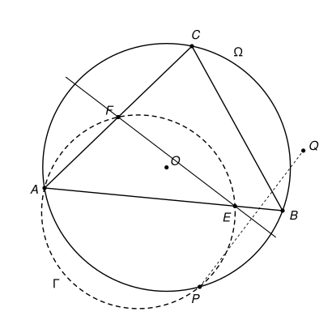

## Statement

Soit $ABC$ un triangle. Soient $E$ un point de la droite $(AB)$ et $F$ un point de la droite
$(AC)$, tous deux distincts de $A$, $B$ et $C$. On note $\Omega$ le cercle circonscrit au triangle
$ABC$, $O$ son centre, et $\Gamma$ le cercle circonscrit au triangle $AEF$. On suppose que les
cercles $\Gamma$ et $\Omega$ se recoupent en un point $P$ distinct de $A$, et on note $Q$ le
symétrique de $P$ par rapport à la droite $(EF)$.

Montrer que $Q$ appartient à la droite $(BC)$ si et seulement si $O$ appartient au cercle
$\Gamma$.

## Hints

1. Pour ne pas avoir à distinguer les cas de figure, travaille avec des angles orientés de
   droites (voir le rappel au début de la solution).
2. Introduis le point $T$ où la droite $(EF)$ coupe la droite $(BC)$. Comme $T$ est sur l'axe de
   la symétrie, $Q$ est sur $(BC)$ exactement quand la droite $(EF)$ fait le même angle avec
   $(TP)$ qu'avec $(TB)$, de part et d'autre.
3. Montre que les points $P$, $T$, $E$, $B$ sont sur un même cercle. Pour cela, compare l'angle
   entre $(EP)$ et $(EF)$ à l'angle entre $(BP)$ et $(BC)$, en passant par le point $A$.
4. Traduis chacune des deux conditions en une égalité d'angles dans le triangle $PEB$. Pour
   « $O$ est sur $\Gamma$ », utilise l'angle au centre : l'angle en $O$ entre $(OA)$ et $(OP)$ est
   le double d'un angle inscrit dans $\Omega$.

## Solution

**Rappel.** Ce problème se résout avec les *angles orientés de droites*, qui ne sont pas au
programme du lycée. Pour deux droites $d$ et $d'$, on note $(d, d')$ l'angle dont il faut faire
tourner $d$, dans le sens direct, pour la rendre parallèle à $d'$. Cet angle n'est connu qu'à
$180^\circ$ près, puisque tourner une droite de $180^\circ$ redonne la même droite. Toutes les
égalités d'angles de cette solution s'entendent donc à $180^\circ$ près. L'intérêt de cet outil
est qu'on n'a jamais à distinguer les cas selon la position des points sur la figure. On utilise
quatre règles.

- **(R1) Relation de Chasles.** $(d_1, d_2) + (d_2, d_3) = (d_1, d_3)$, et $(d, d') = -(d', d)$.
  De plus, $(d, d') = 0$ si et seulement si $d$ et $d'$ sont parallèles. En particulier, deux
  droites qui passent par un même point et qui font le même angle avec une troisième droite sont
  égales.
- **(R2) Symétrie.** Une symétrie axiale $s$ change le signe des angles :
  $(s(d), s(d')) = -(d, d') = (d', d)$.
- **(R3) Angle inscrit.** Soient $A$, $B$, $M$ trois points non alignés et $N$ un point distinct
  de $A$ et de $B$. Alors $N$ est sur le cercle qui passe par $A$, $B$, $M$ si et seulement si
  $(MA, MB) = (NA, NB)$.
- **(R4) Angle au centre.** Si $A$, $B$, $M$ sont trois points distincts d'un cercle de centre
  $O$, alors $(OA, OB) = 2\,(MA, MB)$.

### Étape 0 : quelques points qui ne peuvent pas coïncider

Le point $E$ est sur la droite $(AB)$ et distinct de $A$ et de $B$. Or un cercle coupe une droite
en au plus deux points, et $\Omega$ coupe déjà $(AB)$ en $A$ et $B$ : donc $E$ n'est pas sur
$\Omega$. De même, $F$ n'est pas sur $\Omega$. Comme $P$ est sur $\Omega$, on a $P \neq E$ et
$P \neq F$.

Si l'on avait $P = B$, les trois points distincts $A$, $E$, $B$ de la droite $(AB)$ seraient sur
le cercle $\Gamma$, ce qui est impossible. Donc $P \neq B$, et de même $P \neq C$. Le point $P$ de
$\Omega$, distinct de $A$, $B$ et $C$, n'est donc sur aucune des droites $(AB)$, $(AC)$, $(BC)$.

Enfin, $E$, $F$, $P$ sont trois points distincts du cercle $\Gamma$, donc ils ne sont pas alignés :
$P$ n'est pas sur la droite $(EF)$, et donc $Q \neq P$.

### Étape 1 : les points $P$, $T$, $E$, $B$ sont sur un même cercle

Les points $A$, $E$, $F$, $P$ sont sur $\Gamma$. La règle (R3), appliquée à la corde $[PF]$ vue
depuis $A$ et depuis $E$, donne $(EP, EF) = (AP, AF)$. Comme la droite $(AF)$ est la droite
$(AC)$, c'est aussi $(AP, AC)$. Les points $A$, $B$, $C$, $P$ sont sur $\Omega$, et la règle (R3),
appliquée à la corde $[PC]$ vue depuis $A$ et depuis $B$, donne $(AP, AC) = (BP, BC)$. Ainsi
$$(EP, EF) = (BP, BC). \qquad (1)$$

**Les droites $(EF)$ et $(BC)$ ne sont pas parallèles.** Sinon, on pourrait remplacer $(EF)$ par
$(BC)$ dans (1), ce qui donnerait $(EP, BC) = (BP, BC)$, puis, avec (R1),
$(EP, BP) = (EP, BC) + (BC, BP) = 0$. Les droites $(EP)$ et $(BP)$ seraient parallèles. Comme
elles passent toutes les deux par $P$, elles seraient égales, et $P$ serait sur la droite
$(EB)$, c'est-à-dire sur $(AB)$. C'est exclu par l'étape 0.

Notons donc $T$ le point d'intersection des droites $(EF)$ et $(BC)$. On a :

- $T \neq E$, car $E$ n'est pas sur $(BC)$ (les droites $(AB)$ et $(BC)$ ne se coupent qu'en $B$) ;
- $T \neq B$, car sinon la droite $(EF)$ passerait par $B$ et $E$, donc serait la droite $(AB)$, et
  $F$ serait sur $(AB)$ et sur $(AC)$, donc égal à $A$ ;
- $T \neq P$, car $P$ n'est pas sur $(BC)$.

Puisque $(EF) = (ET)$ et $(BC) = (BT)$, l'égalité (1) s'écrit $(EP, ET) = (BP, BT)$. Les points
$P$, $T$, $B$ ne sont pas alignés (car $P$ n'est pas sur $(BC)$), et $E$ est distinct de $P$ et de
$T$. D'après (R3), le point $E$ est sur le cercle qui passe par $P$, $T$, $B$. Notons $\omega$ ce
cercle : **les quatre points $P$, $T$, $E$, $B$ sont sur $\omega$.**

### Étape 2 : traduire « $Q$ est sur $(BC)$ »

Notons $s$ la symétrie par rapport à la droite $(EF)$. Elle laisse fixes les points $T$ et $E$, et
$Q = s(P)$. Comme $P \neq T$, on a aussi $Q \neq T$.

Le point $Q$ est sur $(BC)$ si et seulement si les droites $(TQ)$ et $(TB)$ sont égales. Ces deux
droites passent par $T$, donc d'après (R1), c'est le cas si et seulement si
$(TE, TQ) = (TE, TB)$. Or la symétrie $s$ envoie la droite $(TE)$ sur elle-même et la droite
$(TP)$ sur la droite $(TQ)$, donc d'après (R2), $(TE, TQ) = (TP, TE)$. Ainsi
$$Q \in (BC) \iff (TE, TB) = (TP, TE).$$

Utilisons maintenant le cercle $\omega$. La règle (R3), appliquée à la corde $[EB]$ vue depuis $T$
et depuis $P$, donne $(TE, TB) = (PE, PB)$. Appliquée à la corde $[PE]$ vue depuis $T$ et depuis
$B$, elle donne $(TP, TE) = (BP, BE)$. Donc
$$Q \in (BC) \iff (PE, PB) = (BP, BE). \qquad (2)$$

### Étape 3 : traduire « $O$ est sur $\Gamma$ »

Les points $A$, $P$, $E$ sont trois points de $\Gamma$, non alignés puisque $P$ n'est pas sur
$(AB)$. Le centre $O$ de $\Omega$ n'est pas sur $\Omega$, donc il est distinct de $A$ et de $P$.
D'après (R3), $O$ est sur $\Gamma$ si et seulement si $(EA, EP) = (OA, OP)$.

D'une part, $A$, $P$, $B$ sont trois points distincts de $\Omega$, donc d'après (R4),
$(OA, OP) = 2\,(BA, BP)$. D'autre part, la droite $(EA)$ est la droite $(BA)$, donc d'après (R1),
$(EA, EP) = (BA, EP) = (BA, BP) + (BP, EP)$. Par conséquent,
$$O \in \Gamma \iff (BA, BP) + (BP, EP) = 2\,(BA, BP) \iff (BP, EP) = (BA, BP). \qquad (3)$$

### Étape 4 : conclusion

Comparons (2) et (3). Les droites $(PB)$ et $(BP)$ sont les mêmes, ainsi que $(PE)$ et $(EP)$, et
$(BE)$ et $(BA)$. L'égalité (2) s'écrit donc $(EP, BP) = (BP, BA)$. En changeant le signe des deux
membres avec (R1), elle devient $(BP, EP) = (BA, BP)$, qui est exactement l'égalité (3).

Les conditions « $Q$ est sur $(BC)$ » et « $O$ est sur $\Gamma$ » sont donc équivalentes à la même
égalité d'angles. **Le point $Q$ appartient à la droite $(BC)$ si et seulement si $O$ appartient
au cercle $\Gamma$.**

## Going further

Montrer que ces deux conditions sont aussi équivalentes à $EP = EB$, c'est-à-dire au fait que le
triangle $PEB$ est isocèle en $E$.
