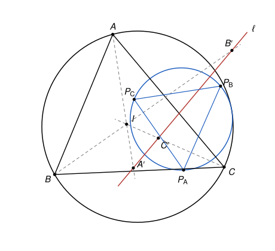

## Statement

Soit $ABC$ un triangle et $I$ le centre de son cercle inscrit. Soit $A'$, $B'$ et $C'$ trois points
situés respectivement sur les droites $(AI)$, $(BI)$ et $(CI)$, distincts de $A$, $B$, $C$ et de
$I$, et alignés sur une même droite $\ell$.

On note $P_A$ le point d'intersection des médiatrices de $[BB']$ et de $[CC']$, $P_B$ celui des
médiatrices de $[CC']$ et de $[AA']$, et $P_C$ celui des médiatrices de $[AA']$ et de $[BB']$.

Démontrer que le cercle circonscrit au triangle $ABC$ et le cercle circonscrit au triangle
$P_AP_BP_C$ sont tangents.

## Hints

1. Note $A''$, $B''$, $C''$ les seconds points d'intersection de $(AI)$, $(BI)$, $(CI)$ avec le
   cercle circonscrit à $ABC$. On sait que $A''B = A''C = A''I$. De quels segments les droites
   $(A''B'')$, $(B''C'')$ et $(C''A'')$ sont-elles les médiatrices ? Compare avec les côtés du
   triangle $P_AP_BP_C$.
2. Trace les perpendiculaires à $(IA)$ en $A'$, à $(IB)$ en $B'$ et à $(IC)$ en $C'$. Elles forment
   un triangle $E_AE_BE_C$, où $E_A$ est l'intersection des deux perpendiculaires qui passent par
   $B'$ et $C'$. Montre avec le produit scalaire que
   $\overrightarrow{IP_A} = \overrightarrow{IA''} + \frac{1}{2}\overrightarrow{IE_A}$.
3. Les pieds des perpendiculaires abaissées de $I$ sur les côtés du triangle $E_AE_BE_C$ sont $A'$,
   $B'$ et $C'$, qui sont alignés. Montre, avec des angles orientés de droites, que $I$ est sur le
   cercle circonscrit à $E_AE_BE_C$.
4. Les triangles $A''B''C''$ et $E_AE_BE_C$ ont leurs côtés parallèles deux à deux. Écris
   $\overrightarrow{IE_A} = \lambda\,\overrightarrow{IA''} + \vec t$, et de même pour $B$ et $C$,
   puis calcule les centres et les rayons des trois cercles.

## Solution

**Rappel.** Cette solution utilise des notions qui ne sont pas au programme du lycée.

1. *Angles orientés de droites.* Pour deux droites $d$ et $d'$, on note $(d, d')$ l'angle dont il
   faut faire tourner $d$, dans le sens direct, pour la rendre parallèle à $d'$. Il est défini à
   $180^\circ$ près. On a la relation de Chasles $(d_1, d_2) + (d_2, d_3) = (d_1, d_3)$, et
   $(d_2, d_1) = -(d_1, d_2)$. Si $d_1'$ est perpendiculaire à $d_1$ et $d_2'$ perpendiculaire à
   $d_2$, alors $(d_1', d_2') = (d_1, d_2)$ : tourner les deux droites de $90^\circ$ ne change pas
   l'angle entre elles.
2. *Points cocycliques.* Soit $X$, $Y$, $M$, $N$ quatre points distincts, avec $M$, $X$, $Y$ non
   alignés. Le point $N$ est sur le cercle passant par $M$, $X$ et $Y$ si et seulement si
   $(MX, MY) = (NX, NY)$. L'intérêt des angles orientés est que cette règle vaut sans avoir à
   regarder de quel côté de $(XY)$ se trouvent $M$ et $N$.
3. *Angle entre une tangente et une corde.* Si $\tau$ est la tangente en $X$ à un cercle qui passe
   par trois points distincts $X$, $Y$, $Z$, alors $(\tau, XY) = (ZX, ZY)$.
4. *Cercles tangents.* Deux cercles de centres distincts $O_1$ et $O_2$ et de rayons $r_1$ et $r_2$
   sont tangents si et seulement si $O_1O_2 = r_1 + r_2$ (ils se touchent de l'extérieur) ou
   $O_1O_2 = |r_1 - r_2|$ (l'un touche l'autre de l'intérieur).

On note $\Omega$ le cercle circonscrit à $ABC$, $O$ son centre et $R$ son rayon, et $\Gamma$ le
cercle circonscrit à $P_AP_BP_C$. L'énoncé suppose que $P_A$, $P_B$, $P_C$ forment un vrai
triangle.

Les droites $(IA)$, $(IB)$ et $(IC)$ sont trois droites distinctes passant par $I$, car $I$ est à
l'intérieur du triangle. Les points $A'$, $B'$ et $C'$ sont donc distincts deux à deux : deux
d'entre eux sont sur deux droites différentes passant par $I$, et aucun n'est égal à $I$.

### Étape 1 : le lemme du pôle Sud

Soit $A''$ le second point d'intersection de la droite $(AI)$ avec $\Omega$. Montrons que
$A''B = A''C = A''I$.

Notons $\widehat{BAC} = 2\alpha$ et $\widehat{ABC} = 2\beta$. Comme $(AI)$ est la bissectrice de
l'angle en $A$, le point $A''$ est sur l'arc $BC$ qui ne contient pas $A$. D'après le théorème de
l'angle inscrit, $\widehat{CBA''} = \widehat{CAA''} = \alpha$. Donc
$$\widehat{IBA''} = \widehat{IBC} + \widehat{CBA''} = \beta + \alpha.$$
D'autre part, $\widehat{BIA''}$ est l'angle extérieur en $I$ du triangle $ABI$, donc
$\widehat{BIA''} = \widehat{IAB} + \widehat{IBA} = \alpha + \beta$. Le triangle $IBA''$ a deux angles
égaux : il est isocèle en $A''$, et $A''B = A''I$. On montre de même que $A''C = A''I$.

On définit de même $B''$ sur $(BI)$ et $C''$ sur $(CI)$, avec $B''C = B''A = B''I$ et
$C''A = C''B = C''I$. Ce sont trois points distincts de $\Omega$. On en déduit :

- $A''$ et $C''$ sont à égale distance de $B$ et de $I$, donc $(A''C'')$ est la médiatrice de
  $[BI]$ ;
- de même, $(A''B'')$ est la médiatrice de $[CI]$ et $(B''C'')$ est la médiatrice de $[AI]$.

### Étape 2 : un triangle auxiliaire $E_AE_BE_C$

Notons $d_A$ la perpendiculaire à $(IA)$ passant par $A'$, $d_B$ la perpendiculaire à $(IB)$
passant par $B'$, et $d_C$ la perpendiculaire à $(IC)$ passant par $C'$. Comme $(IA)$, $(IB)$,
$(IC)$ sont distinctes, ces trois droites sont deux à deux sécantes. On note
$$E_A = d_B \cap d_C, \qquad E_B = d_C \cap d_A, \qquad E_C = d_A \cap d_B.$$

**Ces trois points forment un vrai triangle.** Sinon les trois droites passeraient par un même point
$M$. Ce point n'est pas $I$, car $d_A$ ne passe pas par $I$ (puisque $A' \neq I$). Les angles en
$A'$, $B'$ et $C'$ des triangles $IA'M$, $IB'M$, $IC'M$ seraient droits, donc $A'$, $B'$ et $C'$
seraient sur le cercle de diamètre $[IM]$. Mais ce sont trois points distincts d'une même droite
$\ell$, et une droite coupe un cercle en au plus deux points. C'est impossible.

De plus, aucun des points $E_A$, $E_B$, $E_C$ n'est égal à $I$ : par exemple $E_A$ est sur $d_B$,
qui ne passe pas par $I$.

### Étape 3 : le point $I$ est sur le cercle circonscrit à $E_AE_BE_C$

Le point $E_B$ est sur $d_A$ et sur $d_C$. Donc $A'$ est sur le cercle de diamètre $[IE_B]$ (l'angle
$\widehat{IA'E_B}$ est droit, ou bien $A' = E_B$), et de même pour $C'$. Ce cercle passe donc par
$I$, $A'$ et $C'$, qui ne sont pas alignés : c'est le cercle circonscrit au triangle $IA'C'$. Sa
tangente en $I$, que l'on note $\tau_B$, est perpendiculaire au diamètre $(IE_B)$. D'après le point 3
du rappel, appliqué à $X = I$, $Y = A'$, $Z = C'$ :
$$(\tau_B, IA') = (C'I, C'A'), \quad \text{c'est-à-dire} \quad (\tau_B, IA) = (IC, \ell).$$

De la même façon, $E_C$ est sur $d_A$ et $d_B$, le cercle de diamètre $[IE_C]$ est le cercle
circonscrit à $IA'B'$, et sa tangente $\tau_C$ en $I$ est perpendiculaire à $(IE_C)$, avec
$$(\tau_C, IA) = (IB, \ell).$$

Comme $(IE_B) \perp \tau_B$ et $(IE_C) \perp \tau_C$, le point 1 du rappel donne
$$(IE_B, IE_C) = (\tau_B, \tau_C) = (\tau_B, IA) + (IA, \tau_C) = (IC, \ell) - (IB, \ell) = (IC, \ell) + (\ell, IB) = (IC, IB).$$

D'autre part, $(E_AE_B) = d_C$ est perpendiculaire à $(IC)$ et $(E_AE_C) = d_B$ est perpendiculaire
à $(IB)$, donc
$$(E_AE_B, E_AE_C) = (IC, IB).$$

Ainsi $(E_AE_B, E_AE_C) = (IE_B, IE_C)$. Comme $E_A$, $E_B$, $E_C$ ne sont pas alignés et que $I$ est
distinct de ces trois points, le point 2 du rappel montre que **$I$ est sur le cercle circonscrit à
$E_AE_BE_C$**.

(C'est la réciproque du théorème de la droite de Simson : les pieds des perpendiculaires abaissées
de $I$ sur les côtés du triangle $E_AE_BE_C$ sont $A'$, $B'$, $C'$, qui sont alignés.)

### Étape 4 : une relation vectorielle pour $P_A$

Soit $N$ le milieu de $[BB']$. Comme $B$ et $B'$ sont sur la droite $(IB)$, la médiatrice de
$[BB']$ est la droite passant par $N$ et perpendiculaire à $(IB)$. Un point $X$ est donc sur cette
médiatrice si et seulement si $\overrightarrow{NX} \cdot \overrightarrow{IB} = 0$, c'est-à-dire
$$\overrightarrow{IX} \cdot \overrightarrow{IB} = \overrightarrow{IN} \cdot \overrightarrow{IB} = \frac{1}{2}\,\overrightarrow{IB} \cdot \overrightarrow{IB} + \frac{1}{2}\,\overrightarrow{IB'} \cdot \overrightarrow{IB}.$$

Soit $M$ le point défini par $\overrightarrow{IM} = \overrightarrow{IA''} + \frac{1}{2}\overrightarrow{IE_A}$.

- Le point $A''$ est sur la médiatrice de $[IB]$ (étape 1), qui passe par le milieu de $[IB]$ et est
  perpendiculaire à $(IB)$. Donc
  $\overrightarrow{IA''} \cdot \overrightarrow{IB} = \frac{1}{2}\,\overrightarrow{IB} \cdot \overrightarrow{IB}$.
- Le point $E_A$ est sur $d_B$, perpendiculaire à $(IB)$ en $B'$. Donc
  $\overrightarrow{IE_A} \cdot \overrightarrow{IB} = \overrightarrow{IB'} \cdot \overrightarrow{IB}$.

En combinant,
$\overrightarrow{IM} \cdot \overrightarrow{IB} = \frac{1}{2}\,\overrightarrow{IB} \cdot \overrightarrow{IB} + \frac{1}{2}\,\overrightarrow{IB'} \cdot \overrightarrow{IB}$ :
le point $M$ est sur la médiatrice de $[BB']$. Le même calcul, avec $C$, $C'$ et la médiatrice de
$[IC]$ qui contient aussi $A''$, montre que $M$ est sur la médiatrice de $[CC']$. Ces deux
médiatrices, perpendiculaires à deux droites distinctes, se coupent en un seul point, donc $M = P_A$.
On obtient de même les trois relations
$$\overrightarrow{IP_A} = \overrightarrow{IA''} + \frac{1}{2}\overrightarrow{IE_A}, \qquad \overrightarrow{IP_B} = \overrightarrow{IB''} + \frac{1}{2}\overrightarrow{IE_B}, \qquad \overrightarrow{IP_C} = \overrightarrow{IC''} + \frac{1}{2}\overrightarrow{IE_C}.$$

### Étape 5 : les triangles $A''B''C''$ et $E_AE_BE_C$ ont leurs côtés parallèles

La droite $(E_BE_C) = d_A$ est perpendiculaire à $(IA)$, et la droite $(B''C'')$, médiatrice de
$[AI]$, aussi. Elles sont donc parallèles, et il existe un réel $\lambda$ tel que
$\overrightarrow{E_BE_C} = \lambda\,\overrightarrow{B''C''}$. De même, il existe des réels $\mu$ et
$\nu$ tels que $\overrightarrow{E_CE_A} = \mu\,\overrightarrow{C''A''}$ et
$\overrightarrow{E_AE_B} = \nu\,\overrightarrow{A''B''}$.

En additionnant ces trois égalités, et comme
$\overrightarrow{E_BE_C} + \overrightarrow{E_CE_A} + \overrightarrow{E_AE_B} = \vec 0$ et
$\overrightarrow{A''B''} = -\overrightarrow{B''C''} - \overrightarrow{C''A''}$, on trouve
$$(\lambda - \nu)\,\overrightarrow{B''C''} + (\mu - \nu)\,\overrightarrow{C''A''} = \vec 0.$$
Les vecteurs $\overrightarrow{B''C''}$ et $\overrightarrow{C''A''}$ ne sont pas colinéaires, car
$A''$, $B''$, $C''$ sont trois points distincts d'un cercle. Donc $\lambda = \mu = \nu$. De plus
$\lambda \neq 0$, car $E_B \neq E_C$.

L'égalité $\overrightarrow{E_AE_B} = \lambda\,\overrightarrow{A''B''}$ s'écrit
$\overrightarrow{IE_B} - \lambda\,\overrightarrow{IB''} = \overrightarrow{IE_A} - \lambda\,\overrightarrow{IA''}$,
et de même avec $C$. Le vecteur $\vec t = \overrightarrow{IE_A} - \lambda\,\overrightarrow{IA''}$ est
donc le même pour les trois sommets :
$$\overrightarrow{IE_A} = \lambda\,\overrightarrow{IA''} + \vec t, \qquad \overrightarrow{IE_B} = \lambda\,\overrightarrow{IB''} + \vec t, \qquad \overrightarrow{IE_C} = \lambda\,\overrightarrow{IC''} + \vec t.$$

### Étape 6 : les centres et les rayons

Les points $A''$, $B''$, $C''$ sont sur $\Omega$, de centre $O$ et de rayon $R$.

**Le cercle circonscrit à $E_AE_BE_C$.** Soit $O_E$ le point tel que
$\overrightarrow{IO_E} = \lambda\,\overrightarrow{IO} + \vec t$. Alors
$\overrightarrow{O_EE_A} = \overrightarrow{IE_A} - \overrightarrow{IO_E} = \lambda\,\overrightarrow{OA''}$,
donc $O_EE_A = |\lambda|\,R$, et de même $O_EE_B = O_EE_C = |\lambda|\,R$. Ce cercle a pour centre
$O_E$ et pour rayon $|\lambda|\,R$. D'après l'étape 3, il passe par $I$, donc
$$IO_E = |\lambda|\,R.$$

**Le cercle $\Gamma$.** Posons $m = \frac{\lambda}{2}$, qui n'est pas nul. Les étapes 4 et 5 donnent
$$\overrightarrow{IP_A} = (1 + m)\,\overrightarrow{IA''} + \frac{1}{2}\,\vec t,$$
et de même pour $P_B$ et $P_C$. Si l'on avait $1 + m = 0$, les trois points $P_A$, $P_B$, $P_C$
seraient confondus, ce qui est exclu. Soit $O_\Gamma$ le point tel que
$\overrightarrow{IO_\Gamma} = (1 + m)\,\overrightarrow{IO} + \frac{1}{2}\,\vec t$. Le même calcul que
ci-dessus donne $\overrightarrow{O_\Gamma P_A} = (1 + m)\,\overrightarrow{OA''}$, et de même pour
$P_B$ et $P_C$. Donc $\Gamma$ a pour centre $O_\Gamma$ et pour rayon $|1 + m|\,R$.

**La distance entre les centres.**
$$\overrightarrow{OO_\Gamma} = \overrightarrow{IO_\Gamma} - \overrightarrow{IO} = m\,\overrightarrow{IO} + \frac{1}{2}\,\vec t = \frac{1}{2}\,(\lambda\,\overrightarrow{IO} + \vec t) = \frac{1}{2}\,\overrightarrow{IO_E}.$$
Donc $OO_\Gamma = \frac{1}{2}\,IO_E = \frac{1}{2}\,|\lambda|\,R = |m|\,R$, qui n'est pas nul.

### Étape 7 : conclusion

Les cercles $\Omega$ et $\Gamma$ ont des centres distincts, des rayons $R$ et $|1 + m|\,R$, et
$OO_\Gamma = |m|\,R$.

- Si $m > 0$ : $|1 + m|\,R - R = m\,R = OO_\Gamma$. Le cercle $\Omega$ touche $\Gamma$ de
  l'intérieur.
- Si $-1 < m < 0$ : $R - (1 + m)\,R = -m\,R = OO_\Gamma$. Le cercle $\Gamma$ touche $\Omega$ de
  l'intérieur, comme sur la figure.
- Si $m < -1$ : $R + |1 + m|\,R = R - (1 + m)\,R = -m\,R = OO_\Gamma$. Les deux cercles se touchent
  de l'extérieur.

D'après le point 4 du rappel, **dans tous les cas, les cercles circonscrits à $ABC$ et à
$P_AP_BP_C$ sont tangents.**

## Going further

1. Démontrer que $I$ est l'orthocentre du triangle $A''B''C''$.
2. Démontrer le théorème de la droite de Simson, dont l'étape 3 est la réciproque : si un point $M$
   est sur le cercle circonscrit à un triangle, les pieds des perpendiculaires abaissées de $M$ sur
   les trois côtés sont alignés.
