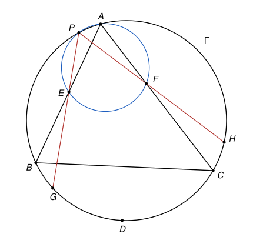

## Statement

Soit $ABC$ un triangle dont les trois angles sont aigus, avec $AB \neq AC$. On note $\Gamma$ son
cercle circonscrit, et $D$ le milieu de l'arc $BC$ de $\Gamma$ qui ne contient pas $A$.

Soit $E$ et $F$ deux points situés respectivement à l'intérieur des segments $[AB]$ et $[AC]$, tels
que $AE = AF$. Le cercle circonscrit au triangle $AEF$ recoupe $\Gamma$ en un point $P$, autre que
$A$. Les droites $(PE)$ et $(PF)$ recoupent $\Gamma$ en $G$ et $H$, autres que $P$.

Enfin, on note $J$ le point d'intersection des droites $(AB)$ et $(DG)$, et $K$ celui des droites
$(AC)$ et $(DH)$.

Démontrer que le milieu du segment $[BC]$ est sur la droite $(JK)$.

## Hints

1. Montre que la droite $(AD)$ est la bissectrice de l'angle $\widehat{BAC}$. Où se trouve alors le
   centre du cercle circonscrit à $AEF$ ?
2. Complète la figure avec les points $J$ et $K$, et mesure l'angle $\widehat{AJD}$. Démontre ce que
   tu observes, avec des angles orientés de droites, en passant par la tangente en $A$ au cercle
   circonscrit à $AEF$.
3. Tu sais maintenant que $J$ et $K$ sont les projetés orthogonaux de $D$ sur $(AB)$ et $(AC)$.
   Montre que $AJ = AK$ et que $BJ = CK$.
4. Pose $x = AJ = AK$ et $y = BJ = CK$, et suppose $AB > AC$. Montre que $AB = x + y$ et
   $AC = x - y$, puis écris le vecteur $\overrightarrow{AX}$, où $X$ est le milieu de $[BC]$, à
   l'aide de $\overrightarrow{AJ}$ et de $\overrightarrow{AK}$.

## Solution

**Rappel.** Cette solution utilise des notions qui ne sont pas au programme du lycée.

1. *Angles orientés de droites.* Pour deux droites $d$ et $d'$, on note $(d, d')$ l'angle dont il
   faut faire tourner $d$, dans le sens direct, pour la rendre parallèle à $d'$. Il est défini à
   $180^\circ$ près. On a la relation de Chasles $(d_1, d_2) + (d_2, d_3) = (d_1, d_3)$.
2. *Points cocycliques.* Si quatre points distincts $X$, $Y$, $M$, $N$ sont sur un même cercle,
   alors $(MX, MY) = (NX, NY)$. Cette règle vaut sans avoir à regarder de quel côté de $(XY)$ se
   trouvent $M$ et $N$, et c'est tout l'intérêt des angles orientés : la preuve marche quelle que
   soit la position des points.
3. *Angle entre une tangente et une corde.* Si $\tau$ est la tangente en $X$ à un cercle qui passe
   par trois points distincts $X$, $Y$, $Z$, alors $(\tau, XY) = (ZX, ZY)$. C'est le cas limite de
   la règle 2, quand $M$ se rapproche de $X$.

On note $\mathcal{C}$ le cercle circonscrit au triangle $AEF$, et $X$ le milieu de $[BC]$.

### Étape 1 : la droite $(AD)$

Comme $D$ est le milieu de l'arc $BC$, on a $DB = DC$. Les angles inscrits $\widehat{BAD}$ et
$\widehat{DAC}$ interceptent les arcs $BD$ et $DC$, qui ont la même longueur : ils sont égaux. La
droite $(AD)$ est donc la **bissectrice** de l'angle $\widehat{BAC}$.

Le triangle $AEF$ est isocèle en $A$. Sa bissectrice issue de $A$, qui est la droite $(AD)$, est
donc aussi la médiatrice de $[EF]$, et elle contient le centre de $\mathcal{C}$. Par conséquent, la
tangente $\Delta$ en $A$ au cercle $\mathcal{C}$, qui est perpendiculaire au rayon issu de $A$, est
**perpendiculaire à $(AD)$**.

### Étape 2 : l'angle en $J$ est droit

Le point $E$ est sur la droite $(PG)$ et sur la droite $(AB)$. Par la relation de Chasles,
$$(AB, DG) = (AB, PG) + (PG, DG) = (EA, EP) + (GP, GD).$$

- Les points $A$, $P$, $E$ sont sur $\mathcal{C}$, donc d'après la règle 3,
  $(EA, EP) = (\Delta, AP)$.
- Les points $A$, $D$, $P$, $G$ sont sur $\Gamma$, donc d'après la règle 2,
  $(GP, GD) = (AP, AD)$.

Ainsi $(AB, DG) = (\Delta, AP) + (AP, AD) = (\Delta, AD) = 90^\circ$, d'après l'étape 1.

De la même façon, avec $F$ et $H$ :
$$(AC, DH) = (FA, FP) + (HP, HD) = (\Delta, AP) + (AP, AD) = 90^\circ.$$

Les droites $(DJ)$ et $(AB)$ sont donc perpendiculaires, et **$J$ est le projeté orthogonal de $D$
sur $(AB)$**. De même, **$K$ est le projeté orthogonal de $D$ sur $(AC)$**.

### Étape 3 : deux paires de longueurs égales

L'angle $\widehat{BAD}$ est la moitié de $\widehat{BAC}$, donc il est aigu. Le projeté $J$ de $D$
est donc sur la demi-droite $[AB)$, et pas sur la demi-droite opposée. De même, $K$ est sur la
demi-droite $[AC)$.

Le point $D$ est sur la bissectrice de $\widehat{BAC}$, donc il est à la même distance des deux
côtés : $DJ = DK$. Avec le théorème de Pythagore dans les triangles rectangles $AJD$ et $AKD$, puis
$BJD$ et $CKD$ :
$$AJ^2 = AD^2 - DJ^2 = AD^2 - DK^2 = AK^2, \qquad BJ^2 = DB^2 - DJ^2 = DC^2 - DK^2 = CK^2.$$
Posons $x = AJ = AK$ et $y = BJ = CK$. On a $x > 0$, car $J = A$ voudrait dire que $(AD)$ est
perpendiculaire à $(AB)$, ce qui est faux.

### Étape 4 : les longueurs $AB$ et $AC$

Quitte à échanger les rôles de $B$ et $C$, on suppose $AB > AC$.

Sur la demi-droite $[AJ)$, où $AJ = x$, les points situés à la distance $y$ de $J$ sont : le point
situé à la distance $x + y$ de $A$, et, si $y \leqslant x$, le point situé à la distance $x - y$ de
$A$. Comme $B$ est sur cette demi-droite et que $BJ = y$, on a $AB = x + y$ ou $AB = x - y$. De
même, $AC = x + y$ ou $AC = x - y$.

Comme $AB \neq AC$, l'une des longueurs vaut $x + y$ et l'autre $x - y$. Puisque $AB > AC$, on a
$$AB = x + y \qquad \text{et} \qquad AC = x - y.$$
Les points $B$ et $J$ sont sur la même demi-droite issue de $A$, et de même pour $C$ et $K$, donc
$$\overrightarrow{AB} = \frac{x + y}{x}\,\overrightarrow{AJ} \qquad \text{et} \qquad \overrightarrow{AC} = \frac{x - y}{x}\,\overrightarrow{AK}.$$

### Étape 5 : conclusion

Comme $X$ est le milieu de $[BC]$,
$$\overrightarrow{AX} = \frac{1}{2}(\overrightarrow{AB} + \overrightarrow{AC}) = \lambda\,\overrightarrow{AJ} + (1 - \lambda)\,\overrightarrow{AK}, \qquad \text{avec} \qquad \lambda = \frac{x + y}{2x}.$$
En retranchant $\overrightarrow{AK}$ des deux côtés, on obtient
$$\overrightarrow{KX} = \overrightarrow{AX} - \overrightarrow{AK} = \lambda(\overrightarrow{AJ} - \overrightarrow{AK}) = \lambda\,\overrightarrow{KJ}.$$
Les vecteurs $\overrightarrow{KX}$ et $\overrightarrow{KJ}$ sont colinéaires, et $J \neq K$ car ces
deux points sont sur les droites $(AB)$ et $(AC)$ et différents de $A$. **Le milieu $X$ de $[BC]$
est donc sur la droite $(JK)$.**

## Going further

1. Montrer que le milieu $X$ de $[BC]$ est le projeté orthogonal de $D$ sur la droite $(BC)$.
   L'exercice dit donc que les projetés orthogonaux de $D$ sur les trois côtés du triangle sont
   alignés. C'est un cas particulier d'un théorème célèbre : la **droite de Simson**. Pour tout
   point $M$ du cercle circonscrit à un triangle, les projetés orthogonaux de $M$ sur les trois
   côtés sont alignés.
2. Montrer que les points $A$, $J$, $D$, $K$ sont sur un même cercle, et trouver son centre.
