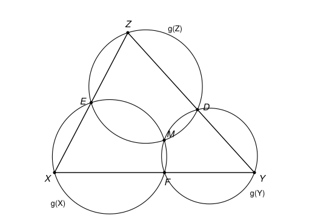

## Statement

Soit $f$ une fonction qui, à chaque droite $d$ du plan, associe un point $f(d)$ appartenant à $d$.
On suppose que, dès que trois droites distinctes $d_1$, $d_2$ et $d_3$ sont concourantes en un point
$X$, les points $f(d_1)$, $f(d_2)$, $f(d_3)$ et $X$ appartiennent à un même cercle. (Ces quatre
points ne sont pas forcément distincts.)

a) Démontrer qu'il existe un point $P$ tel que $f(d) = P$ pour toute droite $d$ passant par $P$.

b) Démontrer qu'il existe bien une telle fonction $f$.

## Hints

1. Pour la question b), fixe un point $O$, et pense au cercle de diamètre $[OX]$.
2. Fixe un point $X$. Si deux droites $\ell_1$ et $\ell_2$ passant par $X$ vérifient
   $f(\ell_1) \neq X$ et $f(\ell_2) \neq X$, montre que, pour toute droite $\ell$ passant par $X$,
   le point $f(\ell)$ est sur le cercle qui passe par $X$, $f(\ell_1)$ et $f(\ell_2)$.
3. Tu obtiens ainsi un cercle $g(X)$ attaché à chaque point $X$. Si un point $P$ est sur $g(X)$ et
   sur une droite $\ell$ qui passe par $X$, alors $f(\ell)$ vaut $X$ ou $P$. Avec deux tels points
   $X$ sur $\ell$, on obtient $f(\ell) = P$. Il faut donc trouver un point $P$ qui est sur beaucoup
   de cercles $g(X)$.
4. Prends trois points $X$, $Y$, $Z$ non alignés tels que les points $f$ des trois droites $(XY)$,
   $(YZ)$, $(ZX)$ soient différents des sommets. D'après le théorème de Miquel, les cercles $g(X)$,
   $g(Y)$, $g(Z)$ ont un point commun. Applique-le à plusieurs points d'une même droite $d$ et à un
   point $Y$ extérieur à $d$.

## Solution

**Rappel.** On utilise les *angles orientés de droites*. Pour deux droites $\ell$ et $m$, on note
$\measuredangle(\ell, m)$ l'angle dont il faut faire tourner $\ell$, dans le sens direct, pour
qu'elle devienne parallèle à $m$. Cet angle n'est défini qu'à un multiple de $180^\circ$ près, et
toutes les égalités d'angles ci-dessous s'entendent à un multiple de $180^\circ$ près. Dans ces
angles, $AB$ désigne la droite $(AB)$. On utilise les faits suivants.

- **(R1) Chasles.** $\measuredangle(\ell, m) + \measuredangle(m, n) = \measuredangle(\ell, n)$. Deux
  droites qui font le même angle avec une droite $\ell$ sont parallèles. Si elles ont en plus un
  point commun, elles sont confondues.
- **(R2) Angle inscrit.** Soit $A \neq B$ deux points, et $U$, $V$ deux points différents de $A$ et
  de $B$. Les points $A$, $B$, $U$, $V$ sont sur un même cercle ou sur une même droite si et
  seulement si $\measuredangle(UA, UB) = \measuredangle(VA, VB)$.
- **(R3) Angle tangentiel.** Si $A$, $B$, $C$ sont trois points distincts d'un cercle et si $t$ est
  la tangente à ce cercle en $A$, alors $\measuredangle(t, AB) = \measuredangle(CA, CB)$.
- **(R4) Cercles tangents.** Deux cercles distincts ont au plus deux points communs. Deux cercles
  distincts qui passent par un point $F$ ont la même tangente en $F$ si et seulement si $F$ est leur
  seul point commun. On dit alors qu'ils sont tangents en $F$.

Enfin, une droite coupe un cercle en au plus deux points, et trois points distincts alignés ne sont
jamais sur un même cercle.

Pour deux points distincts $X$ et $Y$, on écrit $f(XY)$ au lieu de $f((XY))$.

### Étape 1 : un cercle attaché à chaque point

**Lemme 1.** Pour tout point $X$, il existe un cercle passant par $X$ qui contient $f(\ell)$ pour
toute droite $\ell$ passant par $X$. De plus, s'il existe deux droites distinctes $\ell_1$ et
$\ell_2$ passant par $X$ telles que $f(\ell_1) \neq X$ et $f(\ell_2) \neq X$, ce cercle est unique :
c'est le cercle qui passe par $X$, $f(\ell_1)$ et $f(\ell_2)$.

*Preuve.* **Premier cas** : il y a au plus une droite $\ell_0$ passant par $X$ telle que
$f(\ell_0) \neq X$. Pour toutes les autres droites $\ell$ passant par $X$, on a $f(\ell) = X$.
N'importe quel cercle passant par $X$ et par $f(\ell_0)$ convient (n'importe quel cercle passant par
$X$ s'il n'y a pas de telle droite $\ell_0$).

**Second cas** : il existe $\ell_1$ et $\ell_2$ comme dans l'énoncé du lemme. Les points $X$,
$f(\ell_1)$ et $f(\ell_2)$ ne sont pas alignés. Sinon, $f(\ell_2)$ serait sur la droite qui passe
par $X$ et $f(\ell_1)$, c'est-à-dire sur $\ell_1$, donc en $X$, le seul point commun de $\ell_1$ et
$\ell_2$. Soit $\Gamma$ le cercle qui passe par ces trois points. Si $\ell$ est une troisième droite
passant par $X$, les droites $\ell_1$, $\ell_2$, $\ell$ sont concourantes en $X$, donc les points
$X$, $f(\ell_1)$, $f(\ell_2)$, $f(\ell)$ sont sur un même cercle. Ce cercle passe par les trois
points $X$, $f(\ell_1)$, $f(\ell_2)$ : c'est $\Gamma$. Donc $\Gamma$ convient. Et tout cercle qui
convient contient ces trois points, donc c'est $\Gamma$.

Pour chaque point $X$, on choisit un tel cercle, que l'on note $g(X)$.

**Conséquence.** Si une droite $\ell$ passe par $X$, et si $Q \neq X$ est un point de $\ell$ situé
sur $g(X)$, alors $\ell$ coupe $g(X)$ exactement en $X$ et en $Q$, et donc $f(\ell) = X$ ou
$f(\ell) = Q$.

### Étape 2 : le lemme des trois cercles

Dans cette étape, $X$, $Y$, $Z$ sont trois points non alignés tels que
$$F = f(XY) \notin \{X, Y\}, \qquad D = f(YZ) \notin \{Y, Z\}, \qquad E = f(ZX) \notin \{Z, X\}.$$
Les six points $X$, $Y$, $Z$, $D$, $E$, $F$ sont alors distincts. Par exemple $F \neq D$, car les
droites $(XY)$ et $(YZ)$ n'ont que $Y$ en commun.

Les droites $(XY)$ et $(XZ)$ passent par $X$, et leurs images $F$ et $E$ sont différentes de $X$.
D'après le lemme 1, $g(X)$ est le cercle qui passe par $X$, $E$ et $F$. De même, $g(Y)$ passe par
$Y$, $F$, $D$, et $g(Z)$ passe par $Z$, $D$, $E$.

Les cercles $g(X)$ et $g(Y)$ sont distincts, sinon ce cercle contiendrait $X$, $Y$ et $F$, trois
points distincts de la droite $(XY)$. Ils passent tous les deux par $F$. On note $s(X, Y)$ leur
second point commun s'ils en ont deux, et $s(X, Y) = F$ s'ils sont tangents en $F$. Ce point ne
dépend que des deux cercles $g(X)$, $g(Y)$ et du point $F = f(XY)$. On définit de même $s(Y, Z)$
(avec $D$) et $s(Z, X)$ (avec $E$).

**Lemme 2 (théorème de Miquel).** On a $s(X, Y) = s(Y, Z) = s(Z, X)$, et ce point est sur les trois
cercles $g(X)$, $g(Y)$, $g(Z)$.

*Un premier fait : $g(X)$ et $g(Y)$ sont tangents en $F$ si et seulement si $F$ est sur $g(Z)$.*
Soit $t_X$ et $t_Y$ les tangentes en $F$ à $g(X)$ et à $g(Y)$. D'après (R3),
$$\measuredangle(t_X, FX) = \measuredangle(EF, EX) \qquad \text{et} \qquad \measuredangle(t_Y, FY) = \measuredangle(DF, DY).$$
Or les droites $FX$ et $FY$ sont toutes les deux la droite $(XY)$, les droites $EX$ et $EZ$ sont la
droite $(XZ)$, et les droites $DY$ et $DZ$ sont la droite $(YZ)$. D'après (R1), on a donc
$t_X = t_Y$ si et seulement si $\measuredangle(EF, EZ) = \measuredangle(DF, DZ)$. D'après (R2),
appliqué à $A = F$, $B = Z$, $U = E$, $V = D$, cela revient à dire que $F$, $Z$, $E$, $D$ sont sur
un même cercle ou sur une même droite. Ils ne sont pas alignés, car $Z$, $D$, $E$ ne le sont pas.
Cela revient donc à dire que $F$ est sur le cercle $g(Z)$, qui passe par $Z$, $D$, $E$. Enfin,
d'après (R4), $t_X = t_Y$ signifie que $g(X)$ et $g(Y)$ sont tangents en $F$.

Le même raisonnement, en changeant les noms, montre que $g(Y)$ et $g(Z)$ sont tangents en $D$ si et
seulement si $D$ est sur $g(X)$, et que $g(Z)$ et $g(X)$ sont tangents en $E$ si et seulement si $E$
est sur $g(Y)$.

*Le point $M = s(X, Y)$ est sur $g(Z)$.*

- Si $M = F$, les cercles $g(X)$ et $g(Y)$ sont tangents en $F$, donc $F$ est sur $g(Z)$ d'après le
  premier fait.
- Si $M = D$ ou $M = E$, c'est clair, car $D$ et $E$ sont sur $g(Z)$.
- Sinon, $M$ n'est aucun des points $D$, $E$, $F$. Les points $D$, $F$, $M$, $Y$ sont sur $g(Y)$, et
  les points $F$, $E$, $M$, $X$ sont sur $g(X)$. Avec (R1) puis (R2) :
  $$\measuredangle(MD, ME) = \measuredangle(MD, MF) + \measuredangle(MF, ME) = \measuredangle(YD, YF) + \measuredangle(XF, XE).$$
  Comme $YD = YZ$, $YF = XF = XY$ et $XE = XZ$ (ce sont des droites), on obtient
  $$\measuredangle(MD, ME) = \measuredangle(YZ, XY) + \measuredangle(XY, XZ) = \measuredangle(YZ, XZ) = \measuredangle(ZD, ZE).$$
  D'après (R2), les points $D$, $E$, $M$, $Z$ sont sur un même cercle ou sur une même droite. Ils ne
  sont pas alignés, car $Z$, $D$, $E$ ne le sont pas. Donc $M$ est sur $g(Z)$.

*Conclusion.* Le point $M$ est sur les trois cercles. Regardons $g(Y)$ et $g(Z)$, qui passent par
$D$. Si $M \neq D$, alors $M$ est un point commun à $g(Y)$ et $g(Z)$ autre que $D$, donc
$s(Y, Z) = M$. Si $M = D$, alors $D$ est sur $g(X)$, donc $g(Y)$ et $g(Z)$ sont tangents en $D$
d'après le premier fait, et $s(Y, Z) = D = M$. On montre de même que $s(Z, X) = M$, ce qui prouve
le lemme 2.

### Étape 3 : on trouve le point $P$

Fixons une droite $d$, et notons $K = f(d)$. Choisissons six points distincts $X_1, \ldots, X_6$ de
$d$, tous différents de $K$. Choisissons ensuite un point $Y$ qui n'est ni sur $d$, ni sur aucun des
cercles $g(X_1), \ldots, g(X_6)$. C'est possible : une droite autre que $d$ contient au plus un
point de $d$ et au plus deux points de chaque cercle.

Le cercle $g(Y)$ coupe $d$ en au plus deux points. Quitte à renuméroter, les points $X_1$, $X_2$,
$X_3$, $X_4$ ne sont pas sur $g(Y)$.

Soit $i \neq j$ dans $\{1, 2, 3, 4\}$. Vérifions les hypothèses du lemme 2 pour le triangle
$X_i X_j Y$, qui n'est pas aplati puisque $Y$ n'est pas sur $d$.

- $f(X_i X_j) = f(d) = K$, qui est différent de $X_i$ et de $X_j$.
- $f(X_i Y)$ est sur $g(Y)$, mais $X_i$ n'y est pas, donc $f(X_i Y) \neq X_i$. Et $f(X_i Y)$ est
  sur $g(X_i)$, mais $Y$ n'y est pas, donc $f(X_i Y) \neq Y$.
- De même, $f(X_j Y)$ est différent de $X_j$ et de $Y$.

Le lemme 2 donne donc
$$s(X_i, X_j) = s(X_i, Y) = s(X_j, Y) \qquad \text{pour tous } i \neq j \text{ dans } \{1, 2, 3, 4\}. \qquad (\star)$$
Posons $P = s(X_1, Y)$. Avec $(\star)$ pour $i = 1$, on a $s(X_j, Y) = P$ pour $j = 2, 3, 4$. Puis,
de nouveau avec $(\star)$,
$$s(X_i, X_j) = P \qquad \text{pour tous } i \neq j \text{ dans } \{1, 2, 3, 4\}. \qquad (\star\star)$$
En particulier, $P$ est sur les cercles $g(X_1)$, $g(X_2)$, $g(X_3)$, $g(X_4)$.

### Étape 4 : $f(\ell) = P$ pour toute droite $\ell$ passant par $P$

**Si $P$ est sur $d$**, montrons que $f(d) = P$. Le cercle $g(X_1)$ passe par $X_1$ et par
$K = f(d)$, qui sont deux points distincts de $d$, donc il coupe $d$ exactement en $X_1$ et $K$. De
même, $g(X_2)$ coupe $d$ exactement en $X_2$ et $K$. Le point $P$ est sur $d$ et sur ces deux
cercles, et $X_1 \neq X_2$, donc $P = K = f(d)$.

**Soit maintenant $\ell$ une droite passant par $P$, autre que $d$.** Soit $Y'$ un point de $\ell$
qui n'est ni sur $d$, ni sur aucun des cercles $g(X_1), \ldots, g(X_4)$. Tous les points de $\ell$
sauf un nombre fini conviennent. On a $Y' \neq P$, puisque $P$ est sur $g(X_1)$.

Le cercle $g(Y')$ contient au plus deux des points $X_1, \ldots, X_4$. Soit $X_i$ et $X_j$ deux de
ces points qui ne sont pas sur $g(Y')$. Exactement comme à l'étape 3, le lemme 2 s'applique au
triangle $X_i X_j Y'$, et donne, avec $(\star\star)$,
$$s(X_i, Y') = s(X_i, X_j) = P.$$
Donc $P$ est sur $g(Y')$. Les points $Y'$ et $P$ sont deux points distincts de $\ell$ situés sur
$g(Y')$. D'après la conséquence de l'étape 1, $f(\ell) = Y'$ ou $f(\ell) = P$.

On recommence avec un autre point $Y''$ de $\ell$ qui convient : $f(\ell) = Y''$ ou $f(\ell) = P$.
Comme $Y' \neq Y''$, on obtient $f(\ell) = P$.

**Conclusion de la question a).** Pour toute droite $\ell$ passant par $P$, on a $f(\ell) = P$.

### Question b) : un exemple

Fixons un point $O$, et associons à chaque droite $d$ le projeté orthogonal $f(d)$ de $O$ sur $d$.
C'est bien un point de $d$.

Soit $d_1$, $d_2$, $d_3$ trois droites concourantes en un point $X$.

- Si $X = O$, les trois droites passent par $O$, donc $f(d_1) = f(d_2) = f(d_3) = O$. Les quatre
  points sont tous égaux à $O$, et ils sont sur n'importe quel cercle passant par $O$.
- Si $X \neq O$, soit $H = f(d_i)$. Si $H = X$ ou $H = O$, alors $H$ est sur le cercle de diamètre
  $[OX]$. Sinon, le triangle $OHX$ est rectangle en $H$, puisque $(OH)$ est perpendiculaire à $d_i$
  et que $X$ est sur $d_i$. Donc $H$ est encore sur le cercle de diamètre $[OX]$. Les quatre points
  $f(d_1)$, $f(d_2)$, $f(d_3)$ et $X$ sont donc sur le cercle de diamètre $[OX]$.

**Cette fonction vérifie donc la condition de l'énoncé.** Pour elle, le point $P$ de la question a)
est $O$.

## Going further

1. Montrer que le point $P$ de la question a) est unique.
2. Fixons un point $O$ et un angle $\alpha$ qui n'est pas un multiple de $180^\circ$. Pour une droite
   $d$ qui ne passe pas par $O$, notons $f(d)$ le point $H$ de $d$ tel que
   $\measuredangle(OH, d) = \alpha$, et posons $f(d) = O$ si $d$ passe par $O$. Montrer que cette
   fonction vérifie aussi la condition de l'énoncé. Pour $\alpha = 90^\circ$, on retrouve l'exemple
   de la question b).
