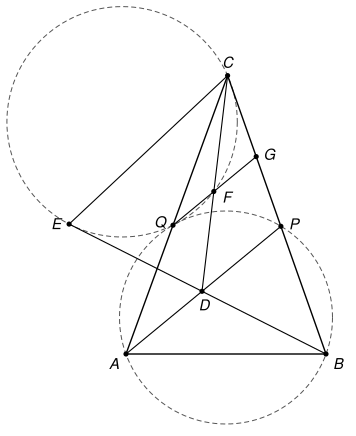

## Statement

Soit $ABC$ un triangle dont les trois angles sont aigus, tel que $\widehat{CAB} > \widehat{BCA}$.

- Soit $P$ le point du segment $[BC]$ tel que $\widehat{PAB} = \widehat{BCA}$.
- Soit $Q$ le point d'intersection, autre que $A$, du cercle circonscrit au triangle $ABP$ et de la
  droite $(AC)$.
- Soit $D$ le point du segment $[AP]$ tel que $\widehat{QDC} = \widehat{CAP}$.
- Soit $E$ le point de la droite $(BD)$, autre que $D$, tel que $CE = CD$.
- Soit $F$ le point d'intersection, autre que $C$, du cercle circonscrit au triangle $CQE$ et de la
  droite $(CD)$.
- Soit $G$ le point d'intersection des droites $(QF)$ et $(BC)$.

Démontrer que les points $B$, $D$, $F$ et $G$ sont sur un même cercle.

## Hints

1. Compare les triangles $CQD$ et $CDA$. Tu dois obtenir $CD^2 = CQ \times CA$, donc aussi
   $CE^2 = CQ \times CA$.
2. Montre que les points $B$, $C$, $Q$, $D$ sont sur un même cercle, puis que les points $A$, $B$,
   $C$, $E$ le sont aussi.
3. L'égalité $CE^2 = CQ \times CA$ dit que les triangles $CAE$ et $CEQ$ sont semblables.
4. Pour conclure, transforme l'angle $(GF, GB)$ à l'aide du cercle qui passe par $C$, $Q$, $E$, $F$,
   puis du cercle qui passe par $A$, $B$, $C$, $E$.

## Solution

**Rappel : les angles de droites.** Dans une figure avec beaucoup de cercles, la position des points
change d'un dessin à l'autre, et une égalité d'angles peut devenir une relation du type « la somme
fait $180^\circ$ ». Pour ne pas distinguer les cas, on utilise les angles de droites, qui ne sont pas
au programme du lycée.

Pour deux droites $d$ et $d'$, on note $(d, d')$ l'angle d'une rotation qui envoie $d$ sur une droite
parallèle à $d'$. Cet angle n'est défini qu'à un multiple de $180^\circ$ près, et toutes les égalités
d'angles de droites s'entendent à un multiple de $180^\circ$ près. Pour des points, $(XY, XZ)$
désigne l'angle des droites $(XY)$ et $(XZ)$. On utilise quatre règles.

- **(R1)** $(d_1, d_2) + (d_2, d_3) = (d_1, d_3)$ et $(d_2, d_1) = -(d_1, d_2)$.
- **(R2)** Soit $X$, $Y$, $M$, $N$ quatre points dont trois ne sont jamais alignés. Ils sont sur un
  même cercle si et seulement si $(MX, MY) = (NX, NY)$. C'est le théorème de l'angle inscrit, cette
  fois sans se demander si $M$ et $N$ sont du même côté de $(XY)$.
- **(R3)** Si le triangle $XYZ$ est isocèle en $X$, alors $(YZ, YX) = (ZX, ZY)$.
- **(R4)** Deux triangles semblables sont soit de même sens, soit de sens contraires (l'un est alors
  l'image de l'autre par une symétrie axiale suivie d'un agrandissement). S'ils sont de sens
  contraires, avec $X$ qui correspond à $X'$, $Y$ à $Y'$ et $Z$ à $Z'$, alors
  $(YX, YZ) = -(Y'X', Y'Z')$, et de même aux autres sommets. Si deux triangles semblables $XYZ$ et
  $XY'Z'$ ont le même sommet $X$, avec $Y'$ sur la demi-droite $[XZ)$ et $Z'$ sur la demi-droite
  $[XY)$, ils sont de sens contraires : la symétrie par rapport à la bissectrice de l'angle en $X$
  échange les deux demi-droites.

Comme l'énoncé le fait sans le dire, on admet que les points construits sont distincts, et que trois
d'entre eux ne sont alignés que lorsque la construction l'impose.

### Étape 0 : où sont $P$, $Q$ et $D$

- Si $P$ était en $C$, on aurait $\widehat{CAB} = \widehat{PAB} = \widehat{BCA}$, ce qui est exclu.
  Donc $P$ est sur le segment $[BC]$, différent de $B$ et de $C$.
- Notons $\omega$ le cercle circonscrit au triangle $ABP$. La partie de la droite $(BC)$ qui est dans
  le disque limité par $\omega$ est le segment $[PB]$, qui ne contient pas $C$ : le point $C$ est
  donc à l'extérieur de ce disque. La partie de la droite $(CA)$ qui est dans le disque est le
  segment $[AQ]$, qui ne contient donc pas $C$. Ainsi **$Q$ est sur la demi-droite $[CA)$**.
- On a $D \neq A$ : si $D = A$, l'angle $\widehat{QDC} = \widehat{QAC}$ vaudrait $0^\circ$ ou
  $180^\circ$, alors que $\widehat{CAP}$ est strictement entre les deux.

### Étape 1 : $CD^2 = CE^2 = CQ \times CA$

Comparons les triangles $CQD$ et $CDA$.

- Comme $Q$ est sur la demi-droite $[CA)$, les angles $\widehat{QCD}$ et $\widehat{DCA}$ sont le même
  angle.
- Comme $D$ est sur $[AP]$ et $D \neq A$, on a $\widehat{CAD} = \widehat{CAP} = \widehat{QDC}$.

Les deux triangles ont deux angles égaux : ils sont semblables, $C$ correspondant à $C$, $Q$ à $D$ et
$D$ à $A$. Donc $\dfrac{CQ}{CD} = \dfrac{CD}{CA}$, et comme $CE = CD$,
$$CD^2 = CE^2 = CQ \times CA. \qquad (1)$$

Ces deux triangles ont le sommet $C$ en commun, $D$ est sur $[CD)$ et $A$ sur $[CQ)$ : d'après (R4)
ils sont de sens contraires. Au sommet $D$ du premier correspond le sommet $A$ du second, donc
$(DC, DQ) = -(AC, AD)$, c'est-à-dire
$$(DQ, DC) = (AC, AD) = (AC, AP). \qquad (2)$$

### Étape 2 : $B$, $C$, $Q$, $D$ sont sur un même cercle

Les points $A$, $B$, $P$, $Q$ sont sur $\omega$, donc d'après (R2), $(BQ, BP) = (AQ, AP)$. Comme
$(BP) = (BC)$ et $(AQ) = (AC)$, avec (2) :
$$(BQ, BC) = (AC, AP) = (DQ, DC).$$
D'après (R2), **les points $B$, $C$, $Q$, $D$ sont sur un même cercle.**

### Étape 3 : $A$, $B$, $C$, $E$ sont sur un même cercle

Traduisons d'abord l'hypothèse $\widehat{PAB} = \widehat{BCA}$. Les triangles $BAP$ et $BCA$ ont le
même angle en $B$ (car $P$ est sur $[BC)$) et $\widehat{BAP} = \widehat{BCA}$ : ils sont semblables,
$B$ correspondant à $B$, $A$ à $C$ et $P$ à $A$. Ils ont le sommet $B$ en commun, $C$ est sur $[BP)$
et $A$ sur $[BA)$, donc ils sont de sens contraires. Au sommet $A$ du premier correspond le sommet $C$
du second :
$$(AB, AP) = -(CB, CA) = (CA, CB). \qquad (3)$$

Le triangle $CDE$ est isocèle en $C$, et les droites $(DE)$, $(DB)$, $(EB)$ sont la même droite.
On a successivement :

- $(EC, EB) = (DB, DC)$, d'après (R3) ;
- $(DB, DC) = (QB, QC)$, car $B$, $C$, $Q$, $D$ sont sur un même cercle (étape 2 et (R2)) ;
- $(QB, QC) = (QB, QA)$, car $(QC) = (QA)$ ;
- $(QB, QA) = (PB, PA)$, car $A$, $B$, $P$, $Q$ sont sur $\omega$ (R2) ;
- $(PB, PA) = (CB, AP)$, car $(PB) = (CB)$ ;
- $(CB, AP) = (CB, AB) + (AB, AP) = (CB, AB) + (CA, CB) = (CA, AB)$, d'après (R1) et (3).

On a donc $(EC, EB) = (AC, AB)$, et d'après (R2), **les points $A$, $B$, $C$, $E$ sont sur un même
cercle.**

### Étape 4 : les triangles $CAE$ et $CEQ$ sont semblables

D'après (1), $\dfrac{CE}{CA} = \dfrac{CQ}{CE}$. De plus les angles $\widehat{ACE}$ et
$\widehat{ECQ}$ sont le même angle, puisque $Q$ est sur $[CA)$. Les triangles $CAE$ et $CEQ$ ont donc
un angle égal compris entre des côtés proportionnels : ils sont semblables, $C$ correspondant à $C$,
$A$ à $E$ et $E$ à $Q$. Ils ont le sommet $C$ en commun, $E$ est sur $[CE)$ et $Q$ sur $[CA)$ : ils
sont de sens contraires. Au sommet $A$ du premier correspond le sommet $E$ du second, donc
$$(AC, AE) = -(EC, EQ) = (EQ, EC). \qquad (4)$$

### Étape 5 : conclusion

Les points $Q$, $F$, $G$ sont alignés, $G$ est sur $(BC)$, $F$ est sur $(CD)$, et les points $C$,
$Q$, $E$, $F$ sont sur un même cercle. On a successivement :

- $(GF, GB) = (FQ, BC)$, car $(GF) = (FQ)$ et $(GB) = (BC)$ ;
- $(FQ, BC) = (FQ, FC) + (FC, BC)$, d'après (R1) ;
- $(FQ, FC) = (EQ, EC)$, car $C$, $Q$, $E$, $F$ sont sur un même cercle (R2), et
  $(EQ, EC) = (AC, AE)$ d'après (4) ;
- $(AC, AE) = (BC, BE)$, car $A$, $B$, $C$, $E$ sont sur un même cercle (étape 3 et (R2)) ;
- $(FC, BC) = (DF, BC)$ et $(BC, BE) = (BC, DB)$, car $(FC) = (DF)$ et $(BE) = (DB)$.

En mettant tout bout à bout, avec (R1) :
$$(GF, GB) = (BC, DB) + (DF, BC) = (DF, BC) + (BC, DB) = (DF, DB).$$
On a donc $(GF, GB) = (DF, DB)$, et d'après (R2), **les points $B$, $D$, $F$ et $G$ sont sur un même
cercle.**

## Going further

1. Montrer que les points $P$, $Q$ et $E$ sont alignés.
2. Montrer que la droite $(QF)$ est parallèle à $(AP)$. En déduire une autre fin de démonstration,
   avec le théorème de Thalès et l'égalité $CD^2 = CP \times CB$.
3. Comment construire la figure à la règle et au compas ? Pour placer $D$, on pourra utiliser
   l'étape 2.
