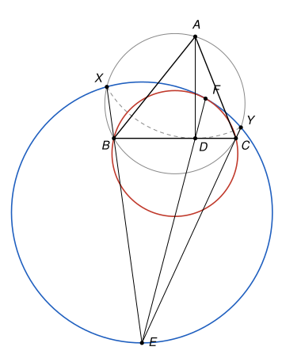

## Statement

Soit $ABC$ un triangle dont les trois angles sont aigus, et soit $D$ le pied de la hauteur issue
de $A$.

On note $X$ et $Y$ les deux points du cercle circonscrit à $ABC$ tels que
$$AX = AY = AD,$$
avec $X$ du même côté de la droite $(AD)$ que $B$, et $Y$ du même côté que $C$.

Soit $E$ le point d'intersection des droites $(BX)$ et $(CY)$. Enfin, soit $F$ le second point
d'intersection, autre que $E$, de la droite $(DE)$ avec le cercle circonscrit au triangle $EXY$.

Démontrer que les cercles circonscrits aux triangles $BCF$ et $EXY$ sont tangents.

## Hints

1. Les deux cercles passent tous les deux par $F$. Il s'agit donc de montrer qu'ils ont la même
   tangente en $F$.
2. Les points $X$, $Y$ et $D$ sont à la même distance de $A$. Que peux-tu dire du cercle qui passe
   par $X$, $Y$ et $D$, et de la droite $(BC)$ ?
3. Les quatre points $B$, $C$, $X$, $Y$ sont sur un même cercle. Écris la puissance du point $E$
   par rapport à ce cercle.
4. Montre que les triangles $EFX$ et $EBD$ sont semblables, en comparant les angles
   $\widehat{EFX}$, $\widehat{EYX}$ et $\widehat{EBD}$. Déduis-en que $X$, $B$, $D$, $F$ sont
   cocycliques, et de même $Y$, $C$, $D$, $F$.
5. Appelle $t$ la tangente en $F$ au cercle $EXY$, et calcule l'angle entre $t$ et $(FB)$ en le
   découpant le long de $(FX)$.

## Solution

**Les outils.** On utilise trois résultats classiques sur les cercles.

- *Angle inscrit.* Deux angles inscrits qui interceptent le même arc sont égaux. Un quadrilatère
  convexe est inscriptible si et seulement si deux angles opposés ont pour somme $180^\circ$.
- *Angle tangentiel.* Si $t$ est la tangente en $P$ à un cercle et si $Q$, $R$ sont deux autres
  points du cercle, l'angle entre $t$ et la corde $[PQ]$ est égal à l'angle inscrit
  $\widehat{PRQ}$, pris du côté opposé. Réciproquement, si une droite $t$ passant par $P$ fait
  avec $[PQ]$ un angle égal à $\widehat{PRQ}$, alors $t$ est tangente en $P$ au cercle $PQR$.
- *Puissance d'un point.* Si deux droites passant par un point $E$ coupent un cercle, l'une en $U$
  et $U'$, l'autre en $V$ et $V'$, alors $EU \cdot EU' = EV \cdot EV'$. Réciproquement, si
  $EU \cdot EU' = EV \cdot EV'$ avec $U, U'$ sur une demi-droite issue de $E$ et $V, V'$ sur une
  autre, les quatre points $U$, $U'$, $V$, $V'$ sont cocycliques. Les deux sens se démontrent
  avec des triangles semblables.

On note $\Gamma$ le cercle circonscrit à $ABC$, $\omega$ le cercle circonscrit à $EXY$, et l'on
raisonne sur la figure ci-dessous. Dans les autres positions possibles des points, certaines
sommes d'angles deviennent des différences, et le même calcul, mené avec des angles orientés de
droites, donne le même résultat.

Les deux cercles de l'énoncé passent par $F$ : $F$ est sur $\omega$ par définition, et sur le
cercle $BCF$ évidemment. Pour qu'ils soient tangents, il suffit qu'ils aient **la même tangente
en $F$**.

### Étape 1 : le cercle $XYD$ est tangent à $(BC)$ en $D$

Comme $AX = AY = AD$, les points $X$, $Y$, $D$ sont sur le cercle de centre $A$ et de rayon
$AD$. Ce cercle passe par $D$ et son rayon $[AD]$ est perpendiculaire à $(BC)$ : la droite
$(BC)$ lui est tangente en $D$.

Par l'angle tangentiel, l'angle entre la tangente $(DB)$ et la corde $[DX]$ vaut l'angle inscrit
en $Y$ :
$$\widehat{XDB} = \widehat{XYD}.$$

### Étape 2 : $X$, $B$, $D$, $F$ sont cocycliques, et $Y$, $C$, $D$, $F$ aussi

Les points $X$, $B$, $C$, $Y$ sont sur $\Gamma$, dans cet ordre, et $E$ est en dehors de
$\Gamma$, avec $B$ entre $E$ et $X$, et $C$ entre $E$ et $Y$.

Dans le quadrilatère inscrit $XBCY$, les angles opposés en $B$ et en $Y$ ont pour somme
$180^\circ$, donc $\widehat{XYC} = 180^\circ - \widehat{XBC} = \widehat{EBC}$. Comme $C$ est sur
$[EY]$, cela s'écrit
$$\widehat{EYX} = \widehat{EBD}.$$

Dans le cercle $\omega$, les angles inscrits $\widehat{EFX}$ et $\widehat{EYX}$ interceptent le
même arc $EX$, donc $\widehat{EFX} = \widehat{EYX} = \widehat{EBD}$.

Les triangles $EFX$ et $EBD$ ont donc l'angle en $E$ en commun et un deuxième angle égal : ils
sont semblables, et
$$\frac{EF}{EB} = \frac{EX}{ED}, \qquad \text{donc} \qquad EF \cdot ED = EB \cdot EX .$$

Par la puissance du point $E$ par rapport à $\Gamma$, on a aussi $EB \cdot EX = EC \cdot EY$.
Donc
$$EF \cdot ED = EB \cdot EX = EC \cdot EY .$$

Par la réciproque de la puissance d'un point, $X$, $B$, $D$, $F$ sont cocycliques, et $Y$, $C$,
$D$, $F$ aussi.

### Étape 3 : la tangente en $F$

Soit $t$ la tangente en $F$ au cercle $\omega$. On calcule l'angle entre $t$ et $(FB)$ en le
coupant en deux le long de $(FX)$.

- Par l'angle tangentiel dans $\omega$, l'angle entre $t$ et $(FX)$ vaut $\widehat{FYX}$.
- Dans le cercle passant par $X$, $B$, $D$, $F$, les angles inscrits $\widehat{XFB}$ et
  $\widehat{XDB}$ interceptent le même arc $XB$, donc $\widehat{XFB} = \widehat{XDB}$, qui vaut
  $\widehat{XYD}$ d'après l'étape 1.

L'angle entre $t$ et $(FB)$ vaut donc
$$\widehat{FYX} + \widehat{XYD} = \widehat{FYD}.$$

Enfin, dans le cercle passant par $Y$, $C$, $D$, $F$, les angles inscrits $\widehat{FYD}$ et
$\widehat{FCD}$ interceptent le même arc $FD$, donc
$$\widehat{FYD} = \widehat{FCD} = \widehat{FCB}.$$

L'angle entre $t$ et la corde $[FB]$ est donc égal à l'angle inscrit $\widehat{FCB}$. Par la
réciproque de l'angle tangentiel, $t$ est tangente en $F$ au cercle $BCF$.

### Conclusion

La droite $t$ est tangente en $F$ à la fois au cercle $EXY$ et au cercle $BCF$. **Les deux cercles
sont donc tangents en $F$.**

## Going further

Le corrigé officiel utilise une *inversion*, une transformation du plan qui n'est pas au
programme du lycée. L'inversion de centre $E$ et de puissance $EB \cdot EX$ échange $B$ et $X$,
$C$ et $Y$, et laisse $\Gamma$ en place. Elle envoie le cercle $EXY$ sur la droite $(BC)$, donc
$F$ sur $D$, puis le cercle $BCF$ sur le cercle $XYD$. Or ce dernier est tangent à $(BC)$, et une
inversion conserve le contact entre deux courbes. La solution ci-dessus est cette idée, traduite
en triangles semblables : l'égalité $EF \cdot ED = EB \cdot EX$ est exactement ce que dit
l'inversion.
