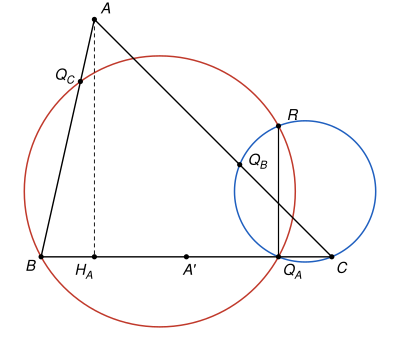
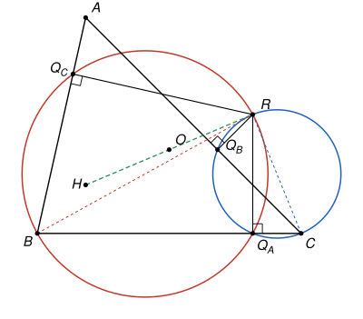

## Statement

Soit $ABC$ un triangle sans angle droit.

- On note $H_A$ le pied de la hauteur issue de $A$, et $A'$ le milieu du segment $[BC]$. On note $Q_A$ le symétrique de $H_A$ par rapport à $A'$.
- De même, $H_B$ est le pied de la hauteur issue de $B$, $B'$ le milieu de $[CA]$, et $Q_B$ le symétrique de $H_B$ par rapport à $B'$.
- De même, $H_C$ est le pied de la hauteur issue de $C$, $C'$ le milieu de $[AB]$, et $Q_C$ le symétrique de $H_C$ par rapport à $C'$.

Enfin, on note $R$ le point d'intersection, autre que $Q_A$, des cercles circonscrits aux triangles $Q_AQ_BC$ et $Q_ABQ_C$.

Démontrer que les droites $(Q_AR)$ et $(BC)$ sont perpendiculaires.

## Hints

1. Fais une figure précise, avec un logiciel de géométrie si tu peux. Trace la perpendiculaire à $(BC)$ en $Q_A$, la perpendiculaire à $(CA)$ en $Q_B$ et la perpendiculaire à $(AB)$ en $Q_C$. Que remarques-tu ?
2. Suppose qu'un point $P$ soit sur ces trois perpendiculaires. Les angles $\widehat{CQ_AP}$ et $\widehat{CQ_BP}$ sont alors droits. Quel cercle passe par $C$, $Q_A$ et $Q_B$ ? Et par $B$, $Q_A$ et $Q_C$ ?
3. Pour trouver ce point $P$, regarde la droite $(BC)$. La perpendiculaire à $(BC)$ en $A'$ passe par le centre $O$ du cercle circonscrit à $ABC$, et la perpendiculaire à $(BC)$ en $H_A$ passe par l'orthocentre $H$. Et $A'$ est le milieu de $[H_AQ_A]$. Quel symétrique de $H$ faut-il essayer ?
4. Prends pour $P$ le symétrique de $H$ par rapport à $O$. Dans un repère où $(BC)$ est l'axe des abscisses, compare l'abscisse de $P$ à celle de $Q_A$.

## Solution

**Ce que l'on suppose.** Si l'angle en $B$ était droit, le pied de la hauteur issue de $A$ serait $B$ lui-même, donc $Q_A$ serait le symétrique de $B$ par rapport au milieu de $[BC]$, c'est-à-dire $C$, et le « triangle » $Q_AQ_BC$ serait aplati. C'est pour cela que l'on suppose qu'aucun angle n'est droit. Alors $Q_A$ est un point de $(BC)$ différent de $B$ et de $C$, et de même pour $Q_B$ sur $(CA)$ et $Q_C$ sur $(AB)$.

**L'idée.** On va trouver un point $P$ qui est à la fois sur la perpendiculaire à $(BC)$ en $Q_A$, sur la perpendiculaire à $(CA)$ en $Q_B$ et sur la perpendiculaire à $(AB)$ en $Q_C$. Avec les angles droits, les deux cercles de l'énoncé deviennent des cercles de diamètres $[CP]$ et $[BP]$, et on montre que $R = P$.

**Étape 1 : un point qui se projette en $Q_A$, en $Q_B$ et en $Q_C$.**

On note $O$ le centre du cercle circonscrit au triangle $ABC$, $H$ son orthocentre (le point commun des trois hauteurs), et $P$ le symétrique de $H$ par rapport à $O$. Ainsi $O$ est le milieu de $[HP]$.

Prenons un repère orthonormé dont l'axe des abscisses est la droite $(BC)$. Le projeté orthogonal sur $(BC)$ d'un point $M(x\,;y)$ est le point $(x\,;0)$ : il a la même abscisse que $M$.

- $H$ est sur la hauteur issue de $A$, qui est perpendiculaire à $(BC)$ en $H_A$. Donc $x_H = x_{H_A}$.
- $OB = OC$, donc $O$ est sur la médiatrice de $[BC]$, qui est perpendiculaire à $(BC)$ en $A'$. Donc $x_O = x_{A'}$.
- $O$ est le milieu de $[HP]$, donc $x_P = 2x_O - x_H = 2x_{A'} - x_{H_A}$.
- $A'$ est le milieu de $[H_AQ_A]$, donc $x_{Q_A} = 2x_{A'} - x_{H_A}$.

Ainsi $P$ et $Q_A$ ont la même abscisse, et $Q_A$ est sur $(BC)$ : **$Q_A$ est le projeté orthogonal de $P$ sur $(BC)$.** Autrement dit, $P$ est sur la perpendiculaire à $(BC)$ en $Q_A$.

Le point $P$ a été défini sans privilégier aucun côté. Le même calcul, fait dans un repère dont l'axe des abscisses est $(CA)$, puis $(AB)$, montre que $Q_B$ est le projeté orthogonal de $P$ sur $(CA)$, et que $Q_C$ est le projeté orthogonal de $P$ sur $(AB)$.

En particulier $P \neq C$ : sinon le projeté de $P$ sur $(BC)$ serait $C$, et on aurait $Q_A = C$. De même $P \neq B$.

**Étape 2 : les deux cercles de l'énoncé.**

On utilise la propriété du cercle de diamètre $[UV]$ : un point $M$ est sur ce cercle si et seulement si $M = U$, ou $M = V$, ou l'angle $\widehat{UMV}$ est droit.

Notons $\Gamma_C$ le cercle de diamètre $[CP]$.

- $C$ est sur $\Gamma_C$.
- Si $Q_A = P$, alors $Q_A$ est sur $\Gamma_C$. Sinon, la droite $(Q_AP)$ est perpendiculaire à $(BC)$, c'est-à-dire à $(Q_AC)$ : l'angle $\widehat{CQ_AP}$ est droit, et $Q_A$ est encore sur $\Gamma_C$.
- Pour la même raison, avec $(CA)$ à la place de $(BC)$, $Q_B$ est sur $\Gamma_C$.

Les points $C$, $Q_A$, $Q_B$ ne sont pas alignés, puisque $Q_A$ est sur $(BC)$, $Q_B$ sur $(CA)$, et que tous deux sont différents de $C$. Or par trois points non alignés passe un seul cercle. Donc **$\Gamma_C$ est le cercle circonscrit au triangle $Q_AQ_BC$.**

De la même façon, le cercle $\Gamma_B$ de diamètre $[BP]$ passe par $B$, $Q_A$ et $Q_C$ : **$\Gamma_B$ est le cercle circonscrit au triangle $Q_ABQ_C$.**

**Étape 3 : $R = P$.**

Une droite coupe un cercle en deux points au plus. Le cercle $\Gamma_B$ passe déjà par $B$ et $Q_A$, qui sont sur $(BC)$, donc il ne passe pas par $C$. De même $\Gamma_C$ coupe $(BC)$ seulement en $C$ et $Q_A$, et ne passe pas par $B$.

Le point $R$ est sur les deux cercles. Il n'est donc ni $C$ (qui n'est pas sur $\Gamma_B$), ni $B$ (qui n'est pas sur $\Gamma_C$), et il n'est pas $Q_A$ par définition.

Supposons $R \neq P$.

- $R$ est sur $\Gamma_C$ et différent de $C$ et de $P$, donc l'angle $\widehat{CRP}$ est droit.
- $R$ est sur $\Gamma_B$ et différent de $B$ et de $P$, donc l'angle $\widehat{BRP}$ est droit.

Les droites $(RC)$ et $(RB)$ sont alors toutes les deux perpendiculaires à $(RP)$ et passent toutes les deux par $R$ : c'est la même droite. Donc $R$ est sur $(BC)$. Mais $\Gamma_C$ ne coupe $(BC)$ qu'en $C$ et en $Q_A$, et $R$ n'est aucun de ces deux points. C'est impossible.

Donc $R = P$.

**Conclusion.** D'après l'étape 1, le point $R = P$ est sur la perpendiculaire à $(BC)$ en $Q_A$, et $R \neq Q_A$. Donc **les droites $(Q_AR)$ et $(BC)$ sont perpendiculaires.**

## Going further

- Le même raisonnement montre que le cercle de diamètre $[AR]$ passe par $Q_B$ et $Q_C$. Les **trois** cercles circonscrits aux triangles $Q_AQ_BC$, $Q_ABQ_C$ et $AQ_BQ_C$ passent donc par un même point, le point $R$.
- Le problème est la version « par symétrie » d'un fait classique. Les angles $\widehat{CH_AH}$ et $\widehat{CH_BH}$ sont droits, donc le cercle circonscrit au triangle $H_AH_BC$ est le cercle de diamètre $[CH]$. Ici, on remplace les pieds des hauteurs par leurs symétriques, et l'orthocentre $H$ par son symétrique par rapport à $O$.
- Le point $R$, symétrique de l'orthocentre par rapport au centre du cercle circonscrit, s'appelle le point de Longchamps du triangle. Il est sur la droite d'Euler, qui passe par $O$, par $H$ et par le centre de gravité $G$.
