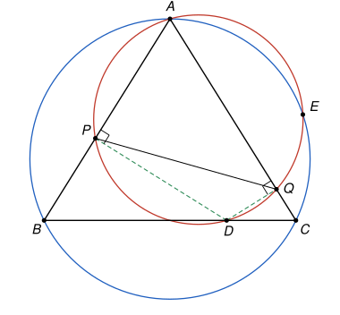

## Statement

Soit $ABC$ un triangle isocèle en $A$, et $D$ un point du segment $[BC]$ tel que $BD \neq CD$. On note $P$ et $Q$ les projetés orthogonaux de $D$ sur les droites $(AB)$ et $(AC)$. Enfin, on note $E$ le point d'intersection, autre que $A$, du cercle circonscrit au triangle $ABC$ et du cercle circonscrit au triangle $APQ$.

Démontrer que si les droites $(EP)$, $(AC)$ et la médiatrice du segment $[PQ]$ sont concourantes, alors le triangle $ABC$ est rectangle en $A$.

## Hints

1. Fais une figure exacte avec un triangle isocèle rectangle en $A$, et regarde ce qui se passe. Puis cherche quel cercle passe par $A$, $P$ et $Q$ : pense aux angles droits en $P$ et en $Q$.
2. Le cercle circonscrit à $APQ$ est le cercle de diamètre $[AD]$. Montre qu'il passe par le milieu $M$ de $[BC]$, et que $MP = MQ$. Ainsi $M$ est sur la médiatrice $\ell$ de $[PQ]$.
3. Appelle $X$ le point de concours. Comme $XP = XQ$, la symétrie d'axe $\ell$ échange les droites $(XQ)$ et $(XP)$, c'est-à-dire $(AC)$ et $(EP)$. Elle conserve aussi le cercle $APQ$. Où envoie-t-elle le point $A$ ?
4. La droite $\ell$ est donc la médiatrice de $[AE]$, et elle passe par le centre $O$ du cercle circonscrit à $ABC$. Les points $O$ et $M$ sont aussi sur la droite $(AM)$. Peut-on avoir $\ell = (AM)$ ?

## Solution

**Ce que l'énoncé suppose sans le dire.** L'énoncé parle du cercle circonscrit au triangle $APQ$ et de la droite $(EP)$. On suppose donc que $P$ et $Q$ sont différents de $A$, et que $E$ est différent de $P$. Alors $P \neq Q$ aussi : un point commun aux droites $(AB)$ et $(AC)$ ne peut être que $A$.

On note $M$ le milieu de $[BC]$, $O$ le centre du cercle circonscrit à $ABC$, $\Gamma$ le cercle circonscrit à $APQ$, et $\ell$ la médiatrice de $[PQ]$. Comme $BD \neq CD$, le point $D$ est différent de $M$.

On utilise la propriété du cercle de diamètre $[UV]$ : un point $N$ est sur ce cercle si et seulement si $N = U$, ou $N = V$, ou l'angle $\widehat{UNV}$ est droit.

**Étape 1 : le cercle $\Gamma$ est le cercle de diamètre $[AD]$, et il passe par $M$.** Les angles $\widehat{APD}$ et $\widehat{AQD}$ sont droits (ou bien $P = D$, ou $Q = D$). Donc $P$ et $Q$ sont sur le cercle de diamètre $[AD]$, tout comme $A$. Par trois points distincts d'un cercle passe un seul cercle, donc $\Gamma$ est le cercle de diamètre $[AD]$. Son centre $O'$ est le milieu de $[AD]$.

Comme $AB = AC$, le point $A$ est sur la médiatrice de $[BC]$, qui est la perpendiculaire à $(BC)$ passant par $M$. Cette médiatrice est donc la droite $(AM)$, et elle est perpendiculaire à $(BC)$. Le point $D$ est sur $(BC)$ et différent de $M$, donc l'angle $\widehat{AMD}$ est droit : **$M$ est sur $\Gamma$.** Notons aussi que $O$, qui est sur la médiatrice de $[BC]$, est sur $(AM)$.

**Étape 2 : $MP = MQ$, donc $M$ est sur $\ell$.** Soit $\tau$ la symétrie d'axe $(AM)$. Elle échange $B$ et $C$ et laisse $A$ fixe, donc elle échange les droites $(AB)$ et $(AC)$. Soit $D' = \tau(D)$. Comme $(AM)$ est perpendiculaire à $(BC)$ en $M$, le point $D'$ est sur $(BC)$ et $M$ est le milieu de $[DD']$.

Une symétrie conserve les angles droits. Comme $P$ est le projeté orthogonal de $D$ sur $(AB)$, le point $Q' = \tau(P)$ est le projeté orthogonal de $D'$ sur $(AC)$. Et $\tau$ laisse $M$ fixe, donc $MP = MQ'$.

Il reste à voir que $MQ' = MQ$. Prenons un repère orthonormé dont l'axe des abscisses est la droite $(AC)$. Le projeté orthogonal d'un point sur $(AC)$ a la même abscisse que ce point. Soit $N$ le projeté orthogonal de $M$ sur $(AC)$. Comme $M$ est le milieu de $[DD']$, et que $D$ et $Q$ ont la même abscisse, ainsi que $D'$ et $Q'$, on obtient
$$x_N = x_M = \frac{x_D + x_{D'}}{2} = \frac{x_Q + x_{Q'}}{2}.$$
Donc $N$ est le milieu de $[QQ']$, et la droite $(MN)$, perpendiculaire à $(AC)$ en $N$, est la médiatrice de $[QQ']$ (si $Q = Q'$, il n'y a rien à montrer). Ainsi $MQ = MQ'$.

Finalement $MP = MQ' = MQ$ : **le point $M$ est sur la médiatrice $\ell$ de $[PQ]$.**

**Étape 3 : la symétrie d'axe $\ell$ envoie $A$ sur $E$.** Soit $X$ le point commun aux droites $(EP)$, $(AC)$ et $\ell$. Comme $X$ est sur $\ell$, on a $XP = XQ$. Comme $P \neq Q$, cela empêche $X = P$ et $X = Q$.

Soit $\sigma$ la symétrie d'axe $\ell$. Elle échange $P$ et $Q$, et laisse $X$ fixe.

- Les points $X$ et $Q$ sont deux points distincts de $(AC)$, donc $(AC) = (XQ)$. De même, $X$ et $P$ sont deux points distincts de $(EP)$, donc $(EP) = (XP)$. La symétrie $\sigma$ envoie donc la droite $(AC)$ sur la droite $(EP)$.
- Le centre $O'$ de $\Gamma$ vérifie $O'P = O'Q$, donc il est sur $\ell$, et $\sigma$ le laisse fixe. Une symétrie conserve les distances, donc $\sigma$ envoie tout point situé à la distance $O'A$ de $O'$ sur un point situé à la même distance de $O'$ : elle envoie le cercle $\Gamma$ sur lui-même.

Le point $A$ est sur $(AC)$ et sur $\Gamma$. Son image $\sigma(A)$ est donc sur $(EP)$ et sur $\Gamma$. Or une droite coupe un cercle en deux points au plus, et la droite $(EP)$ coupe $\Gamma$ en $E$ et en $P$. Donc $\sigma(A) = E$ ou $\sigma(A) = P$. Dans le second cas, on aurait $A = \sigma(P) = Q$, ce qui est exclu. Donc $\sigma(A) = E$. Comme $E \neq A$, **la droite $\ell$ est la médiatrice de $[AE]$.**

**Étape 4 : conclusion.** Les points $A$ et $E$ sont sur le cercle circonscrit à $ABC$, donc $OA = OE$ et $O$ est sur la médiatrice de $[AE]$, c'est-à-dire sur $\ell$. Récapitulons :

- $M$ et $O$ sont sur $\ell$ (étapes 2 et 3) ;
- $M$ et $O$ sont sur $(AM)$ (étape 1) ;
- $O'$ est sur $\ell$ (étape 3), mais pas sur $(AM)$. En effet, si le milieu $O'$ de $[AD]$ était sur $(AM)$, la droite $(AO')$, qui contient $D$, serait $(AM)$. Mais $(AM)$ coupe $(BC)$ seulement en $M$, et $D \neq M$.

Supposons $O \neq M$. Alors $\ell$ et $(AM)$ passent toutes les deux par les deux points distincts $O$ et $M$, donc $\ell = (AM)$. Mais $O'$ est sur $\ell$ et pas sur $(AM)$ : c'est impossible.

Donc $O = M$. Le centre du cercle circonscrit à $ABC$ est le milieu de $[BC]$ : le segment $[BC]$ est un diamètre de ce cercle, et l'angle $\widehat{BAC}$ est droit. **Le triangle $ABC$ est rectangle en $A$.**

## Going further

- La réciproque est vraie : si $ABC$ est isocèle et rectangle en $A$, les trois droites sont concourantes, quel que soit le point $D$ choisi sur $[BC]$ avec $BD \neq CD$. Vérifie-le sur une figure, puis essaie de le démontrer.
- Pourquoi l'hypothèse $BD \neq CD$ ? Si $D = M$, les deux cercles ont leurs centres sur la droite $(AM)$ et passent tous les deux par $A$ : ils sont tangents en $A$, et le point $E$ n'existe pas.
- Sur la figure de l'énoncé, $(AM)$ est la bissectrice de l'angle $\widehat{PAQ}$, et l'étape 2 dit que $M$ est le milieu de l'arc $PQ$ de $\Gamma$ qui ne contient pas $A$. C'est un fait général : dans un triangle, la bissectrice issue d'un sommet recoupe le cercle circonscrit au milieu de l'arc opposé. La preuve de l'étape 2 n'utilise pas ce fait, car quand l'angle en $A$ est obtus, le point $P$ peut se trouver sur $(AB)$ de l'autre côté de $A$, et la figure change.
