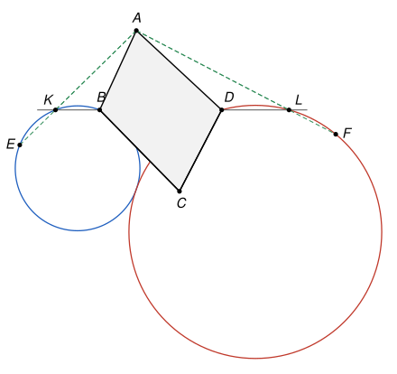

## Statement

Soit $ABCD$ un quadrilatère convexe dont les angles en $B$ et en $D$ sont obtus, et dont les angles en $A$ et en $C$ sont égaux.

- Soit $E$ et $F$ les symétriques de $A$ par rapport aux droites $(BC)$ et $(CD)$.
- Soit $K$ et $L$ les points d'intersection de la droite $(BD)$ avec les droites $(AE)$ et $(AF)$.

Démontrer que les cercles circonscrits aux triangles $BEK$ et $DFL$ sont tangents.

## Hints

1. Fais une figure exacte. Pour placer $C$ de sorte que $\widehat{BCD} = \widehat{BAD}$, introduis le symétrique $A'$ de $A$ par rapport à $(BD)$. Sur quel cercle se trouve $A'$ ?
2. Sur une figure soignée, les deux cercles semblent passer par $A'$. C'est le point de contact qu'il faut atteindre.
3. Prends un repère où $(BD)$ est l'axe des abscisses et $A$ est sur l'axe des ordonnées : $A(0, a)$, $B(b, 0)$, $D(d, 0)$, $C(p, q)$. Calcule les abscisses de $K$ et de $L$, puis écris l'équation du cercle qui passe par $B$, $K$ et $A'$.
4. Pour montrer que $E$ est sur ce cercle, coupe-le par la droite $(AK)$ et utilise le produit des racines d'une équation du second degré.
5. Deux cercles qui passent par $A'$ sont tangents en $A'$ quand leurs centres sont alignés avec $A'$. Écris cette condition avec un déterminant, et utilise le fait que $C$ est sur le cercle $BDA'$.

## Solution

Les points peuvent se placer de bien des façons : $K$ peut être d'un côté ou de l'autre de $B$, $E$ peut être avant ou après $K$, etc. Une chasse aux angles demanderait d'examiner chaque cas. On utilise donc des coordonnées, qui traitent toutes les figures d'un coup.

**Trois rappels.**

- *Réciproque de l'angle inscrit.* Soit $M$ et $N$ deux points situés du même côté d'une droite $(BD)$. Si $\widehat{BMD} = \widehat{BND}$, alors $B$, $D$, $M$, $N$ sont sur un même cercle.
- *Équation d'un cercle.* Dans un repère orthonormé, une équation $x^2 + y^2 - 2\alpha x - 2\gamma y + c = 0$ avec $\alpha^2 + \gamma^2 - c > 0$ est celle du cercle de centre $(\alpha, \gamma)$ et de rayon $\sqrt{\alpha^2 + \gamma^2 - c}$. En effet, elle s'écrit $(x - \alpha)^2 + (y - \gamma)^2 = \alpha^2 + \gamma^2 - c$.
- *Cercles tangents.* La tangente en un point $T$ d'un cercle de centre $\Omega$ est la perpendiculaire à $(\Omega T)$ en $T$. Si deux cercles distincts passent par $T$ et que leurs centres sont alignés avec $T$, ils ont donc la même tangente en $T$ : ils sont tangents en $T$.

**Étape 1 : le symétrique $A'$ de $A$ par rapport à $(BD)$ est sur le cercle $BCD$.** Une symétrie conserve les angles, donc $\widehat{BA'D} = \widehat{BAD} = \widehat{BCD}$. Le quadrilatère est convexe, donc $A$ et $C$ sont de part et d'autre de la diagonale $(BD)$. Ainsi $A'$ et $C$ sont du même côté de $(BD)$, et la réciproque de l'angle inscrit montre que $A'$ est sur le cercle $BCD$. (Si $A' = C$, c'est évident.)

**Étape 2 : le repère.** On prend un repère orthonormé dont l'axe des abscisses est la droite $(BD)$ et dont l'axe des ordonnées passe par $A$, du côté de $A$. Alors
$$A(0, a), \quad A'(0, -a), \quad B(b, 0), \quad D(d, 0), \quad C(p, q),$$
avec $a > 0$, $b \neq d$ et $q < 0$, car $C$ est de l'autre côté de $(BD)$.

Le cercle qui passe par $B$, $D$ et $A'$ a pour équation
$$x^2 + y^2 - (b + d)\,x + \frac{a^2 + bd}{a}\,y + bd = 0.$$
En effet, pour $y = 0$ le membre de gauche vaut $x^2 - (b + d)x + bd = (x - b)(x - d)$, qui s'annule en $x = b$ et en $x = d$. Et au point $A'$ il vaut $a^2 - (a^2 + bd) + bd = 0$. D'après l'étape 1, le point $C$ est sur ce cercle :
$$(\star) \qquad (p - b)(p - d) + q^2 + \frac{a^2 + bd}{a}\,q = 0.$$

**Étape 3 : les points $K$ et $L$.** Le point $E$ est le symétrique de $A$ par rapport à $(BC)$, donc $(AE)$ est la perpendiculaire à $(BC)$ passant par $A$. Avec $\overrightarrow{BC}(p - b, q)$, un point $M(x, y)$ est sur $(AE)$ si et seulement si $\overrightarrow{AM} \cdot \overrightarrow{BC} = 0$, c'est-à-dire
$$x\,(p - b) + (y - a)\,q = 0.$$
Pour $y = 0$, cela donne $x\,(p - b) = aq$. L'énoncé suppose que $(AE)$ coupe $(BD)$, donc $p \neq b$ (sinon on aurait $0 = aq$, ce qui est faux). Ainsi $K(k, 0)$ et, de la même manière avec $(CD)$, $L(l, 0)$, où
$$k = \frac{aq}{p - b} \qquad \text{et} \qquad l = \frac{aq}{p - d}.$$
On a $K \neq B$ : sinon $(AB)$ serait perpendiculaire à $(BC)$, et l'angle en $B$ serait droit. De même $L \neq D$.

**Étape 4 : le cercle circonscrit à $BEK$ passe par $A'$.** On pose $\beta = \dfrac{a^2 + bk}{a}$ et on considère
$$\Gamma_b : \quad f(x, y) = x^2 + y^2 - (b + k)\,x + \beta\,y + bk = 0.$$
Comme à l'étape 2, $\Gamma_b$ passe par $B$ et $K$ (pour $y = 0$, on trouve $(x - b)(x - k)$), et par $A'$, car $a^2 - \beta a + bk = 0$. C'est bien un cercle, car $b \neq k$ (le rappel donne un rayon au carré égal à $\left(\frac{b - k}{2}\right)^2 + \frac{\beta^2}{4} > 0$).

Montrons que $E$ est sur $\Gamma_b$. Les points de la droite $(AK)$ s'écrivent $M_t = A + t\,\overrightarrow{AK}$, avec $\overrightarrow{AK}(k, -a)$ et $t$ réel. En développant, $f(M_t)$ est un polynôme du second degré en $t$ :

- son coefficient de $t^2$ est $k^2 + a^2 = AK^2$ ;
- son terme constant est $f(A) = a^2 + \beta a + bk = 2(a^2 + bk)$.

Il s'annule pour $t = 1$, puisque $M_1 = K$ est sur $\Gamma_b$. Le produit des deux racines vaut $\frac{f(A)}{AK^2}$, donc l'autre racine est
$$t_2 = \frac{2(a^2 + bk)}{AK^2}.$$
D'autre part, $E$ est sur la droite $(AK)$, donc $\overrightarrow{AE} = s\,\overrightarrow{AK}$ pour un certain réel $s$, et $\overrightarrow{AE} \cdot \overrightarrow{AK} = s\,AK^2$. Calculons ce produit scalaire autrement. Soit $H$ le milieu de $[AE]$ : c'est le pied de la perpendiculaire à $(BC)$ issue de $A$, et $\overrightarrow{AE} = 2\,\overrightarrow{AH}$. Le vecteur $\overrightarrow{BH}$ est porté par $(BC)$, donc orthogonal à $\overrightarrow{AK}$. Ainsi
$$\overrightarrow{AE} \cdot \overrightarrow{AK} = 2\left(\overrightarrow{AB} + \overrightarrow{BH}\right) \cdot \overrightarrow{AK} = 2\,\overrightarrow{AB} \cdot \overrightarrow{AK} = 2\,(bk + a^2),$$
car $\overrightarrow{AB}(b, -a)$. On obtient $s = t_2$, donc $E = M_{t_2}$ est sur $\Gamma_b$.

Les points $B$, $E$, $K$ forment un triangle, donc $\Gamma_b$ est son cercle circonscrit, et il passe par $A'$. Exactement de la même façon, avec $\delta = \dfrac{a^2 + dl}{a}$, le cercle circonscrit à $DFL$ est
$$\Gamma_d : \quad x^2 + y^2 - (d + l)\,x + \delta\,y + dl = 0,$$
et il passe lui aussi par $A'$.

**Étape 5 : les centres sont alignés avec $A'$.** D'après le rappel, les centres sont $\Omega_b\left(\frac{b + k}{2}, -\frac{\beta}{2}\right)$ et $\Omega_d\left(\frac{d + l}{2}, -\frac{\delta}{2}\right)$. Comme $a - \frac{\beta}{2} = \frac{a^2 - bk}{2a}$, on a
$$\overrightarrow{A'\Omega_b}\left(\frac{b + k}{2},\ \frac{a^2 - bk}{2a}\right) \qquad \text{et} \qquad \overrightarrow{A'\Omega_d}\left(\frac{d + l}{2},\ \frac{a^2 - dl}{2a}\right).$$
Ces deux vecteurs sont colinéaires si et seulement si leur déterminant est nul, c'est-à-dire, après multiplication par $4a$, si
$$\Delta = (b + k)(a^2 - dl) - (d + l)(a^2 - bk) = 0.$$
En développant puis en regroupant les termes,
$$\Delta = a^2(b - d) + a^2(k - l) + bd\,(k - l) + kl\,(b - d) = (b - d)(a^2 + kl) + (k - l)(a^2 + bd).$$
Avec les valeurs de l'étape 3,
$$k - l = \frac{aq\,(b - d)}{(p - b)(p - d)} \qquad \text{et} \qquad kl = \frac{a^2 q^2}{(p - b)(p - d)}.$$
En mettant $\frac{b - d}{(p - b)(p - d)}$ en facteur, il vient
$$\Delta = \frac{b - d}{(p - b)(p - d)} \times \left(a^2 (p - b)(p - d) + a^2 q^2 + aq\,(a^2 + bd)\right).$$
La parenthèse vaut $a^2$ fois le membre de gauche de $(\star)$, qui est nul. Donc $\Delta = 0$ : les points $A'$, $\Omega_b$, $\Omega_d$ sont alignés.

**Étape 6 : les deux cercles sont distincts.** Supposons $\Gamma_b = \Gamma_d$. Ce cercle coupe la droite $(BD)$ en $B$ et $K$, mais aussi en $D$ et $L$. Un cercle et une droite ont au plus deux points communs, et $B \neq D$, donc $D = K$. Alors $D$ est sur $(AE)$, c'est-à-dire que $(AD)$ est perpendiculaire à $(BC)$. Ces deux droites se coupent en un point $H'$, avec un angle droit. Comme $ABCD$ est convexe, $H'$ est au-delà de $A$ et de $B$, ou bien au-delà de $D$ et de $C$.

- Dans le premier cas, le triangle $H'AB$ a pour angles $90^\circ$, $180^\circ - \widehat{A}$ et $180^\circ - \widehat{B}$. Leur somme vaut $180^\circ$, donc $\widehat{A} + \widehat{B} = 270^\circ$, et $\widehat{C} + \widehat{D} = 90^\circ$. C'est impossible, car $\widehat{D} > 90^\circ$.
- Dans le second cas, on trouve de même $\widehat{C} + \widehat{D} = 270^\circ$, donc $\widehat{A} + \widehat{B} = 90^\circ$, ce qui est impossible car $\widehat{B} > 90^\circ$.

Les deux cercles sont donc distincts. En particulier leurs centres sont distincts, car deux cercles de même centre passant tous deux par $A'$ seraient égaux.

**Conclusion.** Les cercles circonscrits aux triangles $BEK$ et $DFL$ sont distincts, ils passent tous les deux par $A'$, et leurs centres sont alignés avec $A'$. Ils ont donc la même tangente en $A'$ : **ils sont tangents en $A'$, le symétrique de $A$ par rapport à $(BD)$.**

## Going further

- Le corrigé officiel trouve le même point de contact par une chasse aux angles. Il utilise des *angles orientés de droites*, un outil d'olympiade qui permet d'écrire un seul calcul valable pour toutes les positions des points. Sans cet outil, il faudrait séparer de nombreux cas.
- La symétrie par rapport à $(BD)$ fixe $B$ et $K$ et échange $A$ et $A'$. Elle envoie donc le cercle $BEK$, qui passe par $A'$, sur le cercle qui passe par $A$, $B$ et $K$. L'énoncé revient ainsi à montrer que les cercles $ABK$ et $ADL$ sont tangents en $A$. Essaie de le démontrer avec des angles, sur la figure de l'énoncé.
- Le point difficile de l'exercice est de deviner le point de contact. Pour cela, il faut réussir à tracer une figure exacte, et c'est en cherchant comment placer $C$ qu'on rencontre naturellement le point $A'$.
