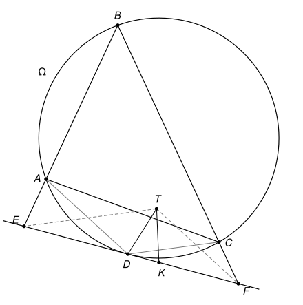

## Statement

Soit $A$, $B$, $C$ et $D$ quatre points distincts situés sur un cercle $\Omega$. La tangente à $\Omega$ en $D$ coupe les demi-droites $[BA)$ et $[BC)$ en des points $E$ et $F$.

Soit $T$ un point situé à l'intérieur du triangle $ABC$, tel que la droite $(TE)$ soit parallèle à $(CD)$ et la droite $(TF)$ parallèle à $(AD)$. Enfin, soit $K$ le point du segment $[DF]$, autre que $D$, tel que $TD = TK$.

Démontrer que les droites $(AC)$, $(DT)$ et $(BK)$ sont concourantes.

## Hints

1. Note $P$ et $Q$ les points où les droites $(TE)$ et $(TF)$ coupent $(AC)$. Montre que $A$, $D$, $E$, $P$ sont sur un même cercle, en utilisant l'angle entre la tangente $(EF)$ et la corde $[DA]$.
2. Montre que $D$ est sur le cercle qui passe par $T$, $P$ et $Q$. Montre ensuite que la tangente à ce cercle en $T$ est parallèle à $(EF)$. Pourquoi cela force-t-il $K$ à être aussi sur ce cercle ?
3. Montre que $(KP)$ est parallèle à $(BC)$ et que $(KQ)$ est parallèle à $(AB)$. Les points $E$, $F$, $P$, $Q$ sont aussi sur un même cercle.
4. Les triangles $ACD$ et $QPT$ ont leurs côtés parallèles, et de même $ABC$ et $QKP$. Cherche un point $O$ de $(AC)$ et un nombre $k$ tels que $\overrightarrow{OQ} = k\,\overrightarrow{OA}$ et $\overrightarrow{OP} = k\,\overrightarrow{OC}$, puis regarde les points $T$ et $K$.

## Solution

**Rappel.** Ce problème se résout avec les *angles orientés de droites*, qui ne sont pas au programme du lycée. Pour deux droites $d$ et $d'$, on note $(d, d')$ l'angle dont il faut faire tourner $d$, dans le sens direct, pour la rendre parallèle à $d'$. Cet angle n'est connu qu'à $180^\circ$ près, puisque tourner une droite de $180^\circ$ redonne la même droite. Toutes les égalités d'angles de cette solution s'entendent donc à $180^\circ$ près. L'intérêt de cet outil est qu'on n'a pas à distinguer les cas selon la position des points sur la figure. On utilise trois règles.

- **(R1) Relation de Chasles.** $(d_1, d_2) + (d_2, d_3) = (d_1, d_3)$ et $(d, d') = -(d', d)$. De plus, $(d, d') = 0$ si et seulement si $d$ et $d'$ sont parallèles. En particulier, si $d_1$ et $d_2$ sont parallèles, on peut remplacer l'une par l'autre : $(d_1, d) = (d_2, d)$.
- **(R2) Angle inscrit.** Soient $U$, $V$, $M$ trois points non alignés et $N$ un point distinct de $U$ et de $V$. Alors $N$ est sur le cercle qui passe par $U$, $V$, $M$ si et seulement si $(MU, MV) = (NU, NV)$.
- **(R3) Angle entre tangente et corde.** Soient $M$, $U$, $V$ trois points distincts d'un cercle, et $t$ la tangente à ce cercle en $M$. Alors $(t, MU) = (VM, VU)$. Inversement, une droite $t$ passant par $M$ qui vérifie cette égalité est la tangente en $M$. C'est le cas limite de (R2), quand le point $N$ vient se placer en $M$ : la droite $(NM)$ devient la tangente.

On note $t$ la tangente à $\Omega$ en $D$, c'est-à-dire la droite $(EF)$. On note $P$ et $Q$ les points d'intersection des droites $(TE)$ et $(TF)$ avec la droite $(AC)$.

**Étape 0 : la position des points.** Les angles orientés évitent de discuter la figure, mais il faut tout de même savoir quels points sont distincts, et deux positions serviront à la fin.

*Le point $D$ est différent de $A$, $B$ et $C$.* Si l'on avait $D = A$, la tangente en $A$ ne couperait la droite $(AB)$ qu'en $A$, donc $E = A$. La droite $(TE)$ serait alors la parallèle à $(CA)$ passant par $A$, c'est-à-dire $(AC)$ elle-même, et $T$ serait sur $(AC)$ : impossible pour un point intérieur au triangle. De même $D \neq C$. Si l'on avait $D = B$, on aurait $E = F = B$, et $T$ serait sur la parallèle à $(AD) = (AB)$ passant par $B$, c'est-à-dire sur $(AB)$ : impossible aussi.

Par conséquent $A$, $C$, $D$ sont trois points distincts de $\Omega$, donc non alignés, et les droites $(AC)$, $(CD)$, $(AD)$ sont deux à deux non parallèles. Une droite coupe un cercle en au plus deux points, donc $D$ n'est sur aucune des droites $(AB)$, $(BC)$, $(AC)$. Enfin, la tangente $t$ ne touche $\Omega$ qu'en $D$ : $A$ et $C$ ne sont pas sur $(EF)$, donc ni $(AD)$ ni $(CD)$ n'est parallèle à $(EF)$.

*Le point $A$ est strictement entre $B$ et $E$.* Notons $\omega$ le centre de $\Omega$ et $R$ son rayon. Pour tout point $M$ de la tangente, le théorème de Pythagore dans le triangle $\omega DM$, rectangle en $D$, donne $\omega M \geqslant \omega D = R$, avec égalité seulement pour $M = D$ : la tangente reste hors du disque, sauf au point $D$. Or $E \neq D$, car $D$ n'est pas sur $(AB)$. Donc $E$ est hors du disque. Les seuls points de la demi-droite $[BA)$ qui sont dans le disque sont ceux du segment $[BA]$, donc $E$ est au-delà de $A$. De même, $C$ est strictement entre $B$ et $F$.

*Les points $P$ et $Q$ sont strictement entre $A$ et $C$, et $P \neq Q$.* La droite $(TE)$ est parallèle à $(CD)$, donc pas à $(AC)$ : le point $P$ existe. Le point $E$ est sur la demi-droite $[BA)$, du même côté de $(BC)$ que $A$, et $T$ aussi, puisqu'il est à l'intérieur du triangle. Le segment $[TE]$ ne coupe donc pas $(BC)$. D'autre part, $T$ est du côté de $B$ par rapport à $(AC)$, et $E$ de l'autre côté, puisque $A$ est entre $B$ et $E$. Le segment $[TE]$ coupe donc $(AC)$, et ce point est $P$.

Ainsi $P$ est un point du segment $[TE]$ autre que $E$. Il est strictement du côté de $A$ par rapport à $(BC)$, puisque $[TE]$ ne coupe pas $(BC)$. Il est aussi strictement du côté de $C$ par rapport à $(AB)$, comme tous les points de $[TE]$ autres que $E$, car $T$ est de ce côté et $E$ est sur $(AB)$. Un point de la droite $(AC)$ qui vérifie ces deux conditions est strictement entre $A$ et $C$. Le même raisonnement, avec $F$ et $C$, montre que $Q$ est strictement entre $A$ et $C$.

Si l'on avait $P = Q$, ce point serait sur $(TE)$ et sur $(TF)$. Ces deux droites ne sont pas parallèles, car $(CD)$ et $(AD)$ ne le sont pas : elles se coupent seulement en $T$, et $T$ serait sur $(AC)$. C'est impossible, donc $P \neq Q$.

*Quelques conséquences.* Comme $T \notin (AC)$, on a $P \neq T$ et $Q \neq T$, donc $(TP) = (TE)$ et $(TQ) = (TF)$. Le point $E$ n'est pas sur $(AC)$, donc $P \neq E$ ; de même $Q \neq F$. Enfin, la droite $(TE)$ coupe $(EF)$ seulement en $E$, car elle n'est pas parallèle à $(EF)$. Donc $P$ n'est pas sur $(EF)$, et de même $Q$ n'est pas sur $(EF)$.

**Étape 1 : trois cercles.**

- *Les points $A$, $D$, $E$, $P$ sont sur un même cercle $\alpha$.* On a $(PA) = (AC)$ et $(PE) \parallel (CD)$, donc $(PA, PE) = (CA, CD)$. La règle (R3) dans $\Omega$, au point $D$, avec $U = A$ et $V = C$, donne $(t, DA) = (CD, CA)$, c'est-à-dire $(DA, DE) = (CA, CD)$. Donc
$$(PA, PE) = (DA, DE).$$
Les points $A$, $D$, $E$ ne sont pas alignés et $P$ est distinct de $A$ et de $E$ : d'après (R2), $P$ est sur le cercle $\alpha$ qui passe par $A$, $D$, $E$.
- *Les points $C$, $D$, $F$, $Q$ sont sur un même cercle $\beta$.* De la même façon, $(QC, QF) = (AC, AD)$, et (R3) avec $U = C$ et $V = A$ donne $(t, DC) = (AD, AC)$, c'est-à-dire $(DC, DF) = (AC, AD)$. Donc $(QC, QF) = (DC, DF)$, et $Q$ est sur le cercle $\beta$ qui passe par $C$, $D$, $F$.
- *Les points $E$, $F$, $P$, $Q$ sont sur un même cercle $\gamma$.* On a $(PQ) = (PA)$, donc $(PQ, PE) = (PA, PE) = (DA, DE)$ d'après le premier point. D'autre part $(FQ) \parallel (AD)$ et $(FE) = (DE)$, donc $(FQ, FE) = (DA, DE)$. Ainsi $(PQ, PE) = (FQ, FE)$. Les points $E$, $F$, $Q$ ne sont pas alignés, puisque $Q \notin (EF)$, et $P$ est distinct de $E$ et de $Q$ : $P$ est sur le cercle $\gamma$ qui passe par $E$, $F$, $Q$.

**Étape 2 : le cercle $\tau$ qui passe par $T$, $P$, $Q$ passe aussi par $D$.** Les points $T$, $P$, $Q$ ne sont pas alignés, car $T \notin (AC)$ : notons $\tau$ leur cercle. Comme $(DE) = (DF)$,
$$(DP, DQ) = (DP, DE) + (DF, DQ).$$
Dans $\alpha$, d'après (R2), $(DP, DE) = (AP, AE) = (AC, AB)$. Dans $\beta$, $(DF, DQ) = (CF, CQ) = (CB, CA)$. Avec la relation de Chasles,
$$(DP, DQ) = (CB, CA) + (AC, AB) = (CB, AB) = (BC, BA).$$
D'autre part, $(TP) \parallel (CD)$ et $(TQ) \parallel (AD)$, donc $(TP, TQ) = (DC, DA)$. Enfin, $A$, $B$, $C$, $D$ sont sur $\Omega$, donc $(BC, BA) = (DC, DA)$ d'après (R2). On obtient $(DP, DQ) = (TP, TQ)$, et comme $D$ est distinct de $P$ et de $Q$, le point $D$ est sur $\tau$.

**Étape 3 : le point $K$ est sur $\tau$.**

*La tangente $t'$ à $\tau$ en $T$ est parallèle à $(EF)$.* La règle (R3) dans $\tau$, au point $T$, avec $U = P$ et $V = Q$, donne $(t', TP) = (QT, QP) = (AD, AC)$, car $(QT) = (TF) \parallel (AD)$ et $(QP) = (AC)$. La règle (R3) dans $\Omega$, au point $D$, avec $U = C$ et $V = A$, donne $(t, DC) = (AD, AC)$. Comme $(TP) \parallel (DC)$, on a donc $(t, TP) = (AD, AC) = (t', TP)$, d'où $(t, t') = (t, TP) + (TP, t') = 0$ : les droites $t$ et $t'$ sont parallèles.

*Une symétrie.* Soit $\ell$ la droite passant par $T$ et perpendiculaire à $(EF)$, et soit $H$ le point où elle coupe $(EF)$. Comme $t'$ est parallèle à $(EF)$, la droite $\ell$ est perpendiculaire en $T$ à la tangente $t'$ : elle passe donc par le centre de $\tau$. La symétrie $s$ d'axe $\ell$ laisse alors le cercle $\tau$ inchangé.

Les points $D$ et $K$ sont sur $(EF)$ et $TD = TK$. Le théorème de Pythagore dans les triangles $THD$ et $THK$, rectangles en $H$, donne $HD^2 = TD^2 - TH^2 = TK^2 - TH^2 = HK^2$. Comme $K \neq D$, le point $H$ est le milieu de $[DK]$, et $K$ est le symétrique de $D$ par rapport à $\ell$ : $K = s(D)$. Puisque $D$ est sur $\tau$, **$K$ est sur $\tau$**.

Remarquons que $K$, qui est sur $(EF)$, est distinct de $T$, $P$ et $Q$, qui n'y sont pas.

**Étape 4 : $(KP)$ est parallèle à $(BC)$, et $(KQ)$ est parallèle à $(AB)$.** Les points $K$, $Q$, $P$, $D$ sont sur $\tau$, donc d'après (R2),
$$(KP, KD) = (QP, QD) = (QP, QF) + (QF, QD).$$
Dans $\gamma$, $(QP, QF) = (EP, EF)$. Dans $\beta$, $(QF, QD) = (CF, CD)$. Or $(EP) = (TE) \parallel (CD)$, $(CF) = (BC)$ et $(KD) = (EF)$. Donc
$$(KP, EF) = (CD, EF) + (BC, CD) = (BC, EF).$$
On en déduit $(KP, BC) = (KP, EF) + (EF, BC) = 0$ : **$(KP)$ est parallèle à $(BC)$.**

De la même façon,
$$(KQ, KD) = (PQ, PD) = (PQ, PE) + (PE, PD).$$
Dans $\gamma$, $(PQ, PE) = (FQ, FE)$. Dans $\alpha$, $(PE, PD) = (AE, AD)$. Or $(FQ) \parallel (AD)$ et $(AE) = (AB)$, donc
$$(KQ, EF) = (AD, EF) + (AB, AD) = (AB, EF),$$
et **$(KQ)$ est parallèle à $(AB)$.**

**Étape 5 : le point de concours.** Les points $P$ et $Q$ sont sur la droite $(AC)$, donc il existe un réel $k$ tel que $\overrightarrow{QP} = k\,\overrightarrow{AC}$. On a $k \neq 0$ car $P \neq Q$. De plus, $P$ et $Q$ sont strictement entre $A$ et $C$, donc $PQ < AC$ et $k \neq 1$. Soit $O$ le point de $(AC)$ défini par
$$\overrightarrow{AO} = \frac{1}{1-k}\,\overrightarrow{AQ}.$$
Alors $\overrightarrow{AQ} = (1-k)\,\overrightarrow{AO}$, donc
$$\overrightarrow{OQ} = \overrightarrow{OA} + \overrightarrow{AQ} = \overrightarrow{OA} - (1-k)\,\overrightarrow{OA} = k\,\overrightarrow{OA},$$
$$\overrightarrow{OP} = \overrightarrow{OQ} + \overrightarrow{QP} = k\,\overrightarrow{OA} + k\,\overrightarrow{AC} = k\,\overrightarrow{OC}.$$

À tout point $M$ du plan, on associe le point $M'$ tel que $\overrightarrow{OM'} = k\,\overrightarrow{OM}$. Pour deux points $M$ et $N$, on a $\overrightarrow{M'N'} = \overrightarrow{ON'} - \overrightarrow{OM'} = k\,\overrightarrow{MN}$. Ici $A' = Q$ et $C' = P$.

- *Le point $D'$ est $T$.* On a $\overrightarrow{QD'} = k\,\overrightarrow{AD}$, donc $D'$ est sur la parallèle à $(AD)$ passant par $Q$, qui est la droite $(TF)$. De même, $\overrightarrow{PD'} = k\,\overrightarrow{CD}$, donc $D'$ est sur la parallèle à $(CD)$ passant par $P$, qui est la droite $(TE)$. Ces deux droites se coupent seulement en $T$, donc $D' = T$. Ainsi $\overrightarrow{OT} = k\,\overrightarrow{OD}$ : les points $O$, $D$, $T$ sont alignés, et $O$ est sur la droite $(DT)$.
- *Le point $B'$ est $K$.* De même, $B'$ est à la fois sur la parallèle à $(AB)$ passant par $Q$ et sur la parallèle à $(BC)$ passant par $P$. Ces deux droites ne sont pas parallèles, donc elles ont un seul point commun. D'après l'étape 4, $K$ est sur chacune d'elles. Donc $B' = K$, et $\overrightarrow{OK} = k\,\overrightarrow{OB}$. On a $K \neq B$ : sinon $(1-k)\,\overrightarrow{OB} = \vec{0}$, alors que $k \neq 1$ et $O \neq B$, puisque $O$ est sur $(AC)$ et pas $B$. Les points $O$, $B$, $K$ sont alignés, et $O$ est sur la droite $(BK)$.

**Conclusion.** Le point $O$ est sur la droite $(AC)$ par construction, et on vient de voir qu'il est sur $(DT)$ et sur $(BK)$. **Les droites $(AC)$, $(DT)$ et $(BK)$ sont concourantes en $O$.**

## Going further

- La transformation $M \mapsto M'$ de l'étape 5 s'appelle l'*homothétie* de centre $O$ et de rapport $k$. Elle envoie le quadrilatère $ABCD$ sur le quadrilatère $QKPT$, et le cercle $\Omega$ sur le cercle $\tau$. Elle montre au passage que $(KT)$ est parallèle à $(BD)$.
- La preuve n'utilise pas que $K$ est sur le *segment* $[DF]$, seulement que $K$ est le point de la droite $(EF)$, autre que $D$, tel que $TK = TD$. Selon la figure, ce point peut d'ailleurs se trouver entre $E$ et $D$. Il n'existe pas lorsque $(TD)$ est perpendiculaire à $(EF)$.
- Le corrigé officiel montre d'abord que la droite $(TD)$ est tangente en $D$ aux cercles $\alpha$ et $\beta$, en utilisant la notion d'*axe radical* de deux cercles, puis il en déduit que $P$ et $Q$ sont sur le cercle passant par $D$, $K$, $T$. La voie suivie ici évite cet outil.
