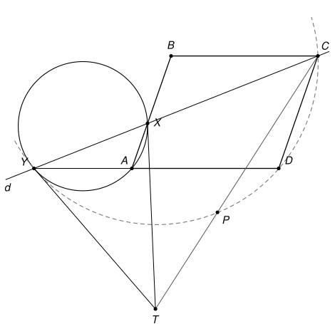

## Statement

Soit $ABCD$ un parallélogramme. Une droite $d$ passant par $C$ coupe les droites $(AB)$ et $(AD)$ en des points $X$ et $Y$.

Les tangentes en $X$ et en $Y$ au cercle circonscrit au triangle $AXY$ se coupent en un point $T$. La droite $(CT)$ recoupe le cercle circonscrit au triangle $CDY$ en un point $P$.

Démontrer que les points $A$, $B$, $D$ et $P$ sont cocycliques.

## Hints

1. Fais une grande figure soignée : beaucoup de groupes de quatre points semblent être sur un même cercle. Commence par montrer que $P$ est sur le cercle qui passe par $T$, $X$ et $Y$.
2. L'angle entre la tangente $(XT)$ et la corde $[XY]$ est égal à un angle de sommet $A$. Grâce aux côtés parallèles du parallélogramme, ce même angle se retrouve en $D$, puis en $P$ grâce au cercle qui passe par $C$, $D$, $Y$.
3. Fais de même avec la tangente en $Y$ pour montrer que $P$ est aussi sur le cercle qui passe par $B$, $C$ et $X$.
4. Pour finir, pars de l'angle $(BP, BA)$ et passe de $B$ à $C$, puis de $C$ à $D$, en utilisant les deux cercles qui passent par $P$.

## Solution

**Rappel.** Ce problème se résout avec les *angles orientés de droites*, qui ne sont pas au programme du lycée. Pour deux droites $d$ et $d'$, on note $(d, d')$ l'angle dont il faut faire tourner $d$, dans le sens direct, pour la rendre parallèle à $d'$. Cet angle n'est connu qu'à $180^\circ$ près, puisque tourner une droite de $180^\circ$ redonne la même droite. Toutes les égalités d'angles de cette solution s'entendent donc à $180^\circ$ près. L'intérêt de cet outil est qu'on n'a pas à distinguer les cas selon la position des points sur la figure. On utilise trois règles.

- **(R1) Relation de Chasles.** $(d_1, d_2) + (d_2, d_3) = (d_1, d_3)$ et $(d, d') = -(d', d)$. De plus, $(d, d') = 0$ si et seulement si $d$ et $d'$ sont parallèles. En particulier, si $d_1$ et $d_2$ sont parallèles, on peut remplacer l'une par l'autre : $(d_1, d) = (d_2, d)$.
- **(R2) Angle inscrit.** Soient $U$, $V$, $M$ trois points non alignés et $N$ un point distinct de $U$ et de $V$. Alors $N$ est sur le cercle qui passe par $U$, $V$, $M$ si et seulement si $(MU, MV) = (NU, NV)$.
- **(R3) Angle entre tangente et corde.** Soient $M$, $U$, $V$ trois points distincts d'un cercle, et $t$ la tangente à ce cercle en $M$. Alors $(t, MU) = (VM, VU)$. Inversement, une droite $t$ passant par $M$ qui vérifie cette égalité est la tangente en $M$. C'est le cas limite de (R2), quand le point $N$ vient se placer en $M$ : la droite $(NM)$ devient la tangente.

On note $\omega$ le cercle qui passe par $A$, $X$, $Y$, et $\Gamma$ le cercle qui passe par $C$, $D$, $Y$.

**Étape 0 : la position des points.** Les angles orientés évitent de discuter la figure, mais il faut savoir quels points sont distincts.

- *$X \neq A$ et $Y \neq A$.* Si l'on avait $X = A$, la droite $d$ passerait par $A$ et $C$, et l'on aurait aussi $Y = A$ : il n'y aurait pas de triangle $AXY$. Comme $X$ est sur $(AB)$, $Y$ sur $(AD)$, et tous deux différents de $A$, le triangle $AXY$ n'est pas aplati.
- *$X \neq B$ et $Y \neq D$.* Si l'on avait $X = B$, la droite $d$ serait $(BC)$, qui est parallèle à $(AD)$, et le point $Y$ n'existerait pas. De même $Y \neq D$. Enfin $C$ n'est ni sur $(AB)$ ni sur $(AD)$, donc $X \neq C$ et $Y \neq C$.
- *Le point $T$ n'est pas sur $d$.* La tangente en $X$ ne touche $\omega$ qu'en $X$ : elle ne passe pas par $Y$, donc elle est différente de $d$ et ne coupe $d$ qu'en $X$. De même, la tangente en $Y$ ne passe pas par $X$, donc $T \neq X$. Ainsi $T \notin d$. En particulier $T \neq C$, la droite $(CT)$ est bien définie, et $T$, $X$, $Y$ ne sont pas alignés.
- *Le cercle $\Gamma$ existe.* Si $Y$ était sur $(CD)$, ce serait le point commun de $(CD)$ et $(AD)$, c'est-à-dire $D$, ce qui est exclu. Donc $C$, $D$, $Y$ ne sont pas alignés.

**Deux égalités qui servent plusieurs fois.** La règle (R3) dans $\omega$, au point $X$, avec $U = Y$ et $V = A$, puis au point $Y$, avec $U = X$ et $V = A$, donne
$$(XT, XY) = (AX, AY) \qquad \text{et} \qquad (YT, YX) = (AY, AX).$$
Dans le parallélogramme, $(AX) = (AB)$ est parallèle à $(DC)$, et $(AY) = (AD) = (DY)$. D'après (R1), on obtient
$$(\star) \qquad (XT, XY) = (AX, AY) = (DC, DY).$$
De plus, la deuxième égalité donne $(YT, YX) = -(XT, XY)$, c'est-à-dire
$$(\star\star) \qquad (XT, XY) = (YX, YT).$$

**Étape 1 : le point $P$ est distinct de $X$, $Y$, $C$ et $T$.**

- *$P \neq X$ et $P \neq Y$.* Si l'on avait $P = X$, les points $C$ et $X$, qui sont distincts, seraient tous les deux sur la droite $(CT)$. On aurait $(CT) = (CX) = d$, donc $T \in d$, ce qui est faux. De même $P \neq Y$.
- *$P \neq C$.* Cela arriverait seulement si $(CT)$ était tangente à $\Gamma$ en $C$. Dans ce cas, la règle (R3) dans $\Gamma$, au point $C$, avec $U = Y$ et $V = D$, donnerait $(CT, CY) = (DC, DY)$, donc $(CT, d) = (XT, d)$ d'après $(\star)$. Avec la relation de Chasles, $(CT, XT) = 0$ : les droites $(CT)$ et $(XT)$ seraient parallèles, et comme elles passent toutes les deux par $T$, elles seraient égales. Le point $C$ serait alors sur la tangente $(XT)$, qui coupe $d$ seulement en $X$, donc $C = X$, ce qui est faux.
- *$P \neq T$.* Sinon $T$ serait sur $\Gamma$, et la règle (R2) dans $\Gamma$ donnerait $(TC, TY) = (DC, DY)$. Avec $(\star)$ puis $(\star\star)$, on aurait $(TC, TY) = (XT, XY) = (YX, YT) = (d, TY)$, donc $(TC, d) = 0$. La droite $(TC)$ serait parallèle à $d$ et passerait par le point $C$ de $d$ : ce serait $d$, et $T$ serait sur $d$, ce qui est faux.

**Étape 2 : le point $P$ est sur le cercle qui passe par $T$, $X$, $Y$.** Les points $P$, $C$, $T$ sont alignés et distincts, donc $(PT) = (PC)$. Les points $P$ et $D$ sont sur $\Gamma$ et distincts de $C$ et de $Y$, donc (R2) donne $(PC, PY) = (DC, DY)$. Avec $(\star)$,
$$(PT, PY) = (PC, PY) = (DC, DY) = (XT, XY).$$
Les points $T$, $X$, $Y$ ne sont pas alignés et $P$ est distinct de $T$ et de $Y$ : d'après (R2), $P$ est sur le cercle qui passe par $T$, $X$, $Y$.

**Étape 3 : le point $P$ est sur le cercle qui passe par $B$, $C$, $X$.** Comme $(PC) = (PT)$, puis en appliquant (R2) dans le cercle de l'étape 2, avec la corde $[TX]$ vue depuis $P$ et depuis $Y$, et enfin la deuxième égalité de (R3) dans $\omega$ :
$$(PC, PX) = (PT, PX) = (YT, YX) = (AY, AX).$$
Or $(AY) = (AD)$ est parallèle à $(BC)$, et $(AX) = (AB) = (BX)$. Donc $(AY, AX) = (BC, BX)$, et
$$(PC, PX) = (BC, BX).$$
Les points $B$, $C$, $X$ ne sont pas alignés, puisque $X$ est sur $(AB)$, différent de $B$, et que $C$ n'est pas sur $(AB)$. Comme $P$ est distinct de $C$ et de $X$, la règle (R2) montre que $P$ est sur le cercle qui passe par $B$, $C$, $X$.

**Étape 4 : conclusion.** Les points $A$, $B$, $D$ ne sont pas alignés, ils sont donc sur un cercle. Si $P$ est l'un de ces trois points, il n'y a rien à démontrer. On suppose donc que $P$ est différent de $A$, de $B$ et de $D$.

On part de l'angle en $B$ et on le transporte jusqu'en $D$ :

- $(BP, BA) = (BP, BX)$, car $(BA) = (BX)$ ;
- $(BP, BX) = (CP, CX)$, d'après (R2) dans le cercle de l'étape 3, car $B$ et $C$ sont distincts de $P$ et de $X$ ;
- $(CP, CX) = (CP, CY)$, car $(CX) = (CY) = d$ ;
- $(CP, CY) = (DP, DY)$, d'après (R2) dans $\Gamma$, car $C$ et $D$ sont distincts de $P$ et de $Y$ ;
- $(DP, DY) = (DP, DA)$, car $(DY) = (DA)$.

Ainsi
$$(BP, BA) = (DP, DA).$$
Les points $P$, $A$, $B$ ne sont pas alignés. En effet, si $P$ était sur $(AB)$, on aurait $(BP) = (BA)$, donc $(DP, DA) = (BP, BA) = 0$, et $P$ serait aussi sur $(DA)$. Il serait alors le point commun de $(AB)$ et $(AD)$, c'est-à-dire $A$, ce qui est exclu. Comme $D$ est distinct de $P$ et de $A$, la règle (R2) montre que $D$ est sur le cercle qui passe par $P$, $A$, $B$.

**Conclusion.** **Les points $A$, $B$, $D$ et $P$ sont cocycliques.**

## Going further

- Le point $T$ n'existe pas toujours. Les tangentes en $X$ et en $Y$ sont parallèles exactement quand $[XY]$ est un diamètre de $\omega$, c'est-à-dire quand l'angle $\widehat{XAY}$ est droit. En disant que les tangentes se coupent, l'énoncé suppose donc que $ABCD$ n'est pas un rectangle.
- L'égalité $(\star\star)$ dit que le triangle $TXY$ est isocèle en $T$. On le savait déjà : les deux segments de tangente $[TX]$ et $[TY]$, menés depuis un même point, ont la même longueur.
- Le corrigé propose une autre solution. On montre d'abord que $(TY)$ est aussi tangente au cercle $\Gamma$, car $(YT, YD) = (YT, YA) = (XY, XA) = (CY, CD)$. Le corrigé utilise ensuite la notion d'*axe radical* de deux cercles, qui n'est pas au programme.
- Le commentaire des correcteurs note que le plus difficile était de repérer tous ces points cocycliques, et qu'une bonne figure était indispensable pour les deviner avant de les démontrer.
