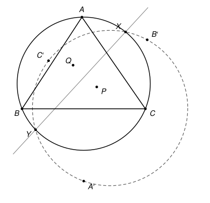

## Statement

Soit $P$ un point situé à l'intérieur d'un triangle $ABC$. On note $A'$, $B'$ et $C'$ les centres respectifs des cercles circonscrits aux triangles $BCP$, $CAP$ et $ABP$.

Le cercle circonscrit au triangle $ABC$ et le cercle circonscrit au triangle $A'B'C'$ se coupent en deux points $X$ et $Y$. Enfin, $Q$ est le symétrique de $P$ par rapport à la droite $(XY)$.

Démontrer que $\widehat{BAP} = \widehat{CAQ}$.

## Hints

1. La construction ne privilégie aucun sommet. Si l'énoncé est vrai, on a donc aussi $\widehat{CBP} = \widehat{ABQ}$ et $\widehat{ACP} = \widehat{BCQ}$. Construisez directement un point $Q_0$ qui vérifie ces trois égalités, puis montrez que $(XY)$ est la médiatrice de $[PQ_0]$.
2. Pour construire $Q_0$, regardez les symétriques $P_a$, $P_b$, $P_c$ de $P$ par rapport aux trois côtés. Pourquoi $A$ est-il sur la médiatrice de $[P_bP_c]$ ?
3. Notez $A''$, $B''$, $C''$ les centres des cercles circonscrits à $BCQ_0$, $CAQ_0$, $ABQ_0$, et $O$, $R$ le centre et le rayon du cercle circonscrit à $ABC$. Les points $O$, $A'$, $A''$ sont sur la médiatrice de $[BC]$. Calculez $OA' \times OA''$ avec un peu de trigonométrie : vous devez trouver $R^2$.
4. Le point $A''$ est donc l'inverse de $A'$ par rapport au cercle circonscrit. Déduisez-en que $X$ et $Y$ sont aussi sur le cercle passant par $A''$, $B''$, $C''$.
5. La droite $(B'C')$ est la médiatrice de $[AP]$ et $(B''C'')$ celle de $[AQ_0]$. Montrez que leur point d'intersection est sur la droite $(XY)$ en utilisant la puissance d'un point par rapport à un cercle.

## Solution

**Rappel.** Cette solution utilise trois outils qui dépassent le programme du lycée. Le *conjugué isogonal* d'un point $P$ intérieur à un triangle est le point obtenu en remplaçant chacune des droites $(AP)$, $(BP)$, $(CP)$ par sa symétrique par rapport à la bissectrice issue du même sommet. La *puissance d'un point* par rapport à un cercle est le produit des distances de ce point aux deux points où une droite qui le traverse coupe le cercle, et l'*axe radical* de deux cercles est l'ensemble des points qui ont la même puissance par rapport aux deux. L'*inversion* de centre $O$ et de rayon $R$ envoie chaque point $Z \neq O$ sur le point $Z^*$ de la demi-droite $[OZ)$ tel que $OZ \times OZ^* = R^2$. Ces outils sont expliqués plus bas : le conjugué isogonal au rappel 1, l'inversion au rappel 2, la puissance d'un point et l'axe radical au rappel 3. On y démontre ce qui sert, sauf deux faits que l'on admet et que l'on signale : un cas particulier de la droite de Simson (rappel 1), et l'image d'un cercle par une inversion (rappel 2).

### Notations et plan

On note $\Omega$ le cercle circonscrit à $ABC$, $O$ son centre et $R$ son rayon, $\Gamma'$ le cercle passant par $A'$, $B'$, $C'$, et $\alpha = \widehat{BAC}$, $\beta = \widehat{CBA}$, $\gamma = \widehat{ACB}$. Les angles sont en degrés.

On laisse de côté les positions particulières de $P$ où certains des points utilisés ci-dessous n'existent pas ou se confondent : par exemple $P$ sur une bissectrice du triangle, ou $\Gamma'$ passant par $O$. Le résultat y reste vrai, mais il faudrait adapter les arguments.

Voici le plan. La construction ne privilégie aucun sommet, donc si l'énoncé est vrai, le point $Q$ vérifie aussi $\widehat{CBP} = \widehat{ABQ}$ et $\widehat{ACP} = \widehat{BCQ}$. On va construire directement un point $Q_0$ qui vérifie ces trois égalités, sans utiliser de cercles, puis montrer que la droite $(XY)$ est la médiatrice de $[PQ_0]$. Il en résultera que $Q = Q_0$.

### Rappel 1 : le conjugué isogonal

Repérons chaque demi-droite issue de $A$ par l'angle qu'elle fait avec $[AB)$, mesuré dans le sens qui va de $B$ vers $C$. La demi-droite $[AC)$ est repérée par $\alpha$, et $[AP)$ par un angle $t$ avec $0 < t < \alpha$.

La symétrie par rapport à une droite passant par $A$, repérée par l'angle $u$, envoie la demi-droite repérée par $v$ sur celle repérée par $2u - v$, et conserve les distances à $A$.

Notons $P_a$, $P_b$, $P_c$ les symétriques de $P$ par rapport à $(BC)$, $(CA)$, $(AB)$. Le point $P_c$ est à la distance $AP$ de $A$ sur la demi-droite repérée par $-t$, et $P_b$ est à la même distance sur la demi-droite repérée par $2\alpha - t$. La symétrie par rapport à la droite $d_A$ passant par $A$ et repérée par la moyenne $\frac{-t + 2\alpha - t}{2} = \alpha - t$ échange donc $P_c$ et $P_b$ : **la droite $d_A$ est la médiatrice de $[P_bP_c]$**.

Comme $0 < \alpha - t < \alpha$, la droite $d_A$ passe à l'intérieur de l'angle $\widehat{BAC}$, et tout point $Z$ de $d_A$ situé dans cet angle vérifie $\widehat{BAZ} = \alpha - t = \widehat{PAC}$, donc aussi $\widehat{CAZ} = t = \widehat{BAP}$.

On définit de même $d_B$, médiatrice de $[P_cP_a]$, et $d_C$, médiatrice de $[P_aP_b]$. On admet que $P_a$, $P_b$, $P_c$ ne sont pas alignés (ce n'est le cas que lorsque $P$ est sur $\Omega$, c'est le théorème de la droite de Simson). Les trois médiatrices du triangle $P_aP_bP_c$ se coupent alors en un point $Q_0$, le centre de son cercle circonscrit. Ce point est sur $d_B$ et $d_C$, qui passent à l'intérieur des angles du triangle en $B$ et en $C$, donc $Q_0$ est à l'intérieur du triangle $ABC$, et

$$\widehat{CAQ_0} = \widehat{BAP}, \qquad \widehat{ABQ_0} = \widehat{CBP}, \qquad \widehat{BCQ_0} = \widehat{ACP}.$$

Le point $Q_0$ s'appelle le **conjugué isogonal** de $P$. Il suffit donc de montrer que $Q = Q_0$.

**Une conséquence.** Notons $\theta = \widehat{BPC}$ et $\varphi = \widehat{BQ_0C}$. Dans le triangle $PBC$, $\theta = 180° - \widehat{PBC} - \widehat{PCB}$. Comme $\widehat{PBC} < \beta$ et $\widehat{PCB} < \gamma$, on a $\theta > 180° - \beta - \gamma = \alpha$. Dans le triangle $Q_0BC$,

$$\varphi = 180° - \widehat{Q_0BC} - \widehat{Q_0CB} = 180° - \left(\beta - \widehat{PBC}\right) - \left(\gamma - \widehat{PCB}\right) = \alpha + 180° - \theta.$$

Donc $\theta + \varphi = 180° + \alpha$, avec $\alpha < \theta < 180°$.

### Étape 1 : où est le centre d'un cercle passant par B et C ?

Notons $a = BC$, $M$ le milieu de $[BC]$ et $\Delta$ la médiatrice de $[BC]$. On repère chaque point de $\Delta$ par son abscisse $x$, d'origine $M$, comptée positivement du côté de $A$.

**Lemme.** Soit $W$ un point du même côté que $A$ par rapport à $(BC)$, et $w = \widehat{BWC}$. Le centre $K$ du cercle passant par $B$, $C$, $W$ est le point de $\Delta$ d'abscisse

$$x(K) = \frac{a}{2} \times \frac{\cos w}{\sin w}.$$

*Preuve.* Le point $K$ est sur $\Delta$ car $KB = KC$. D'après le théorème de l'angle inscrit, si $K$ et $W$ sont du même côté de $(BC)$, alors $w = \frac{1}{2}\widehat{BKC} < 90°$ ; s'ils sont de part et d'autre, $w = 180° - \frac{1}{2}\widehat{BKC} > 90°$ ; si $K = M$, $w = 90°$. Dans le triangle $BMK$ rectangle en $M$, l'angle $\widehat{BKM}$ vaut $\frac{1}{2}\widehat{BKC}$.

- Si $w < 90°$, alors $\widehat{BKM} = w$, et $MK = \frac{MB}{\tan w} = \frac{a}{2} \times \frac{\cos w}{\sin w}$, du côté de $A$.
- Si $w > 90°$, alors $\widehat{BKM} = 180° - w$, et $MK = \frac{a}{2} \times \frac{\cos(180° - w)}{\sin(180° - w)} = -\frac{a}{2} \times \frac{\cos w}{\sin w}$, du côté opposé à $A$.
- Si $w = 90°$, alors $K = M$ et $\cos w = 0$.

Dans les trois cas, on trouve bien l'abscisse annoncée. $\square$

Appliquons le lemme à $W = A$, à $W = P$ et à $W = Q_0$ (ces trois points sont du même côté de $(BC)$) :

$$x(O) = \frac{a}{2} \times \frac{\cos\alpha}{\sin\alpha}, \qquad x(A') = \frac{a}{2} \times \frac{\cos\theta}{\sin\theta}, \qquad x(A'') = \frac{a}{2} \times \frac{\cos\varphi}{\sin\varphi},$$

où $A''$ est le centre du cercle passant par $B$, $C$, $Q_0$. De plus, le théorème de Pythagore dans le triangle $OMB$ donne

$$R^2 = MB^2 + MO^2 = \frac{a^2}{4}\left(1 + \frac{\cos^2\alpha}{\sin^2\alpha}\right) = \frac{a^2}{4\sin^2\alpha}.$$

### Étape 2 : le produit OA' × OA'' vaut R²

Avec la formule $\sin(u - v) = \sin u \cos v - \cos u \sin v$,

$$x(A') - x(O) = \frac{a}{2} \times \frac{\cos\theta \sin\alpha - \cos\alpha \sin\theta}{\sin\theta \sin\alpha} = \frac{a}{2} \times \frac{\sin(\alpha - \theta)}{\sin\theta \sin\alpha},$$

et de même $x(A'') - x(O) = \frac{a}{2} \times \frac{\sin(\alpha - \varphi)}{\sin\varphi \sin\alpha}$.

Or $\varphi = 180° + \alpha - \theta$, donc $\sin(\alpha - \varphi) = \sin(\theta - 180°) = -\sin\theta$ et $\sin\varphi = \sin\left(180° - (\theta - \alpha)\right) = \sin(\theta - \alpha) = -\sin(\alpha - \theta)$. Ces nombres ne sont pas nuls, car $\alpha < \theta < 180°$. Par conséquent

$$\left(x(A') - x(O)\right)\left(x(A'') - x(O)\right) = \frac{a^2}{4} \times \frac{\sin(\alpha - \theta)}{\sin\theta \sin\alpha} \times \frac{-\sin\theta}{-\sin(\alpha - \theta)\sin\alpha} = \frac{a^2}{4\sin^2\alpha} = R^2.$$

Ce produit est positif, donc $A'$ et $A''$ sont du même côté de $O$ sur $\Delta$, et

$$OA' \times OA'' = R^2.$$

On définit de même $B''$ et $C''$, centres des cercles passant par $C$, $A$, $Q_0$ et par $A$, $B$, $Q_0$ ; le même calcul montre que $B''$ est sur la demi-droite $[OB')$ avec $OB' \times OB'' = R^2$, et que $C''$ est sur $[OC')$ avec $OC' \times OC'' = R^2$. On note $\Gamma''$ le cercle passant par $A''$, $B''$, $C''$.

### Rappel 2 : l'inversion

L'**inversion** de centre $O$ et de rayon $R$ associe à tout point $Z \neq O$ le point $Z^*$ de la demi-droite $[OZ)$ tel que $OZ \times OZ^* = R^2$. On a $(Z^*)^* = Z$, et les points de $\Omega$ sont fixes. On admet la propriété suivante : **l'image d'un cercle qui ne passe pas par $O$ est un cercle.**

D'après l'étape 2, l'inversion envoie $A'$, $B'$, $C'$ sur $A''$, $B''$, $C''$.

### Étape 3 : X et Y sont sur le cercle Γ''

L'image de $\Gamma'$ par l'inversion est un cercle qui passe par $A''$, $B''$, $C''$, c'est donc $\Gamma''$. Le point $X$ est sur $\Gamma'$ et sur $\Omega$, donc il est fixe, et il est l'image d'un point de $\Gamma'$ (lui-même) : $X \in \Gamma''$. De même $Y \in \Gamma''$.

**Les trois cercles $\Omega$, $\Gamma'$ et $\Gamma''$ passent tous par $X$ et $Y$.**

### Rappel 3 : puissance d'un point et axe radical

Soit $\mathcal{C}$ un cercle de centre $K$ et de rayon $r$. La **puissance** d'un point $N$ par rapport à $\mathcal{C}$ est le nombre $p(N) = NK^2 - r^2$.

**(a)** Si une droite passant par $N$ coupe $\mathcal{C}$ en $U$ et $V$, alors $\overline{NU} \times \overline{NV} = p(N)$, en mesures algébriques sur cette droite. En effet, soit $H$ le milieu de $[UV]$ ; la droite $(KH)$ est perpendiculaire à $(UV)$, et $\overline{HV} = -\overline{HU}$, donc

$$\overline{NU} \times \overline{NV} = \left(\overline{NH} + \overline{HU}\right)\left(\overline{NH} - \overline{HU}\right) = NH^2 - HU^2 = \left(NK^2 - KH^2\right) - \left(r^2 - KH^2\right) = NK^2 - r^2.$$

**(b)** Soit deux cercles de centres distincts $K_1$ et $K_2$, de rayons $r_1$ et $r_2$, qui se coupent en deux points $U$ et $V$. Un point $N$ a la même puissance par rapport aux deux cercles si et seulement s'il est sur la droite $(UV)$. En effet, si $I$ est le milieu de $[K_1K_2]$,

$$NK_1^2 - NK_2^2 = \left(\overrightarrow{NK_1} - \overrightarrow{NK_2}\right) \cdot \left(\overrightarrow{NK_1} + \overrightarrow{NK_2}\right) = 2\,\overrightarrow{K_2K_1} \cdot \overrightarrow{NI},$$

donc l'égalité des puissances s'écrit $\overrightarrow{K_2K_1} \cdot \overrightarrow{NI} = \frac{r_1^2 - r_2^2}{2}$. C'est l'équation d'une droite perpendiculaire à $(K_1K_2)$. Les points $U$ et $V$ ont une puissance nulle par rapport aux deux cercles, donc cette droite est $(UV)$. On l'appelle l'**axe radical** des deux cercles.

### Étape 4 : un point de la droite (XY)

Montrons que $B'$, $B''$, $C'$, $C''$ sont sur un même cercle. Les droites $(OB')$ et $(OC')$ sont les médiatrices de $[CA]$ et de $[AB]$, donc elles sont distinctes. Soit $\Sigma$ le cercle passant par $B'$, $B''$ et $C'$, et $C^*$ le second point où $\Sigma$ coupe la droite $(OC')$. D'après le rappel 3 (a), en calculant la puissance de $O$ par rapport à $\Sigma$ de deux façons,

$$\overline{OC'} \times \overline{OC^*} = \overline{OB'} \times \overline{OB''} = R^2 = \overline{OC'} \times \overline{OC''},$$

la dernière égalité venant de l'étape 2 ($C'$ et $C''$ sont du même côté de $O$). Donc $\overline{OC^*} = \overline{OC''}$, c'est-à-dire $C^* = C''$ : **le cercle $\Sigma$ passe par $B'$, $B''$, $C'$ et $C''$.**

Soit $A^\bullet$ le point d'intersection des droites $(B'C')$ et $(B''C'')$.

- Les points $B'$ et $C'$ sont communs à $\Gamma'$ et à $\Sigma$, et $A^\bullet$ est sur $(B'C')$ : d'après le rappel 3 (b), $A^\bullet$ a la même puissance par rapport à $\Gamma'$ et à $\Sigma$.
- De même, $B''$ et $C''$ sont communs à $\Sigma$ et à $\Gamma''$, et $A^\bullet$ est sur $(B''C'')$ : il a la même puissance par rapport à $\Sigma$ et à $\Gamma''$.

Le point $A^\bullet$ a donc la même puissance par rapport à $\Gamma'$ et à $\Gamma''$. Ces deux cercles se coupent en $X$ et $Y$ (étape 3), donc, d'après le rappel 3 (b), **$A^\bullet$ est sur la droite $(XY)$.**

### Étape 5 : le même point est sur la médiatrice de [PQ₀]

Le point $B'$, centre du cercle passant par $C$, $A$, $P$, vérifie $B'A = B'P$. De même $C'A = C'P$. Donc $(B'C')$ est la médiatrice de $[AP]$. De la même façon, $(B''C'')$ est la médiatrice de $[AQ_0]$. Ces deux droites ne sont pas parallèles, car $P$ n'est pas sur la bissectrice issue de $A$, donc les droites $(AP)$ et $(AQ_0)$ sont distinctes.

Le point $A^\bullet$ vérifie donc $A^\bullet P = A^\bullet A = A^\bullet Q_0$ : **il est sur la médiatrice de $[PQ_0]$** (les points $P$ et $Q_0$ sont distincts, puisque $(AP) \neq (AQ_0)$).

En faisant jouer le même rôle aux sommets $B$ et $C$, les points $B^\bullet$, intersection de $(C'A')$ et de $(C''A'')$, et $C^\bullet$, intersection de $(A'B')$ et de $(A''B'')$, sont eux aussi sur la droite $(XY)$ et sur la médiatrice de $[PQ_0]$.

### Conclusion

Les trois points $A^\bullet$, $B^\bullet$, $C^\bullet$ ne sont pas tous égaux : ils sont respectivement sur les droites $(B'C')$, $(C'A')$, $(A'B')$, qui sont les trois côtés du triangle $A'B'C'$ et n'ont aucun point commun. Deux d'entre eux sont donc distincts, et ils sont à la fois sur la droite $(XY)$ et sur la médiatrice de $[PQ_0]$. Ces deux droites sont donc égales.

Ainsi $(XY)$ est la médiatrice de $[PQ_0]$, et le symétrique de $P$ par rapport à $(XY)$ est $Q_0$ : $Q = Q_0$. D'après le rappel 1,

$$\widehat{CAQ} = \widehat{CAQ_0} = \widehat{BAP}.$$

**C'est l'égalité demandée.** Au passage, on a aussi obtenu $\widehat{ABQ} = \widehat{CBP}$ et $\widehat{BCQ} = \widehat{ACP}$.

## Going further

1. Lorsque $P$ est le centre du cercle inscrit à $ABC$, montrez que le centre $A'$ du cercle passant par $B$, $C$, $P$ est sur le cercle circonscrit à $ABC$. Pourquoi l'énoncé n'a-t-il alors plus de sens ?
2. Démontrez la propriété admise de l'inversion dans le cas particulier d'une droite qui ne passe pas par $O$ : son image est un cercle passant par $O$.
