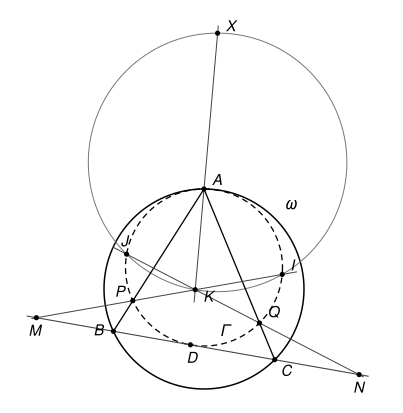

## Statement

Soit $ABC$ un triangle dont les trois angles sont aigus, et soit $\omega$ son cercle circonscrit. Soit $\Gamma$ un cercle situé à l'intérieur de $\omega$, tangent à $\omega$ en $A$ et tangent à la droite $(BC)$. On note :

- $D$ le point de contact de $\Gamma$ et de la droite $(BC)$ ;
- $P$ le second point d'intersection de la droite $(AB)$ avec $\Gamma$, et $Q$ le second point d'intersection de la droite $(AC)$ avec $\Gamma$ ;
- $M$ et $N$ les symétriques de $D$ par rapport à $B$ et par rapport à $C$ ;
- $K$ le point d'intersection des droites $(MP)$ et $(NQ)$ ;
- $I$ le second point d'intersection de la droite $(MP)$ avec $\Gamma$, et $J$ le second point d'intersection de la droite $(NQ)$ avec $\Gamma$ ;
- $X$ le second point d'intersection de la droite $(KA)$ avec le cercle circonscrit au triangle $IJK$.

Démontrer que $\widehat{BXP} = \widehat{CXQ}$.

## Hints

1. Laissez d'abord de côté $M$, $N$ et le cercle $IJK$. Les centres de $\omega$ et de $\Gamma$ sont alignés avec $A$ : déduisez-en que $(PQ)$ est parallèle à $(BC)$.
2. Montrez que $D$ est à égale distance de $P$ et de $Q$, puis que $(AD)$ est la bissectrice de l'angle $\widehat{BAC}$.
3. Cherchez des triangles semblables pour montrer que $AD^2 = AB \times AQ = AC \times AP$.
4. Faites une figure précise : où se trouve $X$ par rapport à $A$ et $D$ ? Pour le démontrer, montrez d'abord que $K$ est sur la droite $(AD)$, puis que $X$, $M$, $I$, $D$ sont sur un même cercle.
5. Une fois que l'on sait que $AX = AD$, l'égalité $AX^2 = AB \times AQ$ fournit encore deux triangles semblables. Ils contiennent les angles $\widehat{AXB}$ et $\widehat{AXP}$.

## Solution

On note $O$ et $R$ le centre et le rayon de $\omega$, $O'$ et $r$ le centre et le rayon de $\Gamma$, et $k = r/R$, qui vérifie $0 < k < 1$. Dans toute la solution, on suppose que les points de l'énoncé sont deux à deux distincts, ce qui est le cas en général.

Le cercle $\Gamma$ est à l'intérieur de $\omega$ et ne le touche qu'en $A$. Tout point de $\Gamma$ autre que $A$ est donc **strictement** à l'intérieur du disque limité par $\omega$. Pour $D$, qui est sur la droite $(BC)$, cela donne : $D$ est strictement entre $B$ et $C$.

### Deux outils : les angles orientés de droites

Pour deux droites $d_1$ et $d_2$, on note $(d_1, d_2)$ l'angle dont il faut faire tourner $d_1$, dans le sens direct, pour la rendre parallèle à $d_2$. Cet angle est compté **à $180^\circ$ près** : tourner une droite de $180^\circ$ la ramène sur elle-même. Ces angles suivent des règles simples.

- **Relation de Chasles** : $(d_1, d_3) = (d_1, d_2) + (d_2, d_3)$.
- $(d_1, d_2) = 0$ si et seulement si $d_1$ et $d_2$ sont parallèles (ou confondues). En particulier, si $d_2$ et $d_3$ sont parallèles, alors $(d_1, d_2) = (d_1, d_3)$.
- Une droite peut être nommée par deux quelconques de ses points : par exemple $(MP) = (MI) = (PI)$.

Le théorème de l'angle inscrit et sa réciproque prennent alors une forme qui ne dépend plus de la figure.

**Angle inscrit.** Si $W$, $X$, $Y$, $Z$ sont quatre points d'un même cercle, alors $(ZX, ZY) = (WX, WY)$.

En effet, notons $\theta = \widehat{XZY}$. Si $Z$ et $W$ sont du même côté de la droite $(XY)$, le théorème de l'angle inscrit donne $\widehat{XWY} = \theta$, et les deux rotations, de $[ZX)$ vers $[ZY)$ et de $[WX)$ vers $[WY)$, tournent dans le même sens : les deux angles orientés sont égaux. Si $Z$ et $W$ sont de part et d'autre de $(XY)$, on a $\widehat{XWY} = 180^\circ - \theta$, et les deux rotations tournent en sens contraires. Si la première vaut $\theta$, la seconde vaut $-(180^\circ - \theta) = \theta - 180^\circ$, c'est-à-dire $\theta$ à $180^\circ$ près.

**Réciproque.** Soit $W$, $X$, $Y$, $Z$ quatre points tels que ni $Z$ ni $W$ ne soit sur la droite $(XY)$. Si $(ZX, ZY) = (WX, WY)$, alors ces quatre points sont sur un même cercle.

En effet, on refait le raisonnement à l'envers. Si $Z$ et $W$ sont du même côté de $(XY)$, les deux rotations tournent dans le même sens, donc $\widehat{XZY} = \widehat{XWY}$ : les deux points voient le segment $[XY]$ sous le même angle, du même côté, donc ils sont sur un même arc de cercle d'extrémités $X$ et $Y$. Si $Z$ et $W$ sont de part et d'autre de $(XY)$, les rotations tournent en sens contraires, donc $\widehat{XZY} + \widehat{XWY} = 180^\circ$, et $W$ est sur l'arc qui complète, de l'autre côté de $(XY)$, le cercle passant par $X$, $Y$ et $Z$.

Ces angles orientés ne serviront qu'à l'étape 4. Ailleurs, les angles sont des angles géométriques ordinaires, entre $0^\circ$ et $180^\circ$.

### Étape 1 : la droite (PQ) est parallèle à (BC)

Les deux cercles sont tangents en $A$ : ils ont la même tangente en $A$. Les rayons $[OA]$ et $[O'A]$ sont tous les deux perpendiculaires à cette tangente, donc $A$, $O'$, $O$ sont alignés. Comme $\Gamma$ est à l'intérieur de $\omega$, les deux centres sont du même côté de la tangente, et

$$\overrightarrow{AO'} = k\, \overrightarrow{AO}.$$

Soit $P'$ le point tel que $\overrightarrow{AP'} = k\,\overrightarrow{AB}$. Alors

$$\overrightarrow{O'P'} = \overrightarrow{AP'} - \overrightarrow{AO'} = k\left(\overrightarrow{AB} - \overrightarrow{AO}\right) = k\,\overrightarrow{OB},$$

donc $O'P' = kR = r$. Le point $P'$ est sur $\Gamma$, sur la droite $(AB)$, et différent de $A$ : c'est $P$. De même pour $Q$. Ainsi

$$\overrightarrow{AP} = k\,\overrightarrow{AB}, \qquad \overrightarrow{AQ} = k\,\overrightarrow{AC}, \qquad \text{donc} \qquad \overrightarrow{PQ} = k\,\overrightarrow{BC}.$$

**La droite $(PQ)$ est parallèle à $(BC)$**, le point $P$ est strictement entre $A$ et $B$, et $Q$ est strictement entre $A$ et $C$. En particulier, la droite $(PQ)$ sépare $A$ de la droite $(BC)$, donc $A$ et $D$ sont de part et d'autre de $(PQ)$.

### Étape 2 : la bissectrice (AD) et deux paires de triangles semblables

**$D$ est à égale distance de $P$ et $Q$.** Le rayon $[O'D]$ est perpendiculaire à la tangente $(BC)$, donc aussi à la corde $[PQ]$, qui lui est parallèle. La perpendiculaire à une corde passant par le centre est la médiatrice de cette corde. Donc $D$ est sur la médiatrice de $[PQ]$ : $DP = DQ$.

**Ordre des points sur $\Gamma$.** Comme $A$ et $D$ sont de part et d'autre de la corde $[PQ]$, on rencontre, en parcourant $\Gamma$, les points dans l'ordre $A$, $P$, $D$, $Q$. Pour chacune des cordes $[AQ]$, $[AP]$, $[DQ]$, $[DP]$, les deux autres points sont donc sur le même arc.

**$(AD)$ est la bissectrice de $\widehat{BAC}$.** Le triangle $DPQ$ est isocèle en $D$, donc $\widehat{DPQ} = \widehat{DQP}$. Par le théorème de l'angle inscrit dans $\Gamma$, $\widehat{DAQ} = \widehat{DPQ}$ (ils interceptent la corde $[DQ]$) et $\widehat{DAP} = \widehat{DQP}$ (ils interceptent la corde $[DP]$). Donc $\widehat{BAD} = \widehat{DAC}$. On note $\theta$ cet angle.

**Les triangles $ABD$ et $ADQ$ sont semblables.** Ils ont le même angle $\theta$ en $A$. Ensuite, par l'angle inscrit dans $\Gamma$ (corde $[AQ]$), puis par les angles correspondants, puisque $(PQ)$ et $(BC)$ sont parallèles :

$$\widehat{ADQ} = \widehat{APQ} = \widehat{ABC} = \widehat{ABD}.$$

Deux angles égaux suffisent : les triangles sont semblables, $A$ correspondant à $A$, $B$ à $D$ et $D$ à $Q$. Donc $AB/AD = AD/AQ$, c'est-à-dire

$$AD^2 = AB \times AQ.$$

**De même**, $\widehat{ADP} = \widehat{AQP} = \widehat{ACB} = \widehat{ACD}$ (angle inscrit sur la corde $[AP]$), donc les triangles $ACD$ et $ADP$ sont semblables, et

$$AD^2 = AC \times AP.$$

### Étape 3 : le point K est sur la droite (AD)

Soit $Y$ le point tel que $\overrightarrow{AY} = k\,\overrightarrow{AD}$. Alors

$$\overrightarrow{YP} = \overrightarrow{AP} - \overrightarrow{AY} = k\left(\overrightarrow{AB} - \overrightarrow{AD}\right) = k\,\overrightarrow{DB}, \qquad \text{et de même} \qquad \overrightarrow{YQ} = k\,\overrightarrow{DC}.$$

Comme $B$ est le milieu de $[DM]$, on a $\overrightarrow{DM} = 2\,\overrightarrow{DB}$, et de même $\overrightarrow{DN} = 2\,\overrightarrow{DC}$. Posons $\lambda = k/2$, qui vérifie $0 < \lambda < 1$. On obtient

$$\overrightarrow{YP} = \lambda\,\overrightarrow{DM}, \qquad \overrightarrow{YQ} = \lambda\,\overrightarrow{DN}.$$

Soit maintenant $K_0$ le point de la droite $(AD)$ tel que $(1 - \lambda)\,\overrightarrow{DK_0} = \overrightarrow{DY}$. Un calcul direct donne $\overrightarrow{K_0Y} = \lambda\,\overrightarrow{K_0D}$. Alors

$$\overrightarrow{K_0P} = \overrightarrow{K_0Y} + \overrightarrow{YP} = \lambda\,\overrightarrow{K_0D} + \lambda\,\overrightarrow{DM} = \lambda\,\overrightarrow{K_0M}.$$

Les vecteurs $\overrightarrow{K_0P}$ et $\overrightarrow{K_0M}$ sont colinéaires : $K_0$ est sur la droite $(MP)$. De la même façon, $\overrightarrow{K_0Q} = \lambda\,\overrightarrow{K_0N}$, donc $K_0$ est sur la droite $(NQ)$. Les droites $(MP)$ et $(NQ)$ n'ont qu'un point commun, $K$. Donc $K = K_0$ : **le point $K$ est sur la droite $(AD)$.**

Par conséquent, la droite $(KA)$ de l'énoncé est la droite $(AD)$, et les quatre points $A$, $D$, $K$, $X$ sont alignés.

### Étape 4 : X est le symétrique de D par rapport à A

**Les points $X$, $M$, $I$, $D$ sont cocycliques.** On enchaîne :

- $(XI, XD) = (XI, XK)$, car $(XD) = (XK)$ ;
- $(XI, XK) = (JI, JK)$, car $X$, $I$, $J$, $K$ sont sur un même cercle ;
- $(JI, JK) = (JI, JQ)$, car $(JK) = (JQ)$, les points $J$, $K$, $Q$ étant sur la droite $(NQ)$ ;
- $(JI, JQ) = (PI, PQ)$, car $I$, $J$, $P$, $Q$ sont sur $\Gamma$ ;
- $(PI, PQ) = (MI, MD)$, car $(PI) = (MI)$, et $(PQ)$ est parallèle à $(BC) = (MD)$.

Donc $(XI, XD) = (MI, MD)$, et d'après la réciproque, $X$, $M$, $I$, $D$ sont sur un même cercle.

**La droite $(XM)$ est parallèle à $(AB)$.** On enchaîne encore :

- $(XM, XD) = (IM, ID)$, car $X$, $M$, $I$, $D$ sont sur un même cercle ;
- $(IM, ID) = (IP, ID)$, car $(IM) = (IP)$ ;
- $(IP, ID) = (AP, AD)$, car $I$, $P$, $A$, $D$ sont sur $\Gamma$ ;
- $(AP, AD) = (AB, XD)$, car $(AP) = (AB)$ et $(AD) = (XD)$.

Donc $(XM, XD) = (AB, XD)$. Par la relation de Chasles, $(XM, AB) = (XM, XD) + (XD, AB) = (AB, XD) - (AB, XD) = 0$ : les droites $(XM)$ et $(AB)$ sont parallèles.

**Conclusion de l'étape.** Dans le triangle $DMX$, le point $B$ est le milieu de $[DM]$, et la droite $(AB)$ passe par $B$ parallèlement à $(MX)$. D'après le théorème de la droite des milieux, elle coupe $[DX]$ en son milieu. Or elle coupe la droite $(DX)$ en $A$. Donc **$A$ est le milieu de $[DX]$** : $X$ est le symétrique de $D$ par rapport à $A$, et $AX = AD$.

### Étape 5 : deux nouvelles paires de triangles semblables

Comme $A$ est entre $D$ et $X$, les angles $\widehat{BAX}$ et $\widehat{BAD}$ sont supplémentaires, de même que $\widehat{XAQ}$ et $\widehat{DAQ}$. Donc

$$\widehat{BAX} = \widehat{XAQ} = 180^\circ - \theta, \qquad \text{et de même} \qquad \widehat{PAX} = \widehat{XAC} = 180^\circ - \theta.$$

**Les triangles $AXQ$ et $ABX$.** D'après l'étape 2, $AX^2 = AD^2 = AB \times AQ$, donc $AX/AB = AQ/AX$. Les deux triangles ont un angle égal en $A$, compris entre deux côtés proportionnels : ils sont semblables, $A$ correspondant à $A$, $X$ à $B$ et $Q$ à $X$. Les angles en $Q$ et en $X$ se correspondent, donc

$$\widehat{AQX} = \widehat{AXB}.$$

**Les triangles $APX$ et $AXC$.** De même $AX^2 = AC \times AP$, donc $AP/AX = AX/AC$, et les deux triangles ont le même angle $180^\circ - \theta$ en $A$. Ils sont semblables, $A$ correspondant à $A$, $P$ à $X$ et $X$ à $C$. Donc

$$\widehat{AXP} = \widehat{ACX}.$$

### Étape 6 : conclusion

Le point $P$ est sur le segment $[AB]$, donc la demi-droite $[XP)$ est à l'intérieur de l'angle $\widehat{AXB}$, et

$$\widehat{BXP} = \widehat{AXB} - \widehat{AXP} = \widehat{AQX} - \widehat{ACX}.$$

Le point $Q$ est sur le segment $[AC]$. Dans le triangle $XQC$, l'angle $\widehat{AQX}$ est donc l'angle extérieur en $Q$ : il est égal à la somme des deux autres angles du triangle, $\widehat{AQX} = \widehat{QXC} + \widehat{QCX}$. Et $\widehat{QCX} = \widehat{ACX}$, puisque les demi-droites $[CQ)$ et $[CA)$ sont les mêmes. Donc

$$\widehat{BXP} = \widehat{QXC}.$$

**Conclusion : $\widehat{BXP} = \widehat{CXQ}$.**

## Going further

1. En reprenant les calculs de l'étape 4 avec $N$, $J$ et $Q$ à la place de $M$, $I$ et $P$, montrez que $X$, $N$, $J$, $D$ sont aussi sur un même cercle, et que $(XN)$ est parallèle à $(AC)$.
2. Sur une figure précise, les angles $\widehat{BXP}$ et $\widehat{CXQ}$ sont très petits, souvent moins de trois degrés : l'égalité est impossible à voir à l'œil. La position de $X$, en revanche, se voit très bien. C'est une bonne raison de commencer par chercher où se trouve $X$.
