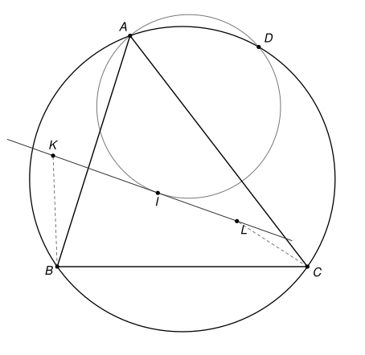

## Statement

Soit $A$, $B$, $C$, $D$ quatre points situés dans cet ordre sur un cercle $\Omega$, et soit $I$ le centre du cercle inscrit dans le triangle $ABC$. On note $t$ la tangente en $I$ au cercle circonscrit au triangle $ADI$. Sur la droite $t$, on place les points $K$ et $L$ tels que $BK = KI$ et $CL = LI$.

Démontrer que les cercles circonscrits aux triangles $ADI$ et $DKL$ sont tangents.

## Hints

1. Notez $A'$, $B'$, $C'$ les points où les droites $(AI)$, $(BI)$, $(CI)$ recoupent le cercle $\Omega$. Montrez que $A'B = A'C = A'I$, et de même pour $B'$ et $C'$.
2. Déduisez-en que $K$ est sur la droite $(A'C')$ et $L$ sur la droite $(A'B')$. Pensez aux médiatrices de $[BI]$ et de $[CI]$.
3. Montrez que les points $C'$, $D$, $I$, $K$ sont sur un même cercle, et $B'$, $D$, $I$, $L$ aussi. L'angle entre la tangente $t$ et la corde $[ID]$ est un angle inscrit déguisé.
4. Calculez l'angle entre la tangente en $D$ au cercle $ADI$ et la droite $(DK)$, puis comparez-le à l'angle $(LD, LK)$. Les angles orientés de droites évitent de distinguer des cas de figure.

## Solution

On note $\omega$ le cercle circonscrit à $ADI$. On note $A'$, $B'$, $C'$ les seconds points d'intersection des droites $(AI)$, $(BI)$, $(CI)$ avec $\Omega$. On suppose, comme sur la figure, que les points qui interviennent sont deux à deux distincts et qu'on n'est pas dans un cas où trois des quatre points d'une cocyclicité sont alignés.

### Outil 1 : les angles orientés de droites

Pour deux droites $d_1$ et $d_2$, on note $(d_1, d_2)$ l'angle dont il faut faire tourner $d_1$, dans le sens direct, pour la rendre parallèle à $d_2$. Cet angle est compté **à $180^\circ$ près** : tourner une droite de $180^\circ$ la ramène sur elle-même. Ces angles suivent des règles simples.

- **Relation de Chasles** : $(d_1, d_3) = (d_1, d_2) + (d_2, d_3)$.
- $(d_1, d_2) = 0$ si et seulement si $d_1$ et $d_2$ sont parallèles (ou confondues). En particulier, si $d_2$ et $d_3$ sont parallèles, alors $(d_1, d_2) = (d_1, d_3)$.
- Une droite peut être nommée par deux quelconques de ses points : par exemple $(AI) = (AA') = (IA')$.

Le théorème de l'angle inscrit et sa réciproque prennent alors une forme qui ne dépend plus de la figure.

**Angle inscrit.** Si $W$, $X$, $Y$, $Z$ sont quatre points d'un même cercle, alors $(ZX, ZY) = (WX, WY)$.

En effet, notons $\theta = \widehat{XZY}$. Si $Z$ et $W$ sont du même côté de la droite $(XY)$, le théorème de l'angle inscrit donne $\widehat{XWY} = \theta$, et les deux rotations, de $[ZX)$ vers $[ZY)$ et de $[WX)$ vers $[WY)$, tournent dans le même sens : les deux angles orientés sont égaux. Si $Z$ et $W$ sont de part et d'autre de $(XY)$, on a $\widehat{XWY} = 180^\circ - \theta$, et les deux rotations tournent en sens contraires. Si la première vaut $\theta$, la seconde vaut $-(180^\circ - \theta) = \theta - 180^\circ$, c'est-à-dire $\theta$ à $180^\circ$ près.

**Réciproque.** Soit $W$, $X$, $Y$, $Z$ quatre points tels que ni $Z$ ni $W$ ne soit sur la droite $(XY)$. Si $(ZX, ZY) = (WX, WY)$, alors ces quatre points sont sur un même cercle.

En effet, on refait le raisonnement à l'envers. Si $Z$ et $W$ sont du même côté de $(XY)$, les deux rotations tournent dans le même sens, donc $\widehat{XZY} = \widehat{XWY}$ : les deux points voient le segment $[XY]$ sous le même angle, du même côté, donc ils sont sur un même arc de cercle d'extrémités $X$ et $Y$. Si $Z$ et $W$ sont de part et d'autre de $(XY)$, les rotations tournent en sens contraires, donc $\widehat{XZY} + \widehat{XWY} = 180^\circ$, et $W$ est sur l'arc qui complète, de l'autre côté de $(XY)$, le cercle passant par $X$, $Y$ et $Z$.

**Angle entre une tangente et une corde.** Soit $\Gamma$ un cercle passant par trois points distincts $X$, $Y$, $Z$, et $\tau$ la tangente à $\Gamma$ en $Z$. Alors $(\tau, ZY) = (XZ, XY)$.

En effet, soit $Z'$ le point diamétralement opposé à $Z$ sur $\Gamma$. La tangente $\tau$ est perpendiculaire au rayon, donc à $(ZZ')$. Si $Y = Z'$, alors $(\tau, ZY) = 90^\circ$, et $(XZ, XY) = 90^\circ$ car $[ZY]$ est un diamètre. Sinon, le triangle $ZYZ'$ est rectangle en $Y$, et par la relation de Chasles,

$$(\tau, ZY) = (\tau, ZZ') + (ZZ', Z'Y) + (Z'Y, ZY) = 90^\circ + (Z'Z, Z'Y) + 90^\circ = (Z'Z, Z'Y),$$

puisque $180^\circ$ compte pour $0$. Enfin $(Z'Z, Z'Y) = (XZ, XY)$ par le théorème de l'angle inscrit, car $X$ et $Z'$ sont sur $\Gamma$.

**Conséquence.** Si une droite $T$ passant par $Z$ vérifie $(T, ZY) = (XZ, XY)$, alors $(T, ZY) = (\tau, ZY)$, donc $(T, \tau) = 0$ par Chasles : $T$ est parallèle à $\tau$ et passe par $Z$, donc **$T$ est la tangente à $\Gamma$ en $Z$**.

### Outil 2 : le pôle Sud

**Lemme.** On a $A'B = A'C = A'I$. De même $B'C = B'A = B'I$ et $C'A = C'B = C'I$.

Notons $\alpha$ et $\beta$ les angles du triangle $ABC$ en $A$ et en $B$. Le point $I$ est à l'intérieur du triangle, et $A'$ est de l'autre côté de $(BC)$ que $A$ : sur $\Omega$, on rencontre $A$, $B$, $A'$, $C$ dans cet ordre, et $I$ est entre $A$ et $A'$.

- Les angles inscrits $\widehat{A'BC}$ et $\widehat{A'AC}$ interceptent le même arc, avec $A$ et $B$ du même côté de $(A'C)$. Donc $\widehat{A'BC} = \widehat{A'AC} = \alpha/2$, car $(AI)$ est la bissectrice de l'angle en $A$. De même $\widehat{A'CB} = \widehat{A'AB} = \alpha/2$. Le triangle $A'BC$ est isocèle en $A'$ : $A'B = A'C$.
- D'une part $\widehat{IBA'} = \widehat{IBC} + \widehat{CBA'} = \beta/2 + \alpha/2$. D'autre part, l'angle $\widehat{BIA'}$ est l'angle extérieur en $I$ du triangle $ABI$, donc $\widehat{BIA'} = \widehat{IAB} + \widehat{ABI} = \alpha/2 + \beta/2$. Le triangle $A'BI$ est isocèle en $A'$ : $A'B = A'I$.

Les deux autres égalités se montrent de la même façon, en échangeant les rôles des sommets.

### Étape 1 : K est sur (A'C') et L sur (A'B')

D'après le lemme, $A'B = A'I$ et $C'B = C'I$ : les points $A'$ et $C'$ sont sur la médiatrice de $[BI]$. Ils sont distincts, donc cette médiatrice est la droite $(A'C')$. Comme $KB = KI$, le point $K$ est aussi sur cette médiatrice : **$K$ est sur la droite $(A'C')$**.

De même, $A'C = A'I$ et $B'C = B'I$, donc la médiatrice de $[CI]$ est $(A'B')$, et **$L$ est sur la droite $(A'B')$**.

Retenons aussi que $I$ est sur les droites $(AA')$, $(BB')$, $(CC')$, et que $K$, $I$, $L$ sont sur $t$.

### Étape 2 : deux nouveaux cercles

**Les points $C'$, $D$, $I$, $K$ sont cocycliques.** D'après l'angle entre tangente et corde dans $\omega$ (avec la tangente $t$ en $I$ et la corde $[ID]$), puis le théorème de l'angle inscrit dans $\Omega$, qui contient $A$, $C'$, $A'$, $D$ :

$$(IK, ID) = (t, ID) = (AI, AD) = (AA', AD) = (C'A', C'D) = (C'K, C'D).$$

La dernière égalité vient de ce que $K$ est sur $(C'A')$. D'après la réciproque du théorème de l'angle inscrit, $C'$, $D$, $I$, $K$ sont sur un même cercle.

**Les points $B'$, $D$, $I$, $L$ sont cocycliques.** De la même façon, avec $\Omega$ qui contient $A$, $B'$, $A'$, $D$, et $L$ sur $(B'A')$ :

$$(IL, ID) = (t, ID) = (AA', AD) = (B'A', B'D) = (B'L, B'D).$$

### Étape 3 : la tangente commune en D

Soit $T$ la tangente en $D$ au cercle $\omega$. D'après l'angle entre tangente et corde dans $\omega$, avec la corde $[DI]$ :

$$(T, DI) = (AD, AI) = (AD, AA').$$

**L'angle $(DI, DK)$.** Dans le cercle passant par $C'$, $D$, $I$, $K$, puis dans $\Omega$, qui contient $C'$, $A$, $C$, $A'$ :

$$(DI, DK) = (C'I, C'K) = (C'C, C'A') = (AC, AA'),$$

car $I$ est sur $(C'C)$ et $K$ est sur $(C'A')$. Par la relation de Chasles,

$$(T, DK) = (T, DI) + (DI, DK) = (AD, AA') + (AC, AA').$$

**L'angle $(LD, LK)$.** Comme $K$ et $I$ sont sur $t$, puis dans le cercle passant par $B'$, $D$, $I$, $L$, puis dans $\Omega$, qui contient $B'$, $A$, $D$, $B$ :

$$(LD, LK) = (LD, LI) = (B'D, B'I) = (B'D, B'B) = (AD, AB),$$

car $I$ est sur $(B'B)$.

**La bissectrice.** La droite $(AA')$ est la bissectrice de l'angle $\widehat{BAC}$ : la rotation de centre $A$ qui envoie la demi-droite $[AB)$ sur $[AI)$ envoie aussi $[AI)$ sur $[AC)$. Donc $(AB, AA') = (AA', AC)$, c'est-à-dire $(AC, AA') = (AA', AB)$. Ainsi

$$(T, DK) = (AD, AA') + (AA', AB) = (AD, AB) = (LD, LK).$$

### Conclusion

La droite $T$ passe par $D$ et vérifie $(T, DK) = (LD, LK)$. D'après la conséquence de l'outil 1, appliquée au cercle circonscrit à $DKL$, la droite $T$ est aussi la tangente en $D$ à ce cercle.

Les cercles circonscrits à $ADI$ et à $DKL$ passent tous les deux par $D$ et y ont la même tangente $T$ : **ils sont tangents en $D$.**

## Going further

1. La solution n'a jamais utilisé l'ordre des points $A$, $B$, $C$, $D$ sur $\Omega$. Le résultat reste-t-il vrai quand $D$ est sur l'arc $BC$ qui ne contient pas $A$ ? Faites une figure.
2. Le lemme du pôle Sud dit que $A'$ est le centre du cercle qui passe par $B$, $I$ et $C$. Pourquoi ce cercle passe-t-il aussi par le centre du cercle exinscrit dans l'angle $\widehat{BAC}$ ?
