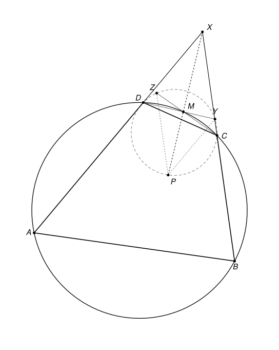

## Statement

Soit $A$, $B$, $C$, $D$ quatre points d'un même cercle, rangés dans cet ordre sur le cercle, tels que $\widehat{BAD} < \widehat{ADC}$. Soit $M$ le milieu de l'arc $CD$ qui ne contient pas $A$.

On suppose qu'il existe un point $P$, situé à l'intérieur du quadrilatère $ABCD$, tel que

$$\widehat{ADB} = \widehat{CPD} \qquad \text{et} \qquad \widehat{ADP} = \widehat{PCB}.$$

Démontrer que les droites $(AD)$, $(BC)$ et $(MP)$ sont concourantes.

## Hints

1. Notez $x = \widehat{ADB}$, $y = \widehat{ADP}$ et $\gamma = \widehat{MAD}$. Écrivez la somme des angles du triangle $CPD$ et montrez que $y = x - \gamma$.
2. Les droites $(AD)$ et $(BC)$ se coupent en un point $X$. Pour montrer que $X$, $M$ et $P$ sont alignés, cherchez un triangle de sommet $P$ dont les côtés sont parallèles à ceux du triangle $XCD$.
3. Soit $Z$ le point de $(CM)$ tel que $(PZ)$ soit parallèle à $(BC)$, et $Y$ le point de $(DM)$ tel que $(PY)$ soit parallèle à $(AD)$. Montrez que $Z$ et $Y$ sont sur le cercle qui passe par $P$, $C$ et $D$.
4. Déduisez-en que $(YZ)$ est parallèle à $(CD)$, puis utilisez des vecteurs dans le triangle $MCD$, comme dans le théorème de Thalès.

## Solution

On note $\widehat{UVW}$ l'angle géométrique, compris entre $0^\circ$ et $180^\circ$. On utilisera aussi des angles orientés de droites, qui évitent de discuter de la position des points.

### Outil : les angles orientés de droites

Pour deux droites $d_1$ et $d_2$, on note $(d_1, d_2)$ l'angle dont il faut faire tourner $d_1$, dans le sens direct, pour la rendre parallèle à $d_2$. Cet angle est compté **à $180^\circ$ près** : tourner une droite de $180^\circ$ la ramène sur elle-même. Ces angles suivent des règles simples.

- **Relation de Chasles** : $(d_1, d_3) = (d_1, d_2) + (d_2, d_3)$.
- $(d_1, d_2) = 0$ si et seulement si $d_1$ et $d_2$ sont parallèles (ou confondues). En particulier, si $d_2$ et $d_3$ sont parallèles, alors $(d_1, d_2) = (d_1, d_3)$.
- Une droite peut être nommée par deux quelconques de ses points : par exemple, si $M$ est sur la droite $(BC)$ et $M \neq C$, alors $(CM) = (CB)$.

Le théorème de l'angle inscrit et sa réciproque prennent alors une forme qui ne dépend plus de la figure.

**Angle inscrit.** Si $W$, $X$, $Y$, $Z$ sont quatre points d'un même cercle, alors $(ZX, ZY) = (WX, WY)$.

En effet, notons $\theta = \widehat{XZY}$. Si $Z$ et $W$ sont du même côté de la droite $(XY)$, le théorème de l'angle inscrit donne $\widehat{XWY} = \theta$, et les deux rotations, de $[ZX)$ vers $[ZY)$ et de $[WX)$ vers $[WY)$, tournent dans le même sens : les deux angles orientés sont égaux. Si $Z$ et $W$ sont de part et d'autre de $(XY)$, on a $\widehat{XWY} = 180^\circ - \theta$, et les deux rotations tournent en sens contraires. Si la première vaut $\theta$, la seconde vaut $-(180^\circ - \theta) = \theta - 180^\circ$, c'est-à-dire $\theta$ à $180^\circ$ près.

**Réciproque.** Soit $W$, $X$, $Y$, $Z$ quatre points tels que ni $Z$ ni $W$ ne soit sur la droite $(XY)$. Si $(ZX, ZY) = (WX, WY)$, alors ces quatre points sont sur un même cercle.

En effet, on refait le raisonnement à l'envers. Si $Z$ et $W$ sont du même côté de $(XY)$, les deux rotations tournent dans le même sens, donc $\widehat{XZY} = \widehat{XWY}$ : les deux points voient le segment $[XY]$ sous le même angle, du même côté, donc ils sont sur un même arc de cercle d'extrémités $X$ et $Y$. Si $Z$ et $W$ sont de part et d'autre de $(XY)$, les rotations tournent en sens contraires, donc $\widehat{XZY} + \widehat{XWY} = 180^\circ$, et $W$ est sur l'arc qui complète, de l'autre côté de $(XY)$, le cercle passant par $X$, $Y$ et $Z$.

**Lien avec les angles géométriques.** Soit $UVW$ un triangle. Si l'on parcourt $U$, $V$, $W$ dans le sens direct (le sens inverse des aiguilles d'une montre), alors $(UV, UW) = \widehat{VUW}$. Sinon, $(UV, UW) = -\widehat{VUW}$. En effet, pour amener la demi-droite $[UV)$ sur la demi-droite $[UW)$, on la fait tourner de l'angle $\widehat{VUW}$, dans le sens direct dans le premier cas, et dans l'autre sens dans le second. Changer l'ordre circulaire des sommets ne change pas le sens : $UVW$, $VWU$ et $WUV$ sont parcourus dans le même sens.

### Étape 0 : orientation de la figure

On oriente le plan de sorte que $A$, $B$, $C$, $D$ soient rangés dans le sens direct sur le cercle. En tournant dans le sens direct, on rencontre alors $A$, $B$, $C$, $M$, $D$, dans cet ordre.

- Trois points du cercle forment un triangle parcouru dans le sens direct quand, en partant du premier et en tournant dans le sens direct, on rencontre le deuxième avant le troisième. Ainsi $DCM$ est direct, et $CDM$ ne l'est pas.
- Le quadrilatère $ABCD$, inscrit dans un cercle, est convexe, et $P$ est à l'intérieur. Les triangles $PAB$, $PBC$, $PCD$ et $PDA$ sont donc parcourus dans le même sens que $ABCD$ : ils sont directs.

### Étape 1 : un calcul d'angles géométriques

Notons $x = \widehat{ADB} = \widehat{CPD}$, $y = \widehat{ADP} = \widehat{PCB}$ et $\gamma = \widehat{MAD}$.

- Comme $M$ est le milieu de l'arc $CD$, les arcs $CM$ et $MD$ sont égaux, donc $MC = MD$ et $\widehat{CAM} = \widehat{MAD} = \gamma$. Le point $M$ est sur l'arc $CD$ qui ne contient pas $A$, donc la demi-droite $[AM)$ est entre $[AC)$ et $[AD)$ : $\widehat{CAD} = 2\gamma$.
- Les angles inscrits $\widehat{MCD}$ et $\widehat{MAD}$ interceptent le même arc $MD$, donc $\widehat{MCD} = \gamma$. Le triangle $MCD$ est isocèle en $M$, donc aussi $\widehat{MDC} = \gamma$.
- Les angles inscrits $\widehat{ACB}$ et $\widehat{ADB}$ interceptent le même arc $AB$, donc $\widehat{ACB} = x$. Comme $ABCD$ est convexe, $\widehat{BCD} = \widehat{BCA} + \widehat{ACD} = x + \widehat{ACD}$.
- Dans le triangle $ACD$, $\widehat{ADC} = 180^\circ - 2\gamma - \widehat{ACD}$. En ajoutant, $\widehat{ADC} + \widehat{BCD} = 180^\circ - 2\gamma + x$.

Comme $P$ est à l'intérieur de $ABCD$, la demi-droite $[DP)$ est entre $[DA)$ et $[DC)$, et $[CP)$ est entre $[CB)$ et $[CD)$. Donc $\widehat{PDC} = \widehat{ADC} - y$ et $\widehat{PCD} = \widehat{BCD} - y$. La somme des angles du triangle $CPD$ donne

$$x + (\widehat{ADC} - y) + (\widehat{BCD} - y) = 180^\circ, \qquad \text{soit} \qquad x + 180^\circ - 2\gamma + x - 2y = 180^\circ.$$

Ainsi **$y = x - \gamma$.**

On traduit maintenant en angles orientés, grâce à l'étape 0 :

- $PCD$ est direct, donc $(PC, PD) = \widehat{CPD} = x$ ;
- $PBC$ est direct, donc $CPB$ aussi, et $(CP, CB) = \widehat{PCB} = y$ ;
- $PDA$ est direct, donc $DAP$ aussi, et $(DA, DP) = \widehat{ADP} = y$ ;
- $DCM$ est direct, donc $(DC, DM) = \widehat{CDM} = \gamma$ ;
- $CDM$ n'est pas direct, donc $(CD, CM) = -\widehat{DCM} = -\gamma$.

### Étape 2 : le point X

Les droites $(AD)$ et $(BC)$ ne sont pas parallèles. Sinon, la médiatrice de $[AD]$, qui passe par le centre du cercle et qui est perpendiculaire à $(AD)$, serait aussi perpendiculaire à $(BC)$ : ce serait aussi la médiatrice de $[BC]$. La symétrie par rapport à cette droite échangerait $A$ et $D$, et $B$ et $C$, et on aurait $\widehat{BAD} = \widehat{CDA}$, ce qui est exclu.

On note $X$ le point d'intersection de $(AD)$ et de $(BC)$. Il faut montrer que $X$ est sur la droite $(MP)$. Remarquons que $X$ n'est ni $C$ ni $D$, car trois points d'un cercle ne sont jamais alignés.

### Étape 3 : deux points sur le cercle PCD

Le point $P$ n'est sur aucune des droites $(BC)$, $(AD)$, $(CD)$, $(CM)$, $(DM)$ : le quadrilatère $ABCD$ est tout entier d'un même côté de chacune d'elles, et $P$ est à l'intérieur. On note $\sigma$ le cercle qui passe par $P$, $C$ et $D$.

**Le point Z.** La parallèle à $(BC)$ passant par $P$ coupe la droite $(CM)$ en un point $Z$, car $(CM)$ n'est pas parallèle à $(BC)$. On a $Z \neq C$, sinon $P$ serait sur $(BC)$. Avec la relation de Chasles, puis la règle des parallèles :

$$(PD, PZ) = (PD, PC) + (PC, PZ) = -x + (PC, BC) = -x + (CP, CB) = -x + y = -\gamma.$$

D'autre part, $Z$ est sur $(CM)$, donc $(CD, CZ) = (CD, CM) = -\gamma$. Ainsi $(PD, PZ) = (CD, CZ)$.

Les points $P$ et $C$ ne sont pas sur la droite $(DZ)$ : pour $P$, parce que $(PD, PZ) = -\gamma$ n'est pas nul ; pour $C$, parce que la droite $(CM)$ ne coupe $(CD)$ qu'en $C$, et que $Z \neq C$. La réciproque du théorème de l'angle inscrit montre que **$Z$ est sur le cercle $\sigma$.**

**Le point Y.** De même, la parallèle à $(AD)$ passant par $P$ coupe $(DM)$ en un point $Y$, et $Y \neq D$, sinon $P$ serait sur $(AD)$. On a

$$(PC, PY) = (PC, PD) + (PD, PY) = x + (PD, AD) = x + (DP, DA) = x - y = \gamma,$$

et $(DC, DY) = (DC, DM) = \gamma$.

Comme pour $Z$, **$Y$ est sur le cercle $\sigma$.**

### Étape 4 : les droites (YZ) et (CD) sont parallèles

Soit $\Delta$ la médiatrice de $[CD]$ et $s$ la symétrie d'axe $\Delta$. Le point $M$ est sur $\Delta$, car $MC = MD$, et le centre de $\sigma$ aussi, car $\sigma$ passe par $C$ et $D$. Donc $s$ échange $C$ et $D$, laisse $M$ en place, envoie la droite $(CM)$ sur la droite $(DM)$, et envoie le cercle $\sigma$ sur lui-même.

Le point $s(Z)$ est donc sur $(DM)$ et sur $\sigma$. Or la droite $(DM)$ coupe $\sigma$ en deux points seulement, $D$ et $Y$. Et $s(Z) \neq D$, car $Z \neq C$. Donc **$s(Z) = Y$.**

Si on avait $Z = Y$, ce point serait sur $\Delta$ et sur $(CM)$, donc égal à $M$. Les droites $(PM)$, $(BC)$ et $(AD)$ seraient alors parallèles, ce qui contredit l'étape 2. Donc $Z \neq Y$, et la droite $(ZY)$ est perpendiculaire à l'axe $\Delta$, comme $(CD)$. **Les droites $(ZY)$ et $(CD)$ sont parallèles**, et on a vu au passage que $Z \neq M$ et $Y \neq M$.

### Étape 5 : M, P et X sont alignés

Les triangles $XCD$ et $PZY$ ont leurs côtés parallèles deux à deux : $(XC) = (BC)$ est parallèle à $(PZ)$, $(XD) = (AD)$ à $(PY)$, et $(CD)$ à $(ZY)$. On en déduit l'alignement avec des vecteurs.

Le point $Z$ est sur $(MC)$ et $Y$ sur $(MD)$, donc il existe des réels $k$ et $k'$ tels que $\overrightarrow{MZ} = k\,\overrightarrow{MC}$ et $\overrightarrow{MY} = k'\,\overrightarrow{MD}$. Comme $(ZY)$ est parallèle à $(CD)$, il existe un réel $\lambda$ tel que $\overrightarrow{ZY} = \lambda\,\overrightarrow{CD}$, c'est-à-dire

$$k'\,\overrightarrow{MD} - k\,\overrightarrow{MC} = \lambda\,\overrightarrow{MD} - \lambda\,\overrightarrow{MC}.$$

Les vecteurs $\overrightarrow{MC}$ et $\overrightarrow{MD}$ ne sont pas colinéaires, donc on peut identifier les coefficients : $k = \lambda = k'$.

Soit $P'$ le point tel que $\overrightarrow{MP'} = k\,\overrightarrow{MX}$. Alors

$$\overrightarrow{ZP'} = \overrightarrow{MP'} - \overrightarrow{MZ} = k\,(\overrightarrow{MX} - \overrightarrow{MC}) = k\,\overrightarrow{CX}.$$

Le point $P'$ est donc sur la parallèle à $(CX) = (BC)$ passant par $Z$, qui est la droite $(PZ)$. De même, $\overrightarrow{YP'} = k\,\overrightarrow{DX}$, donc $P'$ est sur la parallèle à $(AD)$ passant par $Y$, qui est la droite $(PY)$. Les droites $(PZ)$ et $(PY)$ ne sont pas parallèles (elles sont parallèles à $(BC)$ et à $(AD)$), donc leur seul point commun est $P$. Ainsi $P' = P$, et $\overrightarrow{MP} = k\,\overrightarrow{MX}$ : **les points $M$, $P$ et $X$ sont alignés.**

### Conclusion

Le point $P$, à l'intérieur du quadrilatère, est différent de $M$, qui est sur le cercle. La droite $(MP)$ passe donc par $X$, point commun de $(AD)$ et $(BC)$. **Les droites $(AD)$, $(BC)$ et $(MP)$ sont concourantes en $X$.**

## Going further

1. Où a-t-on utilisé l'hypothèse $\widehat{BAD} < \widehat{ADC}$ ? Montrez qu'elle signifie que le point $X$ est du même côté de la droite $(CD)$ que $M$.
2. Montrez que $\widehat{PDC} = \widehat{BDM}$ et que $\widehat{PCD} = \widehat{ACM}$.
