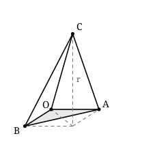

## Statement

Dans l'espace muni d'un repère orthonormé, on appelle **nœud** un point dont les trois
coordonnées sont des entiers.

Dans le plan, le théorème de Pick est une petite merveille : le seul comptage des nœuds
intérieurs et des nœuds du bord suffit à donner l'aire d'un polygone à sommets sur les nœuds,
sans aucune mesure. On aimerait la même chose dans l'espace : le volume d'un polyèdre à
sommets sur les nœuds serait-il lui aussi déterminé par le nombre de nœuds intérieurs et le
nombre de nœuds de sa surface ?

La réponse est non, et un seul exemple suffit à le montrer.

Soit $r$ un entier avec $r \geqslant 1$. On note $T_r$ le tétraèdre de sommets

$$O(0 ; 0 ; 0), \quad A(1 ; 0 ; 0), \quad B(0 ; 1 ; 0), \quad C(1 ; 1 ; r) .$$

1. Montre que le volume de $T_r$ vaut $\dfrac{r}{6}$.
2. Montre que les seuls nœuds appartenant à $T_r$, surface comprise, sont ses quatre sommets,
   et ce quelle que soit la valeur de $r$.
3. Conclus.

## Hints

1. Pour la question 1, la base $OAB$ est dans le plan d'équation $z = 0$. Quelle est son
   aire ? Et à quelle hauteur se trouve $C$ au-dessus de ce plan ?
2. Pour la question 2, décris d'abord les points du tétraèdre. Un point $M$ appartient à
   $T_r$ si et seulement s'il s'écrit
   $$\vec{OM} = \beta\,\vec{OA} + \gamma\,\vec{OB} + \delta\,\vec{OC}$$
   avec $\beta \geqslant 0$, $\gamma \geqslant 0$, $\delta \geqslant 0$ et
   $\beta + \gamma + \delta \leqslant 1$.
3. Calcule les coordonnées $x$, $y$, $z$ de ce point $M$ en fonction de $\beta$, $\gamma$,
   $\delta$ et $r$. La troisième te donne tout de suite $\delta$.
4. Une fois $\delta$ connu, traduis les conditions sur $\beta$ et $\gamma$ en conditions sur
   $x$ et $y$ : tu obtiens trois inégalités très simples.
5. Sépare alors les cas selon la valeur entière de $z$ : $z = 0$, puis $z = r$, puis
   $0 < z < r$. C'est le troisième cas qui porte toute l'idée : si $x$ est un entier
   strictement supérieur à $0$, alors $x \geqslant 1$.

## Solution

**1. Le volume.**

Les trois points $O$, $A$ et $B$ sont dans le plan d'équation $z = 0$, et le triangle $OAB$
est rectangle en $O$ avec $OA = OB = 1$. Son aire vaut donc $\dfrac{1}{2}$.

Le sommet $C$ a pour cote $r$ : sa distance au plan $z = 0$ vaut $r$. Le volume d'un tétraèdre
étant le tiers du produit de l'aire de la base par la hauteur,

$$V(T_r) = \frac{1}{3} \times \frac{1}{2} \times r = \boxed{\frac{r}{6}}$$

**2. Les nœuds du tétraèdre.**

*Une description commode des points de $T_r$.* Le tétraèdre est l'ensemble des points $M$ tels
que

$$\vec{OM} = \beta\,\vec{OA} + \gamma\,\vec{OB} + \delta\,\vec{OC}$$

avec $\beta, \gamma, \delta$ positifs ou nuls et $\beta + \gamma + \delta \leqslant 1$. En
coordonnées, $\vec{OA} = (1 ; 0 ; 0)$, $\vec{OB} = (0 ; 1 ; 0)$ et $\vec{OC} = (1 ; 1 ; r)$,
donc le point $M$ a pour coordonnées

$$x = \beta + \delta, \qquad y = \gamma + \delta, \qquad z = \delta r .$$

*Traduction en inégalités sur $x$, $y$, $z$.* La troisième égalité donne
$\delta = \dfrac{z}{r}$. On en tire $\beta = x - \dfrac{z}{r}$ et $\gamma = y - \dfrac{z}{r}$.
Les trois conditions $\beta \geqslant 0$, $\gamma \geqslant 0$, $\delta \geqslant 0$ et la
condition $\beta + \gamma + \delta \leqslant 1$ deviennent, en posant $t = \dfrac{z}{r}$ :

$$0 \leqslant t \leqslant 1, \qquad x \geqslant t, \qquad y \geqslant t, \qquad x + y \leqslant 1 + t .$$

*(La dernière vient de $(x - t) + (y - t) + t \leqslant 1$.)*

Autrement dit, la tranche de $T_r$ à la hauteur $z = tr$ est le triangle de sommets
$(t ; t)$, $(1 ; t)$ et $(t ; 1)$.

Soit maintenant $M(x ; y ; z)$ un nœud de $T_r$ : $x$, $y$, $z$ sont des entiers et
$0 \leqslant z \leqslant r$. Trois cas.

**Cas $z = 0$**, donc $t = 0$. Les conditions deviennent $x \geqslant 0$, $y \geqslant 0$ et
$x + y \leqslant 1$. Les seuls couples d'entiers qui conviennent sont $(0 ; 0)$, $(1 ; 0)$ et
$(0 ; 1)$ : on obtient $O$, $A$ et $B$.

**Cas $z = r$**, donc $t = 1$. Les conditions deviennent $x \geqslant 1$, $y \geqslant 1$ et
$x + y \leqslant 2$, ce qui force $x = y = 1$ : on obtient $C$.

**Cas $0 < z < r$**, donc $0 < t < 1$. Alors $x \geqslant t > 0$, et comme $x$ est un entier,
$x \geqslant 1$. De même $y \geqslant 1$. Donc

$$x + y \geqslant 2 > 1 + t ,$$

ce qui contredit $x + y \leqslant 1 + t$. **Aucun nœud à ces hauteurs.**

Conclusion : quel que soit $r$, le tétraèdre $T_r$ contient exactement **quatre** nœuds, ses
quatre sommets. Il n'a **aucun** nœud intérieur, et sa surface en porte exactement $4$.

**3. La conclusion.**

Supposons qu'il existe une formule $V = f(I, S)$ donnant le volume d'un polyèdre à sommets sur
les nœuds à partir de son nombre $I$ de nœuds intérieurs et de son nombre $S$ de nœuds de
surface. Appliquons-la aux tétraèdres $T_1, T_2, T_3, \ldots$ : tous ont $I = 0$ et $S = 4$,
donc tous auraient le même volume $f(0, 4)$. Or leurs volumes valent
$\dfrac{1}{6}, \dfrac{2}{6}, \dfrac{3}{6}, \ldots$ et sont deux à deux différents.

$$\boxed{\text{Une telle formule ne peut pas exister : le théorème de Pick n'a pas d'analogue dans l'espace.}}$$

**Ce que cela dit.** Les tétraèdres $T_r$ sont aussi « vides » les uns que les autres au sens
des nœuds : ils n'en contiennent que leurs sommets. Pourtant, en allongeant $r$, on leur fait
prendre un volume aussi grand qu'on veut. Le comptage de nœuds ne voit pas cet étirement,
alors qu'en dimension $2$ il voyait tout. Ces tétraèdres portent le nom de **tétraèdres de
Reeve**, d'après John Reeve qui les a introduits en 1957 pour cette raison exactement.

## Going further

1. Vérifie sur $T_2$ que le volume vaut bien $\dfrac{1}{3}$, par exemple en calculant le
   déterminant des trois vecteurs $\vec{OA}$, $\vec{OB}$ et $\vec{OC}$, puis en le divisant par $6$.
2. Reeve a montré qu'en ajoutant un troisième comptage, celui des nœuds du réseau plus fin de
   pas $\dfrac{1}{2}$, on obtient bien une formule de volume. Compte les points de coordonnées
   demi-entières dans $T_1$ et dans $T_2$ : trouves-tu deux résultats différents ?
3. Dans le plan, une conséquence du théorème de Pick est qu'un triangle à sommets sur les
   nœuds et sans autre nœud a toujours l'aire $\dfrac{1}{2}$. Les tétraèdres de Reeve montrent
   que l'énoncé correspondant est faux dans l'espace. Écris cet énoncé faux.
