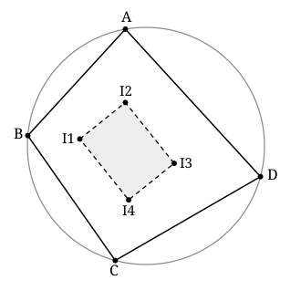

## Statement

Soit $ABCD$ un quadrilatère convexe inscrit dans un cercle $\Gamma$, les quatre sommets étant
placés dans cet ordre sur le cercle.

Ce quadrilatère contient quatre triangles obtenus en oubliant un sommet à chaque fois. Notons :

- $I_1$ le centre du cercle inscrit du triangle $ABC$ ;
- $I_2$ le centre du cercle inscrit du triangle $ABD$ ;
- $I_3$ le centre du cercle inscrit du triangle $ACD$ ;
- $I_4$ le centre du cercle inscrit du triangle $BCD$.

Montrer que $I_1 I_2 I_3 I_4$ est un rectangle.

## Hints

1. L'outil de tout l'exercice est le **théorème du pôle Sud** : dans un triangle $XYZ$ inscrit
   dans un cercle, si la bissectrice issue de $X$ recoupe le cercle en $M$, alors
   $MY = MZ = MI$, où $I$ est le centre du cercle inscrit de $XYZ$. Autrement dit : $Y$, $Z$ et
   $I$ sont sur un même cercle de centre $M$.
2. Prends le côté $[AB]$ et appelle $M$ le milieu de l'arc $AB$ qui ne contient ni $C$ ni $D$.
   Applique le pôle Sud dans $ABC$, puis dans $ABD$. Quels points se retrouvent sur un même
   cercle de centre $M$ ?
3. Tu obtiens ainsi un cercle par côté du quadrilatère. Le cercle du côté $[AB]$ et celui du côté
   $[BC]$ ont deux points communs : lesquels ?
4. Pour l'angle en $I_1$, découpe-le : $\widehat{I_2 I_1 I_4} = \widehat{I_2 I_1 B} + \widehat{B I_1 I_4}$.
   Calcule chaque morceau avec le théorème de l'angle inscrit, dans le cercle qui convient.
5. À la fin, il ne reste qu'à utiliser la propriété des angles opposés d'un quadrilatère
   inscriptible.

## Solution

Tout repose sur un résultat démontré à part, le **théorème du pôle Sud** :

> Dans un triangle $XYZ$ inscrit dans un cercle, si la bissectrice issue de $X$ recoupe le cercle
> en $M$, et si $I$ est le centre du cercle inscrit de $XYZ$, alors
> $$MY = MZ = MI.$$
> Le point $M$ est le milieu de l'arc $YZ$ qui ne contient pas $X$.

On raisonne sur la figure ci-dessus, c'est-à-dire dans le cas d'un quadrilatère convexe dont les
sommets se suivent dans l'ordre $A$, $B$, $C$, $D$ sur le cercle.

### Étape 1 : un cercle attaché à chaque côté du quadrilatère

Prenons le côté $[AB]$ et notons $M$ le milieu de l'arc $AB$ qui ne contient ni $C$ ni $D$. Un tel
point existe : comme $A$, $B$, $C$, $D$ sont dans cet ordre sur $\Gamma$, les points $C$ et $D$
sont tous les deux sur le **même** arc délimité par $A$ et $B$.

- Dans le triangle $ABC$, la bissectrice issue de $C$ recoupe $\Gamma$ au milieu de l'arc $AB$ ne
  contenant pas $C$, c'est-à-dire en $M$. Le théorème du pôle Sud donne
  $$MA = MB = MI_1.$$
- Dans le triangle $ABD$, la bissectrice issue de $D$ recoupe $\Gamma$ au milieu de l'arc $AB$ ne
  contenant pas $D$, c'est-à-dire **au même point** $M$. Le théorème du pôle Sud donne
  $$MA = MB = MI_2.$$

Les quatre points $A$, $B$, $I_1$, $I_2$ sont donc à la même distance de $M$ : ils sont sur un
même cercle, que nous appellerons $\omega_{AB}$, de centre $M$.

Le même raisonnement marche pour chacun des quatre côtés du quadrilatère. On obtient :

| côté | cercle | points qu'il contient |
|---|---|---|
| $[AB]$ | $\omega_{AB}$ | $A$, $B$, $I_1$, $I_2$ |
| $[BC]$ | $\omega_{BC}$ | $B$, $C$, $I_1$, $I_4$ |
| $[CD]$ | $\omega_{CD}$ | $C$, $D$, $I_3$, $I_4$ |
| $[DA]$ | $\omega_{DA}$ | $D$, $A$, $I_2$, $I_3$ |

Vérifions par exemple la deuxième ligne. Le milieu $M'$ de l'arc $BC$ ne contenant ni $A$ ni $D$
sert à la fois dans le triangle $ABC$ (bissectrice issue de $A$), ce qui donne
$M'B = M'C = M'I_1$, et dans le triangle $BCD$ (bissectrice issue de $D$), ce qui donne
$M'B = M'C = M'I_4$.

Remarquons la logique de ce tableau : sur un côté du quadrilatère, on lit les deux triangles qui
contiennent ce côté, donc les deux centres correspondants.

### Étape 2 : l'angle en $I_1$

Le point $I_1$ appartient à deux de ces cercles, $\omega_{AB}$ et $\omega_{BC}$. Et le point $B$
aussi. La demi-droite $[I_1B)$ va nous servir à couper l'angle en deux :
$$\widehat{I_2 I_1 I_4} = \widehat{I_2 I_1 B} + \widehat{B I_1 I_4}.$$

**Le premier morceau, dans le cercle $\omega_{AB}$.**

Sur ce cercle vivent $A$, $B$, $I_1$, $I_2$. Les angles inscrits $\widehat{I_2 I_1 B}$ et
$\widehat{I_2 A B}$ interceptent le même arc $I_2B$, du même côté : ils sont égaux.

Or $I_2$ est le centre du cercle inscrit du triangle $ABD$, donc $(AI_2)$ est la bissectrice de
l'angle $\widehat{DAB}$, et
$$\widehat{I_2 A B} = \frac{\widehat{DAB}}{2}.$$

Donc
$$\widehat{I_2 I_1 B} = \frac{\widehat{DAB}}{2}.$$

**Le second morceau, dans le cercle $\omega_{BC}$.**

Sur ce cercle vivent $B$, $C$, $I_1$, $I_4$. Les angles inscrits $\widehat{B I_1 I_4}$ et
$\widehat{B C I_4}$ interceptent le même arc $BI_4$, du même côté : ils sont égaux.

Or $I_4$ est le centre du cercle inscrit du triangle $BCD$, donc $(CI_4)$ est la bissectrice de
l'angle $\widehat{BCD}$, et
$$\widehat{B C I_4} = \frac{\widehat{BCD}}{2}.$$

Donc
$$\widehat{B I_1 I_4} = \frac{\widehat{BCD}}{2}.$$

**On additionne.**

$$\widehat{I_2 I_1 I_4} = \frac{\widehat{DAB}}{2} + \frac{\widehat{BCD}}{2}
= \frac{\widehat{DAB} + \widehat{BCD}}{2}.$$

Et voici le coup de grâce : $ABCD$ est inscriptible, donc ses angles opposés sont supplémentaires,
$$\widehat{DAB} + \widehat{BCD} = 180°.$$

D'où
$$\widehat{I_2 I_1 I_4} = \frac{180°}{2} = 90°.$$

### Étape 3 : les trois autres angles

Le raisonnement de l'étape 2 n'a rien utilisé de particulier au sommet $I_1$ : on a seulement pris
un sommet du quadrilatère des centres, les deux cercles auxquels il appartient, et le sommet de
$ABCD$ commun à ces deux cercles.

En tournant les lettres, on obtient exactement de la même façon :

- angle en $I_2$, en découpant par $[I_2A)$ : $\ \widehat{I_1 I_2 I_3} = \dfrac{\widehat{ABC} + \widehat{CDA}}{2} = 90°$ ;
- angle en $I_3$, en découpant par $[I_3D)$ : $\ \widehat{I_2 I_3 I_4} = \dfrac{\widehat{DAB} + \widehat{BCD}}{2} = 90°$ ;
- angle en $I_4$, en découpant par $[I_4C)$ : $\ \widehat{I_3 I_4 I_1} = \dfrac{\widehat{ABC} + \widehat{CDA}}{2} = 90°$.

### Conclusion

Le quadrilatère $I_1 I_2 I_3 I_4$ a ses quatre angles droits.

**C'est donc un rectangle.**

## Going further

1. Un rectangle a deux diagonales de même longueur qui se coupent en leur milieu. En déduire que
   les segments $[I_1I_3]$ et $[I_2I_4]$ ont le même milieu, et que ce point est le centre d'un
   cercle passant par les quatre centres de cercles inscrits.
2. À quelle condition sur $ABCD$ ce rectangle est-il un carré ?
