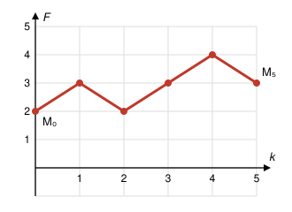

## Statement

On dispose d'une pièce de monnaie, pas forcément équilibrée : la probabilité d'obtenir Pile est
$p$, avec $0 < p < 1$, et on pose $q = 1 - p$.

Un joueur lance la pièce $n$ fois de suite, les lancers étant indépendants. À chaque Pile il gagne
$1$ euro, à chaque Face il perd $1$ euro. Sa fortune initiale est de $f_0$ euros, où $f_0$ est un
entier relatif : une dette compte comme une fortune négative, et le joueur peut être endetté dès le
début.

Pour tout entier $k \geq 1$, on note $X_k$ la variable aléatoire qui vaut $1$ si le $k$-ième lancer
donne Pile et $-1$ s'il donne Face. On pose
$$G_k = X_1 + X_2 + \cdots + X_k ,$$
on note $F_0 = f_0$, et pour $k \geq 1$, $F_k$ est la fortune du joueur (positive ou négative)
après le $k$-ième lancer.

Dans un repère orthonormé, on place pour $0 \leq k \leq n$ le point $M_k(k, F_k)$. La ligne brisée
qui joint $M_0, M_1, \ldots, M_n$ s'appelle une **trajectoire**. Elle part de $M_0(0, f_0)$.

On rappelle que le coefficient binomial $\binom{n}{k}$ est le nombre de façons d'obtenir $k$ Pile et
$n - k$ Face en $n$ lancers.

1. Dans cette question, $n = 5$ et $f_0 = 2$.

   a) Dessiner une trajectoire possible.

   b) Pour un entier relatif $y$, existe-t-il toujours une trajectoire qui va de $M_0$ au point
      $M(5, y)$ ?

   c) Écrire un algorithme (par exemple en Python) qui simule les cinq lancers et affiche les
      coordonnées du point d'arrivée de la trajectoire.

2. Construire à partir de $X_i$ une variable aléatoire $Y_i$ à valeurs dans $\{0, 1\}$, qui vaut
   $1$ si le $i$-ième lancer donne Pile et $0$ s'il donne Face. Quelle est sa loi ?

3. Donner, pour tout entier $k \geq 1$, la loi de $G_k$, puis celle de $F_k$.

4. Soit $n \geq 1$ et $b$ un entier relatif. On note $M(n, b)$ le point de coordonnées $(n, b)$.

   a) Donner une condition nécessaire et suffisante sur $b$ pour qu'il existe une trajectoire de
      $M_0(0, f_0)$ à $M(n, b)$. On note $D$ l'ensemble des entiers $b$ qui vérifient cette condition.

   b) Pour $b \in D$, exprimer en fonction de $n$, $b$, $f_0$ et $p$ la probabilité que la fortune
      du joueur vaille $b$ à l'issue des $n$ lancers.

## Hints

1. **Question 1 b).** Si le joueur obtient $k$ Pile en cinq lancers, quelle est sa fortune à la
   fin ?
2. **Question 2.** Chercher $Y_i$ de la forme $aX_i + c$ : il faut que $-1$ donne $0$ et que $1$
   donne $1$.
3. **Question 3.** La somme $S_k = Y_1 + \cdots + Y_k$ compte les Pile parmi les $k$ premiers
   lancers. Quelle loi connue suit-elle ?
4. **Question 3.** Exprimer $X_i$ à l'aide de $Y_i$, puis $G_k$ à l'aide de $S_k$.
5. **Question 4 a).** Avec $j$ Pile en $n$ lancers, la fortune finale est $f_0 + 2j - n$. Pour
   quels $b$ peut-on trouver un tel $j$ entre $0$ et $n$ ?

## Solution

**1. a)** Par exemple, la suite de lancers Pile, Face, Pile, Pile, Face donne les fortunes
$2, 3, 2, 3, 4, 3$, donc la trajectoire qui joint les points $(0, 2)$, $(1, 3)$, $(2, 2)$,
$(3, 3)$, $(4, 4)$ et $(5, 3)$.



**b)** Non. Si le joueur obtient $k$ Pile et donc $5 - k$ Face, sa fortune finale est
$$2 + k - (5 - k) = 2k - 3 , \qquad k \in \{0, 1, 2, 3, 4, 5\} .$$
Les seuls points d'arrivée possibles sont donc $M(5, y)$ avec
$y \in \{-3, -1, 1, 3, 5, 7\}$. Par exemple, il n'existe aucune trajectoire de $M_0$ à $M(5, 0)$
(la fortune finale est toujours impaire), ni à $M(5, 9)$ (on gagne au plus $5$ euros).

**c)** Un tirage aléatoire uniforme dans $[0, 1[$ est inférieur à $p$ avec probabilité $p$ : on
l'utilise pour simuler la pièce.

```python
from random import random

p = 0.5        # probabilité d'obtenir Pile (à choisir)
f = 2          # fortune initiale
for k in range(5):
    if random() < p:   # Pile
        f = f + 1
    else:              # Face
        f = f - 1
print("Point d'arrivée : (5,", f, ")")
```

**2.** On pose $Y_i = \frac{X_i + 1}{2}$. Si $X_i = 1$ (Pile), $Y_i = 1$ ; si $X_i = -1$ (Face),
$Y_i = 0$. La variable $Y_i$ vaut $1$ avec probabilité $p$ et $0$ avec probabilité $q$ : **elle
suit la loi de Bernoulli de paramètre $p$**.

**3.** Posons $S_k = Y_1 + \cdots + Y_k$ : c'est le nombre de Pile obtenus lors des $k$ premiers
lancers. Les lancers sont indépendants et ont chacun la probabilité $p$ de donner Pile, donc
**$S_k$ suit la loi binomiale de paramètres $k$ et $p$** : pour $0 \leq j \leq k$,
$$P(S_k = j) = \binom{k}{j} p^j q^{k-j} .$$

Comme $X_i = 2Y_i - 1$, on a
$$G_k = \sum_{i=1}^{k} (2Y_i - 1) = 2S_k - k .$$
Donc $G_k$ prend les valeurs $-k, -k + 2, \ldots, k - 2, k$, c'est-à-dire les nombres $2j - k$
pour $j = 0, 1, \ldots, k$, et
$$P(G_k = 2j - k) = P(S_k = j) = \binom{k}{j} p^j q^{k-j} \qquad (0 \leq j \leq k) .$$

Enfin la fortune après $k$ lancers est la fortune initiale plus les gains : $F_k = f_0 + G_k$.
Donc $F_k$ prend les valeurs $f_0 + 2j - k$ pour $0 \leq j \leq k$, et
$$P(F_k = f_0 + 2j - k) = \binom{k}{j} p^j q^{k-j} \qquad (0 \leq j \leq k) .$$

**4. a)** Une trajectoire de $M_0$ à $M(n, b)$ correspond à une suite de $n$ lancers dont la
fortune finale est $b$. Avec $j$ Pile, la fortune finale est $f_0 + 2j - n$. Il existe donc une
trajectoire si et seulement s'il existe un entier $j$ avec $0 \leq j \leq n$ et
$b = f_0 + 2j - n$, c'est-à-dire si et seulement si
$$j = \frac{n + b - f_0}{2}$$
est un entier compris entre $0$ et $n$. Or $0 \leq \frac{n + b - f_0}{2} \leq n$ équivaut à
$-n \leq b - f_0 \leq n$. La condition est donc :

**$b - f_0 + n$ est pair et $|b - f_0| \leq n$.** Autrement dit, $b - f_0$ a la même parité que
$n$, et on ne peut pas s'éloigner de plus de $n$ de la fortune initiale.

**b)** Pour $b \in D$, posons $j = \frac{n + b - f_0}{2}$, de sorte que $n - j = \frac{n - b + f_0}{2}$.
La fortune finale vaut $b$ exactement quand on obtient $j$ Pile, donc
$$P(n, b, f_0, p) = P(F_n = b) = \binom{n}{j} p^{j} q^{n - j}
\qquad \text{avec} \qquad j = \frac{n + b - f_0}{2} .$$

Par exemple, avec $n = 5$ et $f_0 = 2$, la probabilité de finir avec $3$ euros est
$\binom{5}{3} p^3 q^2 = 10\,p^3 q^2$.

**Bilan.** Le nombre de Pile suit une loi binomiale, et la fortune s'en déduit par une
transformation affine : $F_k = f_0 + 2S_k - k$. La fortune finale $b$ est possible exactement quand
$b - f_0$ a la parité de $n$ et $|b - f_0| \leq n$, et sa probabilité est alors
$\binom{n}{j} p^j q^{n-j}$ avec $j = \frac{n + b - f_0}{2}$.

## Going further

- Calculer l'espérance de $F_n$. Pour quelles valeurs de $p$ le jeu est-il favorable au joueur ?
- Dans la suite du sujet, on comptait les trajectoires qui ne touchent jamais l'axe des
  abscisses, c'est-à-dire les parties où le joueur n'est jamais à zéro, grâce à une symétrie : c'est
  l'exercice 41006.
