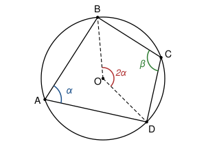

## Overview

**Organisation.** La séance a quatre parties. Chacune commence par un court rappel au tableau,
puis les élèves cherchent. Dans chaque partie, les exercices vont du plus facile au plus
difficile :

- les deux premiers sont pour tout le monde ;
- les deux suivants sont pour ceux qui avancent ;
- le dernier est un bonus pour les plus rapides.

Il n'est pas nécessaire de tout faire. Il vaut mieux passer à la partie suivante quand la
plupart des élèves ont fini les deux premiers exercices.

**Le fil rouge.** Chaque partie réutilise un résultat de la précédente. Le dire aux élèves, et
garder ces résultats écrits dans un coin du tableau :

- l'exercice 2 (un point de la bissectrice est à égale distance des deux côtés) explique
  pourquoi les trois bissectrices se coupent en un même point (partie 2) ;
- l'exercice 6 ($\widehat{BIC} = 90^\circ + \widehat{A}/2$) est l'étape clé de l'exercice 17 ;
- le milieu de l'hypoténuse, centre du cercle circonscrit (partie 2), annonce l'angle droit
  inscrit dans un demi-cercle (partie 3) ;
- l'exercice 11 sert de méthode pour l'exercice 12 ;
- le théorème de l'angle inscrit (partie 3) donne la propriété du quadrilatère inscrit
  (partie 4).

**Ce que les élèves ne connaissent pas encore.** Les élèves de 4e n'ont vu ni le cosinus, ni
le théorème de Thalès, ni les triangles semblables. Aucun des vingt exercices n'en a besoin.
Le théorème de l'angle inscrit n'est plus au programme du collège : il est présenté dans la
partie 3. Plusieurs exercices des parties 3 et 4 sont classés en seconde dans la base. Ils
n'utilisent pourtant que ce théorème, les triangles isocèles et la somme des angles.

**Deux habitudes à faire prendre.**

1. Une grande figure, faite à la règle et au compas, avec les angles égaux codés de la même
   couleur. Une figure trop petite ou trop particulière (un triangle presque isocèle, par
   exemple) fait voir des égalités fausses.
2. Chaque égalité d'angle doit avoir sa raison : triangle isocèle, angles opposés par le
   sommet, somme des angles, angles alternes-internes, angle inscrit. Les correcteurs des
   concours insistent : une chasse aux angles juste mais non justifiée ne rapporte rien.

## Block 1

**À écrire au tableau : les trois cas d'égalité.** Deux triangles sont égaux (superposables)
dès qu'ils ont :

1. leurs trois côtés égaux deux à deux ;
2. deux côtés égaux et l'angle compris entre ces deux côtés égal ;
3. un côté égal et les deux angles qui touchent ce côté égaux.

Alors tous leurs autres éléments sont égaux aussi : côtés, angles, hauteurs.

**Le piège à montrer.** Deux côtés égaux et un angle égal qui n'est *pas* compris entre eux ne
suffisent pas. Contre-exemple au tableau : tracer un angle de sommet $B$, placer $A$ sur un de
ses côtés, puis tracer un cercle de centre $A$ qui coupe l'autre côté en deux points $C$ et
$C'$. Les triangles $ABC$ et $ABC'$ ont $AB$ en commun, $AC = AC'$, le même angle en $B$, et
pourtant ils ne sont pas superposables.

**Une astuce utile.** Si on connaît deux angles égaux, mais qu'ils ne touchent pas le côté
égal, la somme des angles donne le troisième angle, qui lui touche ce côté. Dans un triangle,
connaître deux angles revient à connaître les trois.

**La méthode.** Pour montrer que deux longueurs, ou deux angles, sont égaux : chercher deux
triangles qui les contiennent, puis montrer que ces triangles sont égaux. Ce qui sert le plus
souvent : un côté commun, des angles opposés par le sommet, un milieu, une bissectrice, un
angle droit.

**Les exercices.**

- *Exercice 1* (pour tous) : un échauffement, les triangles $ABD$ et $ACD$ ont un côté
  commun.
- *Exercice 2* (pour tous) : à garder au tableau, il sert dans la partie 2. Demander aussi
  la réciproque à l'oral : un point à égale distance des deux côtés d'un angle est sur la
  bissectrice. Elle se démontre avec les mêmes triangles rectangles, qui ont la même
  hypoténuse.
- *Exercice 3* : bien faire voir les angles opposés par le sommet en $D$.
- *Exercice 4* : on y retrouve deux fois l'idée de l'exercice 2. Les points $M$ et $N$
  donnent deux triangles isocèles.
- *Exercice 5* (bonus) : c'est le cas « bissectrice et médiane » de l'exercice 1, et il est
  bien plus difficile. Il faut construire un point : prolonger $[AD]$ d'une longueur égale à
  $AD$. Si personne ne trouve, donner l'indication 1.

## Block 2

**À écrire au tableau : quatre droites et quatre points.**

| Droite | Définition | Point de rencontre des trois droites |
|---|---|---|
| médiatrice de $[AB]$ | perpendiculaire à $[AB]$ en son milieu | centre du cercle circonscrit, $O$ |
| bissectrice de $\widehat{A}$ | partage l'angle en deux angles égaux | centre du cercle inscrit, $I$ |
| hauteur issue de $A$ | passe par $A$, perpendiculaire au côté opposé | orthocentre, $H$ |
| médiane issue de $A$ | joint $A$ au milieu du côté opposé | centre de gravité, $G$ |

**Les médiatrices, à démontrer au tableau.** La médiatrice de $[AB]$ est l'ensemble des points
à égale distance de $A$ et de $B$. Soit $O$ le point commun aux médiatrices de $[AB]$ et de
$[BC]$. Alors $OA = OB$ et $OB = OC$, donc $OA = OC$ : le point $O$ est aussi sur la médiatrice
de $[AC]$. C'est le centre du cercle qui passe par les trois sommets.

**Les bissectrices, même raisonnement.** On remplace « distance à un point » par « distance à
une droite », et on utilise l'exercice 2 et sa réciproque. Le point $I$ est à la même distance
des trois côtés : c'est le centre du cercle tangent aux trois côtés, le cercle inscrit.

**Les hauteurs et les médianes.** On admet qu'elles sont concourantes. Pour les élèves de 3e
qui veulent une preuve des hauteurs : par chaque sommet, tracer la parallèle au côté opposé.
On obtient un grand triangle dont $A$, $B$ et $C$ sont les milieux des côtés (à cause des
parallélogrammes). Les hauteurs du petit triangle sont alors les médiatrices du grand. Pour
les médianes, retenir que $G$ est aux deux tiers de chaque médiane en partant du sommet.

**Deux faits à retenir.**

1. Dans un triangle isocèle en $A$, la médiatrice de $[BC]$, la bissectrice, la hauteur et la
   médiane issues de $A$ sont une seule et même droite : l'axe de symétrie. Les exercices 1
   et 5 en sont des réciproques.
2. Dans un triangle rectangle, le milieu de l'hypoténuse est le centre du cercle circonscrit :
   il est à la même distance des trois sommets. Pour le voir, compléter le triangle en un
   rectangle, dont les diagonales ont la même longueur et se coupent en leur milieu.
   Réciproquement, si le milieu d'un côté est à la même distance des trois sommets, le
   triangle est rectangle. Les exercices 8 et 9 utilisent ce fait, et il annonce la partie 3.

**Les exercices.**

- *Exercice 6* (pour tous) : de la pure chasse aux angles. Garder le résultat au tableau,
  il resservira dans l'exercice 17.
- *Exercice 7* (pour tous) : deux centres de cercles circonscrits voisins sont tous deux sur
  la médiatrice du côté que partagent les deux triangles.
- *Exercice 8* : le fait n° 2 donne un triangle isocèle, et le reste est un calcul d'angles.
- *Exercice 9* : le piège est de croire que $(CD)$ est la bissectrice. La partie « Pour aller
  plus loin » du corrigé montre le lien avec le fait n° 2.
- *Exercice 10* (bonus) : hauteurs et triangles égaux, un bon lien avec la partie 1.

## Block 3

**Le vocabulaire.** Dans un cercle de centre $O$ :

- une *corde* est un segment qui joint deux points du cercle ; deux points $A$ et $B$ du
  cercle le partagent en deux *arcs* ;
- l'*angle au centre* $\widehat{AOB}$ a son sommet au centre ;
- un *angle inscrit* $\widehat{AMB}$ a son sommet $M$ sur le cercle, et ses côtés passent par
  deux autres points $A$ et $B$ du cercle ;
- on dit que ces deux angles *interceptent* l'arc $AB$ qui est à l'intérieur de l'angle.

**Le théorème.** Un angle inscrit vaut la moitié de l'angle au centre qui intercepte le même
arc :
$$\widehat{AMB} = \frac{1}{2}\,\widehat{AOB}.$$

**La preuve, à faire au tableau.** D'abord le cas où un côté de l'angle inscrit passe par le
centre, c'est-à-dire où $[MB]$ est un diamètre.

![Le cercle de centre O, le diamètre [MB], le point A, l'angle inscrit x en M et l'angle au centre 2x en O](figure-angle-inscrit.svg)

Le triangle $OMA$ est isocèle en $O$, car $OM = OA$ (deux rayons). Ses angles à la base sont
égaux, notons-les $x$. Dans ce triangle, l'angle en $O$ vaut $180^\circ - 2x$. Comme $M$, $O$,
$B$ sont alignés, $\widehat{AOB} = 180^\circ - (180^\circ - 2x) = 2x$. Donc
$\widehat{AOB} = 2\,\widehat{AMB}$.

Le cas général se ramène à celui-là : tracer le diamètre $[MM']$ issu de $M$. Si $O$ est à
l'intérieur de l'angle, l'angle inscrit est la somme de deux angles du premier cas. S'il est à
l'extérieur, c'est une différence. Laisser les élèves de 3e faire ce dernier cas.

**Les conséquences à retenir.**

1. Deux angles inscrits qui interceptent le même arc sont égaux (leurs sommets sont du même
   côté de la corde).
2. Un angle inscrit dans un demi-cercle est droit : si $[AB]$ est un diamètre et $M$ un point
   du cercle, alors $\widehat{AMB} = 90^\circ$, car l'angle au centre est plat. Et
   réciproquement, si $\widehat{AMB} = 90^\circ$, alors $M$ est sur le cercle de diamètre
   $[AB]$ : c'est le fait n° 2 de la partie 2, vu autrement.
3. La tangente en un point $T$ du cercle est perpendiculaire au rayon $[OT]$.

**Le résultat de l'exercice 11, à garder au tableau.** Si $O$ est le centre du cercle
circonscrit au triangle $ABC$ et si l'angle en $C$ est aigu, alors
$\widehat{BAO} = 90^\circ - \widehat{C}$. La preuve : l'angle au centre $\widehat{AOB}$ vaut
$2\,\widehat{C}$, et le triangle $AOB$ est isocèle.

**Les exercices.**

- *Exercice 11* (pour tous) : application directe du théorème, la donnée $45^\circ$ ne sert à
  rien. Le faire remarquer.
- *Exercice 12* (pour tous) : le corrigé utilise le théorème de l'angle entre une tangente et
  une corde, que les élèves n'ont pas vu. Ils peuvent s'en passer : $(OB)$ est perpendiculaire
  à $(BD)$, donc $\widehat{DBC} = 90^\circ - \widehat{OBC}$, et $\widehat{OBC} = 90^\circ - \widehat{A}$
  par la méthode de l'exercice 11. Donc $\widehat{DBC} = \widehat{A}$. On trouve $30^\circ$.
- *Exercice 13* : court, mais il faut justifier la position des points sur la figure.
- *Exercice 14* : réunit le cercle inscrit (partie 2), l'angle droit dans un demi-cercle et le
  théorème. La réponse, $45^\circ$, ne dépend pas du point $C$.
- *Exercice 15* (bonus) : deux angles droits dans un demi-cercle, puis un triangle isocèle.
  Un élève de 4e peut le faire avec la seule conséquence n° 2.

## Block 4

**La définition.** Un quadrilatère est *inscrit* dans un cercle quand ses quatre sommets sont
sur ce cercle. On dit aussi que les quatre points sont *cocycliques*.

**Le théorème.** Dans un quadrilatère convexe inscrit dans un cercle, deux angles opposés ont
pour somme $180^\circ$ : $\widehat{A} + \widehat{C} = 180^\circ$ et
$\widehat{B} + \widehat{D} = 180^\circ$.

**La preuve, à faire au tableau.** Les points $B$ et $D$ partagent le cercle en deux arcs.
L'angle $\widehat{A} = \alpha$ intercepte l'arc qui passe par $C$ : l'angle au centre
correspondant vaut $2\alpha$. L'angle $\widehat{C} = \beta$ intercepte l'autre arc, celui qui
passe par $A$ : l'angle au centre correspondant vaut $2\beta$. Les deux angles au centre font
ensemble le tour complet du point $O$, donc $2\alpha + 2\beta = 360^\circ$, c'est-à-dire
$\alpha + \beta = 180^\circ$.

**Les réciproques, admises.** Ce sont elles qui servent à montrer que quatre points sont sur un
même cercle.

- Si un quadrilatère convexe a deux angles opposés dont la somme vaut $180^\circ$, il est
  inscrit dans un cercle.
- Si deux points $M$ et $N$, du même côté de la droite $(XY)$, voient le segment $[XY]$ sous
  le même angle ($\widehat{XMY} = \widehat{XNY}$), alors $X$, $Y$, $M$, $N$ sont sur un même
  cercle.

Pour convaincre sans démontrer : tracer le cercle qui passe par trois des points. Si le
quatrième point est à l'intérieur du cercle, son angle est trop grand. S'il est à
l'extérieur, son angle est trop petit.

**La boîte à outils pour « quatre points sur un même cercle ».**

1. Trouver un point à la même distance des quatre points (avec des médiatrices).
2. Deux angles opposés dont la somme vaut $180^\circ$.
3. Un segment vu sous le même angle depuis deux points du même côté.
4. Deux angles droits qui regardent le même segment : les deux sommets sont sur le cercle qui
   a ce segment pour diamètre. C'est un cas particulier de l'outil 3.

Exemples à donner : un rectangle et un trapèze isocèle sont toujours inscrits dans un cercle.
Un parallélogramme ne l'est que s'il est un rectangle.

**Les exercices.**

- *Exercice 16* (pour tous) : deux méthodes possibles. Avec la symétrie, le centre du cercle
  qui passe par $B$, $C$, $F$ est sur l'axe, donc il est aussi à la bonne distance de $E$
  (outil 1). Ou bien avec les angles : $\widehat{FBE} = \widehat{FCE}$, comme moitiés de deux
  angles égaux (outil 3).
- *Exercice 17* (pour tous) : l'exercice 6 donne $\widehat{BIC} = 120^\circ$, puis l'outil 2.
- *Exercice 18* : la question 1 est l'outil 1. La question 2 utilise l'angle au centre puis
  l'outil 3.
- *Exercice 19* : angles inscrits et angles alternes-internes. Faire une figure où les points
  sont dans l'ordre $A$, $E$, $B$, $F$ sur le cercle.
- *Exercice 20* (bonus) : un lemme célèbre qui réunit toute la séance : le milieu de l'arc
  $BC$ est sur la bissectrice de l'angle $\widehat{A}$. Il resservira souvent.
